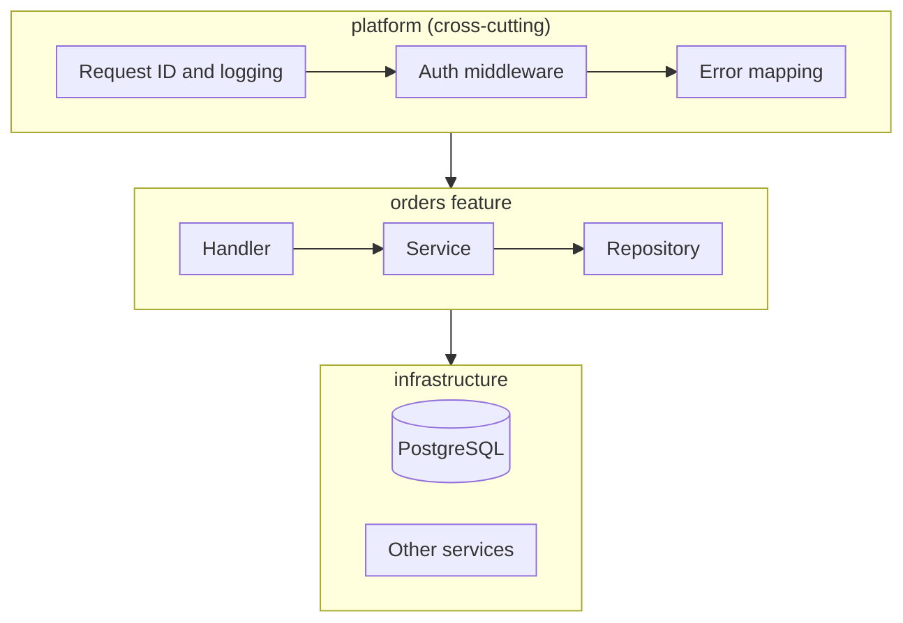
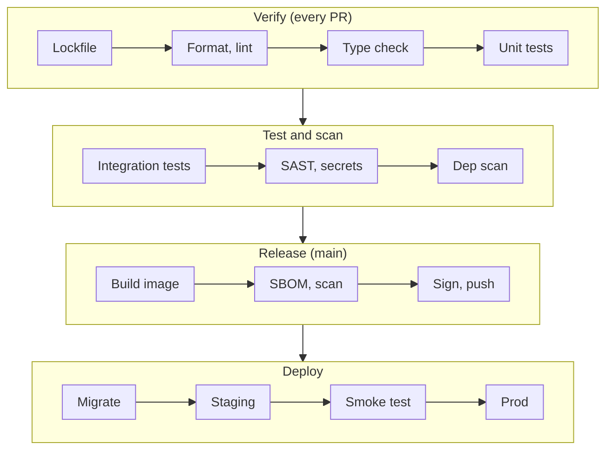

Picture a service six months into its life. There's no lockfile, so two developers get different
dependency versions. The database password sits in a `.env` file that was committed "just for a
day". Every module imports from a 3,000-line `utils.py`. Nobody can run the integration tests locally,
the Docker image is 1.4 GB and runs as root, and adding authentication means touching forty files
because each handler checks the token its own way. None of this came from one bad decision. It came
from a week-one decision that nobody made on purpose.

This post is the list of things I want settled before the first real commit on a new project. The
first half is language-agnostic: the questions to ask, the components every service needs, a folder
structure that holds up, and how authentication, security, isolation, maintainability, scalability,
CI/CD and deployment fit into the skeleton. The second half builds the same service, a small `orders`
REST API backed by PostgreSQL, in **Python**, **Go** and **Java**, so you can see how the same
decisions look in each ecosystem.

<!-- more -->

## Start with questions, not frameworks

The most common mistake is opening with "should we use FastAPI or Django?" before anyone has written
down what the thing has to do. A framework choice is an answer, and you need the questions first. I
go through these before touching a terminal:

| Question | Why it changes the setup |
| --- | --- |
| What kind of program is it: HTTP API, background worker, CLI, library, data pipeline? | A library needs a minimal dependency footprint and a public API; a service needs health checks, config and a container. |
| Who calls it, and how? Browser, other services, a queue? | Decides auth (user tokens vs service identity), the API style (REST, gRPC, events) and the CORS story. |
| What are the latency, throughput and startup-time targets? | Drives runtime choice. Fast cold starts favour Go or a native image; heavy CPU work rules out a single-threaded Python worker without a plan. |
| Where will it run? Kubernetes, serverless, VMs, on-prem? | Changes packaging (container vs zip vs binary), config injection and how you handle shutdown. |
| What data does it own, and how sensitive is it? | Sets the database, migration tooling, encryption needs and the compliance checklist (PII, PCI, HIPAA). |
| What does the team already know? | A language the team can debug at 3 a.m. beats a slightly better one nobody understands. |
| How long will it live? | A two-week spike doesn't need ADRs. A system with a five-year life needs boundaries, docs and upgrade paths. |

Write the answers in the README or in a first Architecture Decision Record (ADR). They're the reason
for every choice that follows, and six months from now someone will ask "why did we pick this?"

> The examples in this post assume the most common case I see: a stateless HTTP API, called by a web
> frontend and other services, storing data in PostgreSQL, deployed as a container to Kubernetes, with
> CI on GitHub Actions. If you're building a CLI or a library, I note where the advice changes.
{: .prompt-info }

## Part 1: The generic playbook

### Compiled, interpreted, or something in between

"Should we compile?" is partly decided by the language and partly by you. What matters is what you
actually ship and run:

| Model | Languages | What you ship | Trade-offs |
| --- | --- | --- | --- |
| Interpreted (compiled to bytecode at runtime) | Python, Ruby, Node.js | Source code plus a runtime and all dependencies | Fast iteration, no build step, but bigger images, slower cold starts, and type errors surface at runtime unless you add a type checker. |
| Ahead-of-time compiled to native code | Go, Rust | A single binary | Tiny images, fast startup, errors caught at build time. You cross-compile per OS and architecture. |
| Bytecode plus a JIT virtual machine | Java, Kotlin, C# | A JAR or DLL plus a JVM or CLR | Excellent peak throughput after warm-up, a huge ecosystem, but slower startup and a larger memory baseline. AOT options (GraalVM native image, AOT caches) trade build time for startup. |

For an interpreted language, "build" still exists. It means resolving a lockfile, running the type
checker and producing a wheel or a container image. Treat it as a real build with a real artifact, not
as "copy the folder to the server".

### Choosing a framework and libraries

I sort frameworks into two buckets. **Batteries-included** frameworks (Django, Spring Boot, Rails)
make choices for you: ORM, migrations, auth, admin. **Minimal** frameworks or plain standard libraries
(FastAPI, Flask, Go's `net/http`, Javalin) give you routing and leave the rest to you. Neither is
better. Batteries-included wins when the problem matches the framework's assumptions and the team
wants convention over debate. Minimal wins for small services where you'd fight the big framework more
than you'd use it.

For every library, including the framework, check:

- **Maintenance**: recent releases, issues answered, more than one active maintainer (the "bus
  factor").
- **Licence**: MIT, Apache-2.0 and BSD are usually fine. Check GPL and AGPL with whoever owns legal
  risk before you depend on them in a product.
- **Security history**: how fast past CVEs were fixed, and whether there's a security policy.
- **Footprint**: how many transitive dependencies it pulls in. Every one is supply-chain surface.
- **Escape hatches**: can you drop down to raw SQL or raw HTTP when the abstraction gets in the way?

My rule is to prefer the standard library, then a well-known library, and only then write it yourself.
The exception is anything security-critical. Never write your own crypto, JWT parsing or password
hashing.

### Package manager, lockfiles and toolchain pinning

There are three separate things to pin, and teams often pin only one:

1. **The toolchain**: the exact Python, Go or JDK version (`.python-version`, the `go`/`toolchain`
   lines in `go.mod`, the Maven or Gradle wrapper plus a JDK version file).
2. **Direct dependencies**: version ranges in the manifest (`pyproject.toml`, `go.mod`, `pom.xml`).
3. **The full resolved graph**: a lockfile with hashes (`uv.lock`, `go.sum`, Gradle lockfiles or a
   Maven BOM with explicit versions).

CI must install from the lockfile and fail if the lockfile is out of date (`uv sync --locked`,
`go mod verify`, `mvn` with the enforcer plugin). That's the difference between "works on my machine"
and reproducible builds.

### Components every service needs on day one

These are cheap to add on day one and painful to retrofit:

- **Typed, validated configuration** loaded from environment variables, failing fast at startup if
  something is missing.
- **Structured logging** (JSON to stdout) with a request ID on every line.
- **Health endpoints**: liveness (`/healthz`, "the process is alive") and readiness (`/readyz`, "I can
  serve traffic, the database is reachable").
- **Graceful shutdown**: on `SIGTERM`, stop accepting requests, finish in-flight ones, close pools.
- **Timeouts** on the server and on every outbound call. The default in most HTTP clients is "wait
  forever".
- **Auth middleware** in one place, not in each handler.
- **A consistent error format** (RFC 9457 Problem Details is a good default).
- **A Dockerfile, a CI workflow and a task runner** (`Makefile` or `Taskfile.yml`) so `make test`
  works the same for everyone.
- **Repo hygiene files**: `README.md`, `.editorconfig`, `.gitignore`, `.dockerignore`, `CODEOWNERS`,
  `SECURITY.md`, a `LICENSE`, `renovate.json` or `dependabot.yml`, and `docs/adr/0001-*.md`.

### Folder structure: organise by feature, not by layer

The classic layered layout puts every controller in `controllers/`, every model in `models/` and every
service in `services/`. It looks tidy for the first three entities. By entity twenty, one change to
"orders" touches five folders, and nothing stops `services/billing.py` from importing
`repositories/orders.py` directly.

I prefer **package-by-feature**, with a thin layering *inside* each feature and a separate `platform`
area for cross-cutting concerns:

```text
orders-api/
├── <entrypoint>            # main.py / cmd/ / Application.java: wiring only
├── orders/                 # one folder per business capability
│   ├── handler             # HTTP: parse, validate, call service, map errors
│   ├── service             # business rules, no HTTP or SQL
│   ├── repository          # persistence, the only place with SQL
│   └── model               # domain types
├── customers/
├── platform/               # cross-cutting, no business logic
│   ├── auth/               # token verification, permission checks
│   ├── config/
│   ├── database/           # pool, transactions
│   ├── observability/      # logging, metrics, tracing setup
│   └── http/               # middleware, error mapping, server
├── migrations/             # versioned SQL, run before the new version starts
├── api/openapi.yaml        # the contract
├── tests/                  # integration and end-to-end (unit tests sit next to code where idiomatic)
├── deploy/                 # Helm chart or Kustomize overlays
├── docs/adr/
├── .github/workflows/
├── Dockerfile
└── Taskfile.yml / Makefile
```

The dependency rule is simple: `handler → service → repository`, and features talk to each other only
through each other's service interface, never through another feature's repository or tables. Each
language has a way to enforce this so it isn't just a convention: Go's `internal/` packages,
`import-linter` in Python, ArchUnit or Spring Modulith in Java.

Here's how a request moves through that structure:



> The structure for a **library** is different: no `platform/`, no `deploy/`, and a deliberately small
> public API surface. For a **CLI**, replace `handler` with `commands/` and keep the same service and
> repository split so the logic can be tested without the CLI parser.
{: .prompt-tip }

### Configuration and secrets

Follow the twelve-factor rule: config comes from the environment, and the same artifact is promoted
through dev, staging and production. Load config into one typed object at startup and validate it.
A missing `DATABASE_URL` should crash the process in the first second, not cause a 500 on the first
request an hour later.

Secrets are a special case of config. Locally, a git-ignored `.env` file is fine. Everywhere else,
secrets come from a secret store (Azure Key Vault, AWS Secrets Manager, HashiCorp Vault) and reach the
pod through the External Secrets Operator or the CSI secrets driver. Even better, use **workload
identity** so the app gets a short-lived token to the database or cloud API and there's no long-lived
password to leak at all. Add a secret scanner (gitleaks, or GitHub push protection) to pre-commit and
CI on day one, because the first leak usually happens in the first week.

### Authentication and authorization

Don't build an identity system. Use an OpenID Connect provider (Entra ID, Auth0, Keycloak, Okta,
Cognito) and have your API act as a **resource server** that only validates JWT access tokens:

- Verify the signature against the provider's JWKS endpoint (cached), and check `iss`, `aud`, `exp`
  and `nbf`. Pin the allowed algorithms. Never accept `alg: none` or whatever the token header claims.
- Do this in **one middleware**, put the verified identity in the request context, and keep handlers
  ignorant of tokens.
- Authorize with scopes or roles at the route level, and with ownership checks ("does this order belong
  to this customer?") in the service layer. The second one is where most real authorization bugs live
  (OWASP calls it Broken Object Level Authorization).
- For service-to-service calls, use the client-credentials flow, or mTLS through a service mesh, and
  give each service its own identity.

### Security baseline

Security in the skeleton is mostly a set of defaults that are annoying to add later:

- Validate input at the edge with schema types (Pydantic, struct validation, Bean Validation). See the
  [OWASP input validation cheat sheet](/posts/cybersecurity/owasp/owasp-input-validation-cheatsheet/).
- Use parameterised queries only. If your ORM has a "raw string" escape hatch, lint for it.
- Set request size limits, rate limits (often at the gateway) and security headers.
- Don't return stack traces or SQL errors to clients. Log them with the request ID, and return a
  generic problem response.
- Run static analysis (Semgrep, CodeQL, or language-specific tools like Bandit-style ruff rules, gosec,
  SpotBugs), dependency vulnerability scanning and container image scanning in CI.
- Run as a non-root user with a read-only root filesystem and no extra Linux capabilities.

### Isolation

Isolation shows up at four levels, and it helps to think about each one:

1. **Developer environment**: a per-project virtual environment or toolchain, ideally a
   [dev container](https://containers.dev/) so a new joiner runs one command and gets the right
   language version, tools and a local PostgreSQL.
2. **Code**: module boundaries enforced by the compiler or a linter, so features can't reach into
   each other.
3. **Runtime**: one process per container, resource requests and limits, non-root, Kubernetes
   NetworkPolicies that only allow the traffic you expect, separate namespaces per environment.
4. **Data and tenants**: one database (or schema) per service, never a shared database that two
   services write to. If you're multi-tenant, decide now between row-level tenant IDs (with row-level
   security), schema-per-tenant or database-per-tenant. That one is very expensive to change later.

### Maintainability and code quality

The goal is to make the right thing automatic, so code review can focus on design rather than
formatting:

- A **formatter** with no options to argue about (ruff format, gofmt, google-java-format or Spotless).
- A **linter** with a strict rule set from day one. Turning rules on later means fixing hundreds of
  warnings at once, so it never happens.
- A **type checker** for dynamic languages (mypy or pyright for Python).
- **Pre-commit hooks** that run the fast checks locally, with CI running the same checks as the
  source of truth.
- **ADRs** for decisions that aren't obvious from the code.

### Testing strategy

Lay the test folders out on day one even if they're nearly empty. The shape I use:

- **Unit tests** for the service layer, with fakes for the repository. Fast, hundreds of them.
- **Integration tests** for repositories and HTTP handlers against a real PostgreSQL started by
  [Testcontainers](https://testcontainers.com/). Mocking the database hides the bugs you most need
  to find: wrong SQL, missing indexes, transaction issues.
- **Contract tests** against the OpenAPI spec, so the API doesn't drift from what clients expect.
- A **coverage gate** in CI, set at a realistic level (around 70–80% on the service layer) rather
  than 100% everywhere.

### Data layer and API contracts

Pick a migration tool before writing the first table (Alembic, goose, Flyway or Liquibase).
Migrations are versioned SQL files committed with the code. They run as a separate step (a Kubernetes
Job or an init container) before the new version starts, and they must be backward compatible with
the version that's still running. That means expand-then-contract: add the new column, deploy, backfill,
switch reads, and only then drop the old one.

For the API, I lean towards **contract-first**: write `api/openapi.yaml`, review it with the
consumers, then implement it, or generate it from code but check the generated spec into git and diff
it in CI. Version the API in the path (`/v1/`) from the first endpoint. It costs nothing on day one.

### Observability

Use [OpenTelemetry](https://opentelemetry.io/) from the start. It's vendor-neutral, so the backend
(Grafana, Datadog, Azure Monitor, whatever) is a deployment decision, not a code change. Emit:

- **Logs**: JSON to stdout, with trace and request IDs, no secrets or PII.
- **Metrics**: the RED set (Rate, Errors, Duration) per endpoint, plus pool and runtime metrics.
- **Traces**: auto-instrument the HTTP server, the HTTP client and the database driver.

### Scalability

Most scalability problems come from a few early shortcuts, not from the language:

- Keep the service **stateless**: sessions, caches and uploads live in Redis or object storage, not
  in process memory or on local disk. Then scaling out is just more replicas.
- Size **connection pools** deliberately. Twenty replicas with a pool of twenty connections each is
  400 connections, and PostgreSQL will refuse them long before your CPU is busy.
- **Paginate** every list endpoint from the start. "Return all orders" works in dev and falls over in
  production.
- Push slow work to a **queue** and a worker, and make handlers **idempotent** (idempotency keys on
  POST) so retries are safe.
- Respect the runtime's concurrency model: process workers for Python, goroutines for Go, threads or
  virtual threads for Java.

### CI/CD

A pipeline that's in place before the first feature keeps everyone honest. The stages I use:



Two details matter more than the tool you pick. First, **build once and promote** the same image digest
through every environment. Never rebuild for production. Second, **pin your CI actions** to a commit
SHA, or at least a major version, and let Renovate or Dependabot bump them. CI is part of your supply
chain too.

### Supply chain

- Lockfiles with hashes, installed in frozen mode.
- Automated dependency updates (Renovate or Dependabot), grouped so you get a few PRs a week rather
  than forty.
- An SBOM for every image (Syft, or the build tool's own CycloneDX plugin).
- Image scanning (Trivy, Grype) that fails the build on fixable criticals.
- Signed images (Sigstore cosign) and, when you're ready, an admission policy that only runs signed
  images.
- Minimal base images (distroless, `-slim`, or Chainguard/Wolfi) so there's less to patch.

### Deployment

A multi-stage Dockerfile, so the build tools never reach the runtime image. A non-root user. A Helm
chart or Kustomize base in `deploy/` with liveness and readiness probes, resource requests, a
PodDisruptionBudget and a HorizontalPodAutoscaler. GitOps (Argo CD or Flux) or a deploy job that
promotes by image digest. Rolling or canary updates, and a rollback that's one command.

### The day-zero checklist

| Area | Decision to make before the first feature |
| --- | --- |
| Toolchain | Language version pinned, wrapper or version file committed |
| Dependencies | Package manager chosen, lockfile committed, CI installs frozen |
| Structure | Package-by-feature skeleton, boundaries enforced |
| Config | Typed config from env, fail fast, `.env.example` committed |
| Secrets | Secret store and workload identity planned, secret scanning on |
| Auth | OIDC provider chosen, one JWT middleware, scope or role model sketched |
| Security | Input validation, SAST, dependency and image scanning in CI |
| Quality | Formatter, linter, type checker, pre-commit hooks |
| Testing | Unit and integration folders, Testcontainers, coverage gate |
| Data | Migration tool chosen, first migration committed |
| API | OpenAPI spec, `/v1/` prefix, error format agreed |
| Observability | JSON logs, OpenTelemetry, health and readiness endpoints |
| Runtime | Graceful shutdown, timeouts, pool sizes from config |
| Delivery | Multi-stage Dockerfile, CI pipeline, deploy manifests, Renovate |
| Docs | README with "run it locally in 3 commands", first ADR |

Now let's see the same service in three languages.

## Part 2: Python

### Python stack choices

| Concern | My default | Alternatives and when |
| --- | --- | --- |
| Runtime | Python 3.14 (3.15 releases on October 9, 2026; move once your libraries have wheels) | Stay one version behind current if a key dependency lags |
| Package manager | [uv](https://docs.astral.sh/uv/) with `uv.lock` | Poetry for existing teams; pip plus pip-tools for minimal setups |
| Web framework | FastAPI plus Pydantic v2 | Django for CRUD-heavy apps with an admin; Litestar; Flask for tiny services |
| Config | pydantic-settings | dynaconf |
| Database | SQLAlchemy 2.0 (async) with asyncpg, Alembic for migrations | psycopg 3 plus plain SQL; Django ORM if you chose Django |
| Auth | PyJWT with `PyJWKClient` | Authlib |
| Lint and format | ruff (both) | black plus flake8 (slower, more config) |
| Types | mypy `--strict` | pyright |
| Tests | pytest, httpx, testcontainers | — |
| Logging and telemetry | structlog, OpenTelemetry instrumentation | standard `logging` with a JSON formatter |
| Server | uvicorn, one process per container | gunicorn with uvicorn workers on VMs |

On "compile or not": Python compiles to bytecode when it imports a module. You don't ship that
bytecode. You ship source plus a virtual environment, and you can pre-compile in the image
(`UV_COMPILE_BYTECODE=1`) to shave startup time. Tools like Nuitka or mypyc exist, but for a web
service they're rarely worth the build complexity. If you're new to how this works, my
[Python at a glance](/posts/programming/python/python-at-a-glance/) post explains the interpreter and
bytecode.

The one decision people get wrong is **concurrency**. An async framework only helps if everything in
the request path is async. One blocking call (a sync database driver, `requests`, a slow `time.sleep`)
inside an `async def` handler stalls every request on that worker. Either go fully async, or use plain
`def` handlers, which FastAPI runs in a thread pool. On Kubernetes, I run one uvicorn process per
container and scale with replicas, rather than tuning gunicorn workers inside a pod.

### Python folder structure

`uv init --package orders-api` gives you the `src/` layout. Keep it, because it stops tests from
accidentally importing the local folder instead of the installed package.

```text
orders-api/
├── .python-version               # 3.14
├── pyproject.toml
├── uv.lock
├── alembic.ini
├── src/orders_api/
│   ├── __init__.py
│   ├── main.py                   # create_app(): wiring, middleware, routers
│   ├── orders/
│   │   ├── router.py             # FastAPI routes, request/response schemas
│   │   ├── service.py            # business rules
│   │   ├── repository.py         # SQLAlchemy queries
│   │   └── models.py             # ORM and domain types
│   └── platform/
│       ├── auth.py               # JWT verification, require_scope()
│       ├── config.py             # Settings (pydantic-settings)
│       ├── database.py           # engine, session dependency
│       └── observability.py      # structlog + OpenTelemetry setup
├── migrations/                   # Alembic versions
├── tests/
│   ├── unit/
│   └── integration/              # Testcontainers PostgreSQL
├── Dockerfile
├── .pre-commit-config.yaml
└── .github/workflows/ci.yml
```

Enforce the feature boundaries with [import-linter](https://import-linter.readthedocs.io/), for
example "`orders_api.platform` must not import any feature", and run it in CI.

### pyproject.toml

```toml
[project]
name = "orders-api"
version = "0.1.0"
requires-python = ">=3.14"
dependencies = [
  "fastapi>=0.115",
  "uvicorn[standard]>=0.32",
  "pydantic-settings>=2.6",
  "sqlalchemy[asyncio]>=2.0",
  "asyncpg>=0.30",
  "alembic>=1.14",
  "pyjwt[crypto]>=2.10",
  "structlog>=24.4",
  "opentelemetry-instrumentation-fastapi",
]

[dependency-groups]
dev = [
  "pytest>=8",
  "pytest-asyncio",
  "httpx",
  "mypy>=1.13",
  "ruff",
  "testcontainers[postgres]",
  "import-linter",
]

[build-system]
requires = ["hatchling"]
build-backend = "hatchling.build"

[tool.hatch.build.targets.wheel]
packages = ["src/orders_api"]

[tool.ruff]
line-length = 100
target-version = "py314"

[tool.ruff.lint]
# E/F: errors, I: import order, B: bugbear, UP: pyupgrade, S: security (Bandit rules), ASYNC: blocking calls in async code
select = ["E", "F", "I", "B", "UP", "S", "ASYNC", "SIM"]

[tool.ruff.lint.per-file-ignores]
"tests/**" = ["S101"]   # assert is fine in tests

[tool.mypy]
strict = true

[tool.pytest.ini_options]
testpaths = ["tests"]
```

The `S` and `ASYNC` rule sets are the two I'd never skip. `S` catches hard-coded passwords, `eval`,
`subprocess` with `shell=True` and SQL built with f-strings. `ASYNC` catches blocking calls inside
`async def`, the bug I described above.

### Python config and auth

```python
# src/orders_api/platform/config.py
from functools import lru_cache

from pydantic import PostgresDsn
from pydantic_settings import BaseSettings, SettingsConfigDict


class Settings(BaseSettings):
    model_config = SettingsConfigDict(env_prefix="ORDERS_", env_file=".env")

    database_url: PostgresDsn
    oidc_issuer: str
    oidc_audience: str
    oidc_jwks_url: str
    db_pool_size: int = 10
    log_level: str = "INFO"


@lru_cache
def get_settings() -> Settings:
    return Settings()  # raises a ValidationError at startup if anything is missing
```

```python
# src/orders_api/platform/auth.py
from typing import Annotated, Any

import jwt
from fastapi import Depends, HTTPException, status
from fastapi.security import HTTPAuthorizationCredentials, HTTPBearer

from orders_api.platform.config import get_settings

_settings = get_settings()
_bearer = HTTPBearer()
_jwks = jwt.PyJWKClient(_settings.oidc_jwks_url, cache_keys=True)


def current_claims(
    creds: Annotated[HTTPAuthorizationCredentials, Depends(_bearer)],
) -> dict[str, Any]:
    # Plain def: PyJWKClient does blocking I/O, so FastAPI runs this in a thread pool.
    try:
        key = _jwks.get_signing_key_from_jwt(creds.credentials)
        return jwt.decode(
            creds.credentials,
            key.key,
            algorithms=["RS256"],  # pinned: never trust the token's own alg header
            audience=_settings.oidc_audience,
            issuer=_settings.oidc_issuer,
        )
    except jwt.PyJWTError:
        raise HTTPException(status.HTTP_401_UNAUTHORIZED, "invalid token") from None


def require_scope(scope: str):
    def checker(claims: Annotated[dict[str, Any], Depends(current_claims)]) -> dict[str, Any]:
        if scope not in claims.get("scope", "").split():
            raise HTTPException(status.HTTP_403_FORBIDDEN, "missing scope")
        return claims

    return checker
```

A route then declares what it needs, and the handler never sees a raw token:

```python
@router.get("/v1/orders/{order_id}")
async def get_order(
    order_id: UUID,
    claims: Annotated[dict, Depends(require_scope("orders:read"))],
    service: Annotated[OrderService, Depends(get_order_service)],
) -> OrderOut:
    return await service.get_for_customer(order_id, customer_id=claims["sub"])
```

Notice the ownership check lives in the service (`get_for_customer`), not in the route.

### Python Dockerfile

```dockerfile
# syntax=docker/dockerfile:1
FROM python:3.14-slim AS build
# Pin this to an exact uv release in a real project.
COPY --from=ghcr.io/astral-sh/uv:latest /uv /usr/local/bin/uv
ENV UV_COMPILE_BYTECODE=1 UV_LINK_MODE=copy UV_PYTHON_DOWNLOADS=0
WORKDIR /app

# Dependencies first, so this layer is cached until uv.lock changes.
COPY pyproject.toml uv.lock ./
RUN --mount=type=cache,target=/root/.cache/uv \
    uv sync --locked --no-install-project --no-dev

COPY src ./src
RUN --mount=type=cache,target=/root/.cache/uv \
    uv sync --locked --no-dev --no-editable

FROM python:3.14-slim
RUN useradd --system --uid 10001 app
WORKDIR /app
COPY --from=build --chown=app:app /app/.venv /app/.venv
COPY --chown=app:app alembic.ini ./
COPY --chown=app:app migrations ./migrations
ENV PATH="/app/.venv/bin:$PATH" PYTHONUNBUFFERED=1
USER 10001
EXPOSE 8000
CMD ["uvicorn", "orders_api.main:app", "--host", "0.0.0.0", "--port", "8000"]
```

The same image runs migrations as a Kubernetes Job with `command: ["alembic", "upgrade", "head"]`.
For more on uv and Poetry builds, see [Python build with uv and Poetry](/posts/devops/build-tools/python/uv-poetry-build/).

### Python CI workflow

```yaml
# .github/workflows/ci.yml
name: ci
on: [push, pull_request]

jobs:
  test:
    runs-on: ubuntu-latest
    steps:
      - uses: actions/checkout@v5
      - uses: astral-sh/setup-uv@v6
        with:
          enable-cache: true
      - run: uv sync --locked              # fails if uv.lock is stale
      - run: uv run ruff format --check .
      - run: uv run ruff check .
      - run: uv run mypy src
      - run: uv run lint-imports            # import-linter boundaries
      - run: uv run pytest --cov=orders_api --cov-fail-under=75
```

Testcontainers needs Docker, which GitHub's Ubuntu runners have, so integration tests run in the same
job.

## Part 3: Go

### Go stack choices

| Concern | My default | Alternatives and when |
| --- | --- | --- |
| Runtime | Go 1.27 (pin with the `go` and `toolchain` lines in `go.mod`) | Go supports the two most recent releases; don't fall further behind |
| Package manager | Go modules (`go.mod`, `go.sum`) | — (there's no real alternative, which is a feature) |
| HTTP | Standard library `net/http` with method and path patterns (Go 1.22+) | chi for richer middleware; avoid heavier frameworks unless the team wants them |
| Config | `caarlos0/env` into a struct | `os.Getenv` plus validation for tiny services; avoid Viper unless you need config files |
| Database | pgx v5 with [sqlc](https://sqlc.dev/) (SQL in, type-safe Go out) | GORM if the team really wants an ORM; goose or golang-migrate for migrations |
| Auth | `coreos/go-oidc` verifier | `lestrrat-go/jwx` for full JOSE control |
| Lint | golangci-lint v2 (includes gosec, errcheck, staticcheck) | — |
| Tests | standard `testing`, testcontainers-go | testify for assertions if you like them |
| Logging and telemetry | `log/slog` (JSON handler), OpenTelemetry Go SDK with `otelhttp` | zap, zerolog |

Go answers "compile or not" for you: `go build` produces a static binary. With `CGO_ENABLED=0` it
depends on nothing, so the runtime image can be `distroless/static` or even `scratch`, and the final
image is often 15–25 MB. Since Go 1.25 the runtime also sets `GOMAXPROCS` from the container's CPU limit
automatically, so you no longer need the `automaxprocs` library that used to be standard in Kubernetes.

The trap in Go projects is copying a big "standard layout" template on day one. There's no official
layout with `pkg/`, `api/`, `build/`, `configs/`, `init/` and a dozen more. The Go team's own
[module layout guide](https://go.dev/doc/modules/layout) is much simpler: `cmd/` for binaries,
`internal/` for everything you don't want imported by other modules. I skip `pkg/` entirely for a
service, because nobody outside should be importing a service's code.

### Go folder structure

```text
orders-api/
├── go.mod
├── go.sum
├── cmd/
│   └── orders-api/
│       └── main.go                # wiring: config, pool, router, server, shutdown
├── internal/
│   ├── orders/
│   │   ├── handler.go             # HTTP handlers, request/response types
│   │   ├── service.go             # business rules, Repository interface defined here
│   │   ├── repository.go          # wraps sqlc-generated queries
│   │   ├── queries.sql            # input for sqlc
│   │   └── service_test.go        # unit tests sit next to code in Go
│   └── platform/
│       ├── auth/middleware.go
│       ├── config/config.go
│       ├── database/pool.go
│       └── telemetry/telemetry.go
├── migrations/                    # goose SQL migrations
├── api/openapi.yaml
├── sqlc.yaml
├── .golangci.yml
├── Dockerfile
└── .github/workflows/ci.yml
```

The compiler enforces `internal/`: no other module can import it. Inside the module, define interfaces
where they're *used* (the `Repository` interface lives in `service.go`), which is the idiomatic Go way
to keep features decoupled and testable. Since Go 1.24 you can also pin code generators like sqlc with a
`tool` directive in `go.mod`, so `go tool sqlc generate` uses the same version for everyone.

### main.go: config, server timeouts and graceful shutdown

```go
// cmd/orders-api/main.go
package main

import (
	"context"
	"errors"
	"log/slog"
	"net/http"
	"os"
	"os/signal"
	"syscall"
	"time"

	"github.com/jackc/pgx/v5/pgxpool"

	"example.com/orders-api/internal/orders"
	"example.com/orders-api/internal/platform/auth"
	"example.com/orders-api/internal/platform/config"
)

func main() {
	ctx, stop := signal.NotifyContext(context.Background(), os.Interrupt, syscall.SIGTERM)
	defer stop()

	log := slog.New(slog.NewJSONHandler(os.Stdout, nil))
	if err := run(ctx, log); err != nil {
		log.Error("fatal", "err", err)
		os.Exit(1)
	}
}

func run(ctx context.Context, log *slog.Logger) error {
	cfg, err := config.Load() // fails fast on missing env vars
	if err != nil {
		return err
	}

	pool, err := pgxpool.New(ctx, cfg.DatabaseURL)
	if err != nil {
		return err
	}
	defer pool.Close()

	verifier, err := auth.NewVerifier(ctx, cfg.OIDCIssuer, cfg.OIDCAudience)
	if err != nil {
		return err
	}

	mux := http.NewServeMux()
	mux.HandleFunc("GET /healthz", func(w http.ResponseWriter, _ *http.Request) {
		w.WriteHeader(http.StatusOK)
	})
	mux.HandleFunc("GET /readyz", func(w http.ResponseWriter, r *http.Request) {
		if err := pool.Ping(r.Context()); err != nil {
			http.Error(w, "db unavailable", http.StatusServiceUnavailable)
			return
		}
		w.WriteHeader(http.StatusOK)
	})
	svc := orders.NewService(orders.NewRepository(pool))
	orders.RegisterRoutes(mux, svc, auth.Require(verifier))

	srv := &http.Server{
		Addr:              cfg.Addr,
		Handler:           mux,
		ReadHeaderTimeout: 5 * time.Second, // the zero-value default has no timeouts at all
		ReadTimeout:       15 * time.Second,
		WriteTimeout:      30 * time.Second,
		IdleTimeout:       60 * time.Second,
	}

	errCh := make(chan error, 1)
	go func() {
		log.Info("listening", "addr", cfg.Addr)
		errCh <- srv.ListenAndServe()
	}()

	select {
	case err := <-errCh:
		if !errors.Is(err, http.ErrServerClosed) {
			return err
		}
	case <-ctx.Done():
		log.Info("shutting down")
	}

	shutdownCtx, cancel := context.WithTimeout(context.Background(), 20*time.Second)
	defer cancel()
	return srv.Shutdown(shutdownCtx)
}
```

The `run()` function returning an error is a small pattern worth copying: `main` stays three lines,
deferred cleanups actually run (they don't if you call `log.Fatal` deep inside), and `run` is testable.

### Go auth middleware

```go
// internal/platform/auth/middleware.go
package auth

import (
	"context"
	"fmt"
	"net/http"
	"strings"

	"github.com/coreos/go-oidc/v3/oidc"
)

type ctxKey struct{}

// NewVerifier discovers the issuer's JWKS and checks iss, aud, exp and the signature.
func NewVerifier(ctx context.Context, issuer, audience string) (*oidc.IDTokenVerifier, error) {
	provider, err := oidc.NewProvider(ctx, issuer)
	if err != nil {
		return nil, fmt.Errorf("oidc discovery: %w", err)
	}
	return provider.Verifier(&oidc.Config{ClientID: audience}), nil
}

func Require(v *oidc.IDTokenVerifier) func(http.Handler) http.Handler {
	return func(next http.Handler) http.Handler {
		return http.HandlerFunc(func(w http.ResponseWriter, r *http.Request) {
			raw, ok := strings.CutPrefix(r.Header.Get("Authorization"), "Bearer ")
			if !ok {
				http.Error(w, "missing bearer token", http.StatusUnauthorized)
				return
			}
			tok, err := v.Verify(r.Context(), raw)
			if err != nil {
				http.Error(w, "invalid token", http.StatusUnauthorized)
				return
			}
			next.ServeHTTP(w, r.WithContext(context.WithValue(r.Context(), ctxKey{}, tok)))
		})
	}
}
```

`go-oidc` is designed around ID tokens, but it works for JWT access tokens as long as the token's `aud`
matches the configured audience. If your provider issues opaque access tokens, you need token
introspection instead.

### Lint config and Dockerfile

```yaml
# .golangci.yml
version: "2"
linters:
  enable:
    - gosec        # security issues
    - errorlint    # wrong error comparisons
    - bodyclose    # unclosed HTTP response bodies
    - noctx        # HTTP requests without a context
    - revive
formatters:
  enable:
    - gofumpt
    - goimports
```

```dockerfile
# syntax=docker/dockerfile:1
FROM golang:1.27 AS build
WORKDIR /src
COPY go.mod go.sum ./
RUN --mount=type=cache,target=/go/pkg/mod go mod download
COPY . .
RUN --mount=type=cache,target=/go/pkg/mod \
    --mount=type=cache,target=/root/.cache/go-build \
    CGO_ENABLED=0 go build -trimpath -ldflags="-s -w" -o /out/orders-api ./cmd/orders-api

FROM gcr.io/distroless/static-debian12:nonroot
COPY --from=build /out/orders-api /orders-api
USER nonroot:nonroot
EXPOSE 8080
ENTRYPOINT ["/orders-api"]
```

The runtime image has no shell, no package manager and no libc, so image scanners usually have very
little to report. The flip side is that you can't `kubectl exec` into it to poke around. Use
`kubectl debug` with an ephemeral container instead. More on Go builds and GoReleaser in
[Go Build](/posts/devops/build-tools/go/go-build/).

### Go CI workflow

```yaml
# .github/workflows/ci.yml
name: ci
on: [push, pull_request]

jobs:
  test:
    runs-on: ubuntu-latest
    steps:
      - uses: actions/checkout@v5
      - uses: actions/setup-go@v6
        with:
          go-version-file: go.mod
      - run: go mod verify
      - run: go tool sqlc diff          # generated code matches queries.sql
      - uses: golangci/golangci-lint-action@v8
      - run: go test -race -coverprofile=cover.out ./...
      - run: go run golang.org/x/vuln/cmd/govulncheck@latest ./...
```

`govulncheck` is worth calling out. It only reports vulnerabilities in functions your code actually
calls, so it produces far less noise than scanners that flag every vulnerable module in `go.sum`.

## Part 4: Java

### Java stack choices

| Concern | My default | Alternatives and when |
| --- | --- | --- |
| Runtime | Java 25 (the current LTS) | Java 21 LTS if a platform constraint forces it |
| Build tool | Maven with the Maven Wrapper (`mvnw`) | Gradle (Kotlin DSL) for multi-module builds or custom build logic |
| Framework | [Spring Boot 4](https://spring.io/projects/spring-boot) | Quarkus or Micronaut for fast startup and native images; Javalin for tiny services |
| Config | `application.yaml` plus `@ConfigurationProperties` records with validation | — |
| Database | Spring Data JDBC or JPA (Hibernate), Flyway for migrations | jOOQ for SQL-first teams; Liquibase |
| Auth | Spring Security OAuth2 Resource Server | — |
| Lint and format | Spotless (google-java-format), Error Prone, SpotBugs | Checkstyle, PMD |
| Architecture rules | Spring Modulith or ArchUnit | — |
| Tests | JUnit 5, AssertJ, Testcontainers with `@ServiceConnection` | — |
| Observability | Actuator, Micrometer, OpenTelemetry (OTLP export) | OpenTelemetry Java agent for zero-code instrumentation |

Java compiles `.java` to bytecode, and the JVM JIT-compiles the hot paths at runtime. That's why Java
services are slow for the first few seconds and very fast afterwards. If startup matters (serverless,
scale-to-zero, CLIs), you have two options. **GraalVM native image** produces a native binary with
millisecond startup and lower memory, at the cost of long builds and reflection configuration.
**Class-data sharing and the AOT cache** (Project Leyden, JDK 24 and later) keep the normal JVM but
cut startup significantly with much less friction. For a normal long-running API on Kubernetes, I stay
on the regular JVM and enable virtual threads.

### Java folder structure

Use the Maven standard layout, and package by feature underneath it:

```text
orders-api/
├── mvnw, mvnw.cmd, .mvn/wrapper/       # pins the Maven version
├── pom.xml
├── src/main/java/com/example/orders/
│   ├── OrdersApplication.java          # @SpringBootApplication, nothing else
│   ├── order/                          # one package per feature (module)
│   │   ├── OrderController.java
│   │   ├── OrderService.java           # public API of the module
│   │   ├── OrderRepository.java        # package-private where possible
│   │   └── Order.java
│   ├── customer/
│   └── platform/
│       ├── security/SecurityConfig.java
│       ├── config/OrdersProperties.java
│       └── web/ProblemDetailsAdvice.java
├── src/main/resources/
│   ├── application.yaml
│   └── db/migration/V1__create_orders.sql   # Flyway
├── src/test/java/com/example/orders/
│   ├── order/OrderServiceTest.java
│   ├── order/OrderApiIT.java           # Testcontainers integration test
│   └── ModularityTest.java             # Spring Modulith / ArchUnit rules
├── Dockerfile
└── .github/workflows/ci.yml
```

The habit that keeps Java codebases maintainable is making classes **package-private by default**.
Only the service a feature exposes is `public`. Combine that with a one-line Spring Modulith test
(`ApplicationModules.of(OrdersApplication.class).verify()`) and a cross-feature import fails the
build.

### Java config and security

```yaml
# src/main/resources/application.yaml
spring:
  application:
    name: orders-api
  threads:
    virtual:
      enabled: true            # one virtual thread per request, cheap blocking I/O
  datasource:
    url: ${DATABASE_URL}
    username: ${DATABASE_USERNAME}
    password: ${DATABASE_PASSWORD}
    hikari:
      maximum-pool-size: ${DB_POOL_SIZE:10}
  security:
    oauth2:
      resourceserver:
        jwt:
          issuer-uri: ${OIDC_ISSUER}
          audiences: ${OIDC_AUDIENCE}
  mvc:
    problemdetails:
      enabled: true            # RFC 9457 error responses
server:
  shutdown: graceful
management:
  endpoint:
    health:
      probes:
        enabled: true          # /actuator/health/liveness and /readiness
  endpoints:
    web:
      exposure:
        include: health,info,prometheus
```

```java
// src/main/java/com/example/orders/platform/security/SecurityConfig.java
package com.example.orders.platform.security;

import org.springframework.context.annotation.Bean;
import org.springframework.context.annotation.Configuration;
import org.springframework.security.config.Customizer;
import org.springframework.security.config.annotation.method.configuration.EnableMethodSecurity;
import org.springframework.security.config.annotation.web.builders.HttpSecurity;
import org.springframework.security.config.http.SessionCreationPolicy;
import org.springframework.security.web.SecurityFilterChain;

@Configuration
@EnableMethodSecurity
class SecurityConfig {

    @Bean
    SecurityFilterChain api(HttpSecurity http) throws Exception {
        return http
            .authorizeHttpRequests(auth -> auth
                .requestMatchers("/actuator/health/**").permitAll()
                .requestMatchers("/v1/orders/**").hasAuthority("SCOPE_orders:read")
                .anyRequest().authenticated())
            .oauth2ResourceServer(oauth -> oauth.jwt(Customizer.withDefaults()))
            .sessionManagement(s -> s.sessionCreationPolicy(SessionCreationPolicy.STATELESS))
            .csrf(csrf -> csrf.disable()) // stateless bearer-token API, no cookies
            .build();
    }
}
```

Spring Security fetches the issuer's discovery document and JWKS, validates the signature, `iss`,
`exp` and the configured audience, and maps the `scope` claim to `SCOPE_*` authorities. That's a lot of
security-critical code you don't write. Disabling CSRF is only correct because this API uses bearer
tokens and no cookies. If you add cookie sessions later, turn it back on.

### pom.xml essentials

Rather than paste a full POM, these are the parts I add to the Spring Initializr output on day one:

```xml
<properties>
  <java.version>25</java.version>
</properties>

<dependencies>
  <!-- starters: web, validation, actuator, security, oauth2-resource-server, data-jdbc, flyway -->
  <dependency>
    <groupId>org.springframework.modulith</groupId>
    <artifactId>spring-modulith-starter-test</artifactId>
    <scope>test</scope>
  </dependency>
  <dependency>
    <groupId>org.springframework.boot</groupId>
    <artifactId>spring-boot-testcontainers</artifactId>
    <scope>test</scope>
  </dependency>
  <dependency>
    <groupId>org.testcontainers</groupId>
    <artifactId>postgresql</artifactId>
    <scope>test</scope>
  </dependency>
</dependencies>

<build>
  <plugins>
    <!-- fail the build on dependency convergence problems and old Maven/JDK versions -->
    <plugin>
      <groupId>org.apache.maven.plugins</groupId>
      <artifactId>maven-enforcer-plugin</artifactId>
    </plugin>
    <!-- formatting: mvn spotless:check in CI, spotless:apply locally -->
    <plugin>
      <groupId>com.diffplug.spotless</groupId>
      <artifactId>spotless-maven-plugin</artifactId>
    </plugin>
    <!-- SBOM for every build -->
    <plugin>
      <groupId>org.cyclonedx</groupId>
      <artifactId>cyclonedx-maven-plugin</artifactId>
    </plugin>
    <!-- unit tests via surefire; *IT.java integration tests via failsafe -->
    <plugin>
      <groupId>org.apache.maven.plugins</groupId>
      <artifactId>maven-failsafe-plugin</artifactId>
    </plugin>
  </plugins>
</build>
```

Plugin versions and configuration are omitted for brevity. Pin every plugin version explicitly, because
Maven warns about unpinned plugins for a reason. The [Maven Build](/posts/devops/build-tools/java/maven-build/)
and [Gradle Build](/posts/devops/build-tools/java/gradle-build/) posts cover the lifecycle and scanners
in more depth.

### Java Dockerfile

Spring Boot's layered JAR puts dependencies, which rarely change, and your code, which changes on
every commit, into separate image layers:

```dockerfile
# syntax=docker/dockerfile:1
FROM eclipse-temurin:25-jdk AS build
WORKDIR /src
COPY mvnw pom.xml ./
COPY .mvn .mvn
RUN --mount=type=cache,target=/root/.m2 ./mvnw -B dependency:go-offline
COPY src src
RUN --mount=type=cache,target=/root/.m2 ./mvnw -B package -DskipTests
# <finalName>app</finalName> in the POM gives a predictable target/app.jar
RUN java -Djarmode=tools -jar target/app.jar extract --layers --destination /extracted

FROM eclipse-temurin:25-jre
RUN useradd --system --uid 10001 app
WORKDIR /app
COPY --from=build /extracted/dependencies/ ./
COPY --from=build /extracted/spring-boot-loader/ ./
COPY --from=build /extracted/snapshot-dependencies/ ./
COPY --from=build /extracted/application/ ./
USER 10001
EXPOSE 8080
ENTRYPOINT ["java", "-XX:MaxRAMPercentage=75", "-jar", "app.jar"]
```

`-XX:MaxRAMPercentage=75` makes the heap a share of the container's memory limit rather than a guess,
which leaves room for metaspace, thread stacks and native memory. The extracted layout keeps the JAR's
name, which is why `app.jar` appears in both the extract step and the entrypoint. If you'd
rather skip Dockerfiles, `./mvnw spring-boot:build-image` builds an OCI image with Cloud Native
Buildpacks.

### Java CI workflow

```yaml
# .github/workflows/ci.yml
name: ci
on: [push, pull_request]

jobs:
  test:
    runs-on: ubuntu-latest
    steps:
      - uses: actions/checkout@v5
      - uses: actions/setup-java@v5
        with:
          distribution: temurin
          java-version: "25"
          cache: maven
      - run: ./mvnw -B spotless:check
      - run: ./mvnw -B verify          # unit + Testcontainers ITs + Modulith checks + SBOM
```

## Side by side

| Concern | Python | Go | Java |
| --- | --- | --- | --- |
| Execution model | Interpreted (bytecode) | Native static binary | Bytecode on a JIT VM |
| Toolchain pin | `.python-version` | `go`/`toolchain` in `go.mod` | `mvnw` plus `java.version` |
| Package manager and lock | uv, `uv.lock` | Go modules, `go.sum` | Maven or Gradle, BOM or lockfile |
| Web layer | FastAPI | `net/http` | Spring Boot (MVC) |
| Boundary enforcement | import-linter | `internal/` (compiler) | Package-private plus Spring Modulith |
| Config | pydantic-settings | env struct | `@ConfigurationProperties` |
| Auth | PyJWT plus FastAPI dependency | go-oidc middleware | Spring Security resource server |
| Migrations | Alembic | goose | Flyway |
| Lint, format, types | ruff, mypy | golangci-lint, gofumpt | Spotless, Error Prone |
| Concurrency | async or thread pool; scale with processes or pods | goroutines | virtual threads |
| Runtime image | `python:*-slim`, ~150 MB+ | distroless static, ~20 MB | JRE, ~200 MB+ |
| Startup | Fast | Very fast | Slower (fix with an AOT cache or native image) |
| Vulnerability scan | pip-audit, ruff `S` | govulncheck, gosec | OWASP Dependency-Check, SpotBugs |

## Common pitfalls

- **Picking the framework first.** Answer the questions table before choosing anything. A
  batteries-included framework for a 200-line event consumer is weight you'll carry for years.
- **No lockfile, or a lockfile CI ignores.** If CI runs `pip install -r requirements.txt` with
  unpinned versions, your production build is a lottery.
- **A shared `utils` or `common` package.** It becomes the place where every boundary goes to die. Put
  shared code in `platform/` with a clear purpose, or duplicate a small function rather than couple two
  features.
- **Auth checks in handlers.** One forgotten check equals one data leak. Centralise token
  verification, and keep ownership checks in the service layer where tests can cover them.
- **Health checks that lie.** A liveness probe that checks the database means one database blip
  restarts every pod at once. Liveness checks the process. Readiness checks dependencies.
- **Ignoring `SIGTERM`.** Without graceful shutdown, every deployment drops in-flight requests, and
  you'll chase "random" 502s during releases.
- **Running as root because "it's in a container".** It's one line to fix today and a security finding
  to explain later.
- **Turning on the linter "later".** Later never comes, because by then there are 800 warnings.

## Conclusion

Every decision above takes minutes on day one and days to retrofit in month six. You don't need all of
it for a weekend prototype, but for anything with real users, I'd treat the day-zero checklist as the
definition of "project created".

The practical next step is to turn this into a template. Pick the language your team uses most, build
the skeleton once (folder structure, config, auth middleware, health checks, Dockerfile, CI and
Renovate), and publish it as a GitHub template repository, a `cookiecutter` or `copier` template, or a
Backstage software template. Then the next project starts from a skeleton you've already reviewed
instead of an empty folder.

## References

- [uv: Creating projects](https://docs.astral.sh/uv/concepts/projects/init/)
- [uv: Using uv in Docker](https://docs.astral.sh/uv/guides/integration/docker/)
- [FastAPI: Security](https://fastapi.tiangolo.com/tutorial/security/)
- [Ruff rules](https://docs.astral.sh/ruff/rules/)
- [PEP 790: Python 3.15 release schedule](https://peps.python.org/pep-0790/)
- [Go: Organizing a Go module](https://go.dev/doc/modules/layout)
- [Go 1.25 release notes](https://go.dev/doc/go1.25)
- [Go 1.27 release notes](https://go.dev/doc/go1.27)
- [Go release history](https://go.dev/doc/devel/release)
- [govulncheck](https://go.dev/doc/tutorial/govulncheck)
- [golangci-lint configuration](https://golangci-lint.run/docs/configuration/)
- [Spring Boot 4.0 system requirements](https://docs.spring.io/spring-boot/4.0/system-requirements.html)
- [Spring Boot 4.0 release notes](https://github.com/spring-projects/spring-boot/wiki/Spring-Boot-4.0-Release-Notes)
- [Spring Security: OAuth 2.0 Resource Server JWT](https://docs.spring.io/spring-security/reference/servlet/oauth2/resource-server/jwt.html)
- [Spring Boot: Efficient container images](https://docs.spring.io/spring-boot/reference/packaging/container-images/efficient-images.html)
- [Spring Modulith](https://spring.io/projects/spring-modulith)
- [The Twelve-Factor App](https://12factor.net/)
- [RFC 9457: Problem Details for HTTP APIs](https://www.rfc-editor.org/rfc/rfc9457)
- [OWASP API Security Top 10](https://owasp.org/API-Security/)
- [OpenTelemetry documentation](https://opentelemetry.io/docs/)
- [Testcontainers](https://testcontainers.com/)
