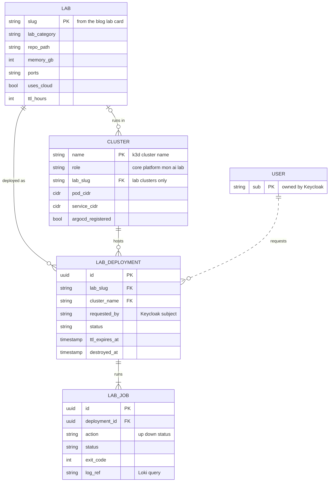
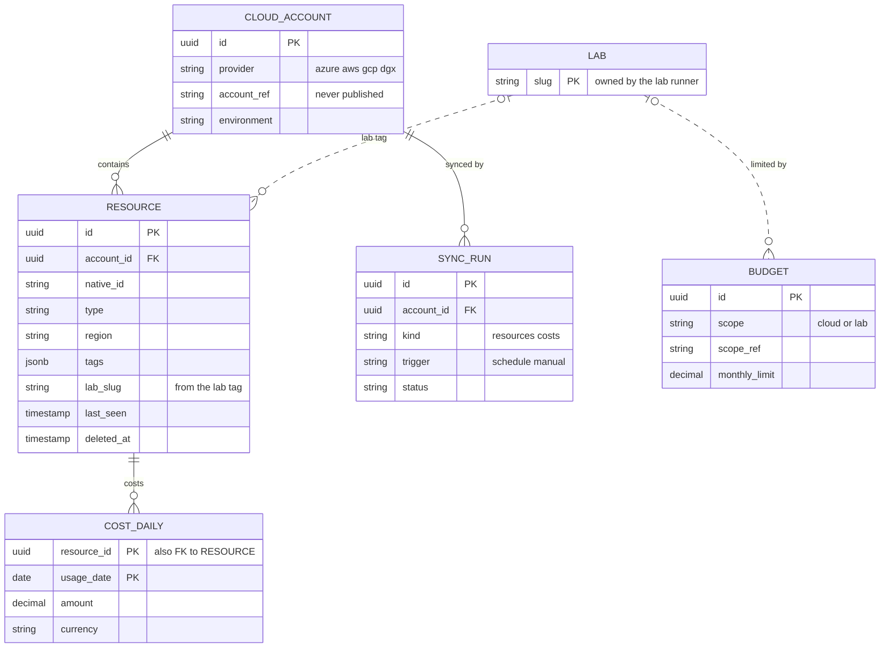
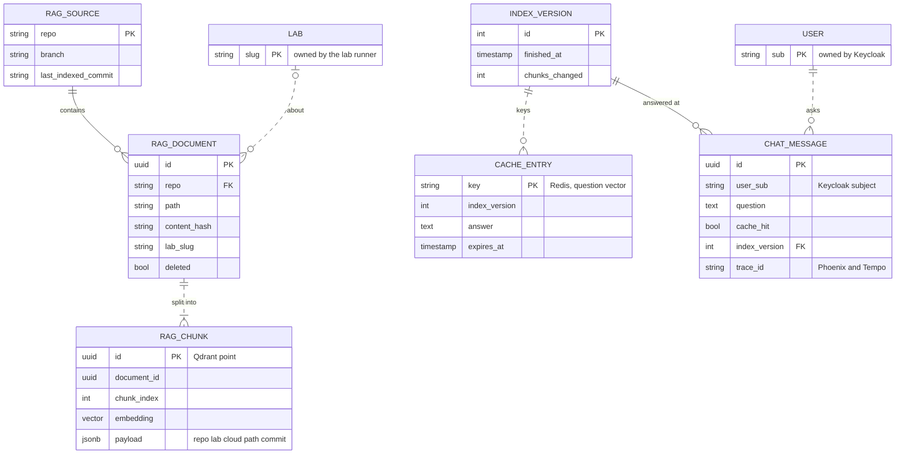
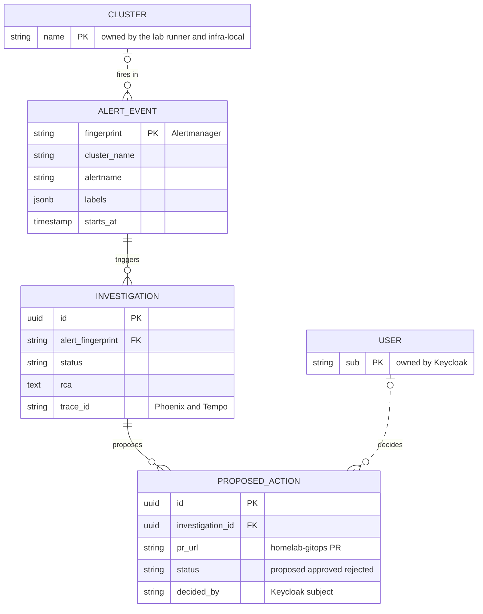

The blog is a static site on GitHub Pages, and that one fact shapes this whole architecture. A login,
a cost dashboard, one-click deploys and a chatbot all need a backend, and GitHub Pages can't run one. So
the backend lives on the NVIDIA DGX Spark under my desk. The internet reaches it through an outbound-only
Cloudflare Tunnel, and the blog only gets a link to it. Everything below follows from that choice. The
risk that matters most is that the whole platform shares one machine, and one pool of unified memory,
with the GPU.

> **Living document.** This project is in the planning stage. The architecture below is the design as
> approved before any code was written. Each delivery phase updates this post with what was actually
> built, and design changes arrive as new ADRs.
{: .prompt-info }

<!-- more -->



## System context and component architecture
{: #system-context-and-component-architecture }

There are six zones:
- the **edge** (Cloudflare, plus the sources the platform reads)
- a long-lived **platform cluster** with the portal and its data stores
- a long-lived **monitoring cluster**
- a **`core` cluster** that boots first and holds identity (Keycloak), secrets (OpenBao) and internal DNS (PowerDNS)
- an **`ai` cluster** that serves the models on the GPU
- any number of disposable **lab clusters**, one per lab
All of them are k3d clusters on one Docker network called `homelab`, so they reach each other by name.
The diagram below opens one layer deep. Use the level buttons or click a cluster to open it, drag and
zoom like a map, and hover an arrow for its protocol and why it exists. The tabs at the top add the
networking, observability, security and CI/CD connections. Pick a use case on the left and press play to
follow a packet through it:



| Component | Runs in | Job |
|---|---|---|
| Cloudflare Access + Tunnel | Cloudflare edge, `cloudflared` ×2 in platform | Google / Entra ID SSO with an email allowlist; outbound-only path to the portal |
| Backstage (`self-service-portal`) | platform | The portal: inventory and cost, labs, chat, Argo CD and Kubernetes views |
| Inventory | platform (CronJob, 6 h + Sync now) | Pulls resources and cost from Azure, AWS, GCP and the DGX into Postgres |
| Lab runner | DGX host (systemd), called from platform | Runs a lab's `make up` / `make down`, registers the cluster with Argo CD |
| Argo CD | platform | One instance that deploys to every cluster from `homelab-gitops` |
| RAG API, rag-ingest | `ai` cluster | Chat retrieval with a semantic cache; scheduled indexing of the blog and repos |
| Qdrant, Redis | `ai` cluster | Vectors and the semantic cache |
| Postgres | platform | Relational state: Backstage, inventory and cost, lab jobs |
| Arize Phoenix | `ai` cluster | Shows every chat and agent request as a trace: retrieved chunks and scores, prompt, tokens, latency per step |
| Model gateway (LiteLLM) | `ai` cluster | The one OpenAI-compatible endpoint for every model call: routing, queueing, limits, token counts, later overflow |
| vLLM chat + vLLM embeddings | `ai` cluster (GPU) | Local chat model and embedding model, each with its own memory slice |
| SRE agent | platform | Alert-triggered diagnosis with human approval before any change |
| mon cluster | its own k3d cluster | OpenTelemetry gateway, Grafana LGTM, Alertmanager; ready-made dashboards for the fleet, Kubernetes, data stores, AI serving and the platform |
| Monitoring pack | every cluster, including labs | OTel collectors, kube-state-metrics and ServiceMonitor discovery, installed by one ApplicationSet |
| Keycloak | `core` cluster | The one identity provider: brokers Google and Entra ID, issues tokens to people and services |
| OpenBao | `core` cluster | The one secret manager; External Secrets in every cluster pulls from it; issues short-lived Kubernetes tokens |
| Zot | `core` cluster | The container registry: our signed images, plus a cache of every upstream image the clusters pull |
| PowerDNS | `core` cluster | Internal zone `home.cloudutsuk.com`, fed by ExternalDNS in every cluster |
| Lab clusters | one k3d cluster per lab | The lab's app plus an OTel collector installed by Argo CD |

Two more diagrams are planned for this playbook. *Commit to deploy* goes in the CI/CD post and *RAG chat*
in the Data post. They'll be added when those areas are written.

## Technology and framework selection
{: #technology-and-framework-selection }

The rule I used: reuse what I already run, and only add a new tool where nothing I have does the job.

| Need | Choice | Why this and not the alternative |
|---|---|---|
| Portal | Backstage (existing `self-service-portal`) | SSO providers, a software catalog, a Kubernetes plugin and an Argo CD plugin already exist. A custom FastAPI + React app would be lighter but means building all of that again |
| Local Kubernetes | k3d | Already used by every lab. Clusters are cheap to create and destroy |
| Cluster lifecycle | Terragrunt units from [Y-IaC](/tags/y-iac/): `docker_network` and `k3d_config_cluster`, which renders k3d's own config file and runs the k3d CLI | The long-lived clusters get the same plan/apply workflow as the cloud infrastructure, and `plan` shows the exact k3d config. The older provider-based unit crashed whenever `update.k3s.io` was down and couldn't set host aliases (ADR 0006) |
| GitOps | Argo CD | Its UI and Backstage plugin suit a portal-centric setup better than Flux |
| CI | GitHub Actions self-hosted runners (ARC) + BuildKit | The repos are already on GitHub, and self-hosted minutes are free |
| Observability | OpenTelemetry Collector + Grafana LGTM | The same stack the [OpenTelemetry lab](/tags/opentelemetry-lab/) already teaches |
| LLM serving | vLLM | OpenAI-compatible API, continuous batching, runs on the GB10 GPU |
| Model gateway | LiteLLM proxy | One endpoint for all callers, so adding a model, a second machine or a hosted fallback doesn't touch the services |
| Vector store | Qdrant | Payload filters (repo, lab, cloud, path) and hybrid search |
| Semantic cache | Redis with RedisVL `SemanticCache` | Small, well understood, TTL and similarity threshold built in |
| RAG visualization | Arize Phoenix (self-hosted) | Understands LLM and retrieval spans (documents, scores, prompts), has an embeddings map and evals, and takes OpenTelemetry input like the rest of the platform. Langfuse is the fallback, but it also needs ClickHouse |
| Troubleshooting agent | existing `sre-agent` | It already has Kubernetes subagents, approval buttons and Slack |
| Testing | pytest + Testcontainers, Schemathesis, Playwright, **Locust**, Argo CD PostSync smoke tests | Locust scripts load in Python like the services, scales with workers, and its thresholds can fail a run. Schemathesis turns each OpenAPI spec into hundreds of API tests for free |
| Security scanning | Gitleaks, Semgrep + Bandit, Trivy (deps, IaC, images, licences), Checkov + Conftest, Hadolint, Syft, OWASP ZAP, Trivy Operator | All free and self-hosted. GitHub's own code scanning needs a paid licence on private repos |
| Supply chain | Cosign signatures, SBOM attestations, Kyverno admission | Only signed images from our own registry can run, in every cluster |
| Container registry | **Zot** in the `core` cluster | Harbor is the usual pick, but its official images are amd64 only and the DGX is arm64. Zot is a single multi-arch binary with access control, OIDC, a pull-through mirror, built-in CVE scanning and the OCI referrers API for signatures |

> **GPU test, done 2026-10-11.** vLLM runs *inside* the `ai` k3d cluster: a k3s image with NVIDIA's
> container toolkit, the NVIDIA device plugin, and pods that ask for `nvidia.com/gpu`. A chat model and an
> embedding model (Qwen3-Embedding-0.6B) served requests at the same time on the one GPU. ADR 0010 is
> accepted. The details are under [Scalability](#scalability-and-performance-strategy).
{: .prompt-info }

> **TODO:** Which chat model goes first: gpt-oss-20b, Qwen3-30B-A3B or something else, and under which
> licence? It's chosen in Phase 5 within the ~30 GB slice and recorded as its own ADR.
{: .prompt-warning }

## API and integration architecture
{: #api-and-integration-architecture }

Backstage is the only thing a browser talks to. Its backend plugins call the internal services, which
are plain HTTP + JSON APIs inside the platform cluster (the model gateway is in the `ai` cluster):

| API | Consumers | Key endpoints |
|---|---|---|
| `inventory` | Backstage Inventory plugin, RAG API (tool) | `GET /resources`, `GET /costs?group_by=lab`, `POST /sync` |
| `lab-runner` | Backstage Labs plugin | `GET /labs`, `POST /labs/{slug}/deploy`, `POST /labs/{slug}/destroy`, `GET /jobs/{id}/logs` (stream) |
| `rag-api` | Backstage Chat plugin, SRE agent | `POST /chat` (streamed, with citations), `POST /search`, `POST /reindex` |
| Model gateway | RAG API, rag-ingest, SRE agent | OpenAI-compatible `/v1/chat/completions`, `/v1/embeddings`; routes to the vLLM instances |
| SRE agent | Alertmanager | `POST /alerts` (Alertmanager webhook payload) |

Outbound integrations are read-only by default:
- Azure Resource Graph and Cost Management.
- AWS Resource Explorer and Cost Explorer.
- GCP Cloud Asset Inventory and the BigQuery billing export.
- GitHub, for repo content and CI.
- Slack, for approvals.

The lab registry isn't a new API. It's the lab cards already in this blog (`_data/labs/*.yml`). Each card
gets a small `deploy:` block with allowlisted Make targets and an estimated memory size, so the blog and
the portal read the same source.

## Data architecture and data models
{: #data-architecture-and-data-models }

Data lives in a handful of stores, and **each entity has exactly one service that writes it**. Other
services read it through that service's API, never straight from its tables. That rule keeps the
ownership in the diagram below honest, and it's why there are no foreign keys across databases.

| Store | Cluster | Holds | Rebuildable? |
|---|---|---|---|
| Postgres `platform-db` | platform | Databases `backstage`, `inventory`, `labs`, `agent`, one owner role each | **No**: nightly `pg_dump` to R2 |
| Postgres `ai-db` | ai | Schemas `rag` (ingest state, chat history) and `phoenix` (traces, evals) | Partly: `rag` rebuilds from git; chat history and evals are backed up |
| Postgres `core-db` | core | Keycloak's realm, users' links to Google/Entra, groups | **No**: backed up with OpenBao's snapshot |
| Qdrant | ai | Chunks of posts, lab cards and repos, with embeddings | Yes: re-ingest from git |
| Redis | ai | Semantic cache entries keyed by the index version | Yes: it's a cache |
| Zot | core | Container images, signatures, SBOMs | Yes: rebuild from git (mirror refills itself) |
| mon (Mimir, Loki, Tempo) | mon | Metrics, logs and traces for about 15 days | Accepted loss |

The logical data model is drawn below as four views, one per owning service. Solid lines are real
foreign keys inside one database. Dotted lines are soft references: an ID or slug held across stores
and checked by the owning service. Entities owned by another service appear as small reference boxes
with only their key. Each diagram has an expand button for full screen.

**1. Labs and clusters.** Written by the lab runner, in `platform-db.labs`.



**2. Inventory and cost.** Written by the inventory service, in `platform-db.inventory`.



**3. Knowledge and chat.** Written by rag-ingest and rag-api, in `ai-db.rag`, Qdrant and Redis.



**4. Incidents.** Written by the SRE agent, in `platform-db.agent`.



**Who owns what.** Each entity has one writer; everything else reads it through that service's API.

| Entity | Written by | Store | Source of truth | Main readers | Retention |
|---|---|---|---|---|---|
| `LAB` | lab runner (read-only copy) | `platform-db.labs` | The lab cards in this blog (`_data/labs/*.yml`), refreshed every sync | Backstage Labs plugin, inventory, RAG | Follows the cards |
| `CLUSTER` | `infra-local` (long-lived), lab runner (labs) | `platform-db.labs` | k3d itself, reconciled every sync | Argo CD registration, SRE agent, inventory | While the cluster exists, then 90 days |
| `LAB_DEPLOYMENT`, `LAB_JOB` | lab runner | `platform-db.labs` | Itself | Backstage, budgets, the TTL reaper | 1 year |
| `CLOUD_ACCOUNT`, `RESOURCE`, `COST_DAILY`, `SYNC_RUN`, `BUDGET` | inventory | `platform-db.inventory` | The cloud providers' APIs and billing exports | Backstage Inventory plugin, RAG tools, budget alerts | Resources 1 year after deletion; daily costs 2 years |
| `ALERT_EVENT`, `INVESTIGATION`, `PROPOSED_ACTION` | SRE agent | `platform-db.agent` | Alertmanager (alerts), GitHub (PR state) | Backstage incident view, Slack | 1 year |
| `RAG_SOURCE`, `RAG_DOCUMENT`, `INDEX_VERSION` | rag-ingest | `ai-db.rag` | The git repos | rag-api | Rebuilt on demand |
| `RAG_CHUNK` | rag-ingest | Qdrant | The git repos | rag-api, SRE agent | Deleted with its document |
| `CACHE_ENTRY` | rag-api | Redis | Derived | rag-api | 24-hour TTL, invalidated by a new index version |
| `CHAT_MESSAGE` | rag-api | `ai-db.rag` | Itself | You (history), Phoenix evals | 90 days |
| `USER` | Keycloak | `core-db` | Google / Entra ID (brokered) | Every service, as a token subject only | While the account exists |

Personal data stays minimal: only Keycloak stores emails. Every other table holds the opaque subject
ID, so removing a user is a Keycloak change plus deleting their chat history.

Costs are grouped by the tags the `infra-*` repos already apply, plus one new optional tag, `lab`. Each
Qdrant point's payload carries `source`, `repo`, `lab`, `cloud`, `path` and `commit`, so the chatbot
can filter ("only the Azure lab") and ingest can delete the chunks of a removed file.

`_posts/private/` and `.env*` files are never indexed.

The RAG pipeline is observable step by step. `rag-api` and `rag-ingest` are instrumented with
OpenInference, and the collector sends their traces to Arize Phoenix as well as to Tempo. For any
answer, Phoenix shows:
- whether the semantic cache hit
- which chunks Qdrant returned, with their scores and source paths
- the exact prompt the model saw
- how long each step took

Each answer in the chat has a "View trace" link. Phoenix also projects the stored embeddings onto a
map, which shows the topics the knowledge base covers well and where it's thin.

Phoenix and Grafana overlap a little, so each has a clear job:
- **Grafana** in `mon` is where the AI stack is *operated*. It holds every dashboard and alert for the GPU, vLLM's queue and time to first token, the gateway, cache hit rate and ingest lag.
- **Phoenix** is where answer *quality* is investigated. Use it when a reply is wrong, or to compare a chunking, prompt or model change with evals over a golden question set.

Phoenix gets no alerts. Both receive the same OTel traces, and one trace ID links a slow request in
Grafana to its readable version in Phoenix. Phoenix arrives with the RAG pipeline in phase 5.

rag-ingest clones the repos from GitHub with a fine-grained, read-only token. Only pushed work is
indexed, so drafts and half-finished experiments stay out of the answers.

## Identity and access architecture
{: #identity-and-access-architecture }

**Keycloak**, running in the `core` cluster, is the one identity provider for everything. It doesn't
hold accounts of its own. It brokers my **Google and Entra ID** logins and adds groups, such as
`platform-admins` and `viewers`, that map to roles in every tool.

There are still two gates for people, so one misconfiguration isn't enough to expose anything:

1. **Cloudflare Access** sits in front of `portal.`, `grafana.`, `argocd.` and `phoenix.cloudutsuk.com`,
   with Keycloak as its identity provider and an allowlist of my addresses.
2. **Every tool signs you in again** through Keycloak OIDC: Backstage, Grafana, Argo CD, OpenBao and
   Phoenix. So does `kubectl` on every k3d cluster, through the k3s OIDC flags. Roles come from
   groups, so one group change applies everywhere.

A direct Google login, limited to my own address, stays on Cloudflare Access as a **break-glass**
route. If `core` is down, I can still get in to fix it.

**Services authenticate to each other with short-lived credentials**, never shared passwords:

| Call | How |
|---|---|
| Backstage, sre-agent and RAG tools → RAG API, inventory, lab runner | OAuth2 client credentials from Keycloak: 5-minute JWTs with an audience and roles, checked against Keycloak's signing keys |
| AI services → LiteLLM gateway | A JWT, or one virtual key per client with its own limits (depends on LiteLLM's free edition) |
| Alertmanager → SRE agent, collectors → mon | OAuth2 client credentials, which both support natively |
| SRE agent and lab runner → a cluster's Kubernetes API | 15-minute ServiceAccount tokens from OpenBao's Kubernetes secrets engine, read-only for the agent |
| Argo CD → every cluster | One ServiceAccount token per cluster, refreshed from OpenBao |
| Every cluster → OpenBao | Per-cluster Kubernetes auth (below) |

Every cross-cluster call is HTTPS on a `*.home.cloudutsuk.com` certificate, and NetworkPolicies
allow only the calls above. Service-mesh mTLS is a later option. Keycloak's events and OpenBao's
audit log go to Loki.

Machine permissions stay least-privilege:

| Identity | Permissions |
|---|---|
| Inventory | Azure Reader + Cost Management Reader; AWS ReadOnly + `ce:Get*`; GCP Viewer + BigQuery Data Viewer |
| Lab runner | Per-lab deploy and destroy credentials, only for labs with cloud resources |
| SRE agent | Read-only Kubernetes access on every cluster through short-lived tokens. Fixes go out as PRs to `homelab-gitops` after approval |
| CI runners | Log in to OpenBao with GitHub OIDC; push to Zot with the `ci-pusher` key (only from `main`); commit image digests to `homelab-gitops` with a short-lived GitHub App token |
| Clusters pulling images | Anonymous pulls of mirrored public images; a `zot-pull` secret from OpenBao (through External Secrets) for our own images, added to pods by a Kyverno policy |

> **TODO:** Which email addresses (Google and Entra) go on the allowlist? Keep them in OpenBao, not in
> this public post.
{: .prompt-warning }

### Secrets: OpenBao and External Secrets

No secret value lives in git. **OpenBao**, the open-source fork of Vault, runs in the `core` cluster
and is the only place secrets are stored. Every cluster (`core`, `platform`, `mon`, `ai` and each lab)
runs the **External Secrets Operator**. Apps keep reading ordinary Kubernetes Secrets, and
ExternalSecret objects in `homelab-gitops` say which OpenBao path each one comes from.

- **Per-cluster identity.** OpenBao has one Kubernetes-auth mount per cluster, so no cluster holds a
  static token. Each cluster's policy reads only its own paths (`platform/*`, `labs/<slug>/*`, …) plus
  `shared/*`. A lab cluster can't read the portal's OAuth secrets.
- **Labs.** The lab runner creates a lab's mount and policy on deploy and removes them on destroy.
- **Outside Kubernetes.**
  - The lab runner uses an OpenBao agent with AppRole.
  - CI runners log in with GitHub's own OIDC token, so nothing is stored as a GitHub secret.
- **What's stored:**
  - the tunnel token
  - the OAuth clients
  - read-only cloud credentials (rotated every 90 days)
  - per-lab deploy credentials
  - GitHub App and repo tokens
  - Slack tokens
  - LiteLLM keys
  - database and Grafana passwords
  - the Cloudflare DNS-01 token
  - backup keys
- **Unseal and backup.** After a reboot, OpenBao is unsealed from a root-only key file on the DGX. A
  nightly snapshot goes to R2, encrypted, and the unseal keys have an offline copy.

## Hosting and deployment model
{: #hosting-and-deployment-model }

Everything runs on the DGX Spark, so hosting costs $0. The only cloud spend is the labs I choose to
deploy. The repos are split by how often they change:

| Repo | Holds |
|---|---|
| `infra-local` (new) | The `core`, `mon`, `platform` and `ai` k3d clusters, the `homelab` network and each node's registry settings, through the shared module's `docker_network` and `k3d_config_cluster` units, plus the Helm bootstrap of OpenBao, PowerDNS, External Secrets and Argo CD |
| `homelab-gitops` (new) | Argo CD app-of-apps, Helm values, image tags, ADRs |
| `homelab-services` (new) | Python services: inventory, lab-runner, rag-ingest, rag-api |
| `self-service-portal` | Backstage plus the new plugins, built into a custom image |
| `sre-agent` | The alert-driven agent |

The three new repos were created on 2026-10-11 through `infra-github`, like every other repo: a new
`homelab` group holds one `resources.yaml` per repo, and a Terragrunt plan showed only additions before
the apply. Each repo is private (ADR 0019: self-hosted runners only serve private repos), squash-merge
only, deletes merged branches, and carries the same custom properties as the other platform repos
(portfolio `platform-engineering`, cloud `on-premises`) plus the topic `cloudutsuk-platform`.
`infra-local` also gets a `production` environment, so its applies can be gated later.

```yaml
# infra-github/environments/github/homelab/homelab-gitops/resources.yaml (abridged)
github_repository:
  - name: homelab-gitops
    description: "Cloudutsuk Platform - Argo CD desired state (app-of-apps, Helm values, dashboards, alert rules) and the platform ADR log"
    allow_auto_merge: false
    topics: ["cloudutsuk-platform", "homelab", "dgx-spark"]
github_repository_collaborators:
  - name: homelab-gitops
    collaborators:
      - teams:
          - team_name: "team-cloudutsuk"
            permission: admin
```

A commit flows:
1. A self-hosted runner on the DGX builds the image and pushes it to Zot in `core`.
2. The new tag is committed to `homelab-gitops`.
3. Argo CD syncs it.

Argo CD is a single hub instance. Lab clusters are registered when the lab runner creates them, and an
ApplicationSet installs the OTel collector on every one.

### Internal DNS and bootstrap order

Containers on the `homelab` network can already reach each other by container name, but nothing gives
services stable, readable names, or lets the DGX resolve them. **PowerDNS** in `core` is the only
server for `home.cloudutsuk.com`, an internal-only zone that's never published in Cloudflare.

- **Records.** ExternalDNS in every cluster writes its Ingress and Service names, such as
  `grafana.mon.home.cloudutsuk.com` or `otel.lab-otel.home.cloudutsuk.com`. A lab's records disappear
  with the lab.
- **Resolution.**
  - Every cluster's CoreDNS forwards the zone to PowerDNS on the fixed gateway address of the
    `homelab` network.
  - The DGX uses split DNS in `systemd-resolved`, the same trick as the
    [Azure private endpoint lab](/tags/azure-private-endpoint-lab/).
- **TLS.** Because the zone sits under a domain I own, cert-manager gets real Let's Encrypt
  certificates through a Cloudflare DNS-01 challenge. Only the `_acme-challenge` TXT records ever reach
  Cloudflare.

The boot order follows from what depends on what:
1. The network.
2. `core`, then OpenBao is unsealed.
3. `mon`, `platform` and `ai`, each with External Secrets.
4. Argo CD, whose own repo credentials come from External Secrets.

After that, Argo CD's ApplicationSets keep External Secrets, ExternalDNS, cert-manager and the OTel
agent on every cluster, including each new lab cluster.

### Commit to deploy
{: #commit-to-deploy }

Every change takes the same path, and every security and test gate sits on it. Tick *Simulate a
failing scan* to see what happens when a gate fails: nothing gets built, so nothing can be deployed.



The gates in short:
- **Every PR:** Gitleaks, Semgrep + Bandit, Trivy (dependencies and IaC), Checkov + Conftest, Hadolint,
  tests and an image scan.
- **Every deploy:** a Kyverno signature check and a PostSync smoke test.
- **Every night:** Playwright, OWASP ZAP and a Locust load run against what's actually deployed.

The full matrix of tools, triggers and severity thresholds belongs in the CI/CD and Quality Assurance
posts, which get written when phase 1 runs. Until then it's in ADRs 0031–0033.

### GitHub, the registry and the local clusters

GitHub hosts the code and runs the workflows, but **every job executes on the DGX** and nothing
connects in:
- **Runners.** Actions Runner Controller in the platform cluster registers arm64 runners with the
  GitHub org through a GitHub App. Each runner pod polls GitHub over outbound HTTPS, takes one job and
  is deleted.
- **CI stops at git.** No cluster credentials ever go to GitHub. A `main` build ends by committing the
  new image digest to `homelab-gitops`.
- **CD pulls.** Argo CD polls that repo every 3 minutes, also outbound, and applies the change to the
  right k3d cluster over the local Docker network.

If GitHub is down, nothing new ships, but everything already running keeps running.

Images live in **Zot**, a small OCI registry in the `core` cluster at
`registry.core.home.cloudutsuk.com`, on HTTPS with a Let's Encrypt certificate. I chose it over Harbor
because Harbor's official images don't support arm64.

| Who | How they authenticate |
|---|---|
| CI pushing an image | The runner logs in to OpenBao with its GitHub OIDC token (only `main` builds of our repos are allowed), reads the `ci-pusher` key, and BuildKit and Cosign push with it. PR builds can't push |
| Clusters pulling public images | No credentials. Every node's containerd is configured to fetch `docker.io`, `ghcr.io`, `quay.io` and `registry.k8s.io` through Zot's mirror, which caches them |
| Clusters pulling our images | A `zot-pull` secret that External Secrets fetches from OpenBao into each namespace; a Kyverno policy attaches it to every pod |
| Kyverno checking signatures | The same `zot-pull` secret; signatures and SBOMs sit next to each image (OCI referrers) |
| People | Zot's web UI through Keycloak |

Deployments reference images **by digest**, so what runs is exactly what was scanned and signed.

### Network layout
{: #network-layout }

The same platform, seen as networks: what talks to what, on which port, and where TLS starts and
ends. Tick *Simulate a cloud lab* to see the WireGuard path a cloud lab adds.



The address plan is fixed up front (ADR 0030). The point is that no two clusters overlap, so a
service mesh or direct pod routing can be added later without renumbering anything:

| Network | Range | Notes |
|---|---|---|
| Home LAN | a `/24` in `192.168.0.0/16` (Wi-Fi) | No port forwards. The DGX only accepts SSH from the LAN |
| `homelab` Docker bridge | `172.30.0.0/24`, gateway `172.30.0.1` | Every k3d node and load balancer. The gateway address publishes `core`'s PowerDNS (`:53`) and Zot registry (`:443`) |
| `core` pods / services | `10.10.0.0/16` / `10.11.0.0/16` | |
| `platform` pods / services | `10.20.0.0/16` / `10.21.0.0/16` | |
| `mon` pods / services | `10.30.0.0/16` / `10.31.0.0/16` | |
| `ai` pods / services | `10.40.0.0/16` / `10.41.0.0/16` | |
| Lab clusters | `10.100.0.0/16` upwards, two /16s per lab | Assigned by the lab runner from the lab card |

k3s's defaults (`10.42/16` pods, `10.43/16` services) would be the same in every cluster. They're
overridden with `--cluster-cidr` and `--service-cidr` when each cluster is created.

| Path | Protocol and port | TLS |
|---|---|---|
| Browser → Cloudflare | HTTPS 443 | TLS 1.3, Cloudflare's edge certificate; Access checks the Keycloak login first |
| cloudflared → Cloudflare | QUIC on UDP 7844 (HTTP/2 on TCP 7844 as fallback), outbound only | Tunnel encryption |
| cloudflared → Traefik | HTTPS 443 | Let's Encrypt certificate for `*.platform.home.cloudutsuk.com`, origin name checked |
| Cluster → cluster | HTTPS 443 through each cluster's k3d load balancer and Traefik | `*.<cluster>.home.cloudutsuk.com`, plus a JWT (ADR 0029) |
| → OpenBao, Keycloak | HTTPS 8200, 8443 | Let's Encrypt certificates in `core` |
| → Kubernetes API | HTTPS 6443 on the load balancer, never published to the LAN | k3s's own CA; short-lived tokens |
| Collectors → mon | OTLP gRPC 4317 | TLS, plus OAuth2 client credentials |
| Pods → internal DNS | DNS 53 to CoreDNS, forwarded to PowerDNS at `172.30.0.1:53` | Plain DNS, on the bridge only |
| Clusters → registry | HTTPS 443 to `registry.core.home.cloudutsuk.com`, which resolves to the gateway address through a k3d host alias on every node | Let's Encrypt certificate. Anonymous pulls of mirrored public images; our images need the `zot-pull` secret |
| cert-manager → Let's Encrypt | HTTPS 443, DNS-01 TXT records through the Cloudflare API | ACME |
| Egress (cloud APIs, GitHub, model downloads) | HTTPS 443 through the router's NAT | Provider certificates |
| Cloud lab (optional) | WireGuard, UDP 51820, from the DGX to the lab's VM | WireGuard |

Inside every cluster, NetworkPolicies default to deny. They allow ingress from Traefik, the calls in
the identity table above, DNS, and egress to the targets in this table. Inside a cluster, Traefik
terminates TLS and talks plain HTTP to the pod. Pod-to-pod mTLS waits for the service mesh option.

> **Checked 2026-10-11.** The home LAN is a `/24` inside `192.168.0.0/16` and the DGX joins it over
> Wi-Fi. Docker's existing networks use `172.17` and `172.18`, and no host route touches `172.30.x` or
> `10.x`, so the plan stands. `infra-local/host/check-prereqs.sh` repeats this check before any cluster
> is created.
{: .prompt-info }

## Scalability and performance strategy
{: #scalability-and-performance-strategy }

This platform can't scale out. It has one GB10 GPU and about 121 GB of unified memory, shared between
the CPU and GPU. Moving vLLM to another k3d cluster doesn't add capacity. Every cluster on this box draws
on the same chip and the same memory. So the budget is the main design constraint:

| Component | Range | Planned (mid-range) |
|---|---|---|
| `ai` cluster: vLLM chat model (~20–30B MoE, FP8/MXFP4) | ~35–40 GB | ~30 GB to start |
| `ai` cluster: vLLM embeddings + model gateway | ~3–5 GB | ~4 GB |
| `ai` cluster: RAG API, rag-ingest, Qdrant, Redis, Phoenix | ~4–6 GB | ~5 GB |
| core cluster (Keycloak, OpenBao, PowerDNS, Zot, ESO, ExternalDNS) | ~3–4 GB | ~3.5 GB |
| mon cluster | ~6–8 GB | ~7 GB |
| platform cluster (portal, Postgres, inventory, Argo CD, CI, SRE agent) | ~7–9 GB | ~8 GB |
| CI runners + BuildKit (in bursts) | ~4–8 GB | ~5 GB |
| Lab clusters | ~3–6 GB each, 2–3 of them | ~10 GB in total |
| k3s servers (4 long-lived clusters) | ~0.5–1 GB each | ~3 GB |
| OS, Docker, desktop use (VS Code, browser, the local blog server) | ~15 GB | ~25–35 GB |

**Measured on 2026-10-11:** with the DGX in use as a desktop and no platform running yet, about 81 GB
of the 121 GB was free. The top of every range needs about 97 GB, so the plan works to the mid-range
column instead: about 75 GB for the platform, which leaves 25–35 GB for the desktop and some
headroom. The chat model starts with a smaller memory slice and only
grows if measurements in Phase 5 leave room. The lab runner's admission control checks the memory
actually free at deploy time (ADR 0017), not a fixed number, so a busy desktop day means fewer labs at
once rather than an out-of-memory model.

**What the GPU test changed.** On the GB10, GPU memory is ordinary system memory, and it isn't charged
to any container. With two small vLLM pods running, the host's used memory rose by about 29 GB, while
Docker counted 7.5 GB for the whole cluster and Kubernetes about 3 GiB per vLLM pod. Three rules follow:

- A model's slice is set by `--gpu-memory-utilization`, as a fraction of the whole 121 GB: 0.1 took
  about 12 GB, so the chat model's ~30 GB start is about 0.25. Pod memory limits don't cap it.
- There's no MIG, so models share the GPU by time-slicing, with no memory isolation between them. A
  wrong utilization setting can starve the other model or the host.
- Admission control reads the host's free memory, never the sum of container metrics, and the Fleet
  dashboard shows host memory next to per-cluster memory so the `ai` cluster doesn't look smaller than
  it is.

The **whole AI stack** lives in its **own `ai` k3d cluster** (ADR 0022): the RAG API, rag-ingest, Qdrant, the Redis semantic cache, Phoenix, the model gateway and the vLLM instances. They're upgraded and tuned together. The SRE agent stays in `platform` on purpose: when the models are down, it still has to post its raw evidence to Slack.

On one host that buys isolation, not capacity:
- Only this cluster needs the custom GPU-enabled k3s image.
- A failure anywhere in the AI stack (vLLM, the GPU driver, Qdrant) can't take the portal, Postgres or GitOps down with it.
- It's the obvious place for a second machine to join later.

**Nothing calls vLLM directly.** The RAG API, rag-ingest and the SRE agent all call one
OpenAI-compatible **model gateway** (LiteLLM proxy) by model name. The gateway routes each request,
queues bursts, applies per-client limits and records token use. That gateway is what makes the
scaling steps below possible:

| Need | What I do | Why not just add replicas |
|---|---|---|
| More requests to the same model | Tune the one instance: continuous batching, FP8/FP4 weights, prefix caching, a cap on concurrent sequences, plus the semantic cache in front | A second replica on the same GPU copies the weights and halves the KV cache each copy gets, so throughput goes down |
| More kinds of model (embeddings, a reranker, a coding model) | Each vLLM instance gets a fixed slice of memory (`--gpu-memory-utilization`) from the budget. Small models stay loaded; rarely used large ones are loaded on demand and unloaded when idle | The GB10 can't be split into hardware partitions (no MIG, confirmed in the GPU test), so pods share it by time-slicing and memory is the only lever |
| More than one box can serve | Add a backend behind the gateway: a second DGX Spark, another GPU machine joining as a k3s node, or a hosted model for overflow | The callers don't change, only the gateway's routing table |

**Autoscaling** in the usual Kubernetes sense doesn't apply with one GPU. CPU-based HPA would only
start copies that compete for the same chip. Instead, `mon` watches vLLM's waiting-request count and
time to first token. When those stay high, that's the signal to add a backend or turn on overflow. Real
autoscaling, such as KEDA on queue depth, becomes possible once there's a second GPU node.

Elsewhere:
- The lab runner refuses or queues a deploy that would push free memory below the headroom.
- rag-api rate-limits per user.
- The services are stateless, so they move to another node as easily as the models do.

> **TODO:** Set performance targets after the first load test. A starting proposal is time to first
> token under 3 s at p95.
{: .prompt-warning }

## Resilience and disaster recovery
{: #resilience-and-disaster-recovery }

One host can't be highly available, so I'm optimising for recovery and for knowing when it's down:

- **Dead-man's switch.** Alertmanager's always-firing `Watchdog` pings an external free heartbeat
  service. If the DGX, power or the ISP goes down, the pings stop and I get an alert, even though
  monitoring died with the host.
- **Isolation.** `mon` is a separate cluster that doesn't depend on Argo CD at runtime. Resource limits
  and PriorityClasses stop vLLM or a runaway lab starving it.
- **Restart.** After a reboot, a systemd unit starts Docker, then `core`, then unseals OpenBao, then starts
  `mon`, `platform` and `ai`. External Secrets retries until OpenBao answers. Lab clusters stay down after a
  reboot.
- **Remote access.** Two `cloudflared` replicas, so one pod crashing doesn't cut off access.
- **Degradation:**
  - Inventory shows the last known data with a "stale since" badge.
  - Chat falls back to search results when the LLM is down.
  - The agent posts its raw evidence when it can't reach the model.
- **Backups.** Only Postgres and the secrets: a nightly encrypted `pg_dump` to the Cloudflare R2 free
  tier. Everything else rebuilds from git. Targets are **RTO 1 hour, RPO 24 hours**, tested once a
  quarter by rebuilding on an empty Docker.

## Architectural decision records
{: #architectural-decision-records }

Decisions are recorded as MADR files in `homelab-gitops/docs/adr/`, in the same PR as the change that
implements them. A changed decision gets a new ADR that supersedes the old one, so the history stays
intact. The full text of every ADR (context, decision, the options that lost, consequences) is in the
[Architecture Decision Records](/posts/projects/cloudutsuk-platform/architecture-decision-records/)
post, generated from the repo. One is still *proposed*: 0020 waits for the first load-test baseline
(the SLO targets). 0010 was accepted after the GPU test on 2026-10-11.



## Checklist
{: #checklist }

- [ ] All three animated diagrams approved before any infrastructure work
- [x] GPU-in-k3d test done and ADR 0010 accepted: vLLM in k3d; no MIG, so time-slicing (2026-10-11)
- [ ] Memory budget confirmed on the DGX with the chosen model loaded
- [x] ADRs 0001–0035 written in `homelab-gitops` and synced to the blog (2026-10-11)
- [x] The three new repos created through `infra-github` (2026-10-11)
- [ ] Keycloak brokering Google and Entra, the tunnel and Access configured, and an email not on the allowlist is denied
- [ ] A service call without a valid token is rejected
- [ ] Backup and restore of Postgres tested once
- [ ] This post updated with what was actually built at the end of each phase


