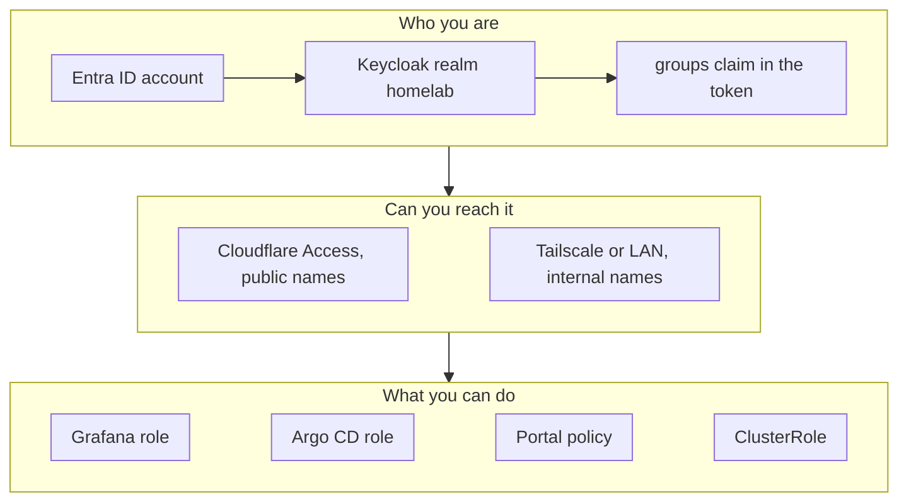

The Cloudutsuk Platform has more than a dozen browser UIs (Grafana, Argo CD, a Backstage portal, OpenBao,
LiteLLM, Homarr, an agent console and others), plus `kubectl` against five long-lived clusters. If each
of those kept its own users, adding one person would mean a dozen accounts, and removing them would mean
hoping you remembered all of them. So none of them keep users. This post explains what they do instead:
which authentication mechanisms sit where, how a person becomes a user, and how one group membership turns
into a role in every tool. It also covers the role model: every app has its own admin, editor and viewer
groups, plus three platform-wide groups for people who need the same role everywhere.

<!-- more -->

> Every hostname and IP range in this post is a sample: `example.com` stands for the public domain,
> `home.example.com` for the internal zone and `10.42.17.0/24` for the cluster subnet.
{: .prompt-info }

## The short version

There's one OIDC issuer, Keycloak, running in the `core` cluster with a realm called `homelab`. Every
tool that has users trusts it, and so does every Kubernetes API server. Keycloak itself doesn't hold
passwords: it sends every sign-in to Microsoft Entra ID and creates a local user record the first time
someone comes back. What a person can do is decided by **which Keycloak group they're in**. Keycloak puts
the groups into a `groups` claim in every token, and each tool translates that claim into its own idea of
a role.

In front of all that sit two network gates. Public hostnames go through Cloudflare Access, which also
signs people in through Keycloak and checks the same `groups` claim. Internal hostnames are only
reachable from the home LAN or over Tailscale.



The three rows answer three different questions, and they fail in different ways. A wrong group gives
you the wrong role inside a tool. A missing network gate means the request never reaches the tool at all.
Most "I can't get in" problems come from mixing those two up.

## The authentication mechanisms

"Single sign-on through Keycloak" covers more than one protocol flow. Here they are from the edge
inward.

### Identity brokering: Entra ID behind Keycloak

Keycloak is configured with Entra ID as an external OIDC identity provider (OIDC v2 endpoints, PKCE, a
single-tenant app registration with tenant-wide consent). The realm's browser flows put an
**identity-provider redirector** before the username and password form, so the form never appears:
whoever opens a Keycloak login page is sent straight to Entra.

When Entra sends the person back, Keycloak runs its *first broker login* flow. The first time, it creates
a realm user from the Entra claims (name, email) and links it to the Entra identity. After that, it just
matches the link. Because the realm trusts Entra's email, it doesn't ask for its own verification.

That has a few consequences worth spelling out:

- **The identity lives in Entra; the authorization lives in Keycloak.** Entra decides whether you are who
  you say you are, and whether you need MFA. Keycloak decides which groups you're in. Nothing about
  platform roles is stored in Entra.
- **You can't create a platform user in advance.** The Keycloak user appears on the first sign-in, so
  group membership can only be assigned after that.
- **Only Keycloak stores email addresses.** Tools see the email in the token, but the data-ownership
  decision is that Keycloak is the only place it's kept.

### OIDC clients: public with PKCE, or confidential

Every tool is registered in the realm as an OIDC client, and there are two kinds.

**Public clients** have no secret. They use the authorization code flow with PKCE (S256), which protects
the code exchange without a shared secret. These are for things that run where a secret can't be kept:
Argo CD's in-browser PKCE flow and its CLI login, `kubectl` (the `kubelogin` plugin opens a browser and
listens on `localhost`), and Hermes' dashboard.

**Confidential clients** have a client secret, and they're for server-side apps: Grafana, the Backstage
portal, OpenBao, the Velero UI, LiteLLM, Homarr, Job Hunter, Shorts Studio, the Temporal UI, and the
Cloudflare Access integration itself. Each secret is generated once, written to OpenBao first, and only
then set on the client, so re-running the realm configuration never rotates it by accident. Clusters
can't read each other's OpenBao paths, so a per-tool script copies the secret into that cluster's own
path, and External Secrets turns it into a Kubernetes Secret for the app.

Both kinds carry the same protocol mapper: Keycloak's group-membership mapper, which writes the user's
group names (short names, not full paths) into a `groups` claim in the ID token, the access token and the
userinfo response.

### oauth2-proxy for apps that don't speak OIDC

Some apps have no sign-in of their own, or one that can't be trusted with the job. Headlamp (a Kubernetes
UI that holds a cluster-admin kubeconfig for every cluster) and the agent operator console are examples.
They sit behind an `oauth2-proxy` that does the OIDC flow with a confidential client and checks the
`groups` claim before it forwards anything.

### Per-app gates in Keycloak

Some apps let in anyone the issuer signs in. Hermes' dashboard and LiteLLM's admin UI are both like that,
and both can do a lot of damage: one reads API keys and runs commands, the other manages every model key.
So the gate is in Keycloak itself.

Each sensitive client has its own browser flow. It runs the normal sign-in, then a conditional step: if the
user doesn't hold that app's realm role (`hermes-access`, `litellm-access` and so on), a deny-access step
ends the flow with an error, so the app never receives a token for someone who shouldn't be there. Those
roles are mapped to groups, so people still only ever join groups.

One table decides who passes each gate:

| App | Groups the gate admits |
|---|---|
| Hermes, Job Hunter, Headlamp, Temporal UI, Wardens console | `platform-admins` and the app's own `-admin` group |
| LiteLLM | `platform-admins`, `litellm-admin`, `litellm-editor`, `litellm-viewer` |
| Shorts Studio, Homarr | All six: the three platform-wide groups and the app's three |

The table is the source of truth in both directions: applying it also takes the role away from any group
no longer listed. That's what makes tightening an app as safe as opening one.

The first version of this was a single shared `platform-admins only` flow. That was fine with one
tier, but it can't express "viewers may use Shorts Studio and not Hermes". Worth knowing if you build
your own: new flow steps get equal priority by default, and Keycloak doesn't promise an order among ties.
In two of the gates here, the role check ran before sign-in until explicit priorities were set.

### Cloudflare Access at the edge

The public hostnames come in through a Cloudflare Tunnel, and every one of them has a Cloudflare Access
application. Access is an OIDC client of Keycloak too (`cloudflare-access`, confidential) and reads the
`groups` claim. Each application has one of four policies:

| Policy | Who gets through | Used for |
|---|---|---|
| `groups` | Members of the groups the application lists | Almost every app, with the same groups it maps to roles |
| `admins` | Members of `platform-admins` | The catch-all, the status page, the Qdrant dashboard |
| `keycloak` | Anyone who can sign in to the realm | The System Design Canvas |
| `bypass` | Everyone, no sign-in | The issuer itself, and endpoints that machines call |

A catch-all application on `*.example.com` uses `admins`, and Access always applies the most specific
hostname match. So a new route added to the tunnel without its own application is still private. It
fails closed. Keycloak's own hostname has to be `bypass`, because Access uses Keycloak to sign people in
and would otherwise loop.

There's one more way through Access: a **one-time PIN** sent to the owner's email. That's the break-glass
for when Keycloak is down. It's restricted to one address, and it's the reason MFA at the edge is an open
decision on this platform: a PIN is a single factor.

After Access lets a request through, the tool does its own OIDC sign-in with Keycloak. Because the
browser already has a Keycloak session, that second sign-in is silent. The person sees one login, but two
independent checks happened.

### Kubernetes API servers

Each k3s API server is started with OIDC flags pointing at the issuer: client `kubernetes`, username
from the `email` claim, groups from the `groups` claim, and both prefixed with `oidc:`. The prefix
matters. It means a Keycloak group can never collide with a built-in Kubernetes group such as
`system:masters`.

On the client side, `kubectl` uses an exec credential plugin (`int128/kubelogin`) that runs the PKCE
flow in a browser and caches the tokens in `~/.kube/cache`, never in the kubeconfig. So a kubeconfig for
a person contains only API addresses, cluster CAs and the OIDC user definition. It's safe to hand out,
because there's nothing secret in it.

Each API server needs to resolve the issuer itself (it fetches the discovery document and keys), and
it resolves through the node, not CoreDNS. That's a detail that's easy to miss on k3d, where each node
needs a host alias for the issuer.

### OpenBao

OpenBao has an OIDC auth method backed by the `openbao` client, and bound claims on each role decide who
can use it:

| OpenBao role | Groups | What it allows |
|---|---|---|
| `admin` | `platform-admins`, `openbao-admin` | Everything, through the `homelab-admin` policy |
| `viewer` | `platform-viewers`, `openbao-viewer`, `platform-editors`, `openbao-editor` | Secret names and versions, mounts, auth methods and policies. Never a secret's value |

Secrets are the one place where a normal "read-only" still means "can read every password", so the viewer
policy has no rule on the data path at all. Editors get the viewer role on purpose. Overwriting a secret
without reading it sounds safe, but replacing a database password or client secret with one you know is as
good as reading it. Tokens last one hour, eight at most.

### Machines are a different story

Services don't sign in as people. Service-to-service calls use Keycloak **client credentials**
(five-minute JWTs with an audience and role claims, checked against Keycloak's JWKS). Clusters
authenticate to OpenBao with OpenBao's **Kubernetes auth**, CI uses **GitHub OIDC**, and automation that
calls cluster APIs gets short-lived ServiceAccount tokens from OpenBao. None of these use groups, and none
of them come into the user model below. I mention them so it's clear that "everything trusts Keycloak"
is about people.

## Users, groups and roles

### Users

A user exists in Keycloak once they've signed in through Entra once. They have no local password and no
attributes anyone edits by hand. The realm is closed: self-registration is off, password reset is off,
and the only way in is the Entra broker. Removing a person means removing their group membership and
signing out their sessions. Disabling the Entra account stops new sign-ins.

### Groups are the only thing anyone manages

There are no per-user permissions in any app. Access is assigned in one place, the Keycloak realm, by adding
a person to a group, and there are two kinds:

| Group | Meaning |
|---|---|
| `platform-admins`, `platform-editors`, `platform-viewers` | That role in every app |
| `<app>-admin`, `<app>-editor`, `<app>-viewer` | That role in one app |

The apps are `grafana`, `argocd`, `portal`, `kubernetes`, `openbao`, `velero`, `hermes`, `litellm`,
`job-hunter`, `shorts-studio`, `headlamp`, `homarr`, `temporal` and `wardens-console`. That makes 45 groups:
three for each of the 14 apps, plus the three platform-wide ones. A person can be in several, and their role
in an app is the highest one that applies. Someone who only needs to read dashboards joins `grafana-viewer`.
Someone who runs the platform day to day might join `platform-viewers` and `argocd-editor`.

The roles mean the same thing everywhere:

- **Viewer** reads. Dashboards, app health, the catalog, pods and logs.
- **Editor** operates, through paths that leave a trail: syncing apps, editing dashboards, deploying labs.
- **Admin** owns the app.

Neither viewers nor editors ever read secrets.

### Why the groups live in Keycloak, not Entra

Entra was the obvious other home, since every account is already there. I kept groups in Keycloak because
Entra would send them as object IDs in its token, which would need one mapper per group to turn each ID back
into a Keycloak group. That's 45 mappers to keep in step, with changes only arriving at the next brokered
sign-in. It would also leave a second copy of the `groups` claim that every app already reads from Keycloak.
So the split stays clean: Entra says who you are, Keycloak says what you can do.

The cost of per-app groups is that every app needs its mapping updated when you add a tier, and 45 groups
is a long list in an admin console. I think that's a fair price for assigning everything in one place.

### How each tool turns a group into a role

Putting groups rather than roles in the token lets each tool interpret them in its own vocabulary, without
Keycloak knowing anything about Grafana or Argo CD. Here's what each tier gets:

| App | Viewer | Editor | Admin |
|---|---|---|---|
| Grafana | `Viewer` | `Editor` | `Admin` |
| Argo CD | `role:readonly` | Custom `role:editor`: sync and resource actions | `role:admin` |
| Portal (Backstage) | Reads everything | Plus deploying and destroying labs, refreshing the catalog | Everything |
| `kubectl`, every long-lived cluster | `view` | `view` | `cluster-admin` |
| OpenBao | Secret names, never values | Same as viewer | `homelab-admin` |
| Velero UI | Reads everything | Plus creating backups and reading their logs | Plus restores, downloads and settings |
| LiteLLM | `proxy_admin_viewer` | `internal_user` | `proxy_admin` |
| Shorts Studio | Reads everything except model settings | Plus making shorts, editing drafts, approving scripts | Plus approving videos, publishing and model settings |
| Homarr | Views boards | Edits boards and apps | Admin |
| Hermes, Job Hunter, Headlamp, Temporal UI, Wardens console | Refused by Keycloak | Refused by Keycloak | Full access |

The last row is the honest answer for apps with no safe read-only mode. Hermes reads API keys, Headlamp holds
a cluster-admin kubeconfig, Temporal UI's open-source edition has no roles, the Wardens console starts real
agent runs, and every page of Job Hunter shows personal data. Their viewer and editor groups exist so the
model stays uniform, and they'd only start to work if an app gained a role that's safe for them.

A viewer does see Homarr's board, which lists internal hostnames. It holds no credentials, and every tile
still needs its own sign-in, so I'm comfortable with that.

The mechanism differs per tool, and it's worth seeing how small each one is.

**Grafana** evaluates a JMESPath expression against the claims. The first match wins, so the order runs
from most to least privileged:

```yaml
auth.generic_oauth:
  groups_attribute_path: groups
  role_attribute_path: >-
    (contains(groups[*], 'platform-admins') || contains(groups[*], 'grafana-admin')) && 'Admin' ||
    (contains(groups[*], 'platform-editors') || contains(groups[*], 'grafana-editor')) && 'Editor' ||
    (contains(groups[*], 'platform-viewers') || contains(groups[*], 'grafana-viewer')) && 'Viewer'
  role_attribute_strict: true
```

`role_attribute_strict: true` is what makes "no group" mean "no access". Without it, Grafana would fall
back to its default role and quietly let the person in as a Viewer.

**Argo CD** maps groups to roles in its Casbin `policy.csv`, reading the `groups` scope. Its built-in
roles are `readonly` and `admin`, so an editor role is a short list of explicit grants:

```text
p, role:editor, applications, get, */*, allow
p, role:editor, applications, sync, */*, allow
p, role:editor, applications, action/*, */*, allow
p, role:editor, logs, get, */*, allow
p, role:editor, projects, get, *, allow
p, role:editor, clusters, get, *, allow
p, role:editor, repositories, get, *, allow
g, platform-admins, role:admin
g, argocd-admin, role:admin
g, platform-editors, role:editor
g, argocd-editor, role:editor
g, platform-viewers, role:readonly
g, argocd-viewer, role:readonly
```

What it leaves out is the interesting part: no `create` or `delete` on applications (git and the
app-of-apps own those), no `exec` (a shell in any pod), and only `get` on clusters, repositories and projects.
The default policy is empty, so someone in no group sees nothing.

**The Backstage portal** has two checks in its backend. A sign-in resolver turns the `groups` claim into
`group:default/<name>` ownership references and refuses anyone in none of the portal's six groups. A
permission policy then lets everyone read, and gives admin groups everything. Editor groups get an allow-list
of permission names (`labs.lab.manage`, `catalog.entity.refresh`) rather than "any update", so a new plugin
can't hand editors delete rights by accident. Deploying and destroying a lab share one permission, and I'm
fine with editors having both, because destroying a short-lived lab is part of running one.

**LiteLLM** maps groups natively with its `GENERIC_ROLE_MAPPINGS_*` settings, which replaced a fixed claim
that made everyone an admin. It has two quirks. Its free SSO stops working for everyone once more than five
people exist in its database, so its gate deliberately leaves out the platform-wide editor and viewer groups,
which would quietly use up the seats. And `proxy_admin_viewer` outranks `internal_user`, so someone in both a
LiteLLM viewer and editor group ends up with the viewer role.

**Homarr** matches group names at each sign-in, but it never creates a group, so its groups and their
permissions have to exist in Homarr first. **Shorts Studio** checks the tier on the server on every request,
and the line it draws matters: an editor can approve a script, which starts a render, but only an admin can
approve the video, because that uploads to YouTube. **Velero UI** keeps restores and downloads for admins,
because a downloaded backup contains every Secret it captured.

**Kubernetes** binds the prefixed groups to the built-in ClusterRoles in every long-lived cluster:

```yaml
kind: ClusterRoleBinding
roleRef: {kind: ClusterRole, name: view}
subjects:
  - {kind: Group, name: "oidc:platform-editors"}
  - {kind: Group, name: "oidc:kubernetes-editor"}
  - {kind: Group, name: "oidc:platform-viewers"}
  - {kind: Group, name: "oidc:kubernetes-viewer"}
```

### Why editors don't get `edit` in Kubernetes

This is the design decision I'd defend hardest. Kubernetes' built-in `edit` ClusterRole looks like the
obvious match for an editor, but it can read and write Secrets. On this platform, the Secrets in each
namespace are what External Secrets copies out of OpenBao: database passwords, API keys, OIDC client
secrets. Binding `edit` would quietly give editors everything we just kept them out of OpenBao for.

It also wouldn't do what people expect. Argo CD runs with self-heal, so a change made with `kubectl edit`
is reverted within minutes. An editor's write path is Argo CD (sync, refresh, restart) and git, both of
which leave an audit trail. `kubectl` stays read-only, and `view` deliberately excludes Secrets.

### Why the sensitive tools have two locks

The admin-only UIs are protected twice: Cloudflare Access only admits the groups the app allows, and the
Keycloak gate refuses anyone else even on the internal hostname, where Access isn't in the path. Either lock
alone would cover one network path. Together they don't depend on how the person reached the tool. It does
mean an app's list has to match in both places, and a mismatch shows up as someone getting through one lock
and not the other.

## Sessions and token lifetimes

Groups are copied into tokens when the tokens are issued, so the lifetimes decide how fast a change in
membership takes effect.

| What | Lifetime |
|---|---|
| Keycloak access token | 5 minutes |
| Keycloak SSO session | 8 hours idle, 24 hours maximum |
| OpenBao token from OIDC | 1 hour, renewable to 8 |
| Grafana, Argo CD, portal sessions | Each tool's own session settings |

A short access token doesn't mean a quick revocation. Grafana and Argo CD keep their own sessions after
the first sign-in, so removing someone from a group only fully takes effect once those sessions end, or
once someone signs them out. Signing the user out in Keycloak ends the SSO session; it doesn't reach into
each tool's cookie.

## Where it goes wrong

Most problems show up in one of a few ways, and the symptoms tell you which layer to look at:

- **A Cloudflare error page, not the tool's.** Access stopped the request: the application's policy
  doesn't include the person's group. The tool never saw it.
- **A Keycloak page saying you can't use this app.** That's the app's gate, working as intended: none of
  your groups are in its table.
- **In the app, but with the wrong role.** The gate let you through and the app's own mapping decided. Check
  which of your groups that app maps, since being in `grafana-viewer` means nothing to Argo CD.
- **The role didn't change after a group change.** The person is still carrying an old token or tool
  session. Signing out of Keycloak, not only of the tool, picks up the new groups.
- **Fine in Grafana, refused by the portal.** Often correct: per-app groups are meant to do that. If the
  person is in a `platform-*` group, though, one app's mapping has probably missed it. This is the price of
  mapping groups in each tool: add a group, and you touch every tool.
- **Someone in two groups.** Argo CD combines the permissions of every matching role. Grafana takes the
  first match in the expression, so reordering it can demote people without warning. LiteLLM uses its own
  ranking, as above.
- **A Keycloak user with no email.** Some Entra guest accounts have no `mail` attribute, so the claim is
  missing. The fix is in Entra, not Keycloak.

## Conclusion

Strip away the tool names and the model is small: Entra proves who you are, Keycloak decides which groups
you're in, Cloudflare Access and Tailscale decide whether you can reach a tool, and each tool turns the groups
into its own role. Changing what someone can do means changing one group membership, in one place.

The rule I'd keep fixed as this grows is the one behind the editor tier: editors operate through Argo CD and
git, and never through Secrets. If you're building something similar, start with the table of what each tier
gets in each app, including the apps where the honest answer is "admins only". Everything else follows from it.

The next step here is moving the groups, gates and that table out of a script and into a Terragrunt stack, so
they get a plan on every change. Who belongs to a group will stay out of git, since that would put people's
addresses in the repo.

## References

- [Keycloak Server Administration: identity brokering, groups and authentication flows](https://www.keycloak.org/docs/latest/server_admin/)
- [OAuth 2.0 PKCE (RFC 7636)](https://datatracker.ietf.org/doc/html/rfc7636)
- [Grafana: Generic OAuth role mapping](https://grafana.com/docs/grafana/latest/setup-grafana/configure-security/configure-authentication/generic-oauth/)
- [Argo CD: RBAC configuration](https://argo-cd.readthedocs.io/en/stable/operator-manual/rbac/)
- [Kubernetes: OpenID Connect tokens](https://kubernetes.io/docs/reference/access-authn-authz/authentication/#openid-connect-tokens)
- [Kubernetes: user-facing roles (view, edit, admin)](https://kubernetes.io/docs/reference/access-authn-authz/rbac/#user-facing-roles)
- [Cloudflare Access policies](https://developers.cloudflare.com/cloudflare-one/policies/access/)
- [OpenBao: JWT/OIDC auth method](https://openbao.org/docs/auth/jwt/)
