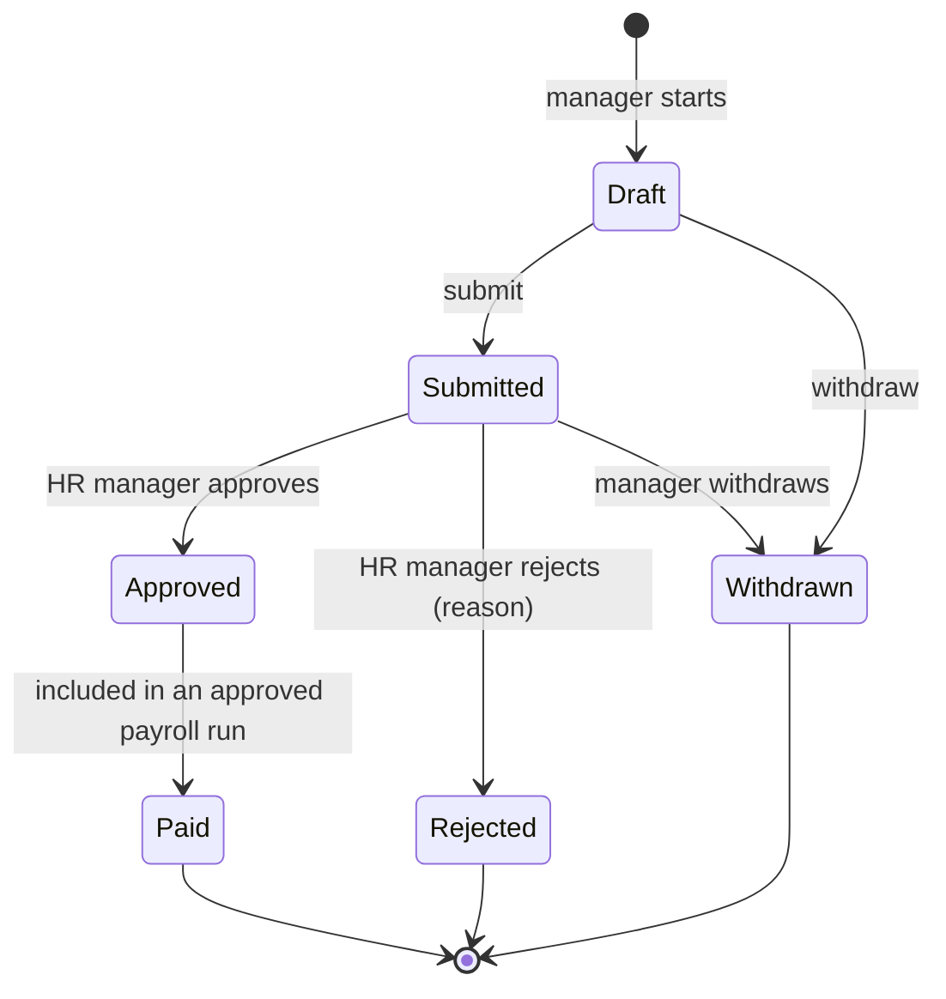

The 2023 case study had a short requirements list and one excellent habit: it asked the awkward
questions before designing anything. How many users? How much data? What do we know about the payment
system? The answers ("10", "25.5 GB" and "legacy C++, files only, once a month") shaped the whole design
more than any feature did. This post keeps those answers, expands the five functional bullets into
something a team can build and test, and marks where the case study stopped.

<!-- more -->



## Functional requirements
{: #functional-requirements }

The client gave five requirements: web based, CRUD on employees, manage salaries (manager asks, HR manager
approves or rejects), manage vacation days, and use the external payment system. Here they are broken
down, with an ID each so stories and tests can point at them:

| ID | Requirement | Source |
|---|---|---|
| FR-1 | Browser-based UI; nothing to install | Case study |
| FR-2 | HR can create, read, update and deactivate employees | Case study |
| FR-3 | HR can attach, list, download and remove scanned documents per employee | Case study (API table) |
| FR-4 | A manager can request a salary change for a direct report | Case study |
| FR-5 | The HR manager can approve or reject a salary request, with a reason | Case study |
| FR-6 | HR sets each employee's annual vacation entitlement | Case study |
| FR-7 | Employees request vacation; managers approve; balances update | Expanded (see below) |
| FR-8 | Once a month, approved pay data goes to the payment system as a file | Case study |
| FR-9 | HR can see whether this month's payroll file was delivered | New |
| FR-10 | Every change to salary, leave and personal data is audited | New |
| FR-11 | Employees can view (not edit) their own profile, leave and documents | New |

Two of these change the original design on purpose. The case study had employees "reduce vacation days"
directly; in practice that means anyone can book leave without their manager knowing, so **FR-7** adds a
request and approval step. And "delete employee" becomes **deactivate**, because HR records have legal
retention periods (see [retention](/posts/projects/dunderly/07-data-and-integration/#data-retention-and-deletion)).

## Non-functional requirements
{: #non-functional-requirements }

These are the case study's answers, kept exactly, plus the ones it didn't ask:

| Area | Requirement | Source |
|---|---|---|
| Concurrency | 10 concurrent users | Case study |
| Population | 250 employees today, 500 in five years | Case study |
| Data per employee | ~1 MB structured + ~10 scanned documents × ~5 MB = ~51 MB | Case study |
| Total data | 51 MB × 500 = ~25.5 GB, relational and unstructured | Case study |
| Criticality | Not mission critical | Case study |
| Integration | File-based, one file a month, legacy C++ system on-premises | Case study |
| Availability | 99.5% in business hours | Assumption A7 |
| Recovery | RTO one business day, RPO 15 minutes | Assumption A7 |
| Latency | p95 under 500 ms for API calls; first page load under 3 s | Assumption |
| Security | SSO with MFA; salary data visible only to HR roles and the line manager | Assumption |
| Retention | Personnel records kept for the legally required period after leaving | TODO |

"Not mission critical" needs a caveat. The *web app* isn't: if it's down for an afternoon, nobody's harmed.
The *payroll file* is: if it's late, 250 people aren't paid. So I treat the system as non-critical with one
time-critical job, and design the [payroll run](/posts/projects/dunderly/07-data-and-integration/#external-systems-and-third-party-integrations)
to be verified and alerted on, rather than making the whole platform highly available.

> **TODO:** What does "not very critical" mean in hours? Is a full business day of downtime acceptable
> outside payroll week? This confirms or changes assumption A7.
{: .prompt-warning }

## User journeys and use cases
{: #user-journeys-and-use-cases }

The journey that carries the most risk is the salary change, because it's the one that ends in money.
Tick the box to see a rejection instead:



The other core journeys, written as user stories:

- **Onboard an employee.** As an HR admin, I create the employee, set their manager, salary and leave
  entitlement, and upload their signed contract, so they're paid from the next run.
- **Book leave.** As an employee, I see my remaining days, request five days in August, and get a
  notification when my manager approves.
- **Approve leave.** As a manager, I see my team's requests and calendar, and approve or decline with a
  comment.
- **Close payroll.** As the payroll operator, I review the draft run, explain the variances, and send it
  for approval; as the HR manager, I approve it, and the file goes out.
- **Leaver.** As an HR admin, I set a leaving date; the employee is included in the final run, then
  deactivated, and their records start the retention clock.

## Acceptance criteria
{: #acceptance-criteria }

I'd write acceptance criteria as Given/When/Then for the risky rules and keep the rest short. For FR-4 and
FR-5:

```gherkin
Scenario: A manager can only request changes for direct reports
  Given Priya manages Sam and not Alex
  When Priya requests a salary change for Alex
  Then the request is refused with 403
  And an audit event "SalaryRequestForbidden" is recorded

Scenario: Approval creates an effective-dated salary
  Given a submitted request for Sam to 52,000 effective 1 March
  When the HR manager approves it
  Then Sam's salary history shows 52,000 from 1 March
  And the previous salary is still visible in history
  And the March payroll run includes 52,000 for Sam

Scenario: No changes into a closed period
  Given the February payroll run is approved
  When a manager requests a change effective 1 February
  Then the request is refused with "period closed"
```

Every FR in the table above gets at least one scenario like these before it's "ready" for a sprint
(see [Backlog structure](/posts/projects/dunderly/03-product-planning/#backlog-structure)).

## Business rules
{: #business-rules }

The salary request is a small state machine, and writing it down caught two rules the case study didn't
mention (withdrawal, and locking once paid):



The rules around it:

| Rule | Detail |
|---|---|
| BR-1 | Only the employee's current line manager (or HR) can raise a request |
| BR-2 | One open request per employee at a time |
| BR-3 | Effective date can't fall in a payroll period that's already approved |
| BR-4 | A requester can't approve their own request (four eyes) |
| BR-5 | Increases above a threshold are flagged for the HR manager |
| BR-6 | Leave balance can't go negative without HR override |
| BR-7 | Unpaid leave is passed to payroll as a deduction line |
| BR-8 | The payroll run is approved by someone other than the person who prepared it |

> **TODO:** What is the salary increase threshold that needs extra scrutiny (BR-5), and does Dunderly allow
> carrying unused vacation into the next year? If so, how many days?
{: .prompt-warning }

## Reporting and analytics requirements
{: #reporting-and-analytics-requirements }

HR at this size needs a handful of reports, not a BI platform:

- Headcount by department and month (joiners, leavers).
- Leave taken and remaining, per team.
- Salary changes in a period, with requester and approver.
- Payroll run history: totals, variances, delivery status.
- Audit extract for a given employee (also used for data subject access requests).

All of these run as SQL views behind API endpoints and export to CSV. I'd resist Power BI in v1: it adds
licensing, another place salary data lives, and another set of permissions to review. If HR asks for
dashboards after go-live, a read-only reporting replica or a Power BI dataset with row-level security is a
clean add-on (see [Product analytics](/posts/projects/dunderly/18-continuous-improvement/#product-analytics)).

## Accessibility and localization requirements
{: #accessibility-and-localization-requirements }

**Accessibility:** WCAG 2.2 level AA. An HR system is used by every employee, including people using
screen readers or keyboard-only navigation, and in many jurisdictions an employer's internal tools are
expected to be accessible. The details are in [Accessibility design](/posts/projects/dunderly/04-user-experience-and-design/#accessibility-design).

**Localization:** English only in v1.

> **Assumption:** One country, one currency, one language. Dates and numbers follow the browser locale.
{: .prompt-info }

> **TODO:** Does Dunderly employ people in more than one country? Multiple countries means multiple public
> holiday calendars, leave rules and possibly currencies, which changes the leave and payroll model.
{: .prompt-warning }

## Regulatory, legal, and compliance requirements
{: #regulatory-legal-and-compliance-requirements }

HR data is personal data, and salary, bank and health-related absence data are about as sensitive as an
ordinary company holds. Under assumption A2 (EU employees), GDPR applies:

- Lawful basis is the employment contract and legal obligation; no consent banners needed for core HR.
- Data subject rights: access and rectification must be supportable (the audit extract helps).
- Data minimisation: don't store what payroll or HR law doesn't need.
- Records of processing and, given the sensitivity, a DPIA before go-live.
- Data stays in the EU (West Europe and North Europe regions).

> **TODO:** Which national employment and record-keeping laws apply, and what are the retention periods for
> personnel files, payroll records and leave records? These set the
> [retention policy](/posts/projects/dunderly/07-data-and-integration/#data-retention-and-deletion).
{: .prompt-warning }

## Prioritization and release scope
{: #prioritization-and-release-scope }

I'd use MoSCoW, with the payroll path as a must because it's the reason the system exists:

| Must (MVP) | Should (MVP if time) | Could (later) | Won't (v1) |
|---|---|---|---|
| FR-1, 2, 3, 4, 5, 6, 8, 9, 10 | FR-7 leave approval, FR-11 self-service | Reports as dashboards, Teams notifications | Payroll calculation, recruitment, mobile app |

FR-7 is a "should" only because the case study's simpler version (HR sets days, employees reduce them) is
enough to launch; the approval step can follow a sprint later without migration pain, since both write to
the same leave ledger.

## Checklist
{: #checklist }

- [ ] Walk FR-1 to FR-11 with the HR manager and record changes.
- [ ] Confirm the NFR table, especially what "not very critical" means in hours.
- [ ] Get the salary-increase threshold and the vacation carry-over rule.
- [ ] Confirm countries, currencies and languages in scope.
- [ ] Get retention periods for personnel, payroll and leave records from legal.
- [ ] Write Given/When/Then for every "must" requirement.
- [ ] Agree the MoSCoW split with the sponsor.


