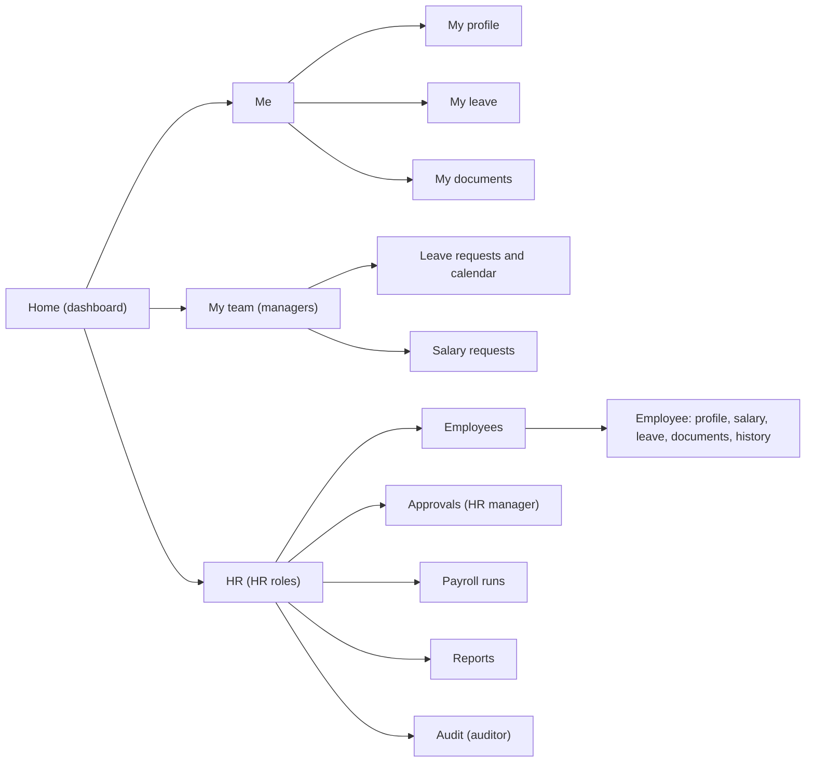

Most of Dunderly's 250 employees will open this app a few times a month, to check how many vacation days
they have left. A handful of HR people will live in it. The UX has to serve both without becoming two
products: an employee should never see a menu item they can't use, and the HR manager should never wonder
whether the payroll file actually left the building.

<!-- more -->



## Information architecture
{: #information-architecture }

The navigation is shaped by role. Everyone gets "Me"; managers add "My team"; HR roles add the HR
section. Items a role can't use are not rendered, rather than shown disabled.



The employee detail page is the hub for HR: one page with tabs (Profile, Salary, Leave, Documents,
History) rather than separate screens per service. That's the UX reason the original "Employee, Salary
and Vacation services" become modules of one API: the screen needs data from all three at once (see
[ADR-001](/posts/projects/dunderly/05-technical-architecture/#architectural-decision-records)).

## User flows
{: #user-flows }

Three flows matter most; the salary flow is animated in
[User journeys](/posts/projects/dunderly/02-requirements-gathering/#user-journeys-and-use-cases).

**Book leave (employee), target three clicks:** Home shows "14 days left" with a "Request leave" button →
pick dates on a calendar that already greys out public holidays and weekends, and shows the day count →
submit. The balance updates as "pending" immediately.

**Approve leave (manager):** the Home card "2 requests waiting" → a list with the team calendar beside it,
so the manager sees overlaps → approve or decline with an optional comment.

**Close payroll (payroll operator, HR manager):**

1. Payroll runs → "March 2027 (Draft)" → summary: headcount, gross total, change vs February.
2. Variance list: every employee whose pay moved more than the threshold, with the reason (salary
   change, unpaid leave, joiner, leaver).
3. "Send for approval". The HR manager gets the same view and an Approve button that's disabled for
   whoever prepared the run.
4. After approval, the run page shows a status strip: *Approved → File written → Picked up → Delivered*,
   with timestamps. This strip is the UX answer to FR-9.

## Wireframes and prototypes
{: #wireframes-and-prototypes }

Low fidelity first. Here's the employee home, as a sketch for the first review with HR:

```text
+-----------------------------------------------------------+
| Dunderly HR                       Sam Rivera  [Sign out]  |
+-----------+-----------------------------------------------+
| Home      |  Vacation                Next payday          |
| My profile|  +-----------------+     +-----------------+  |
| My leave  |  | 14 days left    |     | 28 March        |  |
| Documents |  | 3 pending       |     |                 |  |
|           |  | [Request leave] |     |                 |  |
|           |  +-----------------+     +-----------------+  |
|           |  Recent                                        |
|           |  - Leave 5-9 Aug approved by Priya             |
|           |  - Contract (PDF) added by HR                  |
+-----------+-----------------------------------------------+
```

Then a clickable prototype in Figma for the payroll and salary screens only, because those are the ones
where a misunderstanding costs money. I wouldn't prototype the employee CRUD screens: standard forms,
built straight in Blazor, reviewed in the PR preview environment
(see [CI/CD](/posts/projects/dunderly/12-cicd-and-release-management/#deployment-automation)).

> **TODO:** Does Dunderly have brand guidelines (logo, colours) for internal tools, or is a plain Microsoft
> Fluent look acceptable?
{: .prompt-warning }

## Visual design and design system
{: #visual-design-and-design-system }

**Decision: Microsoft Fluent UI Blazor components** (`Microsoft.FluentUI.AspNetCore.Components`).

- Staff already know the Fluent look from Microsoft 365, so the app feels familiar on day one.
- The components ship with keyboard support and ARIA roles, which does a lot of the accessibility work.
- Light and dark themes come for free, and a single accent colour can carry Dunderly's brand.

The rules on top: one primary action per screen; money is always shown with the currency and right
aligned in tables; status is a coloured badge *and* a word (never colour alone); destructive actions
(deactivate employee, reject request) ask for confirmation with the consequence spelled out.

## Interaction patterns
{: #interaction-patterns }

- **Forms validate as you type**, with the same rules the API enforces (shared validators, see
  [Input validation](/posts/projects/dunderly/06-security-and-privacy/#input-validation-and-secure-coding)).
  The server is still the authority.
- **Optimistic concurrency is visible.** If two HR admins edit the same employee, the second save gets
  "This record changed since you opened it" with the differences, not a silent overwrite.
- **Long lists page on the server** (employee list, audit log) with search and filters in the URL, so a
  filtered view can be bookmarked or shared with a colleague.
- **Toasts for success, inline messages for errors.** Errors stay on screen until fixed.
- **Every write shows who and when** ("Approved by Ana, 3 March 10:42"), because in HR the question after
  "what" is always "who".

## Responsive behavior
{: #responsive-behavior }

Desktop first for HR and payroll screens, which are table-heavy and used at a desk. Mobile-friendly for the
employee and manager screens: checking a balance, requesting leave and approving a request must work on a
phone browser, because managers in the warehouse or on the road won't be at a desk.

Breakpoints follow Fluent's defaults. On small screens the left navigation collapses into a menu, cards
stack, and tables turn into lists with the two most important columns.

No native app in v1. A phone browser with SSO covers the use cases; an installable PWA is a cheap later
step if usage shows demand.

## Accessibility design
{: #accessibility-design }

Target WCAG 2.2 AA (see [Requirements](/posts/projects/dunderly/02-requirements-gathering/#accessibility-and-localization-requirements)).
Designed in, not tested in at the end:

- All flows work by keyboard alone, with a visible focus ring and a "skip to content" link.
- Colour contrast at least 4.5:1 for text; status never relies on colour only.
- Form fields have labels, errors are linked to fields with `aria-describedby`, and the first error gets focus.
- The leave calendar has a list alternative, because date grids are hard with screen readers.
- Session timeout warns two minutes ahead and lets the user extend (WCAG 2.2.1).
- Target sizes at least 24 × 24 px (WCAG 2.5.8).

Testing is in [QA](/posts/projects/dunderly/10-quality-assurance/#accessibility-testing).

## Usability testing
{: #usability-testing }

Five users per round is enough to find most problems. I'd run two rounds:

| Round | When | Who | Tasks |
|---|---|---|---|
| 1 | Prototype, week 4 | 2 HR admins, the payroll operator, the HR manager, 1 manager | Approve a salary request; close a payroll run |
| 2 | Test environment, week 12 | 3 employees, 2 managers | Request leave; find a document; approve leave |

Each session is 30 minutes, task-based, think-aloud, recorded with consent. Success is "completed without
help". Anything that fails for two or more people goes into the next sprint.

## Content and messaging
{: #content-and-messaging }

Plain, specific, and never blaming the user. Some rules and examples:

| Instead of | Write |
|---|---|
| "Error 409" | "Someone else changed this record while you were editing. Review their changes, then save again." |
| "Invalid date" | "Choose a date after 1 April. March payroll is already closed." |
| "Request denied" | "Ana rejected this request: *Budget for this role is set until July.*" |
| "Upload failed" | "We couldn't accept this file. Upload a PDF, JPG or PNG under 10 MB." |

Salary amounts are never shown in notifications, emails or browser tab titles, only inside the app behind
sign-in. An email says "You have a salary request to review", not the number.

## Checklist
{: #checklist }

- [ ] Review the role-based navigation with HR and one manager.
- [ ] Prototype and test the payroll run and salary approval screens (round 1).
- [ ] Confirm brand guidelines or accept the Fluent default look.
- [ ] Write the error message catalogue for the top 20 validation rules.
- [ ] Check that no notification or email contains salary amounts.
- [ ] Verify the leave flow works on a phone browser.
- [ ] Run usability round 2 in the test environment.


