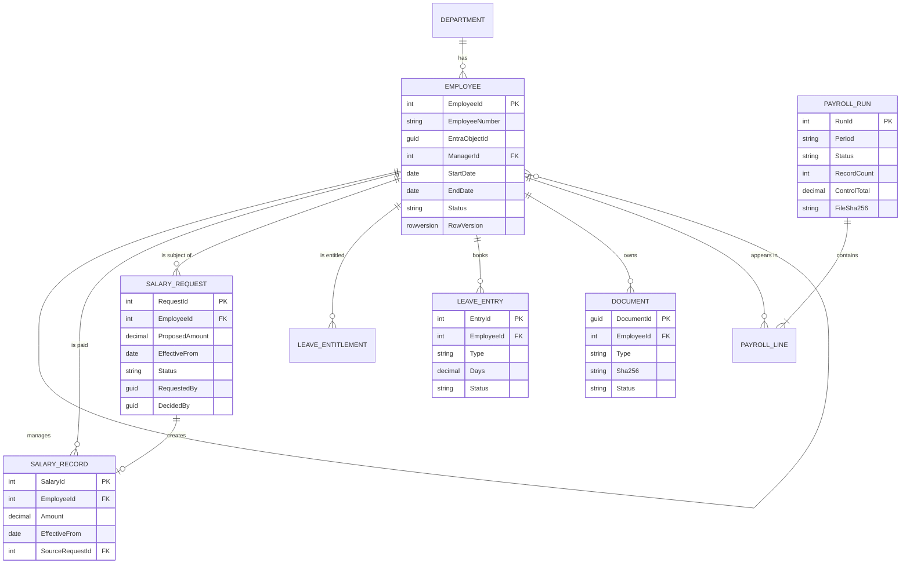

The 2023 design split Dunderly's HR system into six services: Employee, Salary, Vacation, View, Payment
Interface and Logging. Then it noticed that the data is shared between them and chose a single data store.
That second decision was right, and it quietly undoes the first. Three services sharing one database, for
ten concurrent users, is a distributed monolith with three times the deployment pipelines. This post keeps
what the case study got right, merges what it over-split, and records every change as an ADR.

<!-- more -->



## System context and component architecture
{: #system-context-and-component-architecture }

The target architecture, end to end, including the monthly trip to the server farm:



| Component | Azure service | Replaces (2023) | Responsibility |
|---|---|---|---|
| Web app | Static Web Apps (Standard), Blazor WebAssembly | View service | UI, served as static files |
| HR API | App Service (Linux, Premium v3), ASP.NET Core | Employee, Salary and Vacation services | All business logic, as modules |
| Payroll Functions | Azure Functions (Flex Consumption, .NET isolated) | Payment interface (WebJob) | Draft runs, write files, receipts, document promotion, outbox |
| Relational store | Azure SQL Database (serverless) | Same | Employees, salaries, leave, payroll, audit |
| Documents | Blob Storage (GRS) | Storage Account | Scanned contracts and reviews |
| Payroll outbound | A second storage account | (new) | Payroll files, manifests, receipts |
| Identity | Microsoft Entra ID | (not in 2023) | SSO, MFA, app roles |
| Secrets | Key Vault | (not in 2023) | The few secrets left; keys |
| Observability | Application Insights + Log Analytics | Logging service | Traces, logs, metrics, alerts |
| Pickup agent | Scheduled task on an Azure Arc-enabled server | (new) | Pulls the file into the payment system |

Inside the API, the old services survive as **modules** with their own folders, their own EF Core
`DbContext` configuration and schema (`employees`, `salary`, `leave`, `payroll`, `audit`), and no
cross-module table access except through a module's public interface. If one ever needs to scale or ship
separately, it can be lifted out. At 10 concurrent users, I don't expect that day to come.

## Technology and framework selection
{: #technology-and-framework-selection }

The client asked for Azure and .NET. Within that:

| Choice | Why | Trade-off |
|---|---|---|
| .NET 10 (LTS) | Long-term support through the system's first years | Upgrade to the next LTS every two to three years |
| ASP.NET Core minimal APIs, grouped per module | Small surface, fast, OpenAPI out of the box | Less structure than controllers; we add it with module conventions |
| EF Core with migrations | Team knows it; migration bundles fit the pipeline | Must watch for N+1 queries; raw SQL for reports |
| Blazor WebAssembly | One language and shared validation code with the API | Larger first download than a JS SPA; fine on office networks |
| Fluent UI Blazor | Matches Microsoft 365; accessible components | Ties the look to Fluent |
| Azure Functions, isolated worker | Timer, queue and Event Grid triggers for monthly and event-driven jobs | A second deployable |
| Bicep with Azure Verified Modules | Azure-only estate, no state file to manage | Not multi-cloud; Terraform would be equally valid |
| GitHub Actions | Code, issues and pipeline in one place, OIDC to Azure | If Dunderly standardizes on Azure DevOps, pipelines move |

The case study rejected Azure Functions for the payment interface as "designed for lightweight actions".
I'd turn that around: a monthly export of 250 to 500 rows is about as light as a job gets. What makes it
*important* isn't its weight, it's that it must be verified, which the design below handles.

## API and integration architecture
{: #api-and-integration-architecture }

REST over HTTPS with JSON, versioned in the path (`/api/v1`), described by OpenAPI. The case study's API
tables are kept, with three fixes: one plural resource name everywhere (2023 mixed `employee` and
`employees`), `DELETE` on employees becomes deactivation, and approvals return the updated resource.

| Functionality | Path | Return codes |
|---|---|---|
| Get employee by ID | `GET /api/v1/employees/{id}` | 200 / 404 |
| List employees by parameters | `GET /api/v1/employees?name=…&department=…&page=1&pageSize=50` | 200 / 400 |
| Add employee | `POST /api/v1/employees` | 201 / 400 |
| Update employee | `PUT /api/v1/employees/{id}` with `If-Match` | 200 / 400 / 404 / 412 |
| Deactivate employee | `POST /api/v1/employees/{id}/deactivation` | 200 / 404 / 409 |
| Add document | `POST /api/v1/employees/{id}/documents` | 202 (pending scan) / 400 / 404 |
| List documents | `GET /api/v1/employees/{id}/documents` | 200 / 404 |
| Get document | `GET /api/v1/employees/{id}/documents/{docId}` | 200 / 404 / 409 (not scanned yet) |
| Remove document | `DELETE /api/v1/employees/{id}/documents/{docId}` | 204 / 404 |
| Add salary request | `POST /api/v1/salary-requests` | 201 / 400 / 403 |
| Get salary requests | `GET /api/v1/salary-requests?status=Submitted` | 200 |
| Withdraw salary request | `POST /api/v1/salary-requests/{id}/withdrawal` | 200 / 404 / 409 |
| Approve salary request | `POST /api/v1/salary-requests/{id}/approval` | 200 / 403 / 404 / 409 |
| Reject salary request | `POST /api/v1/salary-requests/{id}/rejection` (reason required) | 200 / 400 / 403 / 404 / 409 |
| Set vacation entitlement | `PUT /api/v1/employees/{id}/leave/entitlements/{year}` | 200 / 404 |
| Get vacation balance | `GET /api/v1/employees/{id}/leave/balance` | 200 / 404 |
| Request leave | `POST /api/v1/leave-requests` | 201 / 400 / 409 |
| Payroll runs | `GET/POST /api/v1/payroll-runs`, `POST …/{id}/approval` | 200 / 201 / 403 / 409 |

Errors use RFC 9457 problem details. Lists are paged. Writes that matter carry `If-Match` with the row
version, so two HR admins can't overwrite each other (412). The integration with the payment system is
*not* an API at all, it's a file; see
[External systems](/posts/projects/dunderly/07-data-and-integration/#external-systems-and-third-party-integrations).

## Data architecture and data models
{: #data-architecture-and-data-models }

One Azure SQL database, one schema per module; documents in Blob Storage with metadata in SQL. This is the
case study's "single data store", made explicit:



Three modelling choices do most of the work:

- **Salaries are effective-dated rows, never updated in place.** "What was Sam paid in March?" is a query,
  not an archaeology project. `EMPLOYEE` and `SALARY_RECORD` are also SQL **temporal tables**, so every
  change keeps its previous version automatically.
- **Leave is a ledger.** Entitlements add days; bookings subtract them; adjustments are their own entries.
  The balance is a sum, and every number can be explained.
- **Payroll runs are snapshots.** A run copies the figures it pays into `PAYROLL_LINE`, so later edits
  can't change a file that's already gone.

Sizing from the case study: about 1 MB of structured data per employee, so SQL stays under 1 GB for years;
the ~25 GB is documents, which is why they live in Blob Storage and not in the database.

## Identity and access architecture
{: #identity-and-access-architecture }

> **Assumption:** Dunderly uses Microsoft 365 (assumption A5), so every employee already has an Entra ID
> account and MFA can be enforced with Conditional Access.
{: .prompt-info }

- **Two app registrations:** `dunderly-hr-web` (single-page app, MSAL, PKCE) and `dunderly-hr-api` (exposes
  the `HR.Access` scope and defines app roles).
- **App roles** assigned to Entra groups: `Employee` (everyone), `Manager`, `HR.Admin`, `HR.Manager`,
  `Payroll.Operator`, `Auditor`.
- **Two layers of authorization.** The role says what *kind* of thing you can do; the data says *to whom*.
  A `Manager` can raise salary requests, but only for employees whose `ManagerId` is them, checked in the
  API on every call. The reporting line lives in the HR database, which is the source of truth for it.
- **Workloads have no passwords.** The API and the Functions use managed identities for SQL (Entra-only
  authentication), Blob, queues and Key Vault. The on-premises pickup agent uses an **Azure Arc** managed
  identity, so even it has no stored secret.
- **Admin access to Azure** goes through PIM for just-in-time elevation.

More in [Authentication and authorization](/posts/projects/dunderly/06-security-and-privacy/#authentication-and-authorization)
and the Entra posts on [app registrations](/posts/iam/entraid/application-registrations-and-enterprise-apps/)
and [modern authentication](/posts/iam/entraid/modern-authentication/).

## Hosting and deployment model
{: #hosting-and-deployment-model }

Everything PaaS, one region, private data plane:

| Resource | SKU / plan | Notes |
|---|---|---|
| Static Web Apps | Standard | Custom domain, PR preview environments |
| App Service plan | Linux Premium v3 (P0v3), 1 to 2 instances | Deployment slots, VNet integration |
| Functions app | Flex Consumption | VNet integration, scales to zero between jobs |
| Azure SQL | General Purpose serverless, max 2 vCores | Auto-pause off in prod, on in dev/test |
| Storage (documents) | StorageV2, GRS | Versioning, soft delete, Defender malware scanning |
| Storage (payroll) | StorageV2, GRS | Immutability policy on files and receipts |
| Key Vault | Standard, RBAC mode | Private endpoint |
| Log Analytics + App Insights | Pay as you go | Workspace-based |

> **Assumption:** West Europe as the primary region (as in the 2023 estimate), with North Europe for
> disaster recovery (assumption A1).
{: .prompt-info }

The VNet has two subnets: one delegated for App Service and Functions VNet integration, one for private
endpoints (SQL, both storage accounts, Key Vault). Public network access is disabled on SQL and Key Vault.
The payroll storage account also allows the server farm's egress IP, unless a VPN exists (see
[Network security](/posts/projects/dunderly/06-security-and-privacy/#network-security)). Environments are
covered in [Infrastructure](/posts/projects/dunderly/11-infrastructure-and-environments/).

## Scalability and performance strategy
{: #scalability-and-performance-strategy }

The honest answer is that scale isn't the problem. Ten concurrent users and 500 employees will barely
register on a P0v3 and a serverless database. The strategy is about not wasting money and not being slow:

- **Autoscale 1 to 2 instances** on CPU above 70%, mainly for resilience during platform maintenance.
  The 2023 design used autoscale on each of three App Services; one plan does the same job.
- **SQL serverless** scales vCores with load and bills per second; max 2 vCores covers month-end reporting.
- **Documents never pass through the database.** Downloads stream from Blob through the API (5 MB files,
  so a SAS URL isn't needed and every download is authorized and audited).
- **Cache reference data** (departments, leave types, public holidays) in memory for minutes.
- **Paging everywhere**, and an index on every foreign key and on `(EmployeeId, EffectiveFrom)`.

What would change at 10× (5,000 employees, 100 concurrent users)? Probably only SKUs. The first real
change would be a read replica for reports.

## Resilience and disaster recovery
{: #resilience-and-disaster-recovery }

"Not mission critical", with one time-critical job, gives this shape:

| Failure | Effect | Response |
|---|---|---|
| API instance restarts | Seconds of errors | Second instance during scale-out; client retries idempotent reads |
| SQL transient faults | Failed requests | EF Core retry on failure (connection resiliency) |
| Payroll Function fails mid-file | No file | Queue retry; file write is idempotent by run ID |
| Pickup agent offline | File not delivered | Missing-receipt alert days before payday |
| Region outage | System down | Restore in North Europe within RTO |

> **Assumption:** RTO one business day, RPO 15 minutes (assumption A7).
{: .prompt-info }

**DR plan:** Azure SQL geo-restore from geo-redundant backups (RPO typically under an hour) or, if 15
minutes is firm, an auto-failover group with a serverless secondary; documents and payroll storage are
GRS; Bicep redeploys the compute in North Europe; DNS for the custom domains points at the new endpoints.
No warm standby: for this RTO it would double the cost for little benefit.

> **TODO:** Is a 15-minute RPO firm? Geo-restore alone gives roughly an hour of possible data loss; a
> failover group gives seconds but adds a second database's cost.
{: .prompt-warning }

## Architectural decision records
{: #architectural-decision-records }

Each ADR lives in `docs/adr/` in the repo. Here's the summary, with what changed from the 2023 case study:

| ADR | Decision | 2023 design | Why it changed |
|---|---|---|---|
| ADR-001 | One API, modular monolith | Three App Services (Employee, Salary, Vacation) | Shared data, one UI page needs all three, 10 users; three deployables triple the work for no gain |
| ADR-002 | Blazor WebAssembly on Static Web Apps | Static Web Apps for the View service | Kept; Blazor shares validation code with the API |
| ADR-003 | Azure Functions for background and monthly jobs | App Service WebJob | WebJobs have no built-in redundancy (the case study noted it) and tie jobs to the API's deployment; Functions give queue retries and Event Grid triggers |
| ADR-004 | No Application Gateway WAF in v1 | App Gateway WAF v2 (~$352/month) | 41% of the 2023 cost to protect an internal app with SSO and MFA; revisit if exposure grows |
| ADR-005 | Private endpoints and managed identities | Firewall rules on App Service outbound IPs | Outbound IPs are shared and can change; identity is a stronger boundary than an IP |
| ADR-006 | Application Insights with OpenTelemetry | A custom logging service fed by a queue | The SDK already batches asynchronously; a logging service is code we'd have to run |
| ADR-007 | Pull-based payroll file with manifest and receipt | WebJob sends a file to the payment system | No inbound path into the server farm; delivery is verified, not assumed |
| ADR-008 | Azure SQL serverless with temporal tables | SQL GP provisioned, 3-year reserved | Pays for actual use; temporal tables give history for audit |
| ADR-009 | Bicep with Azure Verified Modules | Portal configuration | Repeatable environments and DR |

An ADR stub, as the team would write it:

```markdown
# ADR-004: No Application Gateway WAF in v1
Status: Accepted (2026-10)
Context: 2023 design put App Gateway WAF v2 in front of three APIs, $352.15/month (41.5% of total).
  Users are ~250 staff signing in with Entra ID, MFA and Conditional Access.
Decision: No WAF in v1. Rely on Entra ID, JWT validation, rate limiting, input validation, and
  Defender for Cloud recommendations.
Consequences: Lower cost; no OWASP rule set in front of the API.
Revisit when: the app is exposed to non-employees, a pen test finds an issue a WAF would block,
  or a regulator or insurer requires it. Front Door Premium with WAF is the likely choice then.
```

## Checklist
{: #checklist }

- [ ] Review ADR-001 to ADR-009 with the client and record acceptance.
- [ ] Confirm Microsoft 365 / Entra ID tenant and Conditional Access licensing.
- [ ] Confirm region choice (assumption A1) and the RPO question.
- [ ] Publish the OpenAPI document from the walking skeleton.
- [ ] Agree module boundaries and schema names before the first migration.
- [ ] Confirm the server farm can reach Azure Storage on HTTPS 443.
- [ ] Re-price the hosting table (see [Budget](/posts/projects/dunderly/03-product-planning/#budget-and-resource-planning)).


