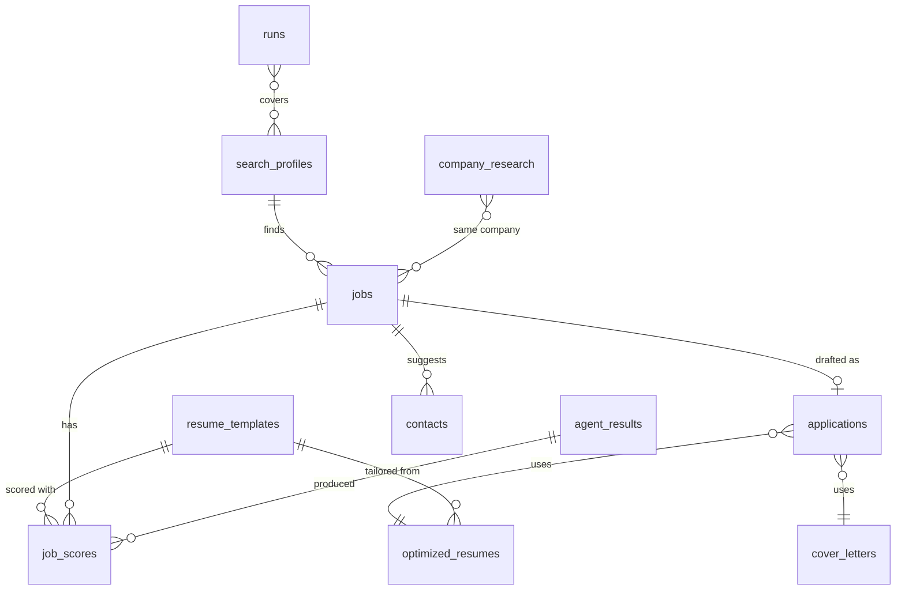

The architecture fits in one pod because the hard parts aren't scale. They're trust (an LLM that wants to
please will invent experience), a website that doesn't want to be automated, and a local model that's
slower than a cloud API. So the design spends its complexity on deterministic checks and careful
integration, and keeps the runtime simple: one process, one sidecar, one database.

<!-- more -->



## System context and component architecture
{: #system-context-and-component-architecture }

Step through one scheduled run for one search profile:



| Component | What it is | Runs where |
|---|---|---|
| Job Hunter app | FastAPI service: API, review UI (static HTML/JS), pipeline, agents, scheduler | `app` container, port 8000 |
| LinkedIn MCP server | `mcp-server-linkedin`: a Chromium browser signed in as me, exposed as MCP tools | `linkedin` sidecar, loopback 8080 only |
| LiteLLM gateway | OpenAI-compatible gateway in front of the local model `qwen3.5-35b-a3b` | Homelab `ai` cluster |
| Supabase | Postgres with a REST API, free tier | Supabase cloud |
| Keycloak | OIDC provider, realm `homelab` | Homelab `core` cluster |
| Wikidata, Google News | Public company facts and headlines | Internet |
| Slack | Run reports through an incoming webhook | Slack |

Inside the app, the pieces are deliberately few: `pipeline.py` (discover, score, draft, evaluate one job,
status transitions), `agents/` (one base class, six agents), `truthfulness.py`, `sources.py` (LinkedIn,
Indeed, company intel), `company_facts.py`, `scheduler.py`, `runs.py` (history), `notify.py` (Slack) and
`db/` (Supabase and an in-memory store with the same interface).

## Technology and framework selection
{: #technology-and-framework-selection }

| Choice | Why | Alternative I passed on |
|---|---|---|
| Python + FastAPI | Async I/O for slow LLM and browser calls; Pydantic models double as the LLM's JSON schemas | Node: fewer good PDF/DOCX libraries |
| Pydantic v2 | One model per agent output; validation catches malformed LLM answers before they're stored | Hand-written JSON parsing |
| OpenAI SDK against LiteLLM | Any OpenAI-compatible backend; structured output with `json_schema` | A provider-specific SDK |
| Local `qwen3.5-35b-a3b` | My resume stays home; free to run | A frontier cloud model: better prose, but my data leaves the house |
| `mcp-server-linkedin` | Maintained, read-only tools, real signed-in browser | Writing my own Playwright scraper |
| Supabase | The articles used it; Postgres + REST + row-level security on a free tier | SQLite in a PVC: simpler, but no off-cluster copy |
| Vanilla JS UI | No build step, ~800 lines, served by FastAPI | React: more structure than one user needs |
| APScheduler | In-process cron, one job per profile | A Kubernetes CronJob per profile: needs the sidecar's browser session |

## API and integration architecture
{: #api-and-integration-architecture }

A REST API under the same origin as the UI (OpenAPI at `/docs`). The groups:

| Group | Main endpoints |
|---|---|
| Profiles and resumes | `GET/POST /profiles`, `PUT/DELETE /profiles/{id}`, `POST /resumes/upload`, `PUT /resumes/{id}` |
| Jobs | `GET /jobs` (with each job's evaluation), `POST /jobs`, `POST /jobs/{id}/evaluate` |
| Pipeline | `POST /pipeline/discover?profile_id=`, `POST /pipeline/draft`, `POST /pipeline/run`, `GET /runs`, `GET /stats`, `GET /schedule` |
| Review | `GET /applications`, `GET /applications/{id}`, `POST /applications/{id}/approve` (and `reject`, `reopen`, `applied`) |
| Research | `GET /research`, `POST /research/{id}/refresh` |

Integrations, each behind a small interface so tests can swap in fakes:

- **LinkedIn**: MCP over streamable HTTP; the client refuses any tool not on a read-only list.
- **LLM**: one `structured(system, user, schema)` call; JSON schema output, thinking disabled, one repair
  retry when validation fails.
- **Company facts**: Wikidata `wbsearchentities` / `wbgetentities`, Google News RSS.
- **Slack**: a POST of `{"text": …}` to an incoming webhook.

## Data architecture and data models
{: #data-architecture-and-data-models }

Every row carries `user_id`, `created_at` and `updated_at`. The core of the model:

Two stores I'd call out: `agent_results` keeps every LLM call's input, output and error (the audit
trail for "why did it write that?"), and `company_research` is a per-company cache keyed by the
lower-cased company name. More in [Data and Integration](/posts/projects/job-hunter-agent/07-data-and-integration/#database-schema-and-migrations).

## Identity and access architecture
{: #identity-and-access-architecture }

- **People:** Keycloak OIDC, authorization code flow with PKCE and a confidential client. The app
  validates the ID token, then checks membership of `platform-admins` itself, so a misconfigured client
  still can't let others in. The session is a signed `jh_session` cookie, 8 hours, `SameSite=Lax`,
  `Secure`.
- **App to services:** a LiteLLM virtual key limited to one model; a Supabase service-role key (server
  only, bypasses row-level security); a Slack webhook URL. All from OpenBao through External Secrets.
- **App to LinkedIn:** my own signed-in browser session, stored on a persistent volume. It's the most
  sensitive credential here, and it never leaves the pod.

## Hosting and deployment model
{: #hosting-and-deployment-model }

One Argo CD application on the homelab `platform` k3d cluster, namespace `job-hunter`:

| Object | Notes |
|---|---|
| Deployment | 1 replica, `Recreate` (single writer of the browser profile); `app` + `linkedin` containers; an init container prepares the browser's home folder |
| PVC `linkedin` | 2 GiB, holds the LinkedIn browser profile; backed up by Velero |
| Service + Ingress | `jobs.platform.home.cloudutsuk.com`, Traefik, Let's Encrypt via cert-manager DNS-01 |
| NetworkPolicy | Ingress only from Traefik, only port 8000; the sidecar has no Service port |
| ExternalSecret | `kv/platform/job-hunter` → env vars |

The image is built by the platform's reusable workflow, signed with cosign and pinned by digest; Kyverno
refuses unsigned or unpinned images. Details in
[CI/CD](/posts/projects/job-hunter-agent/12-cicd-and-release-management/#build-automation).

## Scalability and performance strategy
{: #scalability-and-performance-strategy }

Scale isn't the goal; LinkedIn's patience is the ceiling. The numbers that matter:

- At most 5 postings per keyword per run, past week only, sorted by date.
- One run per profile per weekday, profiles 4 hours apart, and a lock so two scheduled runs never share
  the browser.
- Each draft costs about five LLM calls (score, tailor, re-score, letter, contacts) plus research once per
  company. With a local model that's minutes per job, which is fine unattended.
- Resume tailoring returns **line edits**, not a rewritten resume: rewriting a 28,000-character resume
  timed out at 180 s; edits finish well inside the 300 s timeout.

Horizontal scaling isn't possible as built (one browser session, an in-process scheduler) and isn't needed.

## Resilience and disaster recovery
{: #resilience-and-disaster-recovery }

| Failure | Behaviour |
|---|---|
| LinkedIn errors or blocks | That keyword's error is recorded; other keywords and profiles continue |
| LLM times out or returns junk | One repair retry; then that job is listed under `failed` and the run goes on |
| Company research, facts, news, contacts or apply-link fail | Recorded as warnings; the draft still completes |
| Slack is down | Logged; the run is unaffected |
| Pod restarts | Browser session survives on the PVC; the scheduler's jobs live in memory, so a run whose time passed while the pod was down is skipped until the next slot |
| Supabase unavailable | Runs and the UI fail visibly; nothing is lost that isn't regenerable |

Recovery is mostly re-running: postings and drafts can be regenerated. What can't be regenerated is my
review history and the LinkedIn session. See [Backup and restore](/posts/projects/job-hunter-agent/07-data-and-integration/#backup-and-restore-strategy).

## Architectural decision records
{: #architectural-decision-records }

The decisions live as MADR files in `job-hunter-agent/docs/adr` and are published in full on the
[Architecture Decision Records](/posts/projects/job-hunter-agent/architecture-decision-records/) page:

| # | Decision | Status |
|---|---|---|
| 1 | Manual approval only; the agent never submits, connects or messages | Accepted |
| 2 | Local LLM through LiteLLM instead of a cloud API | Accepted |
| 3 | Resume tailoring as line edits applied by code, not a regenerated resume | Accepted |
| 4 | Deterministic truthfulness checks block approval | Accepted |
| 5 | LinkedIn through an MCP sidecar with a read-only tool allow-list | Accepted |
| 6 | Company figures only from published sources (Wikidata), never the model | Accepted |
| 7 | One scheduled job per profile, spread through the day | Accepted |
| 8 | Six-month retention, and our own nightly export because the Supabase free plan has no backups | Accepted |
| 9 | Service level objectives for scheduled runs, and alerts on the platform | Accepted |



## Checklist
{: #checklist }

- [ ] System diagram matches the deployed pod (containers, ports, volumes)
- [ ] Every external integration has a fake used in tests
- [ ] Read-only tool allow-list reviewed when the MCP server is upgraded
- [ ] LinkedIn volume limits written down next to the scheduler settings
- [ ] Backup covers the browser session and Supabase data
- [ ] The seven decisions above written as ADRs


