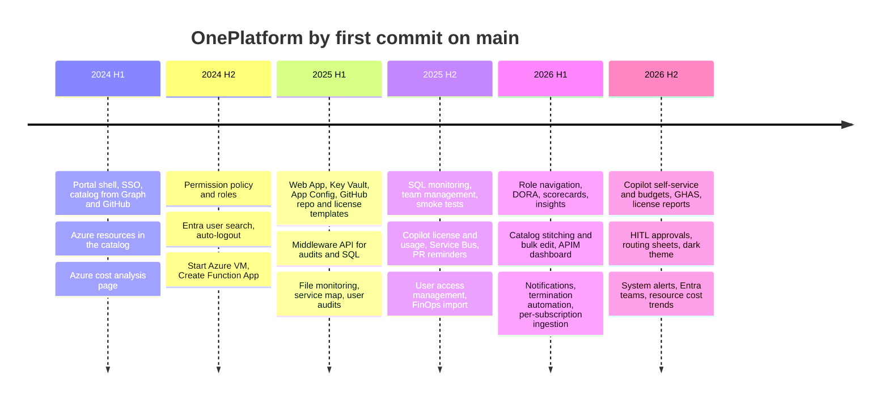

OnePlatform never had a big-bang launch. It began with an Azure resource catalog and a cost page in 2024 and grew one painful ticket type at a time, to 80 features and 45+ templates by late 2026. This post covers that roadmap, the full feature catalog, and how we decide what comes next.

<!-- more -->



## Product roadmap
{: #product-roadmap }

The roadmap, reconstructed from when each capability first landed on main. Each phase answered the loudest complaint of the time.

What's next is in [Roadmap refinement](/posts/projects/oneplatform/18-continuous-improvement/#roadmap-refinement).

## Feature catalog
{: #feature-catalog }

Every feature added on top of stock Backstage, grouped by what it's for. The data lives in one YAML file, and each entry has empty lifecycle fields: requirements, design, implementation, testing and benefits. I'll fill those in feature by feature, each as its own deep-dive, starting with the ones that have full planning docs.



## MVP definition
{: #mvp-definition }

Looking back, the MVP was smaller than people remember:

- Entra SSO plus the standard catalog, TechDocs and search
- Users and groups from Microsoft Graph, components from `catalog-info.yaml` across the GitHub organizations
- Azure resources ingested as catalog entities, so ownership questions had one answer
- A cost analysis page

No self-service actions at all. That was deliberate. A portal that only *shows* things is low-risk, and it let us learn how people searched and what they asked for before giving it rights to change anything. The first write action, Start Azure VM, arrived about ten months after the repo started, together with the permission policy that gates it.

If I were starting again I'd keep that order. A template that creates infrastructure, without a role model and environment scoping behind it, is a security incident waiting to happen.

## Release milestones
{: #release-milestones }

| Milestone | What it meant | Approx. date |
|---|---|---|
| M1 Catalog live | Read-only portal, SSO, Azure resources visible | 2024 H1 |
| M2 First self-service | Permission policy plus Start VM and Create Function App | 2024 Q4 |
| M3 Access self-service | Key Vault, App Config, GitHub repo, license and access templates | 2025 H1 |
| M4 Middleware | .NET API for audits, SQL and file monitoring; operational dashboards | 2025 H1 |
| M5 Compliance workflows | User audits, team and user management, Copilot approvals | 2025 H2 |
| M6 Insights and admin | DORA, scorecards, FinOps, role navigation, notifications | 2026 H1 |
| M7 Self-service maturity | Copilot budgets, HITL approvals, system alerts, cost on entity pages | 2026 H2 |

Dates are first-commit months. Production release dates aren't recorded in the repos.

> **TODO:** Were M1 to M7 announced as releases to users? If there were launch dates or announcements, add them here.
{: .prompt-warning }

## Backlog structure
{: #backlog-structure }

The backlog lives in Jira. Every feature folder in the repo is named after its ticket, and the commit and PR titles carry the same key, so code, docs and ticket link up. Work that started without a ticket is still tracked: its folder is prefixed `No-Ticket_`.

The structure that works for a portal:

- **Epic per capability area** (catalog, self-service infra, access, operations, compliance, insights, FinOps, portal admin, developer experience): the same categories as the feature catalog above.
- **Story per user-visible change**, with a PLAN for anything beyond a two-file fix.
- **Chores** for upgrades, Dependabot groups and Sonar findings, kept visible so they aren't starved.

## Prioritization approach
{: #prioritization-approach }

We weigh three things, roughly in this order:

1. **Risk removed.** Anything that cuts standing elevated access or produces audit evidence goes first (the Key Vault redesign, termination automation).
2. **Tickets removed.** Volume times turnaround. A template that replaces 30 tickets a month beats a dashboard nobody asked for.
3. **Reuse.** A feature that extends an existing plugin, like adding a column to Copilot usage, is cheap. The build-decision guide pushes hard on "extend, don't add a plugin".

> **TODO:** Is there a formal scoring model (RICE, WSJF) or a regular prioritization meeting with stakeholders? Describe it here if so.
{: .prompt-warning }

## Budget and resource planning
{: #budget-and-resource-planning }

The visible costs are modest: AKS capacity for two portal replicas and one middleware API pod per environment, a PostgreSQL server, Function Apps, Application Insights, and seats for GitHub Apps and SonarQube. The real cost is people.

> **TODO:** Team size and budget. The git history shows a core of a few frequent contributors plus occasional contributors from other teams, but I won't put a number here without your confirmation. How many engineers work on the portal, and is it funded as a product or as a shared service?
{: .prompt-warning }

## Risk and dependency management
{: #risk-and-dependency-management }

| Risk | Mitigation in place |
|---|---|
| Backstage upgrades break custom plugins | Pre-upgrade compatibility workflow (unit, integration, PostgreSQL matrix, E2E, image check) |
| Upstream API retirement (e.g. GitHub's old Copilot metrics API) | Tracked as its own work item with a migration plan |
| Catalog ingestion overloads the database | Per-subscription providers with staggered schedules |
| A service principal or GitHub App credential expires | Secrets in Key Vault; health checks on dependencies |
| Too few people know a plugin | Per-feature ARCHITECTURE docs and an onboarding path |
| Template changes production by mistake | Environment scoping; prod-capable templates limited by role |

## Change-control process
{: #change-control-process }

Two paths, chosen by size. The repository prompts encode the split:

- **Small change** (two files or fewer, no new API, route, permission or component): a `CHANGES.md` or none, one PR, review, merge.
- **Moderate change:** a PLAN in the feature folder, phased implementation, review.
- **New feature or plugin:** the full set (PLAN, DESIGN, IMPLEMENTATION checklist, ARCHITECTURE). Review happens at the plan stage as well as at the PR.

Production changes then go through the promotion workflow with a GitHub environment approval ([CI/CD](/posts/projects/oneplatform/12-cicd-and-release-management/#approval-gates)).

## Checklist
{: #checklist }

- [ ] Every feature in the catalog has a category, kind, first-commit month and status
- [ ] Features with full planning docs are scheduled first for lifecycle deep-dives
- [ ] Production release dates recorded for M1 to M7
- [ ] Prioritization model written down and shared with stakeholders
- [ ] Team size and funding model confirmed
- [ ] Platform chores have a fixed share of each sprint
- [ ] Change-control size thresholds documented in the contributing guide


