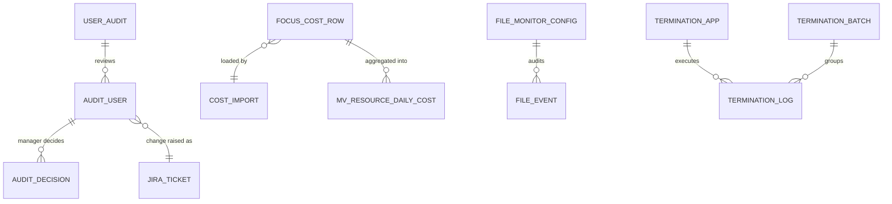

OnePlatform is two systems that look like one. The Backstage portal, TypeScript on Node, owns identity, permissions, the catalog and every template. A .NET 10 middleware owns the data-heavy and scheduled work: audits, FinOps, file and SQL monitoring, terminations. The decision that shaped everything else was keeping that line clean. This post covers both sides and the decisions behind them.

<!-- more -->



## System context and component architecture
{: #system-context-and-component-architecture }

Step through one request, from sign-in to the scheduled jobs:



The deployable units:

| Unit | Tech | Runs as | Responsibility |
|---|---|---|---|
| Portal frontend | React 18, Backstage new frontend system, MUI | Served by the portal backend | Pages, template forms (40+ custom field extensions), dashboards |
| Portal backend | Node 24, Backstage new backend system | AKS deployment, 2 replicas | Auth, permission policy, catalog, scaffolder with ~50 custom actions, ~45 custom plugins and modules |
| Middleware API | ASP.NET Core on .NET 10 | AKS deployment via Helm | REST APIs for audits, FinOps, file and SQL monitoring, terminations, scorecards, routing sheets |
| Middleware Functions | Azure Functions v4 | Function App | Timer jobs (FOCUS import, inactivity scan, State of DevOps, sprint predictability) and HTTP validation |
| PostgreSQL 16 | PostgreSQL server provisioned by the infrastructure Terraform repo | Shared server, TLS required | Portal plugin databases and middleware schemas |

Inside the portal the code is a Yarn workspace: `packages/app`, `packages/backend`, shared packages, and a `plugins/` folder with a frontend and a backend plugin per feature area (`github` and `github-backend`, `catalog-stitching` and `catalog-stitching-backend`, and so on). Self-service templates live in `services/`, grouped by domain.

## Technology and framework selection
{: #technology-and-framework-selection }

**Backstage** because the catalog, scaffolder, TechDocs and permission framework are the parts we'd otherwise build badly ourselves, and its plugin model lets us add the rest. The trade-off is upgrade work: Backstage ships roughly monthly, and staying current is a standing cost ([Support](/posts/projects/oneplatform/16-support-and-maintenance/#patch-and-upgrade-management)). For background on the framework, see [Backstage architecture](/posts/platform%20engineering/backstage/backstage-architecture/).

**A separate .NET middleware** because several features are data pipelines, not portal features: FOCUS cost files, SQL Server Agent history across servers, multi-application terminations with dynamic SQL connections. .NET with EF Core and Azure Functions suited that work. Keeping it separate means a large import (the middleware accepts payloads up to 1 GB) never shares a process with the portal UI.

**PostgreSQL** for both, because Backstage needs it anyway and one engine is cheaper to run, back up and secure than two.

| Layer | Choice | Pinned in the repo |
|---|---|---|
| Framework | Backstage, new backend and frontend systems | `backstage.json` |
| Runtime | Node 24, `node:24-trixie-slim` image | `package.json`, Dockerfile |
| UI | React 18, MUI 5, MUI X DataGrid, Chart.js, Recharts | app `package.json` |
| Language | TypeScript 5.x | root `package.json` |
| Middleware | .NET 10, ASP.NET Core, Azure Functions v4, EF Core | `global.json`, `Directory.Packages.props` |
| Package managers | Yarn 4 via Corepack; NuGet central package management | |

## API and integration architecture
{: #api-and-integration-architecture }

Three rules:

1. **The browser talks only to the portal backend.** Each frontend plugin registers a typed API client that resolves its backend through Backstage discovery (`/api/<plugin-id>`). There are 38 client registrations.
2. **The portal backend fronts the middleware.** A middleware plugin logs in with client credentials (`POST /login`), caches the JWT and calls the middleware with `Authorization: Bearer …`. Users never hold a middleware token.
3. **External systems are called by identities we control.** One GitHub App per organization, scoped Azure service principals, Jira OAuth, and a few PATs where an API requires one.

| Integration | How |
|---|---|
| Azure ARM, Monitor, Cost, Log Analytics, App Insights | Azure SDK with client credentials |
| Entra ID | Microsoft Graph (users, groups, role assignments); catalog Graph provider |
| GitHub (three orgs) | Octokit REST and GraphQL with App auth; webhooks into the backend |
| Terraform | `workflow_dispatch` into infrastructure repos, then wait for the run |
| Jira Cloud | REST, OAuth 2.0 (middleware) |
| SonarQube, Statuspage, Datadog | Community or custom plugins via backend proxy |
| Ansible, Zscaler | Backend routes calling their APIs |
| Temporal | Signals to external workflows for human-in-the-loop decisions |

Details per system are in [Data and Integration](/posts/projects/oneplatform/07-data-and-integration/#external-systems-and-third-party-integrations).

## Data architecture and data models
{: #data-architecture-and-data-models }

The portal stores what belongs to the portal: catalog entities, search index, scaffolder tasks, and plugin tables such as Copilot license requests, role-to-navigation mappings, catalog fragments, notifications, system alerts and HITL requests. Each backend plugin owns its tables and Knex migrations.

The middleware owns one schema per feature, each with its own EF Core context and migrations:

Two design choices are worth copying. Reports read **materialized views**, never the raw FOCUS table, so the cost of a page load doesn't grow with the data. And **SQL Server is read-only** to the middleware except for termination, which builds connections dynamically per configured application.

## Identity and access architecture
{: #identity-and-access-architecture }

- **Primary identity:** Entra ID OAuth. The sign-in resolver checks the email domain and membership of a standard-user group, then issues a Backstage token tied to the catalog user.
- **Roles:** 13 Entra security groups (Admin, Architect, Software Engineer, SRE, DevOps, Data Engineer, Data Analyst, QA Engineer, Leadership, Operations, Tester, User Audit Manager, Copilot Reports). Membership arrives through the user's ownership references.
- **Policy:** one custom permission policy maps roles to template and page permissions, applies environment scoping per subscription, and hard-denies catalog entity create/delete and template management for everyone.
- **Secondary identity:** a GitHub App sign-in only for actions that must act as the user on GitHub.
- **Service-to-service:** static tokens for internal callers (webhooks, sibling plugins), and client-credential JWTs to the middleware.

The full model, including PHI access, is in [Security and Privacy](/posts/projects/oneplatform/06-security-and-privacy/#authentication-and-authorization).

## Hosting and deployment model
{: #hosting-and-deployment-model }

Both the portal and the middleware API run on **AKS**, one namespace per environment (development, staging, production), behind an **internal nginx ingress** with TLS certificates pulled from Key Vault. Pods get secrets through the Key Vault CSI driver and **workload identity**, not Kubernetes secrets in Git. The middleware Functions run as a **Function App** per environment.

Deployment is **GitOps for the portal**: CI builds an image tagged `YYYY.MM.DD.<run>`, pushes it to the artifact registry, and bumps the tag in a charts repository that **Argo CD** watches. Development deploys automatically; promotion workflows bump staging and production values. The middleware uses Helm through manually dispatched workflows. The detail is in [CI/CD](/posts/projects/oneplatform/12-cicd-and-release-management/#deployment-automation).

## Scalability and performance strategy
{: #scalability-and-performance-strategy }

Load from users is modest. Load from **ingestion** is not, and that's where we spent effort:

- **Per-subscription catalog providers.** The Azure provider used to walk 22+ subscriptions in one task and write ~10,000 entities in one mutation, which locked the catalog database for everyone. Now each subscription is its own provider with a staggered schedule, writing ~500 entities at a time, so a failure in one subscription no longer loses the others.
- **Staggered GitHub discovery** per organization and branch (30 to 120 minutes apart).
- **Pre-aggregated reporting** in the middleware (materialized views).
- **Heavy UI work off the main thread:** SQL schedule compliance runs in a Web Worker; the service map culls nodes outside the viewport.
- **Caching:** the Entra-to-GitHub identity map is cached for 10 minutes; App Insights responses use the backend cache.

> **TODO:** How many active users at peak, and how long does a full catalog refresh take today? Those two numbers tell us when two portal replicas stop being enough.
{: .prompt-warning }

## Resilience and disaster recovery
{: #resilience-and-disaster-recovery }

What's in place: two portal replicas, health endpoints (`/healthcheck` on the portal, `/healthz` on the middleware with database checks), idempotent release workflows, and catalog providers that fail per subscription instead of all at once. The portal is mostly a cache of other systems. If the catalog database were lost, ingestion would rebuild most of it from Azure, Graph and GitHub.

One gap: neither the portal manifests nor the middleware chart in these repos wire those endpoints into Kubernetes liveness and readiness probes. The charts repo may; if not, that's a quick fix.

What isn't rebuildable: audit records, termination logs, Copilot approvals, role mappings and fragments. Those need backups with a tested restore.

> **TODO:** What are the RPO and RTO for the PostgreSQL server, which backup tier is it on, and has a restore been tested? Is there a second region? See [Backup and restore](/posts/projects/oneplatform/07-data-and-integration/#backup-and-restore-strategy).
{: .prompt-warning }

## Architectural decision records
{: #architectural-decision-records }

The decisions I'd write up as ADRs, in the short form we use:

| ADR | Decision | Why | Consequence |
|---|---|---|---|
| 001 | Backstage as the portal framework | Catalog, scaffolder, permissions and TechDocs out of the box | Monthly upgrade cost |
| 002 | Separate .NET middleware for data pipelines | Different workload, different skills, isolation | Two stacks, two pipelines |
| 003 | Entra groups are roles | One source of truth, reviewable in access audits | Role changes go through Entra |
| 004 | Deny catalog mutation and template management in the UI | Catalog changes go through Git or the stitching overlay | Admins need Git or bulk-edit templates |
| 005 | Overlay fragments for catalog fields we don't own | Teams' YAML stays theirs; portal fills gaps | Two places to look for a field's value |
| 006 | PHI filtered in the backend, fail closed | Frontend filtering is bypassable with DevTools | Every telemetry route must call the filter |
| 007 | One entity provider per Azure subscription | Smaller writes, fault isolation | More schedules to monitor |
| 008 | GitOps (Argo CD) for portal deploys | Audit trail and rollback through Git | A second repo in the release path |

## Checklist
{: #checklist }

- [ ] System diagram and container table match what is deployed in every environment
- [ ] Every frontend plugin calls only the portal backend; no direct browser calls to the middleware
- [ ] Every backend route has a permission check or an explicit reason it is open
- [ ] Each middleware feature owns its schema and migrations
- [ ] Peak users and catalog refresh duration measured and recorded
- [ ] RPO/RTO agreed and a database restore tested
- [ ] ADRs 001 to 008 written up in the repo


