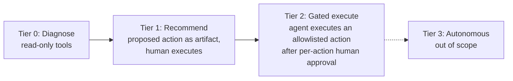
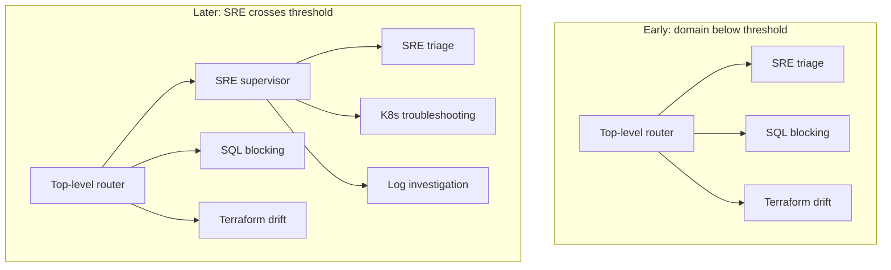
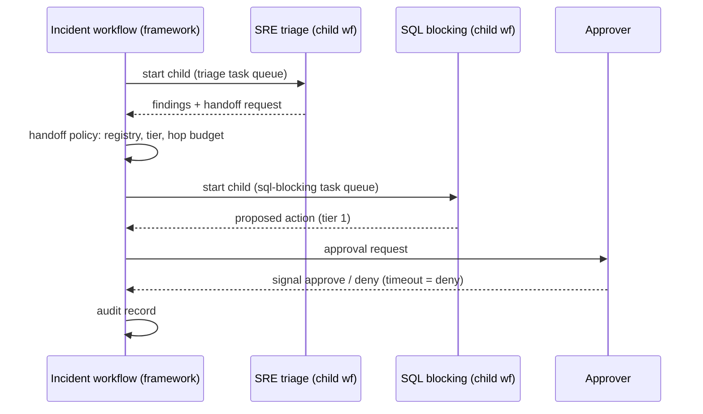
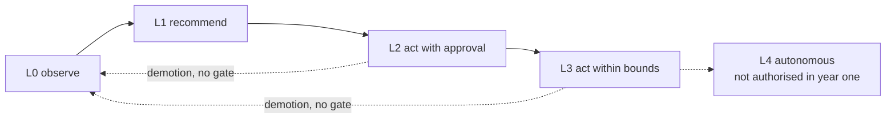
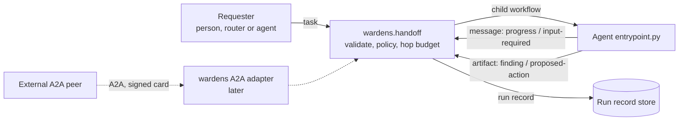
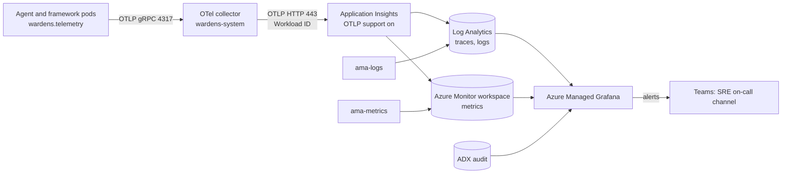
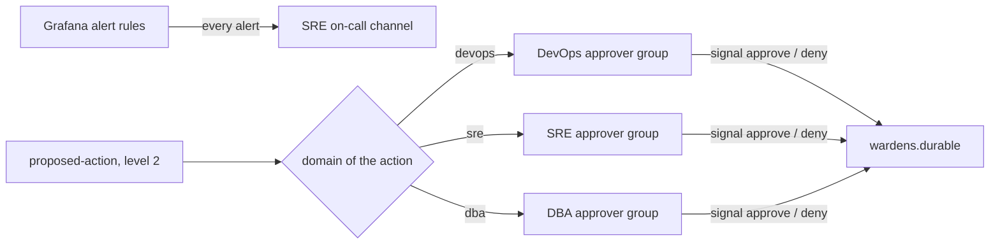
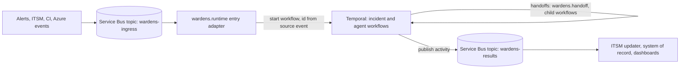
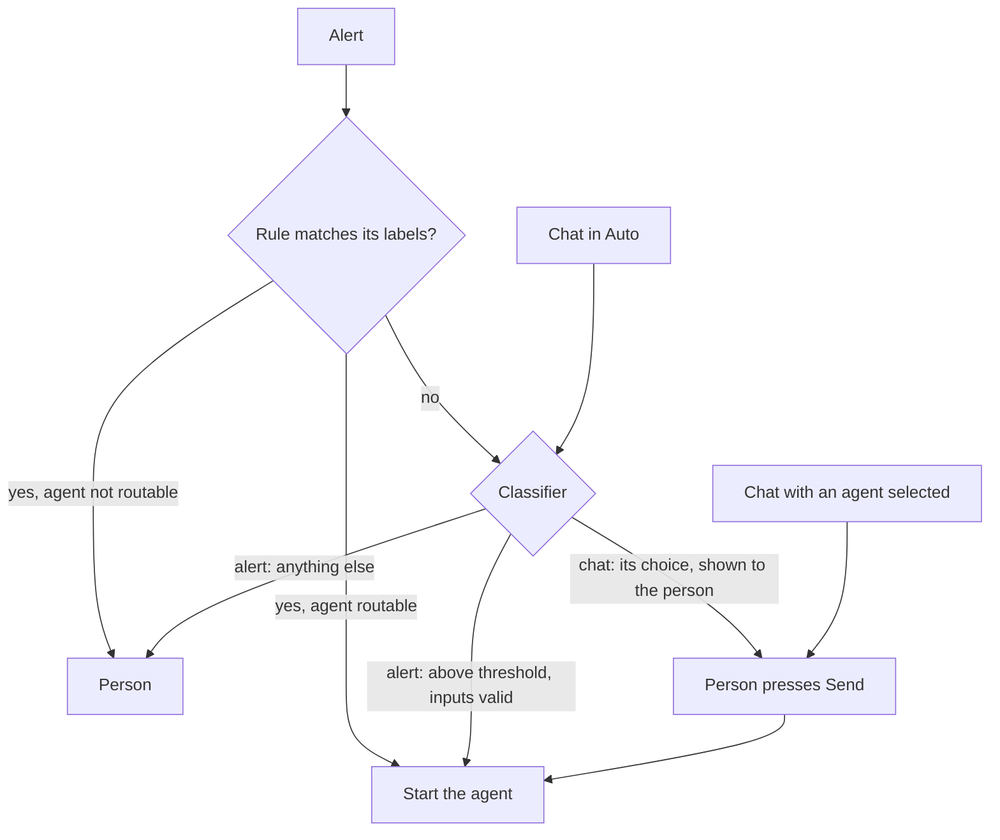
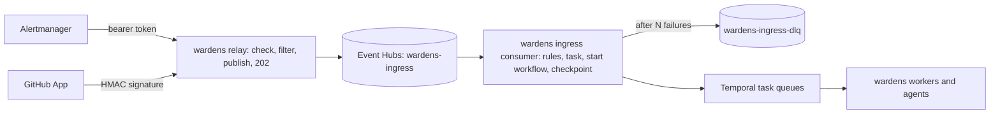

Every significant decision in Platform Wardens is written down as an architecture decision record (ADR): what
forced the decision, what was decided, which options lost and why, and what it costs. This post is the
full log, generated from the project's repo (`platform-wardens/docs/decisions`), so it always matches what the project works to.

<!-- more -->



## How to read this log
{: #how-to-read-this-log }

- **Proposed** decisions are still waiting on evidence, such as a spike or a baseline; **accepted** ones
  are what the platform is built to. A changed decision never edits an accepted ADR: a new ADR replaces
  it and the old one is marked **superseded**, with a link forward, so the history stays.
- Each ADR names the repos it affects. The summary table is in the
  [Technical Architecture](/posts/projects/platform-wardens/05-technical-architecture/#architectural-decision-records) post.

<!-- adr:begin -->


## ADR-0001: Autonomy level: tiered per action
{: #adr-0001 }

Superseded by <a href="#adr-0007">ADR-0007</a> 2026-10-08 · `platform-wardens`

#### Context

Whether agents act in production or only diagnose and recommend drives most other open decisions: identity and RBAC scope, the approval workflow, guardrail depth, durability of state, and audit requirements. It had to be settled before those could be designed.

Both existing assets already sit near the boundary. Terraform drift detection opens a PR that a human merges. The SQL blocking agent has a dedicated "action" sub-agent with a mandatory approval gate.

#### Decision

Autonomy is assigned **per action (per tool), not per agent or globally**, on a tier scale. v1 ships tier 0 and tier 1 only. Tier 2 is granted to an individual tool only after that tool's action path has passed evaluation. The tier concept exists in the tool-permission schema from day one, even while nothing sits above tier 1.

| Tier | Agent may | Human role |
| --- | --- | --- |
| 0 | Call read-only tools | None |
| 1 | Produce a proposed action (command, PR, runbook step) | Executes it |
| 2 | Execute an allowlisted action | Approves each execution |
| 3 | Execute without approval | Out of scope |

#### Considered options

- **Recommend-only everywhere**: rejected. It caps the value at a runbook generator with limited MTTR gains, and if the permission and state models are built without an execution path, adding execution later forces a re-architecture.
- **Gated execution from v1**: rejected. It puts identity, approval, and audit design on the critical path of the first release, and it would grant write access before any action path has been evaluated, contradicting "agents are evaluated before they are trusted".
- **Autonomy set per agent**: rejected. It is too coarse. One agent typically mixes harmless reads with a single risky write, so a per-agent grant over-permissions everything else that agent does.

#### Consequences

- v1 needs only read-only identities. Blast radius is limited to data exposure through read access.
- The tool-permission schema must carry a tier per tool per agent from the start. The design-reviewer should flag any write-capable tool without a tier-2 justification.
- Promoting a tool to tier 2 brings in requirements that v1 does not have:
  - write-scoped, ideally just-in-time, credentials
  - an approval bound to the exact action rather than the intent
  - durable state between approval and execution, so a crash cannot drop or duplicate the action
  - protection against running the same action twice, plus rollback or compensating actions
  - an audit trail strong enough for compliance
- **Failure mode to watch:** pressure to promote tools to tier 2 before evaluation coverage exists. The promotion criteria must be explicit.
- **Follow-up decisions:**
  - Tier-2 promotion criteria: the evaluation bar and who can authorise a promotion.
  - Identity and permissions, and Approval workflow, now only need to cover the tier-2 path in detail.

#### Related

- **Resolves open decision:** Autonomy level

## ADR-0002: Routing pattern: hierarchical per-domain supervisors, introduced lazily
{: #adr-0002 }

Accepted 2026-10-08 · `platform-wardens`

#### Context

The expected number of specialists per domain is large enough that a single router choosing among all of them will eventually see its prompt grow unwieldy and its routing accuracy drop.

Two design principles pull the other way. Supervisors in front of domains with only one or two specialists add a hop (latency, cost, possible context loss) with no routing benefit. A supervisor per domain from day one also turns the DevOps/SRE/DBA groupings into agents, which risks the org-chart split the principles warn against.

#### Decision

The target architecture is **hierarchical**: a top-level router in front of per-domain supervisors, with each supervisor in front of its specialists. Supervisors are **introduced lazily**. A domain gets its own supervisor only once it has enough specialists to need one. Until then, its specialists register directly under the top-level router, with their domain kept as metadata.

#### Considered options

- **Single supervisor only**: rejected. It doesn't scale to the expected number of specialists.
- **Hierarchical supervisors for every domain from day one**: rejected. Supervisors in front of one or two specialists add hops without improving routing, against "start with fewer agents than seems necessary". It also makes the domains into agents, against "split by task, not by org chart".
- **Event-driven triggering as the routing pattern**: reason not recorded. Alert and webhook triggers are still possible as an entry point; that is tracked under the separate Entry points decision.

#### Consequences

- **Agent contract:** the framework must treat "specialist" and "supervisor" as the same kind of routable node. Promoting a domain is then a change to the routing configuration, not changes to each specialist. Every specialist must carry domain metadata from the start.
- **Cost and latency:** each promoted domain adds one hop per request routed into it. This should be visible in tracing so the cost of a promotion can be measured.
- **Failure modes:**
  - **Routing gaps:** a supervisor that misroutes, or doesn't route at all, takes out every specialist behind it. Each supervisor needs its own evaluation scenarios before promotion.
  - **Lost context in cross-domain handoffs:** once domains have supervisors, SRE triage → SQL blocking may cross two supervisors. Handoff state must be explicit and structured, not reconstructed from conversation.
- **Permissions:** supervisors only route. They should hold no tool grants, so a supervisor adds no blast radius of its own.
- **Follow-up decisions** (still open):
  - the threshold for giving a domain its own supervisor (a specialist count, or measured routing accuracy)
  - the path for cross-domain handoffs: direct between specialists, or always through the top-level router

#### Related

- **Resolves open decision:** Routing pattern (partly; see Consequences)

## ADR-0003: Agent framework: Pydantic AI for all agents
{: #adr-0003 }

Superseded by <a href="#adr-0005">ADR-0005</a> 2026-10-09 · `platform-wardens`

#### Context

The original direction assumed LangGraph. The SQL blocking agent, the most mature existing asset, migrated from LangChain/LangGraph to Pydantic AI and documented why (`agent-pydantic-sql-blocking/sql-blocking-agent/docs/WHY_PYDANTIC_AI.md`). The Terraform drift agent is still on LangGraph.

The design principles make every specialist narrow: a small tool set, mostly deterministic logic, and a few schema-bound LLM steps. That is the workload Pydantic AI was chosen for in the SQL blocking agent.

#### Decision

**Pydantic AI is the agent framework for every agent:** specialists, the top-level router, and domain supervisors. LangGraph is not used.

- All LLM calls go through `wardens.llm`, which wraps Pydantic AI. Agents never construct a model client themselves.
- LLM output is always a typed Pydantic model (`output_type`), with validation retries.
- Orchestration *within* an agent is a plain async state machine (`workflow.py`).
- Orchestration *between* agents (routing, handoff, shared state, approval) is framework code in `wardens`, not a graph library.
- Durable execution (Temporal) is out of scope for now.

#### Considered options

- **LangGraph (the original assumption)**: rejected. Rationale from WHY_PYDANTIC_AI.md:
  - It required manual JSON parsing and offered no built-in validation retries.
  - Its dependency tree is heavy relative to the small part each agent used.
  - Token and cost telemetry was not first-class.
  - The SQL agent's flow is nearly linear and doesn't need a general graph runtime.
- **Pydantic AI for agents with LangGraph for cross-agent orchestration**: rejected. It runs two orchestration models and two sets of state semantics side by side. Cross-agent coordination is framework-owned anyway (decision 0002).
- **Raw model SDK, no framework**: rejected. It would mean re-implementing structured-output validation, retries, and telemetry.

#### Consequences

**What gets easier**
- One typed boundary everywhere: tool I/O, LLM output, agent state, and contracts are all Pydantic models.
- Keyless auth to Azure AI Foundry via `DefaultAzureCredential` and workload identity.
- Per-agent token telemetry through Logfire and OpenTelemetry.
- The SQL blocking agent migrates without a framework rewrite.

**What the framework must build itself** (no LangGraph runtime to inherit):
- routing and handoff correctness (decision 0002)
- cycle and hop-budget enforcement
- human-approval interrupts
- persistence of incident state

**Durability gap.** With no checkpointer and Temporal out of scope:
- An agent crash mid-incident loses state that is in flight. That is acceptable at tiers 0–1 (decision 0001), because nothing is executed.
- Before any tool reaches tier 2, the framework needs durable state between approval and execution, per decision 0001.

**Revisit triggers** (adapted from WHY_PYDANTIC_AI.md §8): reconsider durable execution when either of these occurs:
- the first tool is promoted to tier 2
- incident workflows must resume across restarts

Pydantic AI's durable-execution integrations (Temporal, DBOS, Prefect) wrap the same agents, so this is an addition rather than a rewrite.

**Other risks and follow-up work**
- **Version churn.** Pydantic AI's API moves fast. Pin it in the workspace and upgrade all agents together.
- **Smaller ecosystem.** There are fewer prebuilt integrations than LangChain offers. Tools come from our own MCP servers anyway.
- **Migration work.** The Terraform drift agent must be ported from LangGraph when it moves into this repo.
- **Approval pattern.** Approval stays at the orchestrator level, not Pydantic AI's deferred-tool approval, because destructive actions are never LLM tool calls.
- **Model hosting stays open.** Pydantic AI is model-agnostic, so this decision doesn't constrain it.

#### Related

- **Status note:** (durable-execution clause earlier superseded by [0004](#adr-0004)). The choice of Pydantic AI was restored by [0012](#adr-0012).
- **Resolves open decision:** n/a (confirms the "Agent framework" assumption in the project's technical direction; replaces the original LangGraph assumption)

## ADR-0004: Durable execution: Temporal
{: #adr-0004 }

Accepted 2026-10-09 · `platform-wardens`

#### Context

Decision 0003 chose Pydantic AI and deferred durable execution. That left a gap:
- A crash mid-incident loses state that is in flight.
- Approvals have no durable wait.
- Decision 0001 requires durable state between approval and execution before any tool reaches tier 2.

The SQL blocking agent already runs on Temporal in an opt-in mode (`docs/DURABLE_AGENT.md` in that repo), and a Temporal instance exists for it in dev.

#### Decision

Temporal is the framework's durable execution layer, used for checkpointing, human approval, retries, and incident history. It lives in the framework (`wardens.durable`). Agents do not import `temporalio`.

| Concept | Temporal mapping |
| --- | --- |
| Incident | Parent workflow; holds the shared incident state |
| Agent run (incl. a handoff target) | Child workflow on that agent's task queue |
| Stage (LLM or deterministic) | Activity with a bounded retry policy |
| Human approval | Signal plus a timed wait; **timeout = deny** |
| Pending approval visibility | Workflow query |

Temporal is the only execution mode. There is no second in-process loop mode as in the SQL blocking agent. Local development uses `temporal server start-dev`; tests use the time-skipping test environment.

#### Considered options

- **No durable execution (0003 as written)**: rejected. In-flight incidents and approvals are lost on restart, and it blocks tier 2.
- **Opt-in Temporal with an in-process loop mode, as in the SQL blocking agent**: rejected. Two execution paths means double the test surface, and an approval wait in loop mode isn't durable.
- **Pydantic AI `TemporalAgent` wrapping each agent**: rejected for now. Our stages mix deterministic gates and diagnostics around the LLM call, and the SQL blocking agent found running whole stages as activities cleaner (`DURABLE_AGENT.md`).
- **DBOS or Prefect** (also Pydantic AI integrations): reason not recorded beyond Temporal's existing use and instance in the organisation.
- **Hand-rolled database-backed state**: rejected. It would re-implement replay, timers, signals, and retries.

#### Consequences

**Agent code**
- `workflow.py` must be deterministic: no I/O, clocks, randomness, or LLM calls; it only sequences stages.
- Stage inputs and outputs must be serialisable, and must stay below the Temporal payload limits. Large artifacts such as plan XML and reports go to storage, with a reference in state.
- Stages must be idempotent or guarded. A retried activity must not run a destructive action twice.

**Approval and audit**
- A human approval survives redeploys.
- Approval timeouts fail safe to deny.
- Workflow history gives replayable incidents, which supports "everything is traceable". The immutable audit log stays the system of record for decisions.

**Operations and risk**
- Temporal becomes a critical platform dependency. If Temporal is unavailable, incidents can't start, though they don't run blind either. It needs HA, persistence and visibility storage (or Temporal Cloud), plus monitoring.
- Each agent's worker is deployed separately on its own task queue, which matches per-agent deployment. A missing worker leaves child workflows waiting, so each child needs a start-to-close timeout and an incident-level deadline.
- Workflow versioning is needed when `workflow.py` changes while incidents are in flight (Temporal patching or worker versioning).

**Follow-up decisions** (open):
- Temporal hosting: the existing self-hosted instance or Temporal Cloud, and namespaces per environment.
- Whether a Temporal child workflow becomes the cross-agent handoff transport, which would affect the Routing details decision.

#### Related

- **Status note:** (still in force under [0012](#adr-0012), which returns to Pydantic AI; 0012 explains how its Temporal integration relates to the alternatives below)
- **Resolves open decision:** n/a (supersedes the "durable execution out of scope" clause of [0003](#adr-0003))

## ADR-0005: Agent framework: Microsoft Agent Framework for all agents
{: #adr-0005 }

Superseded by <a href="#adr-0012">ADR-0012</a> 2026-10-12 · `platform-wardens`

#### Context

Decision 0003 chose Pydantic AI, based on the SQL blocking agent's migration. Microsoft Agent Framework (MAF), the successor to Semantic Kernel and AutoGen, reached 1.0 GA for Python and .NET in April 2026. Its stable API covers:
- agents with first-party chat clients, including Microsoft Foundry and Azure OpenAI
- typed structured output
- middleware
- MCP tools
- a graph-based workflow engine with checkpointing and human-in-the-loop
- built-in multi-agent patterns: sequential, concurrent, handoff, group chat, Magentic-One

Its durable execution (the Durable Task extension on Durable Task Scheduler) is still prerelease for Python. Temporal remains the durable layer ([0004](#adr-0004)).

#### Decision

**MAF (`agent-framework` 1.x, Python) is the agent framework for every agent:** specialists, the top-level router, and domain supervisors. Pydantic AI and LangGraph are not used. Pydantic, the data-validation library, stays for all data models.

| Concern | How MAF is used |
| --- | --- |
| Model access | `wardens.llm` wraps MAF chat clients (Foundry / Azure OpenAI). Agents never construct a client. |
| Structured output | `response_format` set to a Pydantic model. `wardens.llm` validates `response.value` and retries when it is missing or invalid. |
| Cross-cutting concerns | MAF middleware: telemetry, token accounting, content safety, and tier checks on any LLM-callable tool |
| Shared tools | MAF's MCP support, against our `mcp-servers/` |
| Built-in orchestration and workflows | Allowed **only inside a single stage**, e.g. concurrent analysis by several LLM agents. Never used to sequence stages or route between agents. |
| Durability, approval, retries | Temporal, unchanged (0004). MAF workflow checkpointing and the Durable Task extension are not used. |
| Preview features | Not used in production paths. That includes Foundry hosted agents, the Durable Task extension, Foundry observability and evaluations, and the agent harnesses. |

#### Considered options

- **Pydantic AI (0003)**: superseded on the three grounds above. It works well in the SQL blocking agent; that agent's design patterns carry over, only the library changes.
- **LangGraph**: still rejected, for the reasons in 0003.
- **MAF with its Durable Task extension instead of Temporal**: rejected for now. The Python packages are prerelease, it would need a new backend (Durable Task Scheduler), and it would discard the proven Temporal pattern and the existing instance.
- **MAF workflows with their own checkpointing as the only durable layer**: rejected. Checkpoints alone don't give cross-service retries, timers, or long durable approval waits.

#### Consequences

**The rationale is only partly realised.** MAF's built-in orchestration helps only inside a stage. Stage sequencing and cross-agent coordination remain `wardens` and Temporal code, because routing must be deterministic and auditable (0002), and durability is Temporal's (0004).

**Two orchestration engines are now available, which invites misuse.** The rule is that MAF orchestration stays inside a stage, and the design reviewer flags any use outside one.

**A MAF workflow inside a stage has no durability of its own.** It runs within one Temporal activity, so a retry reruns all of it. Such a stage must be side-effect free (read-only tools and LLM calls only). Destructive actions are never part of it.

**`wardens.llm` must handle what Pydantic AI did for us:**
- validation retries
- per-agent token accounting

Telemetry moves from Logfire to OpenTelemetry, which MAF emits.

**Approval pattern unchanged.** Destructive actions stay deterministic stages behind a Temporal approval signal. MAF's tool-approval feature is not used for them.

**Migration work:**
- The SQL blocking agent ports from Pydantic AI: `ask_structured` and the usage tracker move to `wardens.llm` on MAF.
- The Terraform drift agent ports from LangGraph.

**Version risk.** The Python API changed shape before 1.0, e.g. `create_agent` became `as_agent`, and `response_format` moved from a keyword argument into `options`. Pin `agent-framework` 1.x in the workspace, upgrade all agents together, and avoid `--pre` extras.

**Model hosting stays open.** MAF supports Foundry, Azure OpenAI, OpenAI, Anthropic, Bedrock, Gemini, and Ollama.

**Revisit trigger.** When the Durable Task extension is GA for Python, evaluate replacing Temporal so the whole stack is MAF (would supersede 0004).

#### Related

- **Status note:** (Pydantic AI); earlier amended by [0009](#adr-0009) (group chat and Magentic restricted)
- **Resolves open decision:** n/a (supersedes [0003](#adr-0003))

#### Rationale

- **Fit with Azure and Foundry.** MAF has first-party Foundry and Azure OpenAI connectors and is aligned with the target runtime.
- **Built-in orchestration.** Workflows and multi-agent patterns come with the framework. Within the boundaries above, a stage that needs several LLM agents to collaborate doesn't need hand-written coordination.
- **Enterprise support.** It is Microsoft-backed, with stable 1.x APIs and long-term support, and it has a migration path from the Semantic Kernel and AutoGen code other teams may have.

## ADR-0006: Adopt the reference Multi-Agent Framework standard v1.1 as the conformance baseline
{: #adr-0006 }

Accepted 2026-10-21 · `platform-wardens`

#### Context

Platform Engineering & Operations published *Multi-Agent Framework for Agentic AI: Reference Architecture and Implementation Standard*, v1.1 draft, 2026-10-06 (docx). Existing and future projects are assessed against it.

The repo already covered most of the same ground under its own names: tiers instead of autonomy levels, handoff requests instead of tasks, and 19 design categories instead of seven layers. It lacked several things the standard requires:
- a per-agent specification
- lifecycle gates
- a run record
- a tested kill switch
- per-agent cost ceilings
- reversibility ratings
- evaluation floors

v1.1 was issued for endorsement on 2026-10-13. Endorsement had not been confirmed when this record was written.

#### Decision

platform-wardens conforms to the standard, **v1.1 draft**. Where a repo document conflicts with the standard, the standard wins unless a decision record states the deviation and why. The repo may be stricter than the standard, but never looser.

Framework documentation is organised by the repo's design categories, not by the standard's layers. The original 19 categories are kept, and 8 categories the standard requires are added (20–27). Each category states the layer it belongs to. docs/framework/README.md holds the conformance matrix, which maps each section of the standard to a category, an artifact, and a status.

#### Considered options

- **Organise the docs by the seven layers:** rejected. The categories already map one to one onto `wardens` modules and decision records. Several layers span many modules; Layer 7 alone covers registry, identity, guardrails, audit, lifecycle and cost. The layer mapping is kept in every category doc and in the conformance matrix.
- **Treat the standard as advisory:** rejected. Projects are assessed against it, so every gap would surface at review instead of in design.
- **Copy the standard's text into the repo:** rejected. It has its own owner and revision history. The repo keeps the source document in `docs/reference/` and cites it by section.

#### Consequences

- The repo adopts the standard's vocabulary: task, message, artifact, run, run record, autonomy level, action catalog, kill switch, registry.
- Every agent carries more up-front artifacts: a specification in its manifest, a why-an-agent statement, a threat model, an ROI write-up, a runbook, retirement steps, and gate evidence. The agent template carries all of them.
- **Draft risk:** v1.1 may change before or at endorsement. When the endorsed version lands, re-run the conformance matrix and record any change in a new decision record.
- Follow-up records: [0007](#adr-0007) (autonomy levels), [0008](#adr-0008) (contracts), [0009](#adr-0009) (coordination patterns), [0010](#adr-0010) (observability stack), [0011](#adr-0011) (alert and approval routing).
- The standard adds open decisions: registry location, ownership of shared parts, A2A exposure, data classification, and named roles. They are tracked in section 10 of the project goal.
- Other references are reviewed against, not conformed to. The first is the AWS Enterprise Agentic AI Platform Blueprint (2026-11-03), which covers the platform side the standard leaves open; its accepted items become decision records [0018](#adr-0018) to [0025](#adr-0025).

#### Related

- **Resolves open decision:** n/a

## ADR-0007: Autonomy levels L0–L4, granted per action, with reversibility ratings
{: #adr-0007 }

Accepted 2026-10-21 · `platform-wardens`

#### Context

Decision 0001 introduced a per-action tier scale (0 diagnose, 1 recommend, 2 gated execute, 3 autonomous and out of scope). The standard ([0006](#adr-0006), §8) defines five levels, a human role for each level, the controls each level requires, and two reversibility tests that gate the step to unsupervised execution. Keeping our own numbering would mean translating at every review.

#### Decision

Autonomy uses the standard's **L0–L4** scale and stays **granted per action**, as in 0001. Every write-capable action in an agent's action catalog carries a level and two reversibility ratings. An agent's level is the highest level in its catalog. Reads are not actions; they are tools of kind `read`.

| Level | Agent may | Human role | Was (0001) |
| --- | --- | --- | --- |
| **L0** Observe and explain | Read permitted sources; explain or classify | Operator: people do the work | Tier 0 |
| **L1** Recommend | Propose a specific action with reasoning (a `proposed-action` artifact) | Consultant: people decide and act | Tier 1 |
| **L2** Act with approval | Prepare an action and execute it after a named approver sees the full parameters | Approver | Tier 2 |
| **L3** Act within bounds | Execute pre-approved, reversible, low-consequence actions without waiting | Observer: after-the-fact review | Part of tier 3 |
| **L4** Autonomous within policy | Any catalog action within policy | Sets policy only | Part of tier 3 |

Rules:
- **v1 ships L0 and L1 only**, unchanged from 0001.
- **L2** is granted per action after that action path passes evaluation (floors below), has a proven rollback, and gets independent reviewer sign-off at the Promote gate.
- **L3** is granted only to actions rated reversible on **both** tests:
  - *action reversibility*: can the system change be undone?
  - *consequence reversibility*: can what happened in the world because of it be undone?

  L3 also requires a security review, technical enforcement of the bound (scope, rate, budget), a circuit breaker, anomaly alerting, and a weekly audit sample.
- **L4 is not authorised** for any agent in the standard's first year.
- **Demotion needs no gate.** The owner, the reviewer, or the framework owner can lower any action or agent at any time. The kill switch takes the agent to L0 and stops it (23).
- **Evidence floors for any promotion** (standard §10): at least 30 real cases in the evaluation set, zero safety failures in the evaluation window, a run record for every run, and cost within the ceiling.

#### Considered options

- **Keep tiers 0–3 with a mapping table:** rejected. Every review, manifest and run record would need translating, and tier 3 merged two levels with different controls (L3 bounded, L4 policy-only).
- **Grant autonomy per agent:** rejected, for the same reason as in 0001. One agent mixes harmless reads with a single risky write.

#### Consequences

- The manifest's `actionCatalog` carries `level`, `reversibility.action` and `reversibility.consequence` for every action (contracts). The `tier` field is gone.
- Everything 0001 required before tier 2 still applies to L2: write-scoped just-in-time credentials, approval bound to the exact action, durable state between approval and execution, idempotency, rollback, and audit.
- L3 is now a reachable target. Its extra controls (circuit breaker, bound enforcement, anomaly alerting) must be designed before the first L3 request, not after.
- 0001 gave tier 0 the human role "none". Under L0 the human is the operator who reads the output, so an L0 agent still needs a named recipient.
- **Still open:** the volume and accuracy each agent must show per level (the standard leaves this to the specification), and who holds the sponsor role that approves gates in this organisation. Tracked as "Promotion thresholds and authority" in `open-decisions.md`.
- **Failure mode to watch:** promoting on aggregate accuracy while one action is weak. Evidence is per action, not per agent.

#### Related

- **Resolves open decision:** Tier-2 promotion criteria (partly; see Consequences). Supersedes [0001](#adr-0001).
- **Written exception:** [0028](#adr-0028) (proposed): one approval covers `cicd-triage`'s bounded fix loop.
- **Refined by:** [0024](#adr-0024) (proposed): the evidence a promotion needs for each control (allowed twin, exact denial, mutation test), and [0023](#adr-0023) (proposed): G3 and G4 evidence comes from evaluating the deployed shadow worker.

## ADR-0008: Contracts follow the A2A data model: task, message, artifact
{: #adr-0008 }

Accepted 2026-10-21 · `platform-wardens`

#### Context

The contracts were placeholders: `handoff-request`, `finding`, `proposed-action`. The standard (§7, principle 12) requires agents to cooperate only through three typed structures shaped like the A2A data model. Those are a **task** with a lifecycle state, a **message**, and an **artifact**, all carrying one correlation id. The standard also requires a run record (§10), and an agent specification shaped like an A2A agent card (§6).

Internally, handoffs run as Temporal child workflows ([0004](#adr-0004)). There is no external caller yet.

#### Decision

The shared schemas in `contracts/schemas/` are:

| Schema | Role |
| --- | --- |
| `common` | Shared definitions: correlation id, principal, autonomy level, task state, reversibility, message part |
| `task` | Unit of work: goal, capability, typed inputs, context references, constraints (deadline, cost limit, maximum autonomy level, hop budget), requester, lifecycle state with history |
| `message` | Data exchanged during a task, made of typed parts. Never carries instructions for another agent's model |
| `artifact` | Typed output of a task with a verification record. Content types: `finding`, `proposed-action`, `report` |
| `finding` | Artifact content: a diagnosis with evidence |
| `proposed-action` | Artifact content: an action from the catalog, with full parameters, level, reversibility and rollback |
| `run-record` | The people-readable record of one run (§10) |
| `agent-manifest` | The agent specification (§6), shaped so it can be published as an A2A agent card |

`handoff-request` is removed; a handoff is a `task` with a `parentTaskId`. Task states are the standard's seven: `submitted`, `working`, `input-required`, `completed`, `failed`, `canceled`, `rejected`.

**The transport stays Temporal.** The A2A wire protocol is used only where a task crosses a runtime, team or vendor boundary. That needs a thin adapter in the framework, built when the first such caller exists.

#### Considered options

- **Keep repo-specific shapes and translate at an A2A adapter later:** rejected. The translation layer would be permanent, and the standard requires A2A-shaped records internally so a task can cross a boundary "without translation".
- **Use the A2A protocol internally (JSON-RPC/HTTP between agents):** rejected. It duplicates what Temporal already provides (durable handoff, retries, timeouts) and gives every agent an HTTP surface, against "an agent exposes no HTTP API of its own".

#### Consequences

- `entrypoint.py` maps `task` to agent state and returns artifacts. It is still the only agent module that imports contract types.
- **No progress means failed.** A task in `working` with no progress event past `constraints.progressIntervalSeconds` is treated as failed. This maps to Temporal activity heartbeat timeouts; the coordinator decides on retry.
- `input-required` gives agents a sanctioned way to ask instead of guessing (MAST FM-2.2). It is also the state a task sits in while waiting for approval.
- Every state change records a timestamp and the principal that caused it. The handoff layer enforces this, not the agent.
- **Context by reference.** Context crosses agent boundaries as `contextRefs` to whole artifacts and run records, not as summaries (principle 4). The receiving agent can always resolve a reference to the full evidence.
- Contract changes stay "contracts before code": a schema change lands with every caller and triggers every agent's evals. Each record carries `schemaVersion`.
- **Not modelled:** A2A's `auth-required` and `unknown` states. Add them if an external peer needs them.
- **Open:** when the first A2A boundary appears, and how agent cards are signed. Tracked as "A2A exposure".

#### Related

- **Resolves open decision:** n/a. Closes design-category gaps 2 (clarification status) and 10 (A2A alignment).

## ADR-0009: Coordination patterns: order of preference and restrictions
{: #adr-0009 }

Accepted 2026-10-21 · `platform-wardens`

#### Context

Decision 0005 allowed any MAF multi-agent pattern inside a single side-effect-free stage, including group chat and Magentic-One. The standard (§5) is stricter:
- Group chat is not approved for production.
- Magentic-style open-ended planning is limited to L0/L1, with a person reviewing the progress ledger at each re-plan.
- Hierarchies are limited to two levels.
- A fixed order of preference applies before any agent is built.

#### Decision

**Order of preference.** It applies to every new capability, and the chosen step is recorded in the agent's why-an-agent statement:

1. a plain function
2. a workflow (stages in `workflow.py`, no LLM-chosen path)
3. a single agent
4. an orchestrator with workers
5. a hierarchy of at most two levels

Move down the list only when the previous option has demonstrably failed on the evaluation set.

| Pattern | Where it may run here | Required control |
| --- | --- | --- |
| Sequential chain | `workflow.py` | Programmatic check between stages; retry per stage |
| Routing | `wardens.routing` ([0002](#adr-0002)) | Router measured on its own (`evals/routing/`); fallback route to a person |
| Parallel sections or voting | `workflow.py`, or MAF concurrent inside one stage | Split only work with no shared decisions; **aggregate in code**, not through another model |
| Orchestrator and workers | MAF inside one side-effect-free stage | Plan visible before execution; typed worker outputs; context budget; iteration limit |
| Hierarchical | Top-level router plus lazy domain supervisors (0002) | **At most two coordinating levels.** No sub-supervisors. Raw traces available to the top level |
| Handoff between peers | Via `wardens.handoff` only | Fixed task contract; one owner per task at any moment; hop budget as loop counter |
| Evaluator and optimizer | Inside one stage | Maximum iterations; the evaluator uses a different prompt or model; a person checks irreversible outputs |
| **Group chat** | **Not in production.** Allowed in evaluation only | — |
| **Magentic (open-ended planner with ledger)** | Only in stages of agents whose highest level is L0 or L1 | Progress ledger written to the run record and reviewed by a person at each re-plan |
| Shared state (blackboard) | Not used | Would need a single writer per state element and a coordinator of last resort |

#### Considered options

- **Keep 0005 as written:** rejected. It permits group chat in production stages, which the standard forbids.
- **Ban Magentic outright:** not chosen. The standard allows it at L0/L1. The per-re-plan human review keeps it out of time-critical incident paths in practice, which is acceptable for investigative, non-urgent stages.

#### Consequences

- The design reviewer flags any MAF `GroupChat` in a production stage, any Magentic use in an agent with an L2+ action, and any third coordinating level.
- Supervisor designs carry a known risk: the standard cites 39–70% degradation on sequential reasoning tasks. Sequential cross-domain work such as SRE triage → SQL blocking therefore goes through a typed task with full context references, not a supervisor summarising between levels.
- "Aggregate in code" means concurrent analyses that disagree are resolved by deterministic rules or escalated to a person, never reconciled by a further LLM call (category 1).
- Everything else in 0005 stands.

#### Related

- **Status note:** carried over to Pydantic AI by [0012](#adr-0012), which maps the MAF patterns below to their Pydantic AI equivalents
- **Resolves open decision:** n/a. Amends [0005](#adr-0005).

## ADR-0010: Observability stack: Application Insights, Log Analytics and managed Prometheus, shown in Azure Managed Grafana
{: #adr-0010 }

Accepted 2026-10-28 · `platform-wardens`

#### Context

Every model call, tool call and agent invocation must emit a trace with the shared correlation id (principle 10), and telemetry must land in the **existing monitoring stack** (§13). `wardens.telemetry` already emits OpenTelemetry (OTel) spans that follow the GenAI semantic conventions. An OTel collector runs in `wardens-system`, and metrics already go to Azure Monitor managed Prometheus. The backend for traces and logs was not chosen.

The DevOps, SRE and DBA teams already run Azure infrastructure on **Application Insights** and **Log Analytics workspaces**. Azure Monitor now accepts OTLP directly: an Application Insights resource with OTLP support creates the data collection rule and endpoints, stores traces and logs in Log Analytics (OTel semantic conventions) and metrics in an Azure Monitor workspace.

#### Decision

Telemetry goes to Azure Monitor over OTLP, and **Azure Managed Grafana is the single place for dashboards and alerting.**

| Signal | Path | Stored in | Queried with |
| --- | --- | --- | --- |
| Traces (agent, stage, model, tool, handoff, approval spans) | Pod → OTel collector → Application Insights OTLP endpoint | Log Analytics workspace | KQL (Application Insights views, Grafana) |
| Logs (structured JSON from agents and framework) | Pod → OTel collector → Application Insights OTLP endpoint | Log Analytics workspace | KQL |
| Agent metrics (cost, tokens, latency, tool errors, routing) | Pod → OTel collector → Application Insights OTLP endpoint | Azure Monitor workspace (managed Prometheus) | PromQL |
| Cluster metrics (node, pod, kube-state) | AKS `ama-metrics` add-on, remote write | Azure Monitor workspace | PromQL |
| Container stdout/stderr, Kubernetes events | AKS Container Insights (`ama-logs`), data collection rule | Log Analytics workspace (`ContainerLogV2`, `KubeEvents`) | KQL |
| Audit trail | Framework worker → ADX (11) | Azure Data Explorer | KQL |

**Resources**

- **One Application Insights resource per environment for the framework** (non-prod, prod), separate from the application resources the agents investigate (for example CarePro), so agent telemetry never mixes with the telemetry under investigation.
- It is workspace-based, on a **Log Analytics workspace** in the landing zone. Use the organisation's existing workspace if its access model allows per-table RBAC for the framework tables; otherwise a dedicated workspace.
- Agent metrics use a separate Azure Monitor workspace from cluster metrics, as Azure Monitor requires for Application Insights with OTLP.

**Collector rules**

- Only the collector exports. Pods send OTLP to the collector and hold no Azure Monitor credentials.
- The collector authenticates with **its own Workload ID** (`azure_auth` extension) and holds **Monitoring Metrics Publisher** on the data collection rule. No connection string.
- Before export: redaction per data classification (24), `cumulativetodelta` for metrics (Application Insights needs delta temporality and exponential histograms), tail sampling that **keeps every error and every trace of a run that ended in a proposed action**, and samples successful runs.
- The GenAI semantic-convention version stays pinned in `wardens.telemetry` (12).

**Dashboards and alerting in Grafana**

- Data sources: managed Prometheus (PromQL), Azure Monitor / Log Analytics (KQL), Application Insights traces, ADX (audit). Grafana reads them with its managed identity.
- **Alert rules are Grafana-managed**, kept as code (Terraform) and reviewed like any change. Every alert goes to one Teams contact point, the **SRE on-call channel** ([0011](#adr-0011)).
- Required alert rules from Phase 0: cost per run over budget, p95 latency, tool error rate, breaker open, kill-switch activation, quarantine, shared-agent queue latency (shared agents), and telemetry ingestion stopped.
- **Watching the watcher:** one Azure Monitor alert outside Grafana fires when Grafana or the collector stops reporting (no data for 15 minutes), so a Grafana outage is not silent.

#### Considered options

- **Azure Monitor OpenTelemetry Distro in every agent process** (GA, exports straight to Application Insights): rejected as the default. Every pod would need the App Insights connection and egress to Azure Monitor, and redaction and sampling would be repeated in each agent instead of enforced once in the collector.
- **Collector `azuremonitorexporter` with a connection string** (GA): kept as the **fallback** if the OTLP ingestion path is not acceptable for production when Phase 0 closes. The connection string goes in Key Vault. Data lands in the classic Application Insights tables, so dashboards change.
- **Azure Monitor alerts instead of Grafana alerting:** rejected as the main mechanism, so dashboards and alerts share one set of queries and one review process. Used only for the watcher alert above.
- **Self-hosted backend (Tempo, Loki, OpenSearch):** rejected. It adds a stack to run and is not the teams' existing monitoring stack (§13).

#### Consequences

- Operators get Application Insights' transaction search, failures and agents views on agent traces, and the same data in Grafana, without new tools.
- Phase 0 builds: the Application Insights resource with OTLP support, the data collection rule and role assignment, the collector's identity, the Container Insights data collection rule, Grafana data sources, the first alert rules and the Teams contact point.
- Log Analytics is billed per GB ingested. Sampling and table plans (Basic logs for verbose agent logs) are set in Phase 0 and reviewed in the monthly measures report.
- **Telemetry is not the audit trail.** Sampled traces and retention limits never affect audit, which stays in ADX, or run records, which are never sampled.
- **Preview risk:** some OTLP-to-Application-Insights paths are marked preview by Microsoft. Before the Phase 0 exit gate, check the status of the collector path; if it is still preview and that blocks production, switch to the fallback exporter.
- **Open:** whether to adopt the Agent 365 SDK for agent telemetry; workspace retention per data class. Alert routing is decided in [0011](#adr-0011).

#### Related

- **Resolves open decision:** "Observability stack" in 12; "trace and log backend" in Phase 0.
- **Amended by:** [0025](#adr-0025) (proposed): the same dimensions on every span, metric, resource and gateway call; the collector marks spans without a cell as `unallocated`.

## ADR-0011: Alerts go to SRE; agents act only in their own domain; approvals go to that domain's team
{: #adr-0011 }

Accepted 2026-10-28 · `platform-wardens`

#### Context

Two kinds of message reach people from the framework:
- **Alerts** about the framework and its agents: cost over budget, latency, tool errors, an open breaker, quarantine, a kill-switch activation, a shared-agent backlog, telemetry stopped ([0010](#adr-0010)).
- **Approval requests** for an L2 action: a person must approve the exact action before it runs ([0007](#adr-0007), 10).

These need different audiences. Alerts are about running the platform and need one owner who is always on call. An approval is about a change to a system, and the person approving must know that system.

#### Decision

**Alerts: all to the SRE on-call channel.**

- Every Grafana-managed alert rule uses one Teams contact point: the SRE on-call channel. There is no per-team alert routing.
- Alert labels still carry `agent`, `domain`, `capability` and `correlationId`, so SRE can see whose agent is affected and pull in the owning team.
- The Azure Monitor watcher alert (Grafana or the collector stopped reporting) also goes to SRE.

**Agents propose actions only on systems their own domain owns.**

- A problem on another team's system is a **handoff**, never a proposed action. An SRE agent that finds a SQL Server cause hands the issue to the DBA agent for that capability, which makes the recommendation. The SRE agent may say in its finding that the SQL side looks involved and pass the evidence by reference.
- **A system ownership map** decides which domain owns a system, not the agent. It maps system types and resources to `devops`, `sre` or `dba` (for example SQL Server instances → dba, AKS workloads → sre, Terraform and pipelines → devops), from resource tags and registry scopes. Boundary cases, such as the VM that hosts SQL Server, are decided once in the map.
- **Enforced twice:**
  - CI rejects a manifest whose `actionCatalog` targets systems outside the agent's `domain` in the ownership map.
  - At run time, `wardens.guardrails` rejects any `proposed-action` (L1 and above) whose target the map assigns to another domain, and turns it into a suggested handoff to that domain's capability. It is never dropped silently.
- **A fix that spans domains is one action per domain.** Each owning agent proposes its own part, the parent workflow orders them, and each part is approved by its own team. There is no combined approval for changes across domains.
- **No owning agent yet:** if no agent serves the needed capability in the owning domain, the agent reports the symptom with its evidence and escalates to that team's people. It never fills the gap itself.

**Approvals: to the team that owns the domain of the action.**

- The approval card goes to the approver group of the team that owns the domain of the action. Because agents act only in their own domain, that is always the `domain` of the agent that proposes the action:

| Action | Proposing agent | Domain | Approval goes to |
| --- | --- | --- | --- |
| Drift remediation PR | Terraform Drift Advisor | devops | DevOps approver group |
| `KILL` a head-blocker session | SQL Blocking Investigator | dba | DBA approver group |
| First SRE action (chosen in Phase 4) | Owning SRE agent | sre | SRE approver group |

- **The domain of the action decides, not where the incident started.** When an SRE alert is handed off to a DBA agent that proposes a SQL action, the DBA group approves it.
- `actionCatalog[].approvers` in each manifest names an Entra group of the owning domain team. CI rejects a level 2 action whose approver group does not belong to the agent's `domain`.
- **Shared agents never request approval.** They have no write roles and no actions at L2 (shared agents).
- The rules in 10 still apply: approver identity from the Teams/Entra sign-in, approver ≠ requester, binding to `idempotencyKey` and parameters, expiry, timeout = deny.
- SRE on call is told when an approval is requested or times out on an incident it is handling, for context only. SRE cannot approve another domain's action unless that person is also in the owning group.

#### Considered options

- **Let an agent propose an action on another domain's system, approved by that domain's team:** rejected. The proposing agent was not built or evaluated for that system, and the approver would review an action from an agent outside their domain.

- **Alerts to the team that owns the agent:** rejected for now. It splits on-call for one platform across three channels, and the domain teams don't run the framework day to day.
- **Approvals to SRE on call, as the incident owner:** rejected. The approver must understand the target system, and a `KILL` on a SQL session or a Terraform change needs the domain's expertise.
- **Approvals to the team that raised the incident:** rejected. Handoffs cross domains, so the team that raised the incident is often not the team whose system changes.

#### Consequences

- One Teams contact point in Grafana; alert rules stay simple. SRE on call needs a runbook for each alert that names the owning team per agent.
- `wardens.notify` routes approval cards by the action's domain to that team's approval channel.
- Each team names an approver group in Entra before its first L2 action (Phase 4 L2 design).
- The schema check "approver group belongs to the agent's domain" is a cross-field rule for `contracts/README.md`.
- The system ownership map is a Phase 0 platform deliverable, kept with the registry and changed by review like any registry change.
- Cross-domain handoff pairs must be allow-listed in the registry before an agent can hand a problem to another domain (5).
- **Open:** who decides a disputed entry in the ownership map (proposed: the framework owner, 26).

#### Related

- **Resolves open decision:** "who is authorised per action" in 10 (the rule; the named groups are set per action). Closes "per-team alert routing" in [0010](#adr-0010).
- **Refined by:** [0021](#adr-0021) (proposed): alerts still go to SRE on-call; 0021 names the owner of the follow-up for each kind of failure.

## ADR-0012: Agent framework: Pydantic AI for all agents (return from MAF)
{: #adr-0012 }

Accepted 2026-10-31 · `platform-wardens`

#### Context

Decision 0005 replaced Pydantic AI with Microsoft Agent Framework (MAF) on three grounds: fit with Azure and Foundry, built-in orchestration, and enterprise support. The feature comparison carried out afterwards (framework-comparison.md, researched 2026-10-14 against Pydantic AI 2.x and MAF 1.x) tested those grounds against this project's recorded decisions. It found:

- **Fit with Azure and Foundry.** This is real, but most of it doesn't apply here. The Foundry evaluations, tracing and hosted agents are Preview, and 0005 already excluded Preview features from production. Keyless auth to Foundry also works with Pydantic AI, as the SQL blocking agent shows.
- **Built-in orchestration.** Our rules confine it to a single side-effect-free stage (0005, 0009). They also ban group chat in production and limit Magentic to L0/L1. Most of the benefit is therefore never used.
- **Enterprise support.** This still favours MAF. It is the only ground that survives the comparison unchanged.

The comparison also found that MAF has **no Temporal integration**, while Pydantic AI has a first-party one. Temporal is our durable layer (0004), so this is the deciding factor (comparison, Appendix A, "Reading the appendix"). No agent has been ported to MAF yet. The SQL blocking agent still runs on Pydantic AI.

#### Decision

**Pydantic AI (`pydantic-ai-slim` 2.x, Python) is the agent framework for every agent:** specialists, the top-level router, and domain supervisors. MAF and LangGraph are not used. Pydantic, the data-validation library, stays for all data models.

| Concern | How Pydantic AI is used |
| --- | --- |
| Model access | `wardens.llm` wraps Pydantic AI models and providers (Azure OpenAI / Foundry through `AzureProvider` or a pre-built client with an Entra ID token provider). Agents never construct a model or a client. |
| Structured output | `output_type` set to a Pydantic model. Validation errors are fed back to the model and retried automatically, within a per-stage `retries` budget. Output validators hold the checks a schema can't express. |
| Cross-cutting concerns | Pydantic AI hooks and capabilities: telemetry, token and cost accounting, content safety, and level checks on any LLM-callable tool |
| Usage and cost limits | `UsageLimits` (requests, tool calls, tokens) on every run, set from the manifest. The per-request cost metric feeds the cost meter (15). |
| Shared tools | Pydantic AI's MCP client (`MCPToolset` / the `MCP` capability), against our `mcp-servers/` |
| Coordination inside a stage | Agent delegation and `pydantic-graph`, allowed **only inside a single side-effect-free stage** and within 0009's restrictions. Never used to sequence stages or route between agents. |
| Durability, approval, retries | Temporal, unchanged (0004): stage = activity, approval = signal. Pydantic AI's Temporal integration is the approved path if a stage needs per-model-call durability. Deferred-tool approval is not used for destructive actions. |
| Telemetry | OpenTelemetry from Pydantic AI (`Agent.instrument_all()` with our own `TracerProvider`) to Azure Monitor ([0010](#adr-0010)). Logfire is not used. |
| Testing | `TestModel`, `FunctionModel`, `Agent.override` and `ALLOW_MODEL_REQUESTS = False` in every agent's unit tests |
| Unstable features | Not used in production paths. That covers the harness package (0.x), the `beta` module, and the external `fasta2a` A2A bridge. |

#### Considered options

- **Keep MAF (0005):** rejected. Its three grounds were tested in the comparison. Built-in orchestration is mostly unused under 0009. The Foundry advantages are mostly Preview. Only enterprise support survives, and it doesn't outweigh writing and maintaining our own Temporal wrapping, validation retries, cost limits and test doubles.
- **MAF with its Durable Task extension instead of Temporal:** rejected. The Python packages are prerelease, it needs a new backend, and it would discard the Temporal pattern proven in the SQL blocking agent (0004).
- **Pydantic AI for most agents, MAF for agents that need FIDES:** rejected. Two agent frameworks double the `wardens.llm` surface, the test doubles and the upgrade work. FIDES is Experimental in any case.
- **LangGraph:** still rejected, for the reasons in 0003.

#### Consequences

**What we give up, and how we cover it** (the rows where the comparison favours MAF):

| MAF advantage | Mitigation |
| --- | --- |
| Keyless Entra ID auth is first-class (`credential=` throughout) | `wardens.llm` builds the Azure OpenAI client with a bearer-token provider and workload identity, as the SQL blocking agent does. One implementation, tested once. |
| FIDES, deterministic prompt-injection control (Experimental) | Our guarantees don't depend on the LLM: destructive actions are never LLM-callable, levels are enforced in code ([0007](#adr-0007)), and untrusted input is handled under 9 and 18. Re-evaluate if FIDES reaches GA. |
| Approval responses bound to the session by default | Not needed. Approval is a Temporal signal from an authenticated endpoint (0004, 10), never Pydantic AI's deferred-tool approval. |
| Native Foundry tracing and evaluations | Telemetry is plain OpenTelemetry to Azure Monitor (0010). Evaluations use Pydantic Evals. Foundry evaluators remain optional where they are GA. |
| Prebuilt orchestrations (sequential, concurrent, handoff, group chat, Magentic) | Not needed. Sequencing is `workflow.py`, routing is `wardens.routing` (0002), and concurrency inside a stage is `asyncio` or `pydantic-graph`, aggregated in code (0009). |
| Microsoft backing and long-term support | Pin `pydantic-ai-slim` 2.x in the workspace and upgrade all agents together. The commercial support offering is available if the company standards require a vendor contract. |

**0009 carries over unchanged in substance.** Its pattern table maps to Pydantic AI as follows: "MAF concurrent" becomes concurrent agent runs or `pydantic-graph` parallel steps inside one stage. "MAF inside one stage" (orchestrator and workers) becomes agent delegation or `pydantic-graph` inside one stage. Pydantic AI has no group chat or Magentic class. The restrictions apply to any equivalent we build, including the Subagents and Dynamic Workflow capabilities, which count as Magentic-style open-ended planning.

**`wardens.llm` gets smaller.** Validation retries, usage limits and the cost metric come from the library instead of our code.

**0004 stands.** Whole stages still run as activities. The 0004 alternative "Pydantic AI `TemporalAgent` wrapping each agent" stays rejected as the default. Its successor, `TemporalDurability`, may be used inside a stage that needs per-call durability, through `wardens.durable` only.

**Migration work:**
- The SQL blocking agent moves its `ask_structured` and usage tracker into `wardens.llm` with no framework change.
- The Terraform drift agent ports from LangGraph to Pydantic AI.

**Version risk.** v2 is recent (GA 2026-06-23) and releases often. Pin 2.x, keep the harness and `beta` modules out of production, and re-check class names against the docs before building (comparison, caveat).

**Revisit triggers:**
- MAF adds a first-party Temporal integration, or we move off Temporal (would supersede 0004).
- FIDES or an equivalent deterministic information-flow control reaches GA, and our own gates prove insufficient.
- Company standards require a Microsoft-supported agent framework.

#### Related

- **Resolves open decision:** n/a (supersedes [0005](#adr-0005); restores the choice made in [0003](#adr-0003), with Temporal from [0004](#adr-0004) and the coordination rules from [0009](#adr-0009))

#### Rationale: what Pydantic AI gives us over MAF

Each row comes from the comparison. The section numbers refer to framework-comparison.md.

| Benefit | Pydantic AI | MAF | Comparison |
| --- | --- | --- | --- |
| **First-party Temporal integration** (the deciding factor) | `TemporalDurability` capability, `PydanticAIPlugin`. Model requests, tool calls, MCP calls and argument validation run as activities, with no wrapper code. | None. We would write and maintain the activity wrapping ourselves. Its own durable layer (Durable Task extension) is prerelease for Python and needs a new backend. | §13; Appendix A |
| **Typed output with automatic validation retries** | Built in: the validation error is fed back and re-asked within a retry budget. Output validators can request a retry. Streaming yields validated partial output. | `response.value` may be `None`. No automatic retry is documented, so the retry logic would be ours. | §4; Appendix A |
| **More output types and modes** | Unions, scalars, `TypedDict`, dataclasses, output functions. Tool, native, prompted and text output modes. Prompted mode works with models that lack native structured output. | A Pydantic model or JSON schema only, and only where the model supports it natively. | §4 |
| **Cost and usage controls** | `UsageLimits` in core (requests, tool calls, tokens). Per-request estimated cost (`operation.cost`) in telemetry. `SpendLimits` in the harness. | None by design. The docs say to build input, output and rate limits yourself. | §9, §14; Appendix A |
| **Testing support** | `TestModel` (calls every tool from its schema), `FunctionModel` (scripted), `Agent.override`, `capture_run_messages`, and blocking real model calls in tests | No dedicated test model found. Thinner overall. | §16; Appendix A |
| **Typed dependency injection** | `Agent[Deps, Output]` with `RunContext[Deps]` passed to tools, instructions and validators | No typed dependency container. Runtime values go through kwargs or middleware context. | §2 |
| **Finer-grained interception** | Hooks at run, node, model request, tool validation, tool execution, output validation and event stream, each with before, after, wrap and error variants, plus per-hook timeouts | Middleware at three points: agent run, tool call, model call | §8 |
| **Richer tool retries and argument handling** | `ModelRetry` re-asks the model. `ToolFailed` reports a failure without spending the retry budget. Per-tool retry budgets. Argument validators run before approval. | Function-invocation loop; retry and back-off behaviour not documented | §5 |
| **Broader MCP client** | Sampling, elicitation, config-file loading with env-var expansion, error behaviour per server (`retry` / `failed` / `error`), and MCP calls as Temporal activities | Sampling deprecated; elicitation and config loading not documented | §7 |
| **Wider choice of providers and durable engines** | Very broad provider list. Temporal, DBOS, Prefect, Restate and AWS Lambda are all co-maintained. | Narrower provider list. One durable backend (Durable Task Scheduler). | §3, §13 |
| **Online evaluation** | Pydantic Evals is independent of the agent library and supports sampled grading in production as well as offline datasets | Local evaluators, plus Foundry evaluators that are partly Preview | §15 |
| **No vendor telemetry by default** | Nothing is sent to the vendor; Logfire is opt-in | Adds the framework name, version and a feature-usage token to the User-Agent on Foundry and Azure OpenAI calls (opt-out) | §10 |
| **Smaller install** | Slim package plus only the extras we use | The full package installs every integration | §1 |
| **Clear version policy** | No intentional breaking changes in minor releases. Deprecations are removed only in the next major. v1 gets security fixes until at least late December 2026. | Python minor releases have shifted behaviour (for example checkpoint changes in 1.13.0) | §1, §19 |
| **Lowest migration cost** | The SQL blocking agent already runs on it, so `ask_structured` and its usage tracker move into `wardens.llm` nearly as-is | Both existing agents would have to be ported | Appendix A |

## ADR-0013: An agent-opened draft pull request is a level 1 recommendation
{: #adr-0013 }

Proposed 2026-10-31 · `platform-wardens`

#### Context

Decision 0007 ships L0 and L1 only in v1. At L1 the agent proposes an action and people decide and act. The Terraform drift agent's most useful output is a change to a consumer repository's `resources.yaml`. As patch text in a `proposed-action`, a person has to copy it into a branch and open the pull request by hand. That step adds work and a chance for error, and no control: every control that matters sits after the pull request is opened.

The baseline is the IaC estate the agent was first built for: `terragrunt-shared-module` and its consumers: `infra-devops-sandbox` (the first target) and two more consumer repositories (checked 2026-10-31). In those repositories, opening a pull request changes nothing in Azure:

- A pull request runs `terragrunt plan` per changed stack, with the OPA gate (and Wiz and Infracost where a repository enables them).
- The organisation ruleset on default branches requires a pull request with one approval, dismisses stale approvals on push, and requires approval of the last push. No direct or force pushes.
- Apply runs only after merge, in the shared `terragrunt-cd` workflow. That workflow fails unless the target GitHub environment has a protection rule with required reviewers, and every deploy environment in both repositories has one.

#### Decision

A **draft** pull request opened by an agent is the delivery format of a level 1 `proposed-action`, not a level 2 action, when all of these hold:

- It is opened as a draft from a new branch named from the action's `idempotencyKey`. The agent never pushes to the default branch or to a branch it did not create.
- The agent's GitHub App can create branches, commits and pull requests only in repositories it is installed on that also match the organisation and name pattern in the agent's scope configuration (`config/scope.yaml`). It has no merge, approve, admin or workflow-dispatch permission, and it is never a bypass actor on a ruleset.
- It changes only the files the `proposed-action` names: the `resources.yaml` of a stack that the drift scan planned and the repository has not opted out of. Never any other file: workflows, `config.yaml`, `common_vars.yaml` or the shared module copy.
- The pull request body renders the `proposed-action`: drifted addresses, before and after values, classification, evidence links, and rollback (close the pull request).
- The change is applied only by the repository's existing CD path after a person merges.

The agent opens the pull request only after checking, on every run through the GitHub API, that the repository has, in addition to the organisation ruleset (otherwise it delivers patch text):

- A `CODEOWNERS` file names the owning team for `environments/`, and the ruleset requires code-owner review, so the approver knows the system ([0011](#adr-0011)).
- The pull request plan is a required status check, so a pull request whose plan fails or is blocked by a gate cannot be merged.

The manifest lists the action at `level: 1`, with both reversibility ratings `reversible`, through an `act` tool. CI rejects a level 1 act tool whose scope grants more than the above.

#### Considered options

- **Patch text only; a person opens the pull request (0007 as written):** rejected. It adds a manual copy step and no control.
- **Pull request as a level 2 action behind the Temporal approval signal:** rejected for v1. It approves twice (opening, then merging) a change that has no effect until merged, which feeds approval fatigue (10).

#### Consequences

- The drift use-case exclusion "No automatic PR creation" now reads "No pull request outside decision 0013; no merge, approval or apply".
- **No baseline repository meets the allow-list conditions yet** (2026-10-31, including `infra-devops-sandbox`): there is no `CODEOWNERS` file, code-owner review is off, and the plan is not a required check. Adding them is an onboarding task for each repository, owned by DevOps with the repository owners. Until then the agent delivers patch text only.
- At L1, the pull request review replaces the approval card that 0011 describes for L2. The reviewer comes from the owning team through `CODEOWNERS`, which matches the 0011 rule that the domain owning the system approves.
- Repositories and stacks are discovered, not listed. Installing the GitHub App on a repository is the org-admin decision that brings it into scope; a repository opts stacks out in `.github/drift-agent.yaml`. Each run record lists the repositories and stacks discovered and the commit checked.
- One open drift pull request per stack. New findings update it rather than opening another.
- A pull request closed without merge is the "rejected recommendation" signal in evaluation.
- **Failure mode to watch:** rubber-stamp merges. Track merge rate and time to review; a near-100% merge rate triggers a review, as for approvals.
- **Revisit** for any repository that applies on pull request open, or whose ruleset or environment protection is weakened: there the pull request is an action and needs L2.
- Supersedes, for drift, the autonomous import-and-commit plan in the shared module's `.github/prompts/ai-remediation-agent-plan.md`.

#### Related

- **Date note:** amended 2026-11-02: homelab on GitHub Free
- **Resolves open decision:** n/a (amends [0007](#adr-0007) on what counts as an action at L1)
- **Extended by:** [0028](#adr-0028) (proposed), for `cicd-triage` only: what a level 1 pull request may change depends on what opening it can reach.

#### Amendment: homelab on GitHub Free (2026-11-02)

The homelab organisation (`cloudutsukpilot`) is on GitHub Free. Private repositories there get no branch
protection or rulesets: GitHub refuses even to read them (`403 Upgrade to GitHub Pro or make this repository
public`), so the checks above can never pass. The owner accepts draft pull requests without them there:

- `config/scope.yaml` sets `draftPrWithoutBranchRules: true` on the organisation. The agent then opens draft
  pull requests when GitHub **refuses** the rules API. Rules that are readable but don't meet the checks
  above still mean patch text, and so does any organisation without the setting.
- **Pull request only, enforced in code.** Without a branch rule nothing in GitHub stops the App's
  `contents: write` from writing to the default branch, so `tools/draft_pr.py` refuses, before any write, a
  branch that isn't a new `drift/<stack>/<key>` branch or that is the default branch. The App still has no
  merge, approve, admin or workflow permission, and the agent never merges.
- Accepted risk: a bug in those guards could put a commit on the default branch, which the repository's CD
  applies. Review isn't enforced either: the owner merges every agent pull request by hand. Moving the
  organisation to GitHub Team (branch rules on private repositories) removes the exception; the setting
  can then go back to `false`.

## ADR-0015: Azure Service Bus at the edges only: event ingress and result egress
{: #adr-0015 }

Superseded by <a href="#adr-0030">ADR-0030</a> 2026-11-01 · `platform-wardens`

#### Context

Today an event reaches the framework one way: an entry adapter receives it (alert webhook, Teams request, Temporal schedule), creates the root task and starts a Temporal workflow (16, [0004](#adr-0004)). Nothing publishes results except `wardens.notify` to people.

That holds while there are few sources and no system consumers. Phases 2–5 add more of both:

- **Sources:** Azure Monitor and Grafana alerts, App Insights, Jira or ServiceNow, GitHub Actions and the ITSM MCP work in Phase 2.
- **Consumers:** ITSM updates, the shared system of record (orchestrated-vs-decentralized comparison §7), and dashboards.

One webhook per source and one push per consumer would couple every source and consumer to the entry adapter's uptime. They would also leave no buffer or dead-letter queue, and no replay of what arrived.

The *Enterprise Multi-Agent Architecture Notebook* (v0.1, 2026-11-01) recommends a hybrid design: a broker for event distribution and Temporal for durable execution. The organisation already runs Azure Service Bus with managed identity (for example the shared Platform Engineering namespaces, SDO-17809).

The same notebook also lets agents subscribe to each other's result events. That is choreography, which [0009](#adr-0009) does not allow.

#### Decision

**Service Bus sits at the two edges of the framework, never between agents.**

| Concern | Rule |
| --- | --- |
| Who uses the bus | Only framework components. The entry adapter subscribes to `wardens-ingress`, and a `wardens.durable` publish activity sends to `wardens-results`. **Agents never publish or subscribe.** Agent-to-agent work stays on `wardens.handoff` and Temporal child workflows (0009). |
| Envelope | CloudEvents 1.0, structured JSON. `id` becomes the task's `sourceEventId`, `traceparent` (distributed-tracing extension) becomes the task's `traceparent`, and an optional `environment` attribute fills the task's `environment`. The payload is quoted as data and never used as instructions (18). |
| Ingress idempotency | The Temporal workflow id is derived from `source` + `id`. A duplicate delivery gets "workflow already started", and the adapter completes the message. Entry fingerprint dedupe still applies on top (16). |
| Ingress reliability | Peek-lock. The adapter completes the message only after the workflow start is acknowledged. After `maxDeliveryCount` (default 5) the message goes to the dead-letter queue. |
| Egress reliability | Publishing is a Temporal activity at the end of a run. Temporal's durable history gives outbox semantics. The Service Bus `messageId` is `runId:eventType`, with duplicate detection on the topic. |
| What is published | `run.completed`, `artifact.created` (finding, proposed-action, report) and `approval.decided`. Each carries ids, type, level, correlation id and a reference to the run record, **never the artifact body**. Consumers fetch the body with their own identity (24). |
| Dead letters | Any message in the dead-letter queue raises an alert to SRE on-call ([0011](#adr-0011)). An operator re-submits after diagnosis, following the runbook. Redrive is audited (11). |
| Identity | Managed identity only; SAS keys are disabled. The entry adapter has *Data Receiver* on its subscription only. The publisher has *Data Sender* on `wardens-results` only. Each consumer has *Data Receiver* on its own subscription. |
| Namespaces | One namespace per environment, in the platform landing zone. Topics and subscriptions are in IaC. |

**Local and Azure setups.** The bus sits behind two small protocols in `wardens.runtime`: `EventSource` (receive, complete, dead-letter) and `EventSink` (publish). They follow the existing `DedupeStore`/`MemoryDedupe` pattern. The protocols and the CloudEvents envelope are the same everywhere; only the adapter and the connection change. The full local vs Azure matrix for every component is in 19.

| | Local (laptop, `--dev-server`) | Azure (non-prod and prod) |
| --- | --- | --- |
| Broker | **Azure Service Bus emulator** (Microsoft's official Docker image, with its SQL container), in the local compose file | Azure Service Bus namespace per environment |
| Adapter | `ServiceBusSource` / `ServiceBusSink`: the same code as Azure | `ServiceBusSource` / `ServiceBusSink` |
| Topics and subscriptions | Emulator `Config.json`, kept in the repo next to the compose file | IaC (Terraform), with the same names |
| Authentication | Emulator connection string (`UseDevelopmentEmulator=true`). It is a local-only secret, never committed with real values | Managed identity and RBAC; SAS disabled |
| Unit tests | `MemoryBus` (in-process, implements both protocols); no container | — |

Why the emulator and not RabbitMQ or NATS locally: the emulator speaks the same AMQP protocol and SDK as the cloud service. Peek-lock, dead-letter queue, topics and filters are therefore exercised by the code that runs in Azure. RabbitMQ or NATS would need a second adapter with different semantics, which is the double test surface that [0004](#adr-0004) rejected for Temporal.

**Check before relying on it:** the emulator's published limitations. It has no Entra ID authentication and no management via ARM or SDK (`Config.json` only), entity counts are capped, and it is not for production. Verify duplicate detection and persistence across restarts against the current docs. Anything the emulator lacks is covered by a non-prod Azure namespace test in CI.

**When it is built: deferred, with a trigger.** The first source beyond the alert webhook and Teams, or the first system consumer of results, brings the bus in. Until then the webhook adapter stays, and the task fields this decision adds (`sourceEventId`, `causationId`, `traceparent`, `environment`) are filled from the webhook.

#### Considered options

- **Temporal only, no broker (current state):** kept until the trigger above. It is simplest while sources are few. It gives no buffer, no fan-out to consumers and no dead-letter queue for sources.
- **Event Grid instead of Service Bus:** not chosen as the core. Event Grid suits Azure resource events and can forward to the ingress topic. It has no peek-lock or sessions for our consumers.
- **Kafka or Event Hubs:** rejected. Our volume is business events (alerts, incidents, results), not telemetry streams. Telemetry stays in the observability stack ([0010](#adr-0010)), and high-volume signals are aggregated before they become an event.
- **Agents coordinate through bus events (choreography):** rejected. It conflicts with [0009](#adr-0009) (no blackboard, handoffs only through `wardens.handoff`) and with the hop and cost budgets in 05.

#### Consequences

- **Contracts:** tasks gain the optional fields `sourceEventId`, `causationId`, `traceparent`, `environment` and `replayOf`. The run record gains `terminationReason` and `replayOf`. The change is additive and the minor version stays compatible (04).
- **Replay** becomes possible from the bus (dead-letter queue or retained messages). It follows the replay rules in 07: the original `sourceEventId` is kept, with a new task id and `replayOf`.
- **Failure modes:**
  - **Bus outage:** sources buffer or retry, and webhook fallback stays available for alerts. A bus outage must never block the kill switch, which does not use the bus (23).
  - **Event storm:** the per-entry-point rate limit and fingerprint dedupe still apply.
  - **Poison message:** dead-letter queue and alert.
- **Cost:** a Standard tier namespace per environment. Premium only if isolation or private endpoints require it (platform owner).
- **Threat model:** add a spoofed event on the ingress topic (mitigated by sender RBAC plus the source allow-list in `entry-points.yaml`) and data leakage through result events (mitigated by references only).

#### Related

- **Status note:** (2026-11-06): Azure Monitor, Grafana and GitHub can't send to Service Bus, and Temporal already gives what its lock and duplicate detection would add
- **Resolves open decision:** "Entry points" in 16 (the transport for event sources; the channel list stays open). 0014 is reserved for the drift trigger referenced in framework/README.md.

## ADR-0016: Change evidence comes from the Change Correlator, which uses a provider's MCP server only where it passes our acceptance test
{: #adr-0016 }

Proposed 2026-11-02 · `platform-wardens`

#### Context

The drift scan of 2026-11-02 found the `development/microsoft-foundry` stack deleted outside Terraform: a resource group, a Foundry account and project, a model deployment and four role assignments. The agent reported, for each resource, "was deleted outside Terraform. Next step: investigate." The plan already says that. What a person needs is who did it, when, with which tool, and whether a ticket covers it.

The answer was in the Azure Activity Log. A query scoped to the deleted resource group returned the whole story in one place:
- one person deleted the project, the account, the four role assignments and then the resource group;
- they used the Azure portal, on 2026-11-01 between 15:52 and 16:03 UTC;
- every event carried one correlation id.

Two details shape the design:

- **Cascades:** the model deployment has no delete event of its own; it went with its account. Attribution has to walk up from a resource to its parents (deployment, account, resource group).
- **Scope the query:** a subscription-wide query hit the 5,000-event page limit without reaching these events. Filtering by resource group (or resource id) found them at once.

More agents will need the same evidence across Azure, AWS, GCP, Cloudflare and Jira. Three designs were weighed: a tool inside the drift agent, an MCP server we write, and an agent that uses the providers' own MCP servers.

We tested Microsoft's Azure MCP server (`@azure/mcp` 3.0.0, `--read-only`) on the same deletion. Its activity-log command (`monitor_activitylog_list`) takes a resource **name**, an optional resource type and a number of hours; it has no resource group or resource id filter. It resolves the name to a live resource first, so all three lookups (account, project, resource group) failed with `Resource '<name>' not found in subscription 'dev'`. It never queried the Activity Log. Its tools also have no equivalent of Resource Graph `resourcechanges`, which gives property-level changes with `changedBy`.

#### Decision

**1. The Change Correlator agent is the one place that answers "who changed this, when, how, and is there a ticket".**
- It is the shared agent already planned in phase 2 (capability `change.correlate`).
- Other agents ask it through `wardens.handoff`; `terraform.drift.explain → change.correlate` is already in `framework/config/handoff.yaml`.
- No agent queries audit logs on its own, and we do not build a change-evidence MCP server.

**2. Per provider, it uses the provider's MCP server only where that server passes our acceptance test.** Otherwise it uses a small read tool of its own, in its `tools/`.
- **Acceptance test:** two cases per provider, recorded in the Correlator's eval set:
  - a resource that was **deleted**, together with its parent;
  - a single **attribute** changed on a live resource.
- A server passes only if it returns the actor, the time and the client for both cases.
- **Moving a tool to an MCP server:** under the placement rule in 14, a tool of its own becomes an MCP server only if a second agent needs that raw tool, rather than the Correlator's answer.

| Source | Today | Why |
| --- | --- | --- |
| Azure | **Own tool:** Activity Log REST, filtered by resource id or resource group (90 days), plus Resource Graph `resourcechanges` (14 days, property-level) | Azure MCP server failed the deleted-resource case and has no property-level changes (tested 2026-11-02) |
| AWS | **Candidate:** the AWS Labs CloudTrail MCP server (`lookup_events`, 90 days of management events) | Searches events by resource name rather than resolving a live resource; run the acceptance test before adopting it |
| GCP | **Own tool:** Cloud Audit Logs, Admin Activity (400 days) | No Google-published MCP server for Cloud Logging found (2026-11-02) |
| Cloudflare | To test: Cloudflare's MCP servers against the account audit logs API | |
| Jira | To test: Atlassian's MCP server against a JQL search of our own | Needs a Jira site and projects, which the infra repositories don't have yet (`jira.enabled: false`) |

**3. Lookups run from the Correlator's code, not from LLM tool calls.**
- For each resource, a fixed plan runs:
  1. Look up its events in the window.
  2. If there are none, look up its parents.
  3. Resolve each actor.
  4. Search for tickets.
- It calls MCP tools or its own tools as a client, the same way the drift agent calls GitHub today. Runs are therefore repeatable and testable, and raw event text stays out of the model's tool loop.
- **The LLM's job:**
  - judges which events are relevant;
  - matches tickets to the change;
  - writes the summary;
  - answers an operator's follow-up questions, where it may call the read tools itself, under the rules in 14.
- **Window:** from the stack's last successful apply to the scan's start, capped at the source's retention.

**4. One event shape for every provider.**
- `contracts/schemas/change-event.schema.json` defines it. Each event carries:
  - the source and the resource id;
  - `matchedBy`: the resource itself, or a parent that cascaded;
  - the operation (create / update / delete / action) and its status;
  - the time;
  - the actor: its kind (person / pipeline / other workload / unknown), id and display name;
  - the client (portal / CLI / Terraform / SDK / unknown);
  - the correlation id;
  - the property changes, where the source gives them;
  - links to related tickets.
- The Correlator returns a list of these, with a summary and its confidence, as a `finding`. It reports correlation, never proof of cause (phase 2 §5).
- **Known pipeline identities** (each infra repository's CI identity) are configuration, so "the infra-gcp pipeline" and "a person in the portal" are told apart.

**5. Identity and data handling.**
- **Identity:** the Correlator has its own identity under homelab ADR 0071:
  - an Entra app through workload identity federation, with Reader on the subscriptions (which includes the Activity Log and Resource Graph);
  - Graph `User.Read.All` and `Application.Read.All` to turn object ids into names;
  - read roles on other clouds as they are added.
- **Credentials:** each MCP server it uses runs in the Correlator's namespace with these same read-only credentials.
- **Personal data:** an actor's name or UPN is personal data.
  - It goes into the finding and the notification for people.
  - The model sees only the actor's kind, the client and whether a ticket matched.
  - The threat model, data classification (24) and the consumers' manifests say so.
- **When nothing is found** (no event in retention, or a source unavailable), the finding says that explicitly, with the window searched.

#### Considered options

- **A tool inside each agent (the drift agent's own Activity Log reader):** rejected. Every new agent would copy it, and the evidence would differ between agents.
- **A change-evidence MCP server we write and run:** rejected for now. It is a service to deploy, secure and keep up to date with every provider's API, and it duplicates the Correlator's job. The Correlator's own tools can become one later under the placement rule.
- **The Correlator calls providers' MCP servers through the LLM only:** rejected. The core lookup would be non-deterministic and hard to evaluate, and vendor tools fail on the main case (deleted resources).

#### Consequences

- **Drift findings:** they gain an actor, a time, a client and tickets once the Correlator is live. Until then the drift agent keeps reporting "investigate".
- **Change records:** a ticket the Correlator matches becomes the `change_record` that the drift gate already requires before codify.
- **Order of work:**
  1. The Correlator's Entra identity (ADR 0071).
  2. The Azure tools and the event schema.
  3. The drift → Correlator handoff.
  4. Jira, once a site and projects exist.
  5. The other clouds, each after its acceptance test.
- **First eval case:** the Foundry deletion of 2026-11-01 (one person in the portal, a cascade to the deployment and role assignments). The plan artifacts of drift scan run 41348526292 expire about 2026-11-09, so harvest them before then.
- **Vendor MCP servers we adopt** are pinned (`reviewedServerEntry`, `definitionSha256`). An upgrade blocks the Correlator until someone reviews it, and that review is the price of not maintaining the API client ourselves.
- **Deletions get proposals in the drift agent** (remove from code with a draft PR when intended; re-create by apply when not). That is a separate decision.

#### Related

- **Refines:** the Change Correlator in phase 2 §1.4 and stage 5 `correlate` in the terraform-drift build guide.

## ADR-0017: Cluster upgrade readiness: one provider-neutral agent, a small adapter per Kubernetes distribution
{: #adr-0017 }

Proposed 2026-11-02 · `platform-wardens`

#### Context

An upgrade of a Kubernetes cluster fails or hurts for reasons that are mostly the same everywhere:
- an API the workloads use is removed in the target version;
- nodes are too far behind the control plane;
- a PodDisruptionBudget or a single replica blocks a drain;
- an admission webhook whose backend is down rejects every write.

Only the version questions depend on who runs the control plane: which versions exist, which one to go to next, how nodes are upgraded, and what the provider already checks.

Measured on the homelab on 2026-11-02:
- **Versions:** all five k3d clusters (core, platform, mon, ai, wardens) run v1.35.5+k3s1. The k3s release channels say v1.35.9+k3s1 is the latest 1.35 patch, and `stable` is v1.36.5+k3s1.
- **Deprecated APIs:** every API server's `apiserver_requested_deprecated_apis` metric shows requests to deprecated APIs: Kyverno's `kyverno.io/v1` and `v2` policies on four clusters, and core `v1` Endpoints everywhere. None has a removal release set yet.

#### Decision

**One agent, `cluster-upgrade-readiness`, capability `k8s.upgrade.readiness`, L0 (a report). A deterministic workflow first (decision 0009 order of preference). It is proactive: a weekly schedule per fleet, and an operator can run it for one cluster.**

**1. Generic checks, the same for every conformant cluster** (Kubernetes API, read-only):

| Check | Source | Blocks the upgrade when |
|---|---|---|
| Deprecated APIs in use | `apiserver_requested_deprecated_apis` (the server's own record of requests, with `removed_release`) | the API is removed in or before the target version |
| Version skew | server version, and each node's kubelet version (skew policy: kubelet at most 3 minors older, never newer) | a node is outside the policy for the target |
| Drain blockers | PodDisruptionBudgets with `disruptionsAllowed: 0`, single-replica Deployments and StatefulSets, pods without a controller | warning: the upgrade waits or causes an outage |
| Webhooks that can wedge writes | validating and mutating webhooks with `failurePolicy: Fail` whose service has no ready endpoint | yes: writes, including the upgrade's own, fail |
| Upgrade path | the adapter's available versions | a minor version is skipped (one minor at a time) |

**2. One adapter per distribution** (version facts, and the provider's own checks where they exist):

| Adapter | Detects | Versions | Notes |
|---|---|---|---|
| `k3s` (first) | `+k3s` in the server version | k3s release channels: latest patch of the current minor, and `stable` | k3d clusters are recreated to change version (infra-local), so the plan includes the Velero backup and restore |
| `generic` | anything else | none: the target comes from the request | generic checks only |
| `aks`, `eks`, `gke` (later) | provider hints in the server version and node labels | AKS upgrade profile; EKS standard and extended support; GKE release channel | read the provider's own insights (EKS upgrade insights, GKE deprecation insights, AKS's stop on deprecated API usage) instead of recomputing them; each adapter passes the 0016-style acceptance test first |

**3. Access.**
- **Reads go through `kubectl get --raw`** with a kubeconfig context per cluster. kubectl already speaks every distribution's authentication (client certificates, exec plugins for EKS, GKE and AKS), so the agent needs no provider SDK.
- **Read-only, enforced by RBAC:** one ClusterRole with `get`/`list` on the resources above and `get` on `/metrics` and `/version`. No secrets.
- **Locally,** it uses the operator's contexts.
- **In the `wardens` cluster,** it needs short-lived read-only tokens for the other clusters: Phase 6 step 2, not built yet.

**4. Output.**
- **Findings:** one per cluster and check that fails.
- **Report:** one per cluster, with an ordered plan:
  1. fix blockers;
  2. patch the current minor;
  3. one minor at a time to the target;
  4. after each step, re-run the readiness check.
- **Notification:** a readable digest.
- **Later:** a model may write the plan's rationale and pick the relevant upstream release notes. The checks and the plan order stay deterministic.

#### Considered options

- **AKS-only agent:** rejected. There are no AKS clusters, and the generic checks don't depend on AKS.
- **A provider SDK or MCP server per provider for cluster reads:** rejected for the Kubernetes API, which kubectl covers. Provider APIs are used only in the adapters, for versions and insights.
- **Scanning manifests in git for deprecated APIs (pluto-style):** later, as an extra source. The API server's metric reflects real use and needs no deprecation list to keep up to date. A stored object that nobody requests is missed until then.

#### Consequences

- **Runs today:** the agent runs locally against the homelab clusters. In-cluster runs wait for Phase 6 step 2 (read-only multi-cluster access).
- **First real findings:**
  - patch 1.35.5 → 1.35.9;
  - minor 1.36.5 is available;
  - the Kyverno policy API versions and core v1 Endpoints are deprecated without a removal date. They are warnings until a removal release is set.
- **Upgrades stay human:** L0 only. L1 (draft PRs bumping the k3s image in infra-local) is a later decision, once the report has proved accurate.

#### Related

- **Replaces:** the AKS-only "AKS Upgrade Readiness" candidate in phase 3 §1.2. There is no AKS cluster in any subscription (2026-11-02), and the owner wants a proactive agent that also runs on the local homelab.

## ADR-0018: Models are reached only through a gateway the agent cannot bypass: profiles, a guardrail on every call, and no provider credential in the agent
{: #adr-0018 }

Proposed 2026-11-03 · `platform-wardens`

#### Context

15 says models are reached only through the platform owner's approved resource types, and `wardens.llm` is the only code that builds a model. That is a rule for agent code. Nothing outside the code enforces it:

- `wardens.llm` also accepts `anthropic` and `azure-openai` providers. A worker configured with them talks to a provider directly.
- On the homelab each agent has its own LiteLLM virtual key (`kv/wardens/<agent>`, `litellm_api_key`), but which models and budget the key allows isn't recorded anywhere in this repo.
- The `wardens-agent` chart allows HTTPS egress to anywhere, because agents call GitHub and Azure. A NetworkPolicy can't tell a model provider from GitHub by hostname.
- Manifests name deployments directly (`WARDENS_LLM_MODEL: qwen3.5-35b-a3b`), so a model change is a configuration edit, not a reviewed change.
- No content-safety check runs on model input or output.

The AWS blueprint makes the gateway non-bypassable, identity-bound and the single place for the model allow-list, guardrail, quotas and usage attribution. It also states that gateway rate limits are traffic shaping, not authorization.

#### Decision

**1. The agent holds no credential a model provider accepts.** This is the control that makes the gateway non-bypassable; network rules are a second layer.

- Outside local development, `wardens.llm` accepts only `openai-compatible` with a base URL from the platform's gateway list (`framework/config/models.yaml`). `anthropic` and `azure-openai` stay for local development and refuse to start when `WARDENS_ENVIRONMENT` is `shadow` or `operate`.
- Homelab: provider keys live only in LiteLLM's own OpenBao path. An agent's path (`kv/wardens/<agent>`) holds only its LiteLLM virtual key.
- Azure: the agent's Entra identity has no role on Foundry or Azure OpenAI. Only APIM's managed identity has `Cognitive Services OpenAI User`. APIM validates the agent's workload token (`validate-azure-ad-token`) and maps it to the agent.
- Egress is narrowed where the endpoints are fixed (the chart's `egress.extra` replaces `https: true`). It is defence in depth, not the control.

**2. Logical model profiles are the model allow-list.**

- Profiles (`fast-extraction`, `classification`, `complex-reasoning`, `summarisation`) are listed in `framework/config/models.yaml` with the gateway alias that serves each one per environment. Each profile names its primary and fallback deployment, which is gateway configuration, not agent configuration.
- `models[].primary` and `fallback` in a manifest name a profile. The registry refuses a manifest that names anything else.
- The agent's gateway key (LiteLLM virtual key, APIM product subscription) allows exactly the profiles its manifest names, with the agent's `perDayUsd` as the key's budget. The key is created from the manifest by the onboarding step ([0022](#adr-0022)), not by hand.
- Changing what a profile points to is a model change under 25: every agent that uses the profile is re-evaluated before the change reaches `operate`.

**3. A guardrail runs on every model call, at the gateway, and fails closed.**

- Homelab: a LiteLLM `pre_call` guardrail (prompt-injection and secret detection) on every `wardens-*` profile, plus a `post_call` check for secrets in output. Azure: APIM `llm-content-safety` policy with Prompt Shields.
- If the guardrail can't run, the gateway refuses the call. `wardens.llm` treats the refusal like a model failure: the stage takes its deterministic fallback, and the run record says why.
- Interventions are a metric (`wardens_guardrail_interventions_total` by agent and profile), so a spike pages through [0011](#adr-0011).

**4. Rate limiting is not authorization.** Gateway rate and token limits shape traffic and may fail open. The hard limits are the budgets `wardens.llm` enforces in code (15) and the provider quotas. No control may rely on a gateway rate limit to deny.

**5. Inference and tools are separate trust boundaries.** The gateway key or token is used for inference only. It is never a tool credential, and tool credentials ([0019](#adr-0019)) are never sent to the gateway. The boundary is separate tokens and audiences, not separate products: APIM may serve MCP from the same instance under its own audience ([0031](#adr-0031)).

#### Considered options

- **Egress allow-list as the main control:** rejected. NetworkPolicy has no hostnames, and agents need HTTPS to GitHub and Azure. An FQDN-aware egress proxy can come later as a second layer.
- **Agent-side guardrail in `wardens.llm`:** rejected as the main check. It runs inside the process it is meant to check, and every new provider would need it again. A small agent-side check (quoting untrusted data, 18) stays.
- **Manifests keep naming deployments:** rejected. A model change would bypass review and re-evaluation.

#### Consequences

- `wardens.llm`: profile resolution, the environment check on providers, and handling of guardrail refusals. Category 15's "Logical model profiles (target; not built)" becomes this decision.
- homelab-gitops: the LiteLLM profiles and guardrail settings in the `ai` cluster; a per-agent key created from the manifest with its allowed profiles and budget. infra-azure: APIM policies, and no Foundry role for agent identities.
- The run record already holds the model version; it also records the profile.
- A gateway outage stops every model call. Agents fall back to their deterministic stages, so findings degrade to "unknown" instead of failing silently. Gateway health is a platform SRE alert ([0021](#adr-0021)).
- Local development keeps direct providers, so an agent's behaviour against the real gateway is proven only in `shadow` ([0023](#adr-0023)).

#### Related

- **Resolves open decision:** "Logical model profiles" and "content safety" in 15; the inference half of the identity question in 08. Items C1, C2, C3, C9 and C10 of the blueprint gap review.

## ADR-0019: Tool calls are checked against the manifest inside the stage; an MCP gateway comes with the first shared MCP server
{: #adr-0019 }

Proposed 2026-11-03 · `platform-wardens`

#### Context

14 already requires one logged path for tool calls, read and act tools declared in the manifest, `mcp:` tools pinned by `definitionSha256`, and act tools that are never LLM-callable. Two things are still open:

- **Where the check runs.** Guardrail point 2 of 09 (check each tool call before it runs) is not built. `GuardedToolset` limits the LLM to declared read tools, but there is no per-call check of arguments against the tool's `scope`, and no per-call audit entry.
- **Whether tasks between agents carry a signed caller assertion,** or Temporal's isolation is enough.

The blueprint routes every tool call through a tool gateway that authenticates the calling runtime, derives its targets from approved catalog entries, and invokes only exact approved targets.

Today every tool is `source: local`, with no MCP servers deployed, and the agents run in one Temporal namespace (`wardens`) with one task queue per agent.

#### Decision

**Point 2 runs in `wardens`, inside the stage, for every tool call.**

- `GuardedToolset` gets a `before_tool_call` hook that refuses a call when:
  - the tool isn't in the manifest;
  - the tool is `kind: act` and an LLM issued the call;
  - the arguments fail the tool's parameter schema;
  - the target is outside the tool's declared `scope`.

  A refused call returns a structured error to the model and writes an audit entry. It never raises past the stage.
- Every call, allowed or refused, writes an `execute_tool` span with redacted arguments and the decision. This is the "one logged path" of category 14 while there is no gateway.
- Deterministic stages that call act tools go through the same check before the guardrails point 4 check at emit.

**An MCP gateway comes with the first MCP server shared by more than one agent.** From then on, every `mcp:` call goes through the gateway:

- it authenticates the agent's workload identity;
- it allows only the servers and tool hashes listed in the agent's manifest;
- it logs every call.

Point 2 stays in the stage as a second check. Which gateway product is chosen then, from the candidates that meet this contract.

**Between agents, Temporal isolation is enough for v1.** Child tasks are created only by `wardens.handoff` inside the incident workflow, in the one `wardens` Temporal namespace. Only agent workers hold Temporal client access, through namespaces labelled `homelab/wardens-agent=true` (homelab) or Workload ID (Azure). No signed caller assertion is added while all agents run in one Temporal namespace in one trust domain. Adding a namespace, a cluster, or an agent built outside this repo (27) reopens it.

#### Considered options

- **Deploy an MCP gateway now:** rejected for v1. There are no MCP servers yet, so it would gate nothing, and the gateway would become one more shared service to run.
- **Only `GuardedToolset` filtering, no per-call check:** rejected. It doesn't check arguments or scope, and leaves no per-call evidence.
- **Signed caller assertions on every task now:** rejected. It costs key management for no gain inside one namespace.

#### Consequences

- `wardens.llm.GuardedToolset` and `wardens.guardrails`: the point 2 hook, scope checks and audit entries. Category 09 point 2 moves from "not yet" to built when this lands.
- Each tool's `scope` must be machine-checkable (for example a list of repositories, subscriptions or name patterns), not prose. The template and the existing manifests change to match.
- Control tests for point 2 follow [0024](#adr-0024): an allowed call next to each refused one.
- The gateway choice is a future decision record, triggered by the first shared MCP server in the phase plan. That record is [0031](#adr-0031), which also decides whose credential each MCP server uses.

#### Related

- **Resolves open decision:** "MCP gateway product, or `wardens` middleware only" in 14; "inter-agent authentication" in 08. Items C4 and C9 of the blueprint gap review.

## ADR-0020: Domain cells: the unit of ownership, budget and blast radius above the agent
{: #adr-0020 }

Proposed 2026-11-03 · `platform-wardens`

#### Context

The blueprint scales by repeatable **workstream cells**, not by hand-configured agents. A cell has an owner, cost centre, data classification, on-call, budgets and lifecycle state, and nothing outside the pipeline can change it.

platform-wardens today has two levels and nothing between them:

- **Per agent:** its own Kubernetes namespace, service account, Entra identity, task queue, kill switch and budget. This is finer than a cell, and stays.
- **Platform-wide:** one cluster, one Temporal namespace (`wardens`), one gateway.

Ownership, budgets, cost reporting and approver groups are really per domain, because each team owns its agents ([0011](#adr-0011)). Today each agent restates them. A domain-level control that is missing (for example "stop all DBA agents", or "DBA spend this month") has to be done agent by agent.

#### Decision

**A cell is one domain's set of agents: `devops`, `sre`, `dba`, plus `common` for shared capability agents.** The manifest's `domain` decides the cell; shared capability agents (Change Correlator, Evidence Investigator) are in `common`, whatever team owns them.

A cell has:

| Item | Where it lives |
| --- | --- |
| Owner team, independent reviewer team, approver group, cost centre, on-call | `framework/config/cells.yaml` (one entry per cell); agent manifests inherit, and may only narrow |
| Daily budget across the cell's agents | `cells.yaml`; enforced by `wardens.llm` with the agent and incident budgets (15) |
| Highest data class the cell may handle | `cells.yaml`; the registry refuses an agent whose manifest exceeds it (24) |
| Kill switch for the whole cell | One ConfigMap per cell, checked with the agent's own switch; either one engaged stops acts (23) |
| Label on every resource and span | `wardens/cell: <cell>` ([0025](#adr-0025)) |
| Default egress and resource quota | Set per cell in homelab-gitops; per-agent namespaces stay |

What a cell is **not**:

- It is **not a Temporal namespace.** Cross-domain handoffs are child workflows, and Temporal runs a child workflow only in its parent's namespace. All cells share the `wardens` namespace; task queues stay per agent.
- It is **not a cluster or a subscription.** A cell can move to its own cluster later without changing manifests.

Nothing outside the pipeline changes a cell or its agents. `cells.yaml` and manifests change through pull requests reviewed by the cell's owner team and the framework owner.

#### Considered options

- **Per-agent only (today):** rejected. Domain-wide budgets, kill switches and cost reporting would stay manual.
- **One Temporal namespace per cell:** rejected while handoffs between domains are child workflows. Revisit if handoffs move to signals between namespaces.
- **One cluster per cell:** rejected for the homelab and v1. Too much to run for three teams.

#### Consequences

- New `framework/config/cells.yaml`, and registry checks: the cell exists, the manifest only narrows the cell's settings, and the data class is within the cell's limit.
- homelab-gitops: the cell label and a cell kill-switch ConfigMap in the `wardens-agent` chart; per-cell defaults in the wrapper charts. Azure keeps the namespace layout in the shared-agents phase doc.
- Cell spend, alerts and dashboards come from the `wardens/cell` label.
- Promotion and retirement still happen per agent ([0023](#adr-0023)); a cell has no stage of its own.

#### Related

- **Resolves open decision:** n/a (formalises the namespace layout in shared-agents-deployment §2). Item A2 of the blueprint gap review.

## ADR-0021: Platform ownership and fleet operations: who owns the shared parts, who owns each failure, and the review cadence
{: #adr-0021 }

Proposed 2026-11-03 · `platform-wardens`

#### Context

Category 26 defines roles per agent: owner, reviewer, operators and approvers. The shared parts have no owner:

- the registry and `framework/config`;
- the model gateway ([0018](#adr-0018));
- the eval harness;
- the templates ([0022](#adr-0022));
- Temporal;
- the telemetry pipeline.

[0011](#adr-0011) sends every alert to SRE on-call, but doesn't say who owns the follow-up for each kind of failure. Nothing schedules the recurring reviews, and no metric tells whether the platform itself is working: whether teams can ship agents on it, and how fast.

The blueprint separates platform engineering, product teams, security, platform SRE, cost owners and human approvers. It gives each failure class an owner and a first action, and fixes a review cadence.

#### Decision

**Platform roles.** Named people are recorded in `framework/config/ownership.yaml` under `platform:`; the people are still to be named (26).

| Role | Owns | Doesn't own |
| --- | --- | --- |
| Framework owner | `wardens`, contracts, registry rules, templates and their versions, the eval harness, this repo's `framework/` and `contracts/` | An agent's behaviour, prompts or evaluation set |
| Platform SRE | Temporal, the model gateway's health, the telemetry pipeline, the run-record and audit stores, rollback tooling, platform incidents | Model admission, guardrail settings |
| Security reviewer | The threat-model baseline, guardrail settings, the reviewed MCP server list, adversarial cases, exceptions | Day-to-day operation |
| Cost owner | Allocation labels, cell budgets, the monthly cost report, unallocated spend | Authorization changes (a budget breach is capped by budgets, never by changing access) |
| Cell owner (one per cell, [0020](#adr-0020)) | Its agents' code, prompts, tools, evals, data classification, agent incidents | Shared parts |

The platform roles and the agent roles follow the same rule: no person checks their own work.

**Who owns each failure.** Alerts still go to SRE on-call ([0011](#adr-0011)). SRE hands the follow-up to the owner below:

| Failure | Owner | First action |
| --- | --- | --- |
| An agent's quality regresses | Cell owner | Stop promotion; roll back to the last digest ([0023](#adr-0023)); add the case to the eval set |
| Model gateway degraded or refusing | Platform SRE | Check gateway health and quotas; agents fall back to deterministic stages meanwhile |
| Spike in guardrail interventions | Cell owner with the security reviewer | Correlate traces; classify (attack, false positive, data change); add an adversarial case; change policy only through review |
| Tool-call loop or runaway cost | Cell owner | Kill switch for the agent; budgets already cap it; fix and re-evaluate |
| Authorization anomaly across agents or cells | Security reviewer with platform SRE | Kill switch for the cell; revoke the identity; read the audit log |
| Missing telemetry or run records | Platform SRE | Fix the pipeline; an agent without run records is quarantined after 24 hours |
| Unallocated spend | Cost owner with the cell owner | Find the missing label; cap with the budget |

**Review cadence**, each producing a file under `reports/`:

- **Monthly:** cost and quota per cell, unallocated spend, SBOM and vulnerability findings, measures report per agent (category 17, Operate).
- **Quarterly:** access review of identities and grants against the manifests, kill-switch drill and rollback drill on one agent per cell, threat-model baseline.
- **On every behaviour change:** adversarial cases reviewed with the change ([0024](#adr-0024)).

**Platform product measures**, on one Grafana dashboard:

- time from intake to the first `shadow` deploy;
- share of agents on a supported template version;
- gate failure rate, by gate;
- rollback success rate;
- unallocated spend;
- time to retire an agent with zero leftovers.

#### Considered options

- **Each team owns the shared parts it uses most:** rejected. The registry and the gateway have no single heaviest user, and split ownership left them unowned.
- **Per-team alert routing:** rejected again, as in 0011. One on-call owner, then a named follow-up owner.

#### Consequences

- `ownership.yaml` gains a `platform:` section; the registry refuses to start if a platform role is unset outside local development.
- A fleet runbook (`docs/operations/fleet-runbook.md`) holds the failure table, with commands, and the cadence calendar.
- The dashboard needs the dimensions in [0025](#adr-0025).
- The sponsor names the people; until then, the framework owner holds the unnamed roles and the gap is reported in the monthly review.

#### Related

- **Resolves open decision:** open matter 1 of the standard, "who owns the shared parts once more than one team builds" (framework/README.md); the platform half of "named roles" in 26. Refines [0011](#adr-0011). Items A1, A8, A9 and A10 of the blueprint gap review.

## ADR-0022: Golden paths: versioned agent templates per shape, and onboarding from a self-service template
{: #adr-0022 }

Proposed 2026-11-03 · `platform-wardens`

#### Context

Every agent starts as a copy of `templates/agent/`. That template has no version, so it can't tell which agents are on an old layout. It fits one shape, while the agents built so far already have three:

- terraform-drift: scheduled, with a draft PR;
- change-correlator: a shared capability called by handoff;
- incident-triage: a reactive investigator, planned.

`templates/mcp-server/` is empty.

Onboarding an agent today touches four repos by hand:

- this repo: the manifest and the workspace member;
- infra-azure: the Entra identity;
- homelab-gitops: the wrapper chart and the image workflow;
- OpenBao: the gateway key and secrets.

The blueprint's golden paths are platform-maintained and versioned. Each carries the gateway clients, extension points, an eval corpus, dashboards, budgets and retirement steps. A self-service onboarding flow then removes the ticket queue.

#### Decision

**Three agent templates plus one MCP server template**, each under `templates/<path>/`:

| Template | Shape | Fixed parts |
| --- | --- | --- |
| `scheduled-advisor` | Proactive; runs on `manifest.schedules[]`; L0/L1 finding or draft PR | Schedule wiring, digest notification, draft-PR guard (0013) |
| `reactive-investigator` | Runs as a child of the incident workflow; returns findings and suggested handoffs | Handoff suggestions, context refs, routing samples |
| `shared-capability` | Called by capability from other agents; no schedule; depth-1 handoffs | Caller allow list, per-caller budgets (shared agents) |
| `mcp-server` | A reviewed MCP server for a data source | Read/act tool split, scoped credentials, definition hashing |

Every template carries the same contract:

- manifest;
- `workflow.py` over an `Activities` protocol;
- `worker.py`;
- eval scenarios, including the adversarial cases of [0024](#adr-0024);
- `gates/`;
- the docs set: why-an-agent, runbook, threat model, ROI, retirement;
- Dockerfile;
- image workflow.

**Templates are versioned.**

- Each template has a semantic version and a `CHANGELOG.md`. The manifest records `template: {name, version}`.
- The framework owner supports the current and the previous minor version. A template release lists the upgrade steps.
- The registry warns on an unsupported template version and refuses promotion to `operate` on it.

**Onboarding is a self-service template in the portal.** A Backstage scaffolder template in `self-service-portal` runs the steps in order, as pull requests:

1. **Intake:** the purpose, the why-an-agent statement and a risk tier (highest action level and data class).
2. **Agent folder:** in this repo, from the chosen golden path, with the manifest filled from the intake and the workspace member added.
3. **Identity:** in infra-azure.
4. **Wrapper chart:** in homelab-gitops, at `replicas: 0` until G2.
5. **Secrets:** the request for the agent's OpenBao path and gateway key, with profiles and budget taken from the manifest ([0018](#adr-0018)).

Nothing is applied without review. The scaffolder opens the pull requests; the normal reviewers merge them.

#### Considered options

- **One template with options:** rejected. The three shapes differ in wiring, not in settings, and options hide which parts are fixed.
- **A CLI instead of the portal:** kept as the fallback (`uv run wardens new …` calling the same generator). The portal is the front door because the platform already runs Backstage for its other services.
- **Templates for other agent frameworks (LangGraph, CrewAI):** rejected ([0012](#adr-0012)); outside agents use the adapter in 27.

#### Consequences

- `templates/agent/` becomes `templates/reactive-investigator/`, and the other two are derived from terraform-drift and change-correlator. Existing agents record `template: {name, version}` in their manifests.
- The manifest schema gains `template`; the registry check for supported versions is added.
- `self-service-portal` gains a scaffolder template, and the generator lives in this repo so the CLI and the portal produce the same output.
- The measure "share of agents on a supported template version" ([0021](#adr-0021)) comes from the registry.

#### Related

- **Resolves open decision:** n/a (extends the adoption steps in 17 and `templates/agent/`). Items A3 and A4 of the blueprint gap review.

## ADR-0023: Release path: one digest promoted from shadow to operate on deployed evidence, with provenance, a behaviour hash, a rehearsed rollback and retirement without leftovers
{: #adr-0023 }

Proposed 2026-11-03 · `platform-wardens`

#### Context

Today an agent's image is built on `main` by homelab-gitops `build-image.yaml`:

- Trivy gates;
- a CycloneDX SBOM attested with Cosign;
- a signed image in Zot;
- the digest written into `apps/<agent>/values.yaml`;
- Argo CD deploys it.

There is one deployment per agent. Gaps:

- **No separate shadow deployment.** Lifecycle stage 3 (L0 live) and stage 5 (operate) run the same deployment, so a new digest reaches the live agent as soon as it is built.
- **Evaluation runs only in unit tests,** with `TestModel` and recorded fixtures. Nothing evaluates the deployed worker against the real gateway and model before a gate.
- **No provenance.** The build uses `--provenance=false`. Nothing ties a run to the exact prompts, manifest and tools that produced it, apart from the image digest.
- **No rehearsed rollback.**
- **Retirement is a checklist** (`templates/agent/docs/retirement.md`), with no check that nothing is left behind and no order in which grants are removed.

The blueprint deploys to non-prod, invokes and evaluates the deployed runtime, and approves production from that evidence. It samples during update and rollback, and retires in dependency order with an independent leftovers inventory.

#### Decision

**Two deployments per agent, one digest.**

| Deployment | Runs | Values file | Gets a new digest |
| --- | --- | --- | --- |
| `shadow` | Every build from `main`; L0 only, whatever the manifest allows; output to the shadow channel, never to approvers | `apps/<agent>/values-shadow.yaml` | Automatically, from `build-image.yaml` |
| `operate` | The promoted digest at the agent's granted levels | `apps/<agent>/values.yaml` | Only by a promotion pull request |

- Both run in the agent's namespace with separate task queues (`<agent>-shadow`, `<agent>`) and `WARDENS_ENVIRONMENT` set. A shadow worker cannot take operate tasks.
- A promotion pull request copies the shadow digest into `values.yaml` and adds the gate file with the evidence below. Argo CD deploys it after merge.

**Deployed evaluation is the gate evidence.** A workflow, `eval-deployed.yaml`, runs the agent's eval scenarios as tasks against the **shadow** worker: real gateway, real profiles, real guardrail. It writes `gates/eval-<digest>.json` with:

- the scores against the floors;
- the guardrail outcomes;
- cost per run (median and p95);
- the control evidence of [0024](#adr-0024).

A promotion pull request without a passing report for the same digest fails CI. Unit-test evals stay as the fast check on every pull request.

**Provenance and a behaviour hash.**

- `build-image.yaml` builds with SLSA provenance and attests it with the same Cosign key as the SBOM. Kyverno verifies it on `operate` namespaces.
- At build time, a **behaviour hash** is computed and baked into the image as a label: the SHA-256 of `manifest.yaml`, every `*.prompt.md`, the tool definitions and the template version. The worker writes it into every run record, so two runs can be compared knowing whether their behaviour inputs differed. A behaviour hash change triggers re-evaluation (25).

**Rollback is a digest revert, and it is rehearsed.**

- Rollback = revert the promotion pull request. Argo CD redeploys the previous digest. In-flight workflows finish on the worker version they started on (Temporal worker versioning, the "not yet" item in `durable`).
- Each cell rehearses one rollback per quarter ([0021](#adr-0021)), sampling a live task during the switch.

**Retirement runs in dependency order, then an inventory proves nothing is left.**

1. Remove the agent from routing (`lifecycle.stage: retired`), and from other agents' handoff allow lists.
2. Delete schedules, then scale both deployments to 0.
3. Remove grants on targets (repositories, subscriptions, databases), then the gateway key.
4. Remove the identity and federated credentials, then the OpenBao path.
5. Remove the gitops app; images in Zot age out by retention.
6. Archive run records and audit, which are never deleted at retirement.

`scripts/residue_inventory.py <agent>` checks each item independently: Temporal schedules, task-queue pollers, Entra app and federated credentials, role assignments, OpenBao path, gateway key, gitops app, namespace, dashboards. Retirement is done only when it reports zero. Its output is the G5 gate file.

#### Considered options

- **One deployment, and promotion by changing the manifest's level:** rejected. A new digest reaches operate without deployed evidence, which is today's gap.
- **A separate shadow cluster:** rejected for v1. Namespaces and task queues isolate enough at L0/L1; revisit before L2.
- **Evaluate only in CI with live models, not against the deployed worker:** rejected. It misses the gateway, the guardrail, identity and configuration, which is where the deployed behaviour differs.

#### Consequences

- homelab-gitops: a second Argo CD application per agent; `build-image.yaml` writes to `values-shadow.yaml` and turns on provenance; Kyverno verifies provenance on `operate`.
- `wardens.durable`: worker versioning; `WARDENS_ENVIRONMENT`, read by `wardens.llm` ([0018](#adr-0018)) and `wardens.runtime`.
- `wardens.telemetry`: the behaviour hash in the run-record schema (a contracts change, re-triggering evals).
- Shadow doubles the model calls of a scheduled agent while both run. Shadow budgets are set per cell ([0020](#adr-0020)).
- `templates/*/docs/retirement.md` points to the ordered steps and the inventory script.

#### Related

- **Resolves open decision:** "CI wiring" of evaluation in framework/README.md; how gates G3 and G4 of 17 get their evidence. Items A5, A6, A7 and C6 of the blueprint gap review.

## ADR-0024: Control evidence: every denial test has an allowed twin, names the exact denial, and fails when the control is removed; threat baseline adds OWASP LLM Top 10 and STRIDE
{: #adr-0024 }

Proposed 2026-11-03 · `platform-wardens`

#### Context

The framework's safety rests on controls:

- the kill switch;
- autonomy levels;
- the approval wait;
- the hop budget and cycle checks;
- the ownership map;
- the gateway allow-list and guardrail ([0018](#adr-0018));
- tool-call checks ([0019](#adr-0019)).

The tests show that each control denies. They don't show that the denial came from the control. A test that "passes" because of a misconfigured identity, a missing resource, a timeout or a validation error proves nothing about the control. A test whose control was deleted could still pass.

The blueprint's evidence rules, from live validation:

- an authentication failure isn't an authorization proof;
- a missing resource isn't a denial;
- a timeout or 5xx isn't a denial;
- each negative test needs an authorized positive twin in the same run;
- the denial must name the exact error;
- removing the control must make the test fail.

Category 18 uses the OWASP Top 10 for Agentic Applications as the baseline. It doesn't map the OWASP Top 10 for LLM Applications (model-level risks such as sensitive information disclosure, improper output handling, unbounded consumption). It also has no threat model for the platform services themselves.

#### Decision

**Rules for control evidence**, in framework tests, agent tests and the deployed evaluation ([0023](#adr-0023)):

1. **Twin.** Each denial case has an allowed twin in the same test run, with the same identity and setup, differing only in the input that the control judges. If the twin fails, the denial case counts as not run.
2. **Exact denial.** The assertion names the control's own outcome, for example:
   - `GuardrailDenied(reason="kill_switch")`;
   - `ApprovalExpired`;
   - `HandoffRefused(rule="hop_budget")`;
   - the gateway's guardrail error code.

   An exception type, a timeout, a 5xx, a missing resource or a validation error never counts as a denial.
3. **Mutation.** Each control has a mutation test that disables it (a fixture that patches the check to allow) and asserts that the denial case now **fails**. A control without a passing mutation test is "unproven" in the conformance matrix.
4. **No sensitive data in evidence.** Evidence files hold correlation ids, outcomes and reason codes. They never hold secrets, tokens, prompts or model output.

The controls in scope, each with a twin, an exact denial and a mutation test:

- the kill switch (agent and cell, [0020](#adr-0020));
- autonomy level per action;
- approval: expiry, self-approval, wrong group;
- the ownership map;
- hop budget, cycle and cost narrowing;
- the registry's refusal of non-routable agents;
- tool-call checks;
- gateway profile and guardrail.

**Threat baseline.** Category 18 adds:

- **OWASP Top 10 for LLM Applications:** each item mapped to a control, or to "not applicable" with a reason, next to the ASI01–10 table.
- **STRIDE for the platform services:** the model gateway, Temporal (frontend, history, UI), the approval endpoint, the operator console and the telemetry pipeline. One table per service, kept in `docs/framework/18-threat-model.md`.

Each agent's `docs/threat-model.md` still confirms the agentic and LLM rows for that agent.

#### Considered options

- **Keep denial-only tests:** rejected. They can pass for the wrong reason.
- **A separate red-team suite only:** kept, but in addition. The red-team exercise before L2 (18) finds new attacks; these rules prove the controls we already have.

#### Consequences

- `framework/tests`: twin and mutation tests for each control in scope; a shared fixture to disable one control at a time.
- `wardens.guardrails` and `wardens.handoff`: denials carry a stable reason code that tests and run records can name.
- `wardens.eval`: the deployed report counts a denial only with a passing twin.
- The conformance matrix gains an "evidence" column: proven (twin + exact + mutation), partial, unproven.
- Category 18 and the agent threat-model template gain the LLM Top 10 table; category 18 gains the STRIDE tables.

#### Related

- **Resolves open decision:** n/a (refines the evidence that [0007](#adr-0007), 13 and 18 require). Items C5 and C11 of the blueprint gap review.

## ADR-0025: One set of dimensions on every span, metric, resource and gateway call, so behaviour and cost can be sliced and reconciled per agent and cell
{: #adr-0025 }

Proposed 2026-11-03 · `platform-wardens`

#### Context

[0010](#adr-0010) decides where telemetry goes, and [0011](#adr-0011) says alert labels carry `agent`, `domain`, `capability` and `correlationId`. There is no fixed list of dimensions across spans, metrics, Kubernetes resources, gateway spend and Azure resources. So:

- Fleet views (all agents on a model, all runs of one image, all agents of one template version) need ad hoc joins.
- Cost is bounded per run, agent and incident, but not **attributed**. Gateway spend, cluster cost and Azure resource cost can't be added up per agent or cell, or checked against the run records' own cost.
- Some "not yet" items depend on this: live `chat` and `execute_tool` spans, the run-record store, and the run-wide budget across activities.

The blueprint uses a fixed tag contract (application, agent, tenant, cost centre, environment), the same dimensions in telemetry, budgets per application, and a monthly reconciliation against billing data.

#### Decision

**The dimensions.** The same keys everywhere; the OTel attribute name, and the label or tag name on resources:

| Dimension | OTel attribute | Kubernetes label / Azure tag / gateway metadata | Source |
| --- | --- | --- | --- |
| Agent | `wardens.agent.id` | `wardens/agent` | manifest `name` |
| Cell | `wardens.cell` | `wardens/cell` | manifest `domain` → [0020](#adr-0020) |
| Capability | `wardens.capability` | — (spans only) | task |
| Environment | `deployment.environment.name` | `wardens/environment` (`dev`, `shadow`, `operate`) | `WARDENS_ENVIRONMENT` ([0023](#adr-0023)) |
| Revision | `wardens.agent.revision` | — | image digest |
| Behaviour hash | `wardens.agent.behaviour_hash` | — | build ([0023](#adr-0023)) |
| Template | `wardens.template.version` | — | manifest `template` ([0022](#adr-0022)) |
| Model profile, model | `wardens.model.profile`, `gen_ai.request.model` | — | [0018](#adr-0018) |
| Tool | `gen_ai.tool.name` | — | tool call |
| Cost centre | `wardens.cost_centre` | `wardens/cost-centre` | `cells.yaml` |
| Correlation | `wardens.correlation_id` | — | root task |

- `wardens.telemetry` sets the resource-level dimensions once per worker and the call-level ones per span.
- The `wardens-agent` chart puts the labels on every object it creates.
- The gateway key carries agent, cell, environment and cost centre as metadata, so gateway spend rows have them.
- Azure resources created for an agent (identity, role assignments, APIM subscription) carry the same tags through infra-azure.
- A metric or span without `wardens.agent.id` and `wardens.cell` is a bug. The collector adds `wardens.cell = "unallocated"` to it, so unallocated spend is visible instead of lost.

**Cost attribution and reconciliation.**

- Every model call's tokens and estimated cost already go to the run record (15). They are also emitted as `wardens_cost_usd_total` with the dimensions above.
- **Monthly:** per agent and cell, gateway spend (LiteLLM spend logs, APIM token metrics) is compared with the run-record cost. A difference over 10% is investigated; usually it means calls outside a run or wrong prices in `prices.yaml`. The result goes into the monthly cost review ([0021](#adr-0021)).
- A **run-wide budget across activities** is held in the workflow, not per activity. Each activity is given the remaining budget and returns what it used. This closes the "not yet" item in `wardens.llm`.

**Cardinality.** `correlation_id`, `revision` and `behaviour_hash` are span attributes only, never metric labels.

#### Considered options

- **Derive dimensions from namespaces and service names at query time:** rejected. Gateway spend and Azure resources have no namespace, and shadow and operate share one.
- **Use Azure Cost Management alone for cost:** rejected. The homelab has no billing data, and whole-subscription totals aren't per agent.

#### Consequences

- `wardens.telemetry`: the resource and span attributes, and live `chat` and `execute_tool` spans from Pydantic AI hooks (the "not yet" item).
- `wardens.durable` and `wardens.llm`: the run-wide budget.
- homelab-gitops: chart labels, the collector's `unallocated` default, a Grafana dashboard per cell, and the platform measures dashboard of 0021. infra-azure: tags on agent identities and APIM subscriptions.
- 0010's collector rules gain one step before export: add `wardens.cell = "unallocated"` when the attribute is missing.

#### Related

- **Resolves open decision:** n/a (amends [0010](#adr-0010); extends cost accounting in 15). Items C7 and C8 of the blueprint gap review.

## ADR-0026: A conversational agent is one Temporal workflow per conversation, and the first one authors stack changes
{: #adr-0026 }

Proposed 2026-11-04 · `platform-wardens`

#### Context

Adding a resource to a stack means finding the repository and the stack, reading a module's README and writing `resources.yaml` by hand. People want to describe the change and review the result. That needs back-and-forth: which cloud, which stack, which values. Every agent so far runs one task to the end with no person in between, so the framework has no way to hold a conversation.

#### Decision

**It's an agent.** `agents/devops/stack-author`, capability `iac.resource.author`. Its job is to turn a request into a `resources.yaml` change, and its only write is a draft pull request, which [0013](#adr-0013) counts as L1.

**One Temporal workflow per conversation.** `wardens.durable` gives any agent two more methods on its Activities protocol, answered in the workflow like `now`: `next_message(wait_seconds)`, backed by a `message` signal, and `publish(view)`, read through a `view` query.

- A conversation survives a worker restart and writes one run record.
- The page polls the query, because a local model's turn can outlast any request timeout.
- A message sent during a slow turn waits its turn.

It ends after 30 idle minutes, 40 messages, the cost ceiling, the 4-hour deadline, or the kill switch.

**The operator console is the entry point.** It gets an Author tab and a `console-chat` channel (L1, $1.00 for the whole conversation, no handoffs). The console already signs people in, and only the person who started a conversation can read it or send to it (checked against the `submittedBy` memo).

**The model proposes, code checks, the person decides.**

- The model has five read tools through `GuardedToolset`. Its output is typed: a question, or a proposal.
- `stages/prepare.py` checks a proposal and turns it into an exact diff. A rejected proposal goes back to the model with the reasons, twice at most.
- The write is a deterministic stage reached only by a `confirm` message, which carries the hash of the diff on the page. A hash that doesn't match opens nothing, and a change with deletes also needs an explicit acknowledgement.
- `open_draft_pr` checks the file, branch, hash and kill switch again, in code.

**What it may change:** add, update and delete in one stack's `resources.yaml`, for any cloud in `config/targets.yaml`, including a new stack inside an existing environment. A new environment needs a `common_vars.yaml`, which stays with people. `terragrunt.stack.hcl` is generated by the entrypoint, so it's never written. Module docs are read at `main` of the shared module.

**Blocks versus warnings.** A wrong path, unknown module, secret or inexact edit blocks the pull request. Keys that look missing or unknown only warn, because they come from a text scan of `terragrunt.hcl` that can't be exact across every module. The real check is the terragrunt plan the pull request triggers. The agent watches that plan and posts its counts and addresses, never its values, in the conversation.

**Memory.**

- **Short-term** is the workflow's typed state: the last 16 lines, short notes on what scrolled out, and the change on the table. Tool results stay out of it, and are read again when needed.
- **Long-term** (21) is `wardens.state.memory`: per person, their last cloud, stack and location, with source, expiry (90 days) and `reviewed: false`. Code writes it from a change the person confirmed, never from model text. It reaches the prompt marked as unreviewed and can't satisfy any check.

**The model is a setting.** The homelab uses the local model through LiteLLM. Foundry or Anthropic is `WARDENS_LLM_*`.

#### Considered options

- **Keep the conversation in the console's process and use Temporal only for the pull request:** simpler, but a console restart loses the conversation, and most of the run has no record.
- **Temporal updates instead of a signal and a query:** an update's caller waits for the turn, and a local model's turn outlasts that wait.
- **Let the model call `open_draft_pr` after asking for confirmation:** rejected. An act tool is never LLM-callable ([0007](#adr-0007)), and a model can be talked into skipping a question. The button can't.
- **Add-only for v1:** the owner wants edit and delete too. Both are still only a draft pull request, and the plan shows the effect. Delete is marked irreversible, and needs the extra acknowledgement.
- **Parse `variables.tf` as the input contract:** rejected. `terragrunt.hcl` maps YAML keys to inputs and they differ (`resource_tags` to `tags`), so `variables.tf` gives wrong answers about YAML keys.

#### Consequences

- A conversation's text stays in Temporal's history for the namespace's retention, and it reaches the model. The agent says so when someone pastes a secret, and refuses to put one in a pull request, but it can't unsee it.
- The model's quality on tool calling isn't measured yet. The eval scenarios cover the guards, not its judgment. A weak local model means more questions and rejected proposals, not unsafe pull requests.
- GitHub Free has no branch rules: the same accepted risk as [0013's amendment](#adr-0013), with its own `author/` guard in code. People merge by hand, and no CODEOWNERS routes the review yet.
- The long-term store is a file on the worker's volume. It's fine for advisory notes and not the shared store 21 still leaves open.

#### Related

- **Amended by:** [0029](#adr-0029): the agent is in `shadow` and can be routed to; a person still starts every conversation.
- **Relates to:** [0007](#adr-0007), [0012](#adr-0012), [0013](#adr-0013), homelab-gitops ADR 0076. Fills in the store for 21 with a file store for this agent only.

## ADR-0027: The CI/CD triage agent investigates a failed run in any pipeline stage, with code deciding and the model explaining
{: #adr-0027 }

Proposed 2026-11-05 · `platform-wardens`

#### Context

Phase 2 names a CI/CD Failure Investigator, and a draft plan names a CI/CD Failure Agent. A 30-day sweep of 13 repositories (1,333 runs, 315 failed) changed the design those documents assume:

- 39% of failures aren't IaC. In a sample of those, 53% were security gates and 14% a policy gate. The draft plan's eight categories have no entry for a gate.
- 12% of a random sample had no failed job to read, so a job-level trigger misses them.
- 55% of failed runs share a commit with another failed run, so one message per run would be noise.
- The Evidence Investigator and the GitHub MCP server that the documents depend on don't exist.
- No Maven, Gradle or active .NET pipeline exists in the org, so those can't be evaluated from real failures.

#### Decision

**It's one agent with one capability.** `agents/devops/cicd-triage`, capability `cicd.failure.explain`. It investigates and proposes; the action catalog separates what's granted ([0028](#adr-0028)).

**Trigger on `workflow_run`.** The agent's own GitHub App sends the event to the existing webhook path (homelab-gitops ADR 0082), and the agent re-reads the run from GitHub. Payload values never reach a prompt. A daily sweep covers lost deliveries.

**Code decides; the model explains and drafts.**

- Code finds the failed step, category, rerun safety, owner and attribution. The model can't change them.
- The model has no tools. A model failure gives a templated finding.
- The rerun line comes from a table. A job with side effects is always `unknown`.
- The `explain` stage stays only if an eval with and without it shows it clearly helps ([0009](#adr-0009)'s order of preference).

**Stage and tool packs.** `config/packs/<tool>.yaml` holds how to recognise a tool, its signatures, its report parser and its fix options. Adding a tool means a data file and test logs, with no change to the workflow or the tool count. Stages: lint, Sonar, SAST, dependency and image scan, secret scan, IaC and policy scan, package build and test, Docker build, image push, sign, digest commit, deploy, release, workflow and runner, external.

**One voice per cause, without a store.** A fingerprint is computed per run, and the lowest run id for a fingerprint on a commit speaks. Processing order doesn't matter, so no coordination is needed. The worst case is a duplicate, not a lost finding.

**Standards come from a catalog, not a diff against a repository.** `reusable-workflows/standards/catalog.yaml` holds rules with named check functions and accepted references. The agent checks only the workflow that failed. Fleet-wide scoring stays with the later Standards Agent, which reuses the catalog.

**A failure lab.** A private repository, `cicd-triage-lab`, with seeded faults gives real logs for tools the org doesn't use, and a safe first target for pull requests. Lab cases don't count toward the 30 real cases that promotion needs.

**Chat-based pipeline authoring is a separate, later agent.** It has a different trigger, identity and evaluation, and keeping the agent that reads untrusted logs apart from the one that writes pipelines limits what a poisoned log can reach. Stack-author and terraform-drift already split this way.

#### Considered options

- **A two-mode agent covering failures and standards:** rejected in the review of the plans. Different triggers, permissions and evaluation.
- **Trigger on `workflow_job`, as drift does:** rejected. No event for a run with no jobs, and it arrives while other jobs still run.
- **A signature library in PostgreSQL:** rejected. Every new store is new memory to secure and back up (review finding X2). Signatures live in git, and history comes from the Actions API.
- **A diff against `reusable-workflows`:** rejected. Only 2 of its 135 third-party actions are pinned to a SHA, and comparing with it would flag `build-image.yaml` callers, whose pipeline is stronger.
- **Depending on the Evidence Investigator and the GitHub MCP server:** rejected for now. Neither exists. Local read tools work, as terraform-drift and stack-author show.

#### Consequences

- `finding.schema.json` gains an optional `classification` object, which re-triggers every agent's evals.
- `wardens.runtime.github_webhook` is generalised beyond drift, and drift's behaviour must not change.
- A failure in Argo CD after the digest commit isn't a workflow run, so this agent can't see it. It belongs to `incident-triage`.
- Release strategy has no standard yet: nothing in the org defines canary, blue-green or rollback. Until it does, the agent can only recognise a failed release step and refuse to call a rerun safe.
- `docs/devops/agent-use-cases.md` and phase 2 are corrected in the same change.

#### Related

- **Relates to:** [0007](#adr-0007), [0009](#adr-0009), [0013](#adr-0013), [0028](#adr-0028), homelab-gitops ADR 0082 and ADR 0083. Plan: cicd-triage-implementation-plan.md.

## ADR-0028: A fix pull request's level depends on what opening it can reach; a person always merges
{: #adr-0028 }

Proposed 2026-11-05 · `platform-wardens`

#### Context

Decision 0013 counts a draft pull request as L1 because opening it changes nothing, and says that where a pull request has effects on open it needs L2. For terraform-drift, which edits only `resources.yaml`, opening changes nothing.

`cicd-triage` proposes code and workflow changes, written by a model that has just read logs anyone with push access can influence. A pull request from a branch in the same repository runs that branch's code and workflows as soon as it opens, with the repository's secrets, draft or not. So whether opening changes anything depends on the repository:

| Repository | Repo secrets | Pull request jobs | Reach on open |
| --- | --- | --- | --- |
| `job-hunter-agent`, `shorts-studio` | 0 | GitHub-hosted; the image job is skipped | Low |
| `self-service-portal` | 0 | Some self-hosted | The homelab network |
| `terragrunt-shared-module` | 2 | Plans with cloud credentials | High |
| `infra-local`, `infra-github`, `infra-azure` | 2, 6, 8 | Real plans | High |

GitHub can't close this gap. Its org policy limits `uses:`, not steps or jobs, and required reviewers and environment secrets aren't available on private repositories on the Free plan.

#### Decision

**A person always clicks Merge in the GitHub portal.** The agent has no merge or approve path, at any level.

**The level follows the reach.**

| Change | Level | Before the pull request opens | |
| --- | --- | --- | --- |
| Patch as text in a comment | L1 | Nothing | Nothing runs until a person commits it |
| Any fix in a **low-reach** repository | L1 | Reach check, code checks, LLM reviewer | 0013's reasoning holds |
| Any fix elsewhere, recipes included | L2 | Approval of the exact diff | Opening runs code that can reach secrets |
| Workflow files, in consumers and in `reusable-workflows` | L2, its own grant | Approval | Adds `workflows: write` |
| `terragrunt-shared-module/.github`, `template/terragrunt-cicd.yaml` | L2, its own grant | Approval | Plans run with cloud credentials |

**The low-reach check runs on every run, in code.** If any part fails, the fix goes to approval, or stays as text until L2 is available.

- **Reach:** no repo secrets by API, and every job that runs on a pull request, including called workflows, uses GitHub-hosted runners without `id-token: write`.
- **Files:** no central repository, no `infra-*`, no `.github/**`, and no dependency or lock file changes unless a recipe names the version.
- **Checks:** `prepare` passes and the reviewer doesn't flag it.

A repository that gains a secret or a self-hosted job drops off the path on its next run.

**Extension of 0013, for this agent only.** On the low-reach path, a level 1 pull request may change files that 0013 would not allow, within `fixScope`. All of 0013's other conditions stay: draft, a new branch of the agent's own, no merge or approve permission, and the homelab amendment's refusal in code of any other write. The CI check that rejects a level 1 act tool with wider scope learns this one case.

**One approval covers the fix loop. This is a written exception to [0007](#adr-0007),** which binds an L2 approval to exact parameters. The owner chose it on 2026-11-05: the loop must be able to iterate without a person at each step.

- The limit is `iterationLimit: 3` in config, and code refuses more than 5. It stops early on the same failure twice, a returning failure, a total diff above 5 files or 80 lines, a push by anyone else, or a closed pull request.
- `prepare` and the reviewer run on every commit, against the new patch and the whole branch diff. Each commit's diff is posted to the pull request and to Slack.
- This covers every file, including those that publish, sign or apply.

**Code checks every patch before anything moves.** Exact edits only; allowed paths; size limits; no gate weakening (ignore files, `# nosec`, skipped tests, `continue-on-error`, lowered thresholds); no new secret-shaped strings, fetches or package sources; static validation without executing anything.

**The LLM reviewer can only block.** A different model sees only the diff and no logs, so a poisoned log can't reach it. A flag sends the fix to approval, or to text if it's mid-loop. A pass skips nothing.

**Where a fix goes for IaC pipelines.** Shared workflows live in `terragrunt-shared-module/.github`. An `infra-*` workflow change gets the same change in `template/terragrunt-cicd.yaml` and in the failing repository's rendered `.github/workflows/terragrunt-cicd.yaml`, under one approval. Once that pull request is verified, the same change goes to the other `infra-*` repositories, covered by the first approval because the repositories and hunks are known. There's no loop on those, and a copy that has fallen behind is skipped and reported. `cloud/`, `providers/` and `src/` get a recommendation, never a pull request.

**Central changes must stay compatible.** No removed input, output or secret; no new required input without a default; no type change. A breaking change is written up as text, with the callers listed.

#### Considered options

- **Approval on every commit:** the safest, and consistent with 0007. Rejected by the owner: it defeats a loop that's meant to iterate.
- **Approval on every commit for files that publish, sign or apply only:** rejected by the owner. A branch can't reach OpenBao's role `main`, so these commits can't publish or apply; the remaining risk is at merge.
- **Approval before every pull request, everywhere:** the owner's first choice, then narrowed: where opening reaches nothing sensitive, a person's merge is check enough, and an approval adds work and no control. That is 0013's argument.
- **L3 for the low-reach path:** rejected. L3 executes an action. This one only recommends, and a person merges.
- **An LLM review as the gate instead of approval:** rejected. It's probabilistic, and LLM output is advisory in this framework.
- **Restricting steps or jobs in GitHub:** not available. Tightening `uses:` and requiring SHA pinning at org level is worth doing separately, but doesn't limit a `run:` line or a malicious test.

#### Consequences

- **Accepted risk, low-reach path:** a malicious test could read that repository's private source and its read-only `GITHUB_TOKEN`, and send them out.
- **Accepted risk, the loop:** a later commit runs in CI before anyone has read it, including in repositories with secrets, and its patch comes from logs of the agent's own last run. `prepare` and the reviewer block known patterns, not all possible ones. An approver approves the first diff, not the later ones.
- **Accepted risk, GitHub Free:** review and merge order can't be enforced. It rests on the App having no merge path, plus an alert on a `cicd-fix/` merge by another account.
- `FRAMEWORK_MAX_LEVEL` goes to 2 before any L2 action ships, with per-action grants still limiting. This is the framework's first L2 action, and low-reach pull requests ship before it.
- `model_fix_pr` and the other model actions rate `consequence: irreversible` once they run in CI. Low-reach fixes rate `reversible` on both tests.
- A pull request's green result doesn't always prove the fix. A step that runs only on `main` reports `green-not-exercised`, and the pull request stays a draft.
- Each action needs its own 30 real cases, per 0007.

#### Related

- **Relates to:** [0007](#adr-0007), [0011](#adr-0011), [0027](#adr-0027). **Extends** [0013](#adr-0013) for `cicd-triage` only.

## ADR-0029: Routing is rules first, then a classifier, then a person
{: #adr-0029 }

Proposed 2026-11-05 · `platform-wardens`

#### Context

Every task today names its capability in advance: a schedule, a GitHub webhook rule, or a person in the console. The router exists but nothing calls it, its threshold is a placeholder, and Alertmanager sends alerts only to Slack.

Two kinds of request are coming, and they differ:

- **Alerts are structured.** We write the alert rules, so their labels are known in advance. Their annotations can carry log lines or other text an attacker can influence.
- **Chat requests are free text.** No rule can match them, and the person asking is present to correct a wrong guess.

A capability's name also isn't enough to start work: each one has an input schema (`terraform.drift.explain` requires `repository` and `trigger`). A local model's turn can outlast any request timeout, so a model call can't sit inside a webhook or console request.

#### Decision

**The order is rules, then the classifier, then a person.** The router still selects a capability, never an agent name.

**Rules live in `config/routing.yaml`** and match allowlisted alert labels. The first match wins, and a bad file stops the receiver at startup, as `webhooks.yaml` does. A rule whose agent can't take work escalates and never falls through to the model: a rule states what we meant, and the closest other agent isn't that.

**Alerts arrive at `wardens.runtime.alert_webhook`.**

- Alertmanager keeps Slack (`continue: true`), so people see every alert whatever happens here.
- Escalating an unmatched alert means a log line and a metric, not a second message.
- Only allowlisted labels are read, never annotations, so no alert text reaches a prompt.
- Alertmanager has no request signing, so the receiver checks a bearer token.
- Only firing groups start work. The workflow id derives from the group key and the group's earliest `startsAt`, so a repeat notification starts nothing and a new firing episode does.

**The classifier runs in its own workflow, `wardens.route`,** on a small router worker. Rules run in the receiver itself, so rule-based routing works when LiteLLM is down. The same worker runs the incident workflow for routed alerts, which then doesn't depend on one agent's worker.

**The classifier proposes a capability and its inputs.** Code checks both: the capability must be among the routable candidates, and the inputs must pass its input schema. It has no tools. It gets the request as quoted data, and it's still a single model call rather than an agent.

**Alerts and chat fail differently.**

| | Alert | Chat |
|---|---|---|
| Unsure, invalid inputs, or model down | Escalates; Slack already has it | The page lists the agents as buttons |
| Threshold not measured | Classifier stays off; every unmatched alert escalates | Works: the threshold only decides whether one choice is preselected |
| Who starts the run | Code, above the threshold | The person, always, by pressing Send |

**The threshold comes from `evals/routing/`**, as category 02 requires, including "no capability" cases and overlapping requests. It stays a placeholder until those have run against the real model.

**The chat has one box and a selector.** `Auto` asks the classifier about the first message. Choosing an agent skips the classifier; the guardrails still apply. The selector is built from manifests: a capability with a `chat` block is a conversation. A new chat agent therefore needs a manifest and eval cases, with no console change.

**A conversation stays with one agent.** The router reads the first message only, because each conversation is one Temporal workflow with its own state ([0026](#adr-0026)). If the topic changes, the agent suggests a new conversation.

**Amends [0026](#adr-0026).** `stack-author` moves to `shadow` and can be routed to. A person still starts every conversation with a button, and its `console-chat` channel is unchanged.

**A minimal `incident-triage` proves the path.** `agents/sre/incident-triage` is L0 and has no model and no tools beyond reading its input: it records the alert it received as a finding and sends a notification. Its diagnosis (Phase 6 steps 2 to 4) is separate work. One rule routes a named test alert to it, so a real alert can be followed end to end without acting on production alerts.

### For the CI/CD author

A later chat agent will author pipelines ([0027](#adr-0027) already keeps that apart from the triage agent). It joins through the selector like any other chat agent.

**It may generate only from approved reusable workflows.** Its output calls a workflow from an allowlist at a pinned reference, with validated inputs. It writes no `run:` steps and no other `uses:`, and code rejects anything else before a pull request opens. This is a required check for that agent, because a pull request from a branch in the same repository runs that branch's workflows as soon as it opens, with the repository's secrets, draft or not ([0028](#adr-0028)). A draft pull request alone doesn't make such a change a safe L1 recommendation under [0013](#adr-0013).

#### Considered options

- **Classifier for everything, as category 16 first read:** rejected. Alerts need no judgment to route. It would put untrusted text in front of a model, cost a call per alert during a storm, and depend on LiteLLM during the incidents where it may be down.
- **Rules only:** rejected. Free text has nothing to match.
- **Chat selector only:** rejected. People must then know the agents, and that gets harder as agents are added.
- **Router only, no selector:** rejected. Some requests fit two agents ("a pipeline that deploys this stack"), and the person needs a way to say which.
- **Route on every chat turn:** rejected. A conversation's state belongs to one workflow, so switching mid-way loses it, and each turn would cost a model call.
- **Start chat runs automatically above the threshold:** rejected by the owner. It follows 0026: the model proposes, code checks, the person decides.
- **Run the classifier in the console process:** rejected. A local model's turn outlasts the request.
- **Merge `webhooks.yaml` into these rules:** left for later. It's already rule-based and matches GitHub payloads rather than labels; 0027 is generalising that receiver separately.

#### Consequences

- Classifier mistakes on alerts cost at most one run of an L0 or L1 agent, with constraints capped at the target's own grants. A mistake in chat costs a click.
- The router worker is one more deployment with a LiteLLM key, and needs its own run records and cost limit even though it isn't an agent.
- Label values are still input from outside, so they're length-capped, and a rule's inputs still pass the capability's schema.
- `stack-author` enters `shadow` with people checking its runs, which they do already because every change is a draft pull request.
- Until `evals/routing/` has run against the real model, an unmatched alert never reaches an agent.
- The manifest schema gains an optional `chat` block on a capability. The change re-triggers every agent's evals.

#### Related

- **Resolves open decision:** "Router implementation" in 02
- **Relates to:** [0002](#adr-0002), [0013](#adr-0013), [0015](#adr-0015), [0026](#adr-0026) (amended here), [0027](#adr-0027), [0028](#adr-0028), homelab-gitops ADR 0084.

## ADR-0030: Event Hubs at the ingress edge, Temporal as the work queue
{: #adr-0030 }

Proposed 2026-11-06 · `platform-wardens`

#### Context

Decision 0015 put Azure Service Bus at both edges. Its diagram had alerts publishing to the ingress topic, and that is the part that doesn't hold:

- **Azure Monitor action groups can't send to Service Bus.** Their action types are Automation runbook, Event Hubs, Functions, ITSM, Logic Apps, Webhook and Secure webhook. Event Hubs is the only broker, with managed identity and Private Link ([Microsoft Learn, action groups](https://learn.microsoft.com/azure/azure-monitor/alerts/action-groups), checked 2026-11-05).
- **Grafana and Alertmanager can't send to Service Bus either.** Grafana's contact points include Kafka REST Proxy, MQTT and Webhook, but neither Service Bus nor Event Hubs. A webhook with a SAS key in a header would work, but 0015 disables SAS.
- **GitHub only sends webhooks, and never retries a failed delivery.** A delivery that times out (10 seconds) or gets a 5xx stays failed unless someone redelivers it.

Today the two entry points (`wardens.runtime.alert_webhook`, `wardens.runtime.github_webhook`) route, build the task and start the Temporal workflow **inside the HTTP request**. They run on an unbounded `ThreadingHTTPServer`. A burst (an alert storm, or a busy CI day: the drift App receives about three `workflow_job` events per job in every installed repository) holds one thread per request while each waits on Temporal. A slow or restarting Temporal turns into lost GitHub deliveries.

Most of what 0015 wanted from Service Bus is already done by Temporal in this design:

| Service Bus feature | Already covered by |
|---|---|
| Duplicate detection | The workflow id derived from the event; Temporal refuses a second start |
| Per-message lock and redelivery | The consumer saves its checkpoint only after Temporal accepts the start |
| Work queue and buffer for the work itself | Temporal task queues |

What is missing is a place for **arrivals** to land quickly, so the HTTP edge can answer at once and the routing work happens at its own pace.

#### Decision

**Event Hubs is the only bus, at the ingress edge only. Temporal stays the work queue.**

| Concern | Rule |
| --- | --- |
| Who uses the hub | Only framework components: the relay publishes, the ingress consumer reads. **Agents never publish or subscribe** (0009). |
| Relay | `wardens-alerts` and `wardens-hooks` keep their URLs and their checks (bearer token; HMAC before the body is parsed). They drop what no rule can use (a GitHub event other than a completed job on the allowlist; a resolved alert group), publish the rest and answer **202**. Concurrency is capped. |
| Hub unreachable | The relay answers **503** and does nothing else. Alertmanager retries. GitHub doesn't, so a redelivery job run as the App redelivers failed deliveries every hour. There is no direct-start fallback. |
| Envelope | CloudEvents 1.0, structured JSON. `id` is the source's id (`X-GitHub-Delivery`; Alertmanager's group key and start time). `traceparent` starts at the relay. Only the fields the rules read go in `data`; the payload stays untrusted data (18). |
| Partitioning | Partition key = alert group key, or repository. Order holds per key; different keys scale out. |
| Consumer | One consumer group, `wardens-router`. For each event: the existing rules (`wardens.routing.rules`), `Console.build`, the Temporal start with the existing workflow id, **then** the checkpoint. If Temporal is down, nothing is checkpointed and the consumer waits: backpressure, not loss. |
| Poison events | After 5 failed attempts, the event goes to `wardens-ingress-dlq` with the error, an alert fires, and the consumer moves on. Redrive is a runbook step, and it is audited. |
| Results | **No egress hub.** People get results through `wardens.notify`. A results hub is added when the first *system* consumer exists. |
| Telemetry | The consumer emits a `wardens.ingress` span from the relay's receive time to the workflow start, the root of the incident's trace (traces are keyed by correlation id, which exists only once the task is built, so the CloudEvent's `traceparent` is carried, not used to join). Metrics: received, published, rejected (relay); consumed by outcome, delay, dead-lettered, lag, resets (consumer). |

**Where the hub runs.**

| | Local (laptop) | Homelab (`wardens` cluster) | Azure (later) |
| --- | --- | --- | --- |
| Hub | Event Hubs emulator + Azurite (docker compose) | **Event Hubs emulator + Azurite in one pod** | Event Hubs namespace, Standard tier |
| Authentication | Emulator connection string | Emulator connection string from OpenBao; a NetworkPolicy lets only the relay and consumer reach it | Entra workload identity (already used by wardens pods); no keys |
| Checkpoints | Azurite | Azurite, in the same pod | Blob Storage |
| Unit tests | `MemoryBus` | — | — |

The adapter (`EventHubsSource` / `EventHubsSink`) is the same code everywhere; only the connection changes. Moving from the emulator to Azure is configuration plus IaC, and adds Azure Monitor action groups as a direct source.

#### Considered options

- **Keep Service Bus (0015):** no source in use can send to it without the same relay, and Azure Monitor can't send to it at all. Its lock, dead-letter queue and duplicate detection duplicate what Temporal and the workflow id already give.
- **Kafka (locally or in the homelab):** different semantics (offsets, no per-message settle, no dead-letter queue) would need a second adapter. Grafana's Kafka path needs a REST proxy that Azure Event Hubs doesn't offer. The volume (alerts, CI events) doesn't need it.
- **Azure Event Hubs for the homelab now:** chosen against by the owner for the homelab (2026-11-06). It stays the target for Azure deployments.
- **Fall back to a direct Temporal start when the hub is down:** rejected by the owner (2026-11-06) in favour of 503 plus GitHub redelivery, so there is one path to test.
- **Results egress hub:** deferred until a system consumer exists.

#### Consequences

- **The emulator isn't durable, and isn't supported for production.** Microsoft: "After a container restart, data and entities don't persist", and it has no metrics, no Entra authentication and no on-the-fly management. So:
  - Events accepted (202) but not yet read are lost if the emulator restarts. The consumer reads within seconds, so the window is short. Backstops: Alertmanager re-sends a firing group every `repeat_interval`, and the daily drift schedule re-checks drift. An emulator restart raises an alert.
  - Sequence numbers start again after a restart. Running the emulator and Azurite in one pod without persistence makes both reset together. The consumer also checks that a checkpoint isn't ahead of the partition's last sequence number; if it is, it reads from the start again, and it counts the reset.
  - The dashboard is built from wardens' own metrics, the emulator pod's health and its logs.
- **The HTTP edge stays thin.** A burst costs one publish per delivery, not one Temporal start; the noise filter drops most GitHub events before they reach the hub.
- **Behind the relay there is one path.** Rules, dedupe, task building and the classifier run in one consumer, whatever the source.
- **Contracts:** unchanged. The task fields 0015 added (`sourceEventId`, `causationId`, `traceparent`, `environment`, `replayOf`) are filled from the CloudEvent.
- **Replay:** possible from the hub within its retention, and from the dead-letter hub, keeping the original `sourceEventId` (07).
- **Kill switch:** never depends on the hub (23).
- **Threat model:** add a spoofed event on the hub (mitigated by the NetworkPolicy now, RBAC in Azure, and the source allow-list) and a poisoned event (dead-letter queue).

#### Related

- **Supersedes:** [0015](#adr-0015) (Azure Service Bus at the edges)
- **Relates to:** [0004](#adr-0004), [0009](#adr-0009), [0029](#adr-0029), 16, 19. Implementation plan: event-bus-ingress.

## ADR-0031: MCP calls go through a gateway that checks the agent per tool; no server forwards the agent's token, and each shared MCP server reaches its backend with its own identity
{: #adr-0031 }

Proposed 2026-11-06 · `platform-wardens`

#### Context

[0019](#adr-0019) decided that an MCP gateway arrives with the first MCP server that more than one agent uses. The gateway authenticates the agent, allows only the servers and tool hashes in its manifest, and logs every call. It did not decide two things:
- which product;
- whose credential the MCP server uses to reach the backend.

That second question decides what the audit logs show.

**What the industry does (researched 2026-11-06, sources below):**

- **The MCP specification forbids token passthrough.** "MCP servers MUST NOT accept any tokens that were not explicitly issued for the MCP server." A server that needs a downstream API either holds its own credential or exchanges the caller's token for a new one (RFC 8693, or Entra on-behalf-of). Tokens are bound to one server (RFC 8707 `resource`, audience check).
- **Gateways are the usual control point.** Azure API Management (MCP support GA since November 2025), AWS AgentCore Gateway and agentgateway (Linux Foundation) all do the same job:
  - check the caller's token on the way in;
  - decide which servers, and sometimes which tools, the caller may use;
  - log every call;
  - attach a credential for the backend on the way out, from a vault (APIM credential manager, AgentCore Identity) or by token exchange.
- **Where the exchange happens is not settled.** AgentCore and agentgateway do it in the gateway. Traefik's guidance puts it in the MCP server and keeps the gateway for policy.
- **The same product often serves models and tools.** APIM's AI gateway does both. What the standards require is separate tokens and audiences, not separate products.
- **Other common practices:**
  - one short-lived identity per agent, never a shared key;
  - permissions per tool, denied by default;
  - tool definitions pinned by hash (OWASP MCP Top 10, MCP03);
  - every call logged with the agent, the person if there is one, the tool and a correlation id (CoSAI).

**What each log can show.** Four ways for an MCP server to reach an Azure backend:

| | How | Entra sign-in log | Azure Activity Log (writes only) | Gateway and MCP server logs |
| --- | --- | --- | --- | --- |
| A. Forward the agent's token | The agent's ARM token passes through gateway and server | Agent | Agent | Hold a token not issued to them, which they can't check |
| B. Shared server, its own identity | One server identity for every caller | Server | Server, for every agent | Agent and tool |
| C. Token exchange (on-behalf-of) | The server exchanges a person's token for one to the backend | Person | Person, with the server's app id in the claims | Agent, person and tool |
| D. Per-agent server | The server runs in the agent's namespace under the agent's service account and signs in as the agent (workload identity) | Agent | Agent | Agent and tool |

Two facts narrow the choice:

- **The Activity Log records only writes, deletes and actions.** A read-only tool leaves no Activity Log entry under any option. Its reads show up only in the Entra sign-in log (which identity got an ARM token) and in the gateway and server logs.
- **Entra on-behalf-of accepts only tokens that represent a user.** An unattended agent's app-only token can't be exchanged, so option C applies only when a person started the call.

**Today:** no MCP server is deployed. Every tool is `source: local`. The Change Correlator reads the Activity Log and Resource Graph with its own Entra identity through workload identity ([0016](#adr-0016), homelab ADR 0071).

#### Decision

**1. The agent calls the MCP gateway with a credential of its own, used only for MCP.** It is never the credential the agent uses for models ([0018](#adr-0018) point 5), and never a backend's.
- **Azure:** an Entra workload ID token whose audience is the MCP gateway's app registration. Each agent has an app role on that registration.
- **Homelab:** a LiteLLM virtual key for MCP only, separate from the agent's model key. It sits in the agent's OpenBao path next to the model key, as `litellm_mcp_api_key`, and is rotated on the same schedule. Each agent is its own LiteLLM team, so the team id names the agent. This is a long-lived secret, not a short-lived workload token. That is the same risk already accepted for model keys in 0018, and point 5 lists the way out.

**2. The gateway allows only what the manifest allows, per tool, and logs every call.**
- It denies by default.
- For each agent, the allow list holds the servers and tools of its `mcp:` entries, with their `definitionSha256`. It is generated from the manifest, not written by hand ([0022](#adr-0022)).
- Tools the agent may not call are also hidden from its `tools/list`.
- **Each call's log entry:**
  - the agent;
  - the person, when there is one;
  - the run id and trace id;
  - server, tool, redacted arguments, and the allow or deny decision.
- The check inside the stage ([0019](#adr-0019) point 2) stays as the second layer, and as the only layer locally.

**3. No hop forwards a token it was given.** Every MCP server checks that a token was issued for it, and refuses one that wasn't. Each `mcp:` tool in the manifest declares `credential: server | agent | person`, and the registry refuses a tool without one.

**The default is `server`.** One MCP server per backend serves every agent and reaches the backend with its own identity (option B). This follows the rule in 14: one MCP server per backend system, not one per agent.

| Mode | Use it for | How |
| --- | --- | --- |
| `server` (option B), **default** | Every tool, read or act, unless one of the exceptions below applies | The server has its own workload identity. It runs in its own namespace, signs in to the backend as itself, and serves every agent the gateway lets through |
| `agent` (option D), exception | A permission that only one agent may hold and that no other caller of the server should be able to use. A control that requires the backend's own audit to name the agent | The server runs in the agent's namespace under the agent's service account, and signs in to the backend as the agent. It accepts calls only from the gateway and serves only that agent |
| `person` (option C), exception | A tool called because a person asked, from the operator console or a chat follow-up, where the backend must name the person | The server exchanges the person's token through Entra on-behalf-of (Keycloak token exchange on the homelab). The person's token is never forwarded |

**Rules for a `server`-mode server**, because its identity is shared:

- **It knows which agent is calling.** The gateway calls the server with a token issued for the server, never with the agent's token:
  - **Homelab:** LiteLLM's `mcp_jwt_signer` guardrail (`pre_mcp_call`) signs every tool call with a short-lived RS256 JWT, issued for the server. The server checks the signature against LiteLLM's JWKS (`/.well-known/jwks.json`), so it doesn't have to trust a header. The token's claims (checked 2026-11-06, see Verification):
    - `act.sub` is the key's team, which is the agent;
    - `sub` is a hash of the virtual key;
    - `scope` names the tool being called (`mcp:tools/<tool>:call`).

    The run id and trace id can't be signed claims: claims come only from the caller's LiteLLM account and fixed values. They travel as plain headers instead (`X-Wardens-Run`, `traceparent`), listed in each server's `extra_headers`. Unsigned is acceptable because they only join logs and never decide access.
  - **Azure:** APIM calls the server with its managed identity, and sets `X-Wardens-Agent` and `X-Wardens-Run` from the claims of the agent token it validated.

  The server trusts those headers only on a request authenticated as the gateway. It refuses a call without them.
- **It checks each agent itself.** It keeps its own allow list of agents and tools, generated from the manifests like the gateway's, and checks every call against it (14: "the server enforces it with its own authorisation against the calling agent's identity"). The gateway is not the only check.
- **Reads and changes use separate identities.** A server with act tools runs two deployments, each with its own identity: one with read roles only for its read tools, and one with write roles for its act tools. Each identity's roles are limited to what its tools' declared `scope` covers across all agents, and are reviewed when a manifest widens a scope.
- **Act tools keep their other checks.** Act calls still come only from deterministic stages, after guardrails and approval (14, [0019](#adr-0019)).

For a backend without workload identity (a SaaS API key), the server keeps its credential in OpenBao (homelab) or Key Vault (Azure), never in the agent.

**4. One trace id joins the logs, and it is required.** In `server` mode the backend's audit names the server, so the trace id is the only link from a backend event to the agent. The run's trace id goes:

- into the gateway log, with the agent and the tool;
- into the server log, with the agent, the tool and the backend request id;
- into every backend call that accepts one (`x-ms-correlation-request-id` for Azure Resource Manager, which shows as the event's correlation id in the Activity Log);
- into the run record.

A server refuses a call that has no trace id. To answer "which agent made this Azure change", search the gateway log for the Activity Log event's correlation id. A control test proves this works ([0024](#adr-0024)).

**5. Products.**
- **Azure:** API Management. MCP is a separate API and product from the model API, with its own token audience. It may run on the same instance as the AI gateway: separate audiences meet point 5 of 0018. A shared outage is accepted, because a tool failure already falls back to the deterministic stage and the finding becomes "unknown".
  - APIM applies policies to every tool of an MCP server, not to each tool. So the per-tool allow list is enforced by one APIM MCP server per tool set, or by the stage check alone, until APIM supports per-tool policies.
- **Homelab:** the existing LiteLLM in the `ai` cluster, the same instance that serves models. This matches the Azure choice of one APIM instance.
  - **What it does:** per-key and per-team allow lists of MCP servers and tools, generated from the manifests; `mcp_jwt_signer` toward the servers (point 3); a log entry for every call.
  - **Separation from models:** separate virtual keys (point 1), and a signing key for `mcp_jwt_signer` in its own OpenBao path, rotated without touching the model keys.
  - **The signing key must be set.** It is loaded into `MCP_JWT_SIGNING_KEY` (a PEM, or a `file://` path). Without it, LiteLLM makes a key in memory that changes on every restart, which breaks tokens in flight and any second replica.
  - **Known gap: one audience for every server.** `audience` is a single setting for the whole guardrail, so a token signed for one MCP server is also accepted by another during its lifetime. The Verification test showed this. Mitigations:
    - `ttl_seconds: 60`;
    - tool names unique across servers;
    - each server refuses a token whose `scope` doesn't name one of its own tools.

    If a server needs a token bound to it alone, that is a trigger for the agentgateway fallback, which issues one per server.
  - **Who controls it:** the LiteLLM master key and admin UI stay with the platform owner. Anyone holding them could make a tool call look like any agent's, just as they can already spend any agent's model budget.
  - **Fallback: agentgateway** in the `wardens` cluster, if tool calls should later be isolated from the shared platform service, if a server needs a token bound to it alone (see the known gap above), or if a LiteLLM upgrade removes or licenses `mcp_jwt_signer`. It accepts the agents' projected service-account tokens (issuer `https://oidc.cloudutsuk.com/wardens`) instead of virtual keys, and exchanges them with the agent in the `act` claim. MCP servers only change the JWKS URL they trust.
- **Outside the clusters (the Spark or the homelab PC, with `uv run`):** no gateway. Servers run over stdio with your own credentials, and the stage check logs every call.

**6. When it starts.** The trigger of [0019](#adr-0019) is unchanged: the gateway is deployed with the first MCP server shared by more than one agent. With `server` as the default, that is the first MCP server built. A per-agent server (`credential: agent`) may come before the gateway. Until the gateway exists, the stage check is the logged path for it.

#### Considered options

- **Forward the agent's token (option A):** rejected. The MCP specification forbids it, and the gateway and server could not check a token that wasn't issued to them.
- **A per-agent server for every tool (option D as the default):** rejected as the default. Every Azure log would name the agent directly, but it needs one server deployment per agent per backend, which breaks "one MCP server per backend system" in 14. Kept as the `agent` exception.
- **Accepted cost of `server` as the default:**
  - **Who appears in Azure:** the Activity Log and the Entra sign-in log name the server, not the agent. Finding the agent takes a join on the trace id (point 4), so a lost trace id loses the attribution.
  - **Wider permissions:** the server's identity holds the combined permissions of all its callers' tools. That is mitigated by checking each agent in the server, by separate read and act identities, and by limiting roles to the declared scopes (point 3).
- **The gateway holds every backend credential (APIM credential manager, AgentCore Identity):** rejected. The gateway would hold write credentials for every backend, outside the server that understands them. Each server keeps its own.
- **A second LiteLLM instance in `wardens`, for MCP only:** not required. It would separate outages and admin rights from the shared platform service, but separate keys already keep model and tool credentials apart. The single APIM instance in Azure accepts the same shared outage. Moving to agentgateway is the step if isolation is wanted later.
- **agentgateway from the start:** kept as the fallback. Its advantage is short-lived workload tokens instead of virtual keys. Its cost is one more gateway to run, next to a LiteLLM that already has the agents' keys, teams and logs.
- **A separate APIM instance for MCP:** not required. Separate audiences and products give the separation that 0018 asks for, at a lower cost. It can be revisited if APIM outages become a problem.

#### Consequences

- **Manifest schema:** `mcp:` tools gain `credential: server | agent | person`, with `server` as the template's default. An `agent` or `person` tool states which exception applies.
- **`wardens.runtime`:** gets a token for the MCP gateway's audience. It sends the trace id on every MCP call and records the gateway's decision in the run record.
- **MCP server template (`templates/mcp-server/`):**
  - accepts calls only with a token issued for it, from the gateway;
  - reads the agent and run from the gateway, and refuses a call without them;
  - checks each agent against its own allow list;
  - sends the trace id to the backend;
  - can run as two deployments, read and act.
- **infra-azure:**
  - the MCP gateway app registration, and an app role for each agent;
  - an APIM API and product for MCP, with the policy that sets `X-Wardens-Agent` and `X-Wardens-Run`;
  - a workload identity per MCP server (read and act), with roles limited to its tools' scopes;
  - the gateway's own managed identity has no role on any backend, only on calling the servers.
- **homelab-gitops:**
  - LiteLLM in the `ai` cluster:
    - one team per agent, and an MCP-only virtual key for each agent, created from the manifest with its allowed servers and tools;
    - `mcp_jwt_signer` (`ttl_seconds: 60`, `audience: mcp`), with `MCP_JWT_SIGNING_KEY` from its own OpenBao path;
    - for each MCP server, `extra_headers: [x-wardens-run, traceparent]`;
    - a NetworkPolicy that lets the `ai` cluster reach the MCP servers in `wardens`;
  - each shared MCP server in its own namespace, with its own service account and Entra app (homelab ADR 0071).
- **Change Correlator:** no change for now. Its Azure tools stay its own. When a second agent needs raw Activity Log or Resource Graph reads, they move into a shared Azure MCP server in `server` mode, with Reader only.
- **Control tests ([0024](#adr-0024)):**
  - a call allowed next to one denied for a tool the manifest doesn't list, at the gateway and at the server;
  - a server refusing a token that wasn't issued for it, and a call without an agent or trace id;
  - an act tool's Activity Log entry whose correlation id finds the calling agent in the gateway log.
- **Category 14:** its "MCP gateway product" open item is resolved by this decision.

#### Related

- **Resolves open decision:** "MCP gateway product, or `wardens` middleware only" in 14, which [0019](#adr-0019) left to "a future decision record".
- **Refines:** [0018](#adr-0018) point 5 (inference and tools are separate trust boundaries) and the identity part of [0016](#adr-0016) §5.

#### Verification (2026-11-06)

**Code inspection.** In the running LiteLLM (v1.103.1, `ai` cluster), the guardrail is at `litellm/proxy/guardrails/guardrail_hooks/mcp_jwt_signer/`, and the proxy serves `/.well-known/jwks.json`. Its setup code has no licence check. Signing agents in with a JWT instead of a virtual key stays enterprise-only, so point 1 keeps virtual keys.

**Run test.** LiteLLM v1.103.1 from PyPI with Postgres, on the Spark outside the clusters, not the live instance. Setup:
- `mcp_jwt_signer` with a key from `MCP_JWT_SIGNING_KEY`;
- two FastMCP servers that check the JWKS (`azure_reader`, `other_server`);
- team `change-correlator`, and an MCP-only key granted `azure_reader` only.

| Check | Result |
| --- | --- |
| Agent key → LiteLLM → `azure_reader` | Allowed. The server verified the token: `act.sub: change-correlator`, `sub: apikey:<hash>`, `scope: mcp:tools/call mcp:tools/whoami:call`, `exp` 60 s after `iat`. `x-wardens-run` arrived through `extra_headers` |
| Agent key → LiteLLM → `other_server` (not granted) | Denied by LiteLLM ("User not allowed to call this tool"). The tool was not in the agent's tool list |
| Direct to the server, no token | Refused by the server |
| Direct to the server with the agent's virtual key as the bearer token | Refused by the server |
| Token signed for `azure_reader`, replayed directly to `other_server` | **Accepted.** Both servers trust `aud: mcp`. This is the known gap in point 5 |

The other LiteLLM methods ([MCP authentication](https://docs.litellm.ai/docs/mcp_authentication)) don't meet point 3:
- **Static auth** (`bearer_token`, `api_key`, `basic`, `static_headers`) sends one credential for every caller.
- **`extra_headers` / `x-mcp-*`** forward headers that nothing verifies.
- **Per-user credentials** are keyed by user, not by key or team.
- **On-behalf-of** (`oauth2_token_exchange`, with an `entra_obo` profile) needs a user token and has no fallback to client credentials. It is the candidate for `credential: person`.

#### Sources

- [MCP specification: Security Best Practices (2025-11-25)](https://modelcontextprotocol.io/specification/2025-11-25/basic/security_best_practices): token passthrough, confused deputy, scope minimisation.
- [Azure API Management: MCP server overview](https://learn.microsoft.com/en-us/azure/api-management/mcp-server-overview) and [Secure access to MCP servers](https://learn.microsoft.com/en-us/azure/api-management/secure-mcp-servers): tiers, policies apply per server, credential manager.
- [AWS AgentCore Gateway: outbound authorization](https://docs.aws.amazon.com/bedrock-agentcore/latest/devguide/gateway-outbound-auth.html).
- [LiteLLM: MCP zero trust (`mcp_jwt_signer`)](https://docs.litellm.ai/docs/mcp_zero_trust) and [Gateway auth reference](https://docs.litellm.ai/docs/auth_overview): signed tool calls, JWKS, inbound JWT sign-in is enterprise-only. [MCP authentication](https://docs.litellm.ai/docs/mcp_authentication), [per-user credentials](https://docs.litellm.ai/docs/mcp_per_user_auth) and [OBO](https://docs.litellm.ai/docs/mcp_obo_auth): the alternatives in Verification.
- [agentgateway: token exchange, JWT assertion and Entra on-behalf-of](https://agentgateway.dev/blog/2026-07-12-agentgateway-token-exchange-jwt-assertion-entra-obo/).
- [Traefik: MCP Gateway best practices](https://doc.traefik.io/traefik-hub/mcp-gateway/guides/mcp-gateway-best-practices): exchange in the server, policy in the gateway.
- [CoSAI: A practical guide to MCP security](https://coalitionforsecureai.org/securing-the-ai-agent-revolution-a-practical-guide-to-mcp-security).
- [A gateway architecture for enterprise MCP authentication (arXiv)](https://arxiv.org/html/2608.10760v1): the `act` claim for agent-for-person calls.


<!-- adr:end -->


