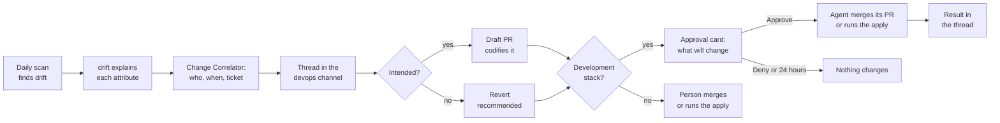

Platform Wardens has almost no screens, and that's the design. People meet the agents where they
already work: a thread in their team's Slack channel after a drift scan, a draft pull request on the stack
that drifted, and, on a development stack, a card that shows what the plan will change with **Approve**
and **Deny** on it. The operator console exists for the few things that need more than a button, and it
can now live on a phone's home screen. The UX question for every surface is the same: can the person check
the agent's work faster than they could have done it?

<!-- more -->



## Information architecture
{: #information-architecture }

| Surface | For | Holds |
|---|---|---|
| Slack, one private channel per domain cell | The cell's members, linked to their Keycloak accounts | One thread per incident: findings, the next step, follow-up questions to the agent, and approval cards with Approve, Deny and a console link |
| GitHub | Infra owners | Draft PRs from drift and Stack Author; comments on the agent's own PRs; on a development stack, the agent's merge after an approval |
| Operator console | Operators, builders, requesters, reviewers | **Home** (tiles for the last 24 hours, 7 or 30 days, then recent executions with waiting approvals first, and a table per agent linking to Grafana), **Agents** (pick an agent and a sample, preview the task, send it), **Chat** (Stack Author's conversations, **Auto** proposes an agent), **Incidents** (one incident as a flow or a timeline), **Approvals** (registry entries and level 2 actions, "Waiting for you" first); Memory, Feedback and Calibration for the roles that use them |
| Temporal UI | Builders | Each workflow's history, with the `submittedBy` memo |
| Grafana | Operators | Fleet, agent detail, model cost, Temporal and event bus dashboards |

The rule that keeps this small: **agents expose no UI or API of their own.** Every entry point and
every screen is a framework component, so a new agent appears in the console from its manifest and
samples without any UI work.

## User flows
{: #user-flows }

The daily drift flow, from the infra owner's side:



The fork after the recommendation is what changed in November
([ADR-0047](/posts/projects/platform-wardens/architecture-decision-records/#adr-0047)). On a development
stack the incident doesn't stop at a draft PR any more: it hands the merge (or, for a revert, the stack's
apply) to an approval, and the card lands in the same thread. I press **Approve** in Slack, the agent
re-checks that nothing moved since the card was sent, merges, and posts the outcome under the card. On a
production stack the flow is what it always was: a draft PR or a recommendation, and a person does the
rest. The incident itself ends after the card is sent; the approval waits in its own workflow, so a card I
don't get to until the evening is still good for 24 hours.

The Stack Author flow is the only conversational one: the person describes a change, answers the
agent's questions (cloud, environment, stack, values) by clicking a choice or typing, sees the exact
`resources.yaml` diff with any warnings, and only then presses **Open draft pull request**. The plan's
result comes back into the same conversation.

## Wireframes and prototypes
{: #wireframes-and-prototypes }

The prototype was the local console, not a wireframe. It runs against a local Temporal dev server and
sends the same root task a real trigger sends, which made it the tool for tuning prompts and stages
before any agent was deployed:

```bash
uv run python -m wardens_services.console.app --dev-server
# console on 127.0.0.1:8765, Temporal on :7233, its UI on :8233
```

Every agent's `samples/` folder holds one-click requests for it (title, description, capability,
channel, goal, data), published with its registry entry so the deployed console offers them. CI builds
a root task from every sample, so a sample that breaks its input contract fails the build. That turned
the prototype's examples into living tests.

## Visual design and design system
{: #visual-design-and-design-system }

There's no design system to speak of, by choice. The console is plain HTML from the framework. The
real visual design is in the **Slack message**, which is where most people meet an agent:

| Element | Rule |
|---|---|
| One thread per incident | The handoffs' findings are folded into the root agent's post; follow-ups and the approval card go in the same thread |
| A table per stack, a row per resource | Columns: what, who and when, why, next |
| Status in words | "codify", "revert", "investigate", never a colour alone |
| Fallback | Tables go as Markdown tables in Block Kit; if Slack rejects them, the message is resent as bullets |

Drift's Slack format was rebuilt twice in its first days: once for readability, once to collapse a
message per stack into one per incident. Both changes came from reading the messages, not from a spec.

### The approval card
{: #the-approval-card }

The card is the one place where a person's press changes the cloud, so it has to show the change, not
describe it. It's laid out like the GitHub summary of the drift scan run, because that's what I already
read:

| Part | What it shows |
|---|---|
| Title and counts | The stack and `Plan: N to import, N to add, N to change, N to destroy` |
| What will change | The first 10 resources with their action (`+` create, `~` update, `-` destroy, `-/+` replace, `<=` import), up to 5 attributes each as before → after, then "and N more" |
| Masks | `(sensitive)` and `(known after apply)`, never the value |
| What the approval binds to | The summary's hash, the PR and the scan run, linked |
| Buttons | **Approve**, **Deny**, and a console link that works without Slack |

A press counts only from a Slack user linked to a Keycloak account in the action's approver group, and
the approver recorded is that account, never a name in the request. The framework draws the card from a
generic change summary the agent supplies, so the next agent with a level 2 action gets the same card
without any Slack work.

## Interaction patterns
{: #interaction-patterns }

- **Preview before send.** The console shows the exact task envelope before it's sent.
- **The person presses the button.** Stack Author never opens a PR without a click, chat's **Auto**
  only proposes an agent and doesn't start it, and a level 2 action never runs without **Approve**.
- **Show the state of what you sent.** In the console's chat a message appears as soon as it's sent,
  with a spinner until the console has passed it on and a checkmark after. A conversation that ended
  while the tab slept shows as ended with **Start a new conversation**, and the text you typed stays in
  the box, instead of an error from Temporal.
- **Choices with an escape hatch.** A question with a known set of answers shows clickable choices, and
  the person can still type anything.
- **Show what it did, including nothing.** A finished run says why it produced no output ("out of
  scope: …") rather than staying silent.
- **Constraints only go down.** A console sample may lower a channel's level or cost limit for a task,
  never raise it.

## Responsive behavior
{: #responsive-behavior }

The surfaces people use on a phone (Slack, GitHub) are someone else's responsive design, which is a
large part of why they were chosen, and the approval card is a Slack message for the same reason: the
press most likely to happen away from a laptop happens in an app that's already on the phone.

The console caught up in November. It installs as an app (a web manifest, icons and a service worker
that caches nothing, so roles, sign-out and a new image show at once), opens full screen from the home
screen, and its Home tab and Approvals list work at phone width. An installed app has no address bar or
back button, so two small things came with it: the Approvals page has a "← Console" link, and the profile
menu shows "This app" and "Latest" versions, checks every five minutes and when the app comes back to
the foreground, and offers **Update now** when they differ. Authoring a long Stack Author conversation is
still a laptop job.

## Accessibility design
{: #accessibility-design }

The practical rules for an operations tool: text labels on every button, status in words rather than
colour, tables with header rows in Slack and in the console, and keyboard-usable forms. Grafana panels
follow the platform's dashboard conventions. Nothing has been tested with a screen reader.

## Usability testing
{: #usability-testing }

The shadow stage is the usability test. In shadow, people read and score every run, and what they
score includes whether the finding was clear enough to act on. The score has a home now: an editor marks
a run **Right** or **Wrong** from the incident's inspector in the console, a wrong run carries a
candidate eval case and blocks the agent's promotion until it's accepted or dismissed, and the Feedback
tab lists them. The changes that came from reading runs so far: one message per incident instead of one
per stack, a "who and when" column from the Change Correlator, console results that say what a run did
and why it stopped, chat answers that name the run they read and when it ran, and a ticket that turns out
to be unrelated reported as exactly that.

> **TODO:** Who besides me scores runs? Every verdict so far is mine, which is a usability test with one
> user.
{: .prompt-warning }

## Content and messaging
{: #content-and-messaging }

The agents' voice follows three rules from the design: say what was found, the evidence behind it, and
the next step; never claim certainty the evidence doesn't give ("unknown" is an allowed answer, and the
fallback when the model's output fails validation); and never put a secret or a sensitive attribute in
a message or a PR. Draft PRs stay drafts until a person acts: Stack Author requests a reviewer on the
PRs it opens, and drift comments on its own PR when it's ready for review. The one exception is drift on
a development stack, where the person's act is the **Approve** press and the agent marks its own PR ready
and squash-merges it.

The Change Correlator's wording is a good example of "never claim certainty". It reports correlation,
never cause, and when it finds a ticket by its key in a commit but the ticket's text names neither the
resource nor the change, it says `ticket <key> found, but no evidence for this change in Jira` and leaves
the ticket out of the verdict
([ADR-0036](/posts/projects/platform-wardens/architecture-decision-records/#adr-0036)'s amendment).

## Checklist
{: #checklist }

- [ ] Every agent's findings reach people in one message per incident
- [ ] Every agent has samples in the console, and CI builds them
- [ ] Status is always in words, never colour alone
- [ ] Every action that changes something has a button a person presses
- [ ] Every approval card shows what will change, masked, and links the console
- [ ] The console installs on a phone and offers an update when a new image is out
- [ ] Shadow-run verdicts are given from the inspector, by more than one person
- [ ] Every draft PR an agent opens names a reviewer or says when it's ready


