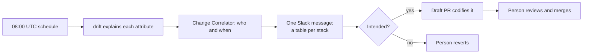

Platform Wardens has almost no screens, and that's the design. People meet the agents where they
already work: a Slack message after the drift scan, a draft pull request on the stack that drifted, a
thread under the alert. The operator console exists for the few things that need a button. The UX
question for every surface is the same: can the person check the agent's work faster than they could
have done it?

<!-- more -->



## Information architecture
{: #information-architecture }

| Surface | For | Holds |
|---|---|---|
| Slack (or Teams, email) | Everyone | One message per incident: findings, the next step, a link to the run |
| GitHub | Infra owners | Draft PRs from drift and Stack Author; comments on the agent's own PRs |
| Operator console | Operators, builders, requesters | **Send** (pick an agent, a sample, preview the task, send it), recent runs with their results, the **Author** tab (Stack Author's chat), **Auto** (the classifier proposes an agent) |
| Temporal UI | Builders | Each workflow's history, with the `submittedBy` memo |
| Grafana | Operators | Fleet, agent detail, model cost, Temporal and event bus dashboards |

The rule that keeps this small: **agents expose no UI or API of their own.** Every entry point and
every screen is a framework component, so a new agent appears in the console from its manifest and
samples without any UI work.

## User flows
{: #user-flows }

The daily drift flow, from the infra owner's side:



The Stack Author flow is the only conversational one: the person describes a change, answers the
agent's questions (cloud, environment, stack, values) by clicking a choice or typing, sees the exact
`resources.yaml` diff with any warnings, and only then presses **Open draft pull request**. The plan's
result comes back into the same conversation.

## Wireframes and prototypes
{: #wireframes-and-prototypes }

The prototype was the local console, not a wireframe. It runs against a local Temporal dev server and
sends the same root task a real trigger sends, which made it the tool for tuning prompts and stages
before any agent was deployed:

```bash
uv run python -m wardens.runtime.console --dev-server
# console on 127.0.0.1:8765, Temporal on :7233, its UI on :8233
```

Every agent's `samples/` folder holds one-click requests for it (title, description, capability,
channel, goal, data). CI builds a root task from every sample, so a sample that breaks its input
contract fails the build. That turned the prototype's examples into living tests.

## Visual design and design system
{: #visual-design-and-design-system }

There's no design system to speak of, by choice. The console is plain HTML from the framework. The
real visual design is in the **Slack message**, which is where most people meet an agent:

| Element | Rule |
|---|---|
| One message per incident | The handoffs' findings are folded into the root agent's message, not posted separately |
| A table per stack, a row per resource | Columns: what, who and when, why, next |
| Status in words | "codify", "revert", "investigate", never a colour alone |
| Fallback | Tables go as Markdown tables in Block Kit; if Slack rejects them, the message is resent as bullets |

Drift's Slack format was rebuilt twice in its first days: once for readability, once to collapse a
message per stack into one per incident. Both changes came from reading the messages, not from a spec.

## Interaction patterns
{: #interaction-patterns }

- **Preview before send.** The console shows the exact task envelope before it's sent.
- **The person presses the button.** Stack Author never opens a PR without a click, and chat's **Auto**
  only proposes an agent; it doesn't start it.
- **Choices with an escape hatch.** A question with a known set of answers shows clickable choices, and
  the person can still type anything.
- **Show what it did, including nothing.** A finished run says why it produced no output ("out of
  scope: …") rather than staying silent.
- **Constraints only go down.** A console sample may lower a channel's level or cost limit for a task,
  never raise it.

## Responsive behavior
{: #responsive-behavior }

The surfaces people use on a phone (Slack, GitHub) are someone else's responsive design, which is a
large part of why they were chosen. The operator console is a desktop tool for operators and builders;
it works on a phone for reading a run's result but isn't designed for authoring there.

> **TODO:** Should the planned approval page be designed phone-first? Approvals are the one action an
> on-call person may need to take away from a laptop.
{: .prompt-warning }

## Accessibility design
{: #accessibility-design }

The practical rules for an operations tool: text labels on every button, status in words rather than
colour, tables with header rows in Slack and in the console, and keyboard-usable forms. Grafana panels
follow the platform's dashboard conventions. Nothing has been tested with a screen reader.

## Usability testing
{: #usability-testing }

The shadow stage is the usability test. In shadow, people read and score every run, and what they
score includes whether the finding was clear enough to act on. The changes that came from that so far:
one message per incident instead of one per stack, a "who and when" column from the Change Correlator,
and console results that say what a run did and why it stopped.

> **TODO:** How are shadow-run scores recorded today, and by whom? The gate needs them per run, and the
> repo doesn't say where they're kept on the homelab.
{: .prompt-warning }

## Content and messaging
{: #content-and-messaging }

The agents' voice follows three rules from the design: say what was found, the evidence behind it, and
the next step; never claim certainty the evidence doesn't give ("unknown" is an allowed answer, and the
fallback when the model's output fails validation); and never put a secret or a sensitive attribute in
a message or a PR. Draft PRs stay drafts: Stack Author requests a reviewer on the PRs it opens, and
drift comments on its own PR when it's ready for review, so a person always does the merge.

## Checklist
{: #checklist }

- [ ] Every agent's findings reach people in one message per incident
- [ ] Every agent has samples in the console, and CI builds them
- [ ] Status is always in words, never colour alone
- [ ] Every action that changes something has a button a person presses
- [ ] The approval page's design (phone-first or not) is decided
- [ ] Shadow-run scores are recorded somewhere the gate can read
- [ ] Every draft PR an agent opens names a reviewer or says when it's ready


