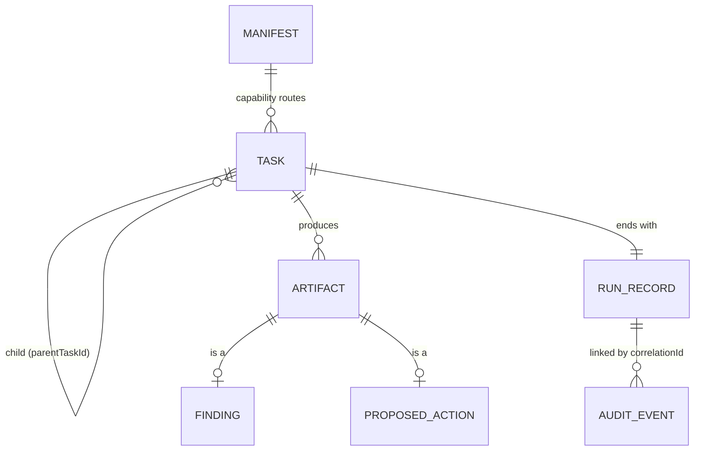

The architecture of Platform Wardens comes down to one question: where is the model allowed to make a
decision? The answer is "almost nowhere". Each agent is a deterministic Temporal workflow over stages,
and only the investigation stages call a model. The model writes explanations; code decides what
happens next and what an agent is allowed to do. Everything below follows from that.

<!-- more -->



## System context and component architecture
{: #system-context-and-component-architecture }

The diagram is the system as built on the homelab, checked against the repos on 2026-11-09. Start at
the Homelab level, open the `wardens` cluster, and play a use case: a scheduled drift run with its
handoff, an alert or a GitHub event through the ingress bus, an LLM stage behind its guardrails, a chat
with Stack Author, shipping a new agent, and (planned) a level 2 approval. The *Identity & secrets*,
*Observability* and *CI/CD* tabs show the cross-cutting paths.



The work is split into three layers, and each has one job:

| Layer | Job | Decision |
|---|---|---|
| Pydantic AI | Model calls inside one stage: typed output, validation retries, hooks and MCP tools | [ADR-0012](/posts/projects/platform-wardens/architecture-decision-records/#adr-0012) |
| Temporal | Durable execution: checkpointed history, retries, timers, approval waits and schedules | [ADR-0004](/posts/projects/platform-wardens/architecture-decision-records/#adr-0004) |
| `wardens` | Coordination and the rules every agent follows: which agent runs, what it may do, and the record of what happened | the framework package |

The `wardens` package has ten modules: `runtime` (registry built from manifests, root tasks, entry
points, the operator console), `routing`, `handoff`, `durable`, `guardrails`, `llm`, `state`,
`telemetry`, `notify` and `eval`. An agent is a folder under `agents/<domain>/<agent>/` with a
`manifest.yaml` (the source of truth), a deterministic `workflow.py`, its `stages/`, `tools/` and
`policies/`, and its evals and gate evidence. Two import rules hold it together: only `wardens.durable`
imports `temporalio`, and only `wardens.llm` builds a model client. An agent that breaks either one
breaks the design.

A run starts one of two ways. **Reactive:** an alert, a GitHub event or a person in the console becomes
a root task, routing picks the agent by capability, and the incident workflow runs it as a child.
**Proactive:** each `schedules[]` entry in a manifest becomes a Temporal Schedule, and every fire is a
fresh root task with its own correlation id.

## Technology and framework selection
{: #technology-and-framework-selection }

The framework choice changed twice before it settled, which the ADR log shows honestly: Pydantic AI
(0003), then Microsoft Agent Framework (0005), then back to Pydantic AI (0012). The reasons it came back:

- **Typed output with validation retries.** A stage asks for a Pydantic model and gets one, or the model
  is asked again. That's what lets code, not prose, carry the decision.
- **It stays inside one stage.** Pydantic AI has no opinion on orchestration, so Temporal can own
  durability and `wardens` can own the rules without fighting a framework's own loop.
- **Provider from configuration.** The same agent runs against LiteLLM on the homelab, Foundry or Azure
  OpenAI (keyless), or Anthropic, chosen by `WARDENS_LLM_*` settings.

Temporal was picked for what operations work needs and a plain queue doesn't give: a run that survives
a worker restart halfway through, timers that wait a day for an approval, retries per activity, and
schedules in the same system.

| Concern | Choice |
|---|---|
| Language and packaging | Python 3.12, one uv workspace, one lock file |
| Contracts | JSON Schema draft 2020-12, A2A-shaped ([ADR-0008](/posts/projects/platform-wardens/architecture-decision-records/#adr-0008)) |
| Telemetry | OpenTelemetry with the GenAI conventions |
| Models on the homelab | Local models behind the platform's LiteLLM gateway |
| Tools | Local read tools per agent; shared tools over MCP behind a gateway ([ADR-0031](/posts/projects/platform-wardens/architecture-decision-records/#adr-0031)) |

## API and integration architecture
{: #api-and-integration-architecture }

Agents don't call each other's APIs. They exchange **tasks and artifacts** through the framework, on
Temporal: a handoff is a child task (`parentTaskId`) whose limits can only narrow (level, cost,
deadline), and the full artifacts travel by reference in `task.contextRefs`, never as summaries.

The edges are where the outside world comes in:

| Entry or exit | How |
|---|---|
| Alertmanager | `POST` with a bearer token; only allowlisted labels are read, never annotations |
| GitHub | The GitHub App's signed `workflow_job` and `workflow_run` webhooks at `hooks.cloudutsuk.com/github`, HMAC checked before the body is parsed |
| The event bus | Both webhooks check, publish a CloudEvents envelope to an Event Hubs emulator and answer 202; one consumer starts runs at its own pace ([ADR-0030](/posts/projects/platform-wardens/architecture-decision-records/#adr-0030)) |
| People | The operator console behind Keycloak (and Cloudflare Access from outside) |
| Models | LiteLLM's OpenAI-compatible API, one virtual key per agent |
| Shared tools | MCP through LiteLLM, which signs a short-lived token that `mcp-guard` checks per agent and tool |
| Out | Slack (Block Kit), Teams and email notifications; draft pull requests through the agent's own GitHub App |

The rule that makes this safe is in the threat model: anything retrieved (a plan, a commit message, a
log line, an alert's text) is data, never instruction.

## Data architecture and data models
{: #data-architecture-and-data-models }

The data model is the contracts. Every record carries `schemaVersion` and `correlationId`, and every
schema sets `additionalProperties: false`, so a field nobody declared can't sneak in.

Where it's stored:

| Data | Store | Notes |
|---|---|---|
| Workflow history | Temporal on `wardens-db` (Postgres) | Replay, not audit; resettable |
| Run records, artifacts, dedupe claims, kill switch, audit log, memory | `wardens-state-db` (Postgres) | Outlives Temporal; run records kept 180 days (30 for confidential data); audit insert-only with a daily chain head kept in `mon` |
| Traces, metrics, logs | The platform's `mon` cluster | One trace per incident, keyed by the correlation id |

> **TODO:** The state store's other tables (artifacts, dedupe, kill switch, audit, memory) are built but
> not all wired yet. Update this table when Wardens Phase 0 step 7 is done.
{: .prompt-warning }

## Identity and access architecture
{: #identity-and-access-architecture }

Every agent is its own principal, never a person and never a shared account. On the homelab, an
agent's Kubernetes service account in `wardens` is its root identity. The cluster's service-account
issuer is published as a public OIDC discovery document, so each agent's own Entra app trusts it
through workload identity federation: an Azure call needs no stored secret. GitHub access is a
GitHub App per agent, with installation tokens minted and refreshed by the worker; a read set and a
separate write set for the one act tool that opens draft PRs.

Rules that hold everywhere:

- Read and act credentials are separate. At L0 and L1 only read identities exist.
- A handoff carries the requester's id, never a credential. The downstream agent uses its own identity.
- Every MCP server authorises the calling agent itself; it never trusts the agent to have checked.
- People sign in through Keycloak (realm `homelab`) for the console and the Temporal UI. Approvals will
  use an OIDC token whose groups the endpoint checks; a service account can't approve.

Details and the threats this answers are in
[Security and Privacy](/posts/projects/platform-wardens/06-security-and-privacy/#authentication-and-authorization).

## Hosting and deployment model
{: #hosting-and-deployment-model }

The first deployment is the `wardens` k3d cluster of the Cloudutsuk Platform homelab. It runs Temporal
on its own Postgres, the state store, the `wardens` runtime (console, webhooks, ingress consumer,
router), and **one worker per agent**, each with its own task queue, namespace, service account,
NetworkPolicy and kill-switch ConfigMap. Models come from the `ai` cluster through LiteLLM, telemetry
goes to `mon`, secrets come from OpenBao in `core`.

Nothing deploys from the wardens repo. On `main`, an agent's workflow runs its tests on the homelab
runner, then calls the platform's reusable build, which builds a signed image into Zot and writes the
digest into `homelab-gitops/apps/<agent>/values.yaml`. Argo CD deploys it with the shared
`wardens-agent` chart. A new agent is a manifest, a Dockerfile, a values file and a workflow file.

The Azure target is AKS with self-hosted Temporal on Azure Database for PostgreSQL, Foundry behind APIM,
Entra Workload ID and Key Vault, planned in the repo's phase documents.

## Scalability and performance strategy
{: #scalability-and-performance-strategy }

Agent runs are bursty and slow (minutes, mostly waiting on a model or an API), so the design scales by
**isolation and back-pressure**, not by raw throughput:

- **A task queue per agent.** A slow agent never starves another; each worker scales on its own.
- **The bus absorbs bursts.** Webhooks answer in milliseconds and the consumer starts runs as Temporal
  can take them. The target is 1,000 alerts and 5,000 GitHub events with nothing lost and every
  expected run started within 5 minutes (the load test is still to run).
- **Parallel children with a cap.** The incident workflow runs up to four handoffs at once by default.
- **Cost is a limit, not a report.** A run's cost ceiling becomes token limits; a handoff's cost is
  capped at the target agent's own ceiling.
- **Shared agents run with two replicas or more** and per-caller budgets in the target plan, because a
  fault there reaches every domain.

> **TODO:** What's the expected run volume per agent per day once the SRE agents take every warning
> and critical alert? That sets the worker counts and model capacity in [Infrastructure](/posts/projects/platform-wardens/11-infrastructure-and-environments/#capacity-and-quota-planning).
{: .prompt-warning }

## Resilience and disaster recovery
{: #resilience-and-disaster-recovery }

| Failure | What happens |
|---|---|
| A worker pod dies mid-run | Temporal resumes the workflow on another worker from its last completed activity |
| Temporal is down | The webhooks still answer; the bus keeps the events and the consumer waits |
| The state database is down | Run records fall back to a local file, a metric counts it and an alert fires |
| The model endpoint fails | A circuit breaker per dependency opens; `CircuitOpen` is never retried by an activity |
| A GitHub delivery is lost | The daily schedule still runs the drift agent; a redelivery job is planned |
| A running workflow's code changes | `workflow.patched` versioning, and recorded histories replayed in CI |
| Something is wrong and spreading | The kill switch fails closed and stops the agent within 60 seconds |

Both Postgres databases are dumped nightly to another host and kept seven nights until Velero backs up
`wardens`. Temporal's own database is treated as resettable; the state store is the one that matters.

> **TODO:** What recovery point and recovery time are acceptable for `wardens-state-db` once audit
> events live there? The nightly dump means up to a day of run records can be lost today.
{: .prompt-warning }

## Architectural decision records
{: #architectural-decision-records }

Decisions live in the wardens repo as numbered records and are published here as they change. Thirty
records so far: the framework (Pydantic AI, Temporal, A2A-shaped contracts), autonomy and routing,
and a long run of proposed decisions from the homelab build (gateways, golden paths, release path,
event bus, MCP). The homelab-specific choices (the `wardens` cluster, self-hosted Temporal, an
identity per agent, the deployment standard) are recorded as Cloudutsuk Platform ADRs 0069 to 0072.



## Checklist
{: #checklist }

- [ ] Only `wardens.durable` imports `temporalio` and only `wardens.llm` builds a model client (checked in review)
- [ ] Every agent's manifest validates and its README restates it
- [ ] Every schema change ships with every caller in the same PR
- [ ] The system diagram matches the repos after each phase step (re-port from the wardens repo)
- [ ] The state store's remaining tables are wired, and the data table above is updated
- [ ] The bus load test has run and the scalability numbers are measured, not targets
- [ ] RPO and RTO for the state store are agreed
- [ ] Proposed ADRs that the build has proven are moved to accepted


