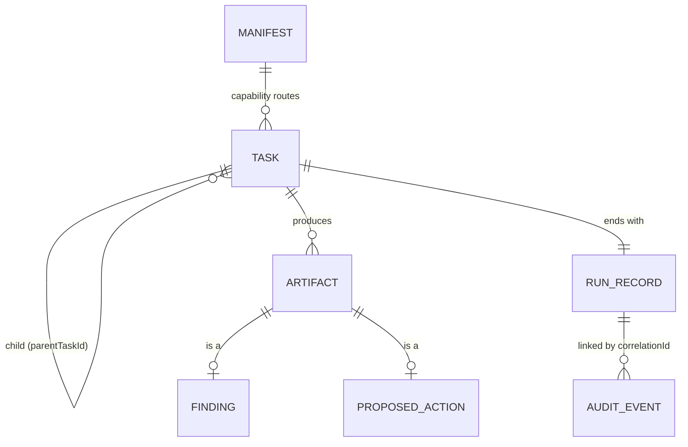

The architecture of Platform Wardens comes down to one question: where is the model allowed to make a
decision? The answer is "almost nowhere". Each agent is a deterministic Temporal workflow over stages,
and only the investigation stages call a model. The model writes explanations; code decides what
happens next and what an agent is allowed to do, and the few acts that change something wait for a
person's approval. Everything below follows from that.

<!-- more -->



## System context and component architecture
{: #system-context-and-component-architecture }

The diagram is the system as built on the homelab, checked against the repos on 2026-11-25. Start at
the Homelab level, open the `wardens` cluster, and play a use case: a drift run with its handoff, an
alert or a GitHub event through the ingress bus, a level 2 approval pressed in Slack, asking wardens in
Slack, an LLM stage behind its guardrails, a chat with Stack Author, a pull request's checks and security
scans, an agent's life cycle from merge to shadow (with the registry approval CI asks for when it raises
risk), and a framework release reaching every agent. Temporal shows one task queue per worker. The *CI/CD & SDLC*, *Security scans*, *Identity &
secrets*, *State & audit* and *Observability* tabs show the cross-cutting paths.



The work is split into three layers, and each has one job:

| Layer | Job | Decision |
|---|---|---|
| Pydantic AI | Model calls inside one stage: typed output, validation retries, hooks and MCP tools | [ADR-0012](/posts/projects/platform-wardens/architecture-decision-records/#adr-0012) |
| Temporal | Durable execution: checkpointed history, retries, timers, approval waits and schedules | [ADR-0004](/posts/projects/platform-wardens/architecture-decision-records/#adr-0004) |
| `wardens` | Coordination and the rules every agent follows: which agent runs, what it may do, and the record of what happened | the framework package |

### Repositories and distributions
{: #repositories-and-distributions }

Until 2026-11-19 everything lived in one repository. Then every agent moved to its own `warden-<agent>`
repository and started importing `wardens` as a versioned library
([ADR-0040](/posts/projects/platform-wardens/architecture-decision-records/#adr-0040)). The reason was
the missing boundary: agents imported internal modules, the framework found agents by walking the folder
tree, and 44 of the first 154 merges changed the framework and an agent in the same pull request. Now
there are four kinds of repository, each with one job:

| Repository | Holds | Ships as |
|---|---|---|
| `platform-wardens` | The `wardens` framework, `wardens-services`, `mcp-guard`, the agent template and the design docs | The `wardens` wheel in a signed FROM-scratch image (`platform/wardens-py:<version>`), plus the router, console and `mcp-guard` images |
| `warden-<agent>` (six today) | One agent: its manifest, workflow, stages, tools, evals and docs, made from the copier template with `wardens new-agent` | Its own worker image, built only by homelab-gitops `agent-ci.yaml` |
| `wardens-deploy` | The versioned agent registry and the deploy config that names agents, cells or channels | ConfigMaps Argo CD renders into each namespace |
| `homelab-gitops` | Which image digest runs where, and the shared `wardens-agent` chart | What Argo CD applies |

The framework is two distributions. `wardens` is the agent SDK, the only thing an agent installs.
`wardens-services` holds what only the platform runs: the router worker, the operator console, the
webhooks and Slack relay, the ingress consumer, the incident read model and the approval endpoint. It
imports `wardens`, never the reverse. A subpackage's public names are its `__all__`; agents and services
import only those, and a test fails CI otherwise.

The `wardens` package has grown from ten modules to about twenty: the original `runtime`, `routing`,
`handoff`, `durable`, `guardrails`, `llm`, `state`, `telemetry`, `notify` and `eval`, plus what the split
needed: `registry`, `contracts` (the schemas shipped inside the wheel), `config`, `clients` (every GitHub,
Azure, AWS, Jira and Kubernetes client, read and act apart), `tools`, `errors`, `check` (behind `wardens
check-agent`), `docs`, `release` and `eval_run`. Two import rules still hold it together: only
`wardens.durable` imports `temporalio`, and only `wardens.llm` builds a model. `lint-imports` fails CI on
either in the framework, and check-agent refuses them in an agent repository.

An agent pins one `wardens` release in two places that move together: `pyproject.toml` and the
Dockerfile's wheel image digest. A release reaches the agents as `wardens bump` pull requests, which also
bring template changes through `copier update`. All six pin 0.10.0 (2026-11-25).

### How a run starts
{: #how-a-run-starts }

A run starts one of two ways. **Reactive:** an alert, a GitHub event, a Slack message or a person in the
console becomes a root task, and the incident workflow runs the chosen agent as a child. The router
(`wardens-router`, two workers) is the only host of the incident workflow: every entry point starts it on
the router's task queue, routing picks the agent by capability, and the child runs on that agent's own
queue. A drift scan that finds nothing starts `terraform-drift.task` alone, with no incident and no
message, so a chat question can still read the latest scan.
**Proactive:** each `schedules[]` entry in a manifest becomes a Temporal Schedule, and every fire is a
fresh root task with its own correlation id. Cluster Upgrade Readiness is the one agent with a schedule
today (weekly, Monday 06:00 IST); the drift agent had a daily schedule until it moved to running only
when a scan finds drift ([ADR-0032](/posts/projects/platform-wardens/architecture-decision-records/#adr-0032)).

Where an agent is allowed to change something, the act no longer happens inside the run. The run hands
the level 2 action to an approve-then-act workflow, also hosted by the router, which asks a person and
only then calls the agent's act once
([ADR-0047](/posts/projects/platform-wardens/architecture-decision-records/#adr-0047)). The
[identity section](#identity-and-access-architecture) covers who can press Approve.

## Technology and framework selection
{: #technology-and-framework-selection }

The framework choice changed twice before it settled, which the ADR log shows honestly: Pydantic AI
(0003), then Microsoft Agent Framework (0005), then back to Pydantic AI (0012). The reasons it came back:

- **Typed output with validation retries.** A stage asks for a Pydantic model and gets one, or the model
  is asked again. That's what lets code, not prose, carry the decision.
- **It stays inside one stage.** Pydantic AI has no opinion on orchestration, so Temporal can own
  durability and `wardens` can own the rules without fighting a framework's own loop.
- **Provider from configuration.** The same agent runs against LiteLLM on the homelab, Foundry or Azure
  OpenAI (keyless), or Anthropic, chosen by `WARDENS_LLM_*` settings.

Temporal was picked for what operations work needs and a plain queue doesn't give: a run that survives
a worker restart halfway through, timers that wait a day for an approval, retries per activity, and
schedules in the same system.

| Concern | Choice |
|---|---|
| Language and packaging | Python 3.12 and uv: one workspace and lock for the framework and services, one lock per agent repository; packages through the homelab Nexus proxy, only releases at least 14 days old |
| Framework distribution | The `wardens` wheel in a signed image in Zot; agents pin a version ([ADR-0040](/posts/projects/platform-wardens/architecture-decision-records/#adr-0040)) |
| Contracts | JSON Schema draft 2020-12, A2A-shaped ([ADR-0008](/posts/projects/platform-wardens/architecture-decision-records/#adr-0008)) |
| Telemetry | OpenTelemetry with the GenAI conventions |
| Models on the homelab | Local models behind the platform's LiteLLM gateway |
| Tools | Local read tools per agent; shared tools over MCP behind a gateway ([ADR-0031](/posts/projects/platform-wardens/architecture-decision-records/#adr-0031)) |

## API and integration architecture
{: #api-and-integration-architecture }

Agents don't call each other's APIs. They exchange **tasks and artifacts** through the framework, on
Temporal: a handoff is a child task (`parentTaskId`) whose limits can only narrow (level, cost,
deadline), and the full artifacts travel by reference in `task.contextRefs`, never as summaries.

The edges are where the outside world comes in:

| Entry or exit | How |
|---|---|
| Alertmanager | `POST` with a bearer token; only allowlisted labels are read, never annotations |
| GitHub | The GitHub App's signed `workflow_job` and `workflow_run` webhooks at `hooks.cloudutsuk.com/github`, HMAC checked before the body is parsed; the same App's org and repository change events are recorded for the Change Correlator |
| Slack | Events, button presses and `/wardens` commands at `hooks.cloudutsuk.com/slack/*`; the relay checks Slack's signature, and the consumer checks it again ([ADR-0041](/posts/projects/platform-wardens/architecture-decision-records/#adr-0041)) |
| The event bus | Every relay, and the console's Send, publishes a CloudEvents envelope to an Event Hubs emulator and answers at once; one consumer starts runs at its own pace ([ADR-0030](/posts/projects/platform-wardens/architecture-decision-records/#adr-0030), [ADR-0038](/posts/projects/platform-wardens/architecture-decision-records/#adr-0038)) |
| People | The operator console behind Keycloak (and Cloudflare Access from outside), and the four cell channels in Slack |
| CI | Machine routes on the console, each accepting only one workflow's GitHub OIDC token: the nightly evals' feedback read, agent-ci's registry approval request, and wardens-deploy's approvals sync |
| Models | LiteLLM's OpenAI-compatible API, one virtual key per agent |
| Shared tools | MCP through LiteLLM, which signs a short-lived token that `mcp-guard` checks per agent and tool |
| Out | Slack posts only through the chat egress worker (threads, answers, approval cards), Teams and email notifications; draft pull requests, merges and applies through the agent's own GitHub App |

The rule that makes this safe is in the threat model: anything retrieved (a plan, a commit message, a
log line, an alert's text, a Slack message, a Jira ticket) is data, never instruction.

## Data architecture and data models
{: #data-architecture-and-data-models }

The data model is the contracts. Every record carries `schemaVersion` and `correlationId`, and every
schema sets `additionalProperties: false`, so a field nobody declared can't sneak in.

Where it's stored:

| Data | Store | Notes |
|---|---|---|
| Workflow history | Temporal on `wardens-db` (Postgres) | Replay, not audit; resettable |
| Run records, artifacts, dedupe and action claims, kill switch, audit log, memory | `wardens-state-db` (Postgres) | Outlives Temporal; run records kept 180 days (30 for confidential data); audit insert-only with a daily chain head kept in `mon` |
| Approvals, people's verdicts on runs, judge samples | `wardens-state-db` | Written by the console; the nightly evals read verdicts through the console as a read-only role |
| Chat links, threads, turns and message text | `wardens-state-db` | Chat text is kept by reference here and stays out of Temporal history, which holds only hashes and ids |
| GitHub change events | `wardens-state-db` | A whitelisted summary of each org or repository change, kept 400 days ([ADR-0034](/posts/projects/platform-wardens/architecture-decision-records/#adr-0034)) |
| Agent registry entries | `wardens-deploy` in git, then ConfigMaps | One folder per agent version; a published version never changes ([ADR-0042](/posts/projects/platform-wardens/architecture-decision-records/#adr-0042)) |
| Traces, metrics, logs | The platform's `mon` cluster | One trace per incident, keyed by the correlation id |

> **TODO:** The incident workflow still keeps its task tree in workflow state, not in the state store,
> and agents use few stores beyond run records. Update this table when that changes.
{: .prompt-warning }

## Identity and access architecture
{: #identity-and-access-architecture }

Every agent is its own principal, never a person and never a shared account. On the homelab, an
agent's Kubernetes service account in `wardens` is its root identity. The cluster's service-account
issuer is published as a public OIDC discovery document, so each agent's own Entra app trusts it
through workload identity federation: an Azure call needs no stored secret. GitHub access is a
GitHub App per agent, with installation tokens minted and refreshed by the worker; a read set and a
separate write set for the act tools (terraform-drift's draft PR, and its merge or apply after an
approval). The Change Correlator's AWS source is built the same way: a read-only role that trusts the
same cluster OIDC issuer, so no AWS key is stored; the role itself is still to be created
([ADR-0035](/posts/projects/platform-wardens/architecture-decision-records/#adr-0035)).

Rules that hold everywhere:

- Read and act credentials are separate. At L0 and L1 only read identities exist.
- A handoff carries the requester's id, never a credential. The downstream agent uses its own identity.
- Every MCP server authorises the calling agent itself; it never trusts the agent to have checked.
- People sign in through Keycloak (realm `homelab`) for the console and the Temporal UI. A service
  account can't approve anything.
- A Slack user becomes a platform principal only through a link they confirm after signing in to the
  console. A level 2 Approve or Deny press counts only from a linked person whose Keycloak account is
  enabled and in the action's approver group, read at the press; the decision is built from the request
  the workflow holds, never from the press.
- CI never holds a password for the console. agent-ci, the nightly evals and wardens-deploy's approvals
  sync each send a GitHub OIDC token minted for one audience, and the console checks the workflow, the
  branch and the organisation before answering
  ([ADR-0044](/posts/projects/platform-wardens/architecture-decision-records/#adr-0044),
  [ADR-0048](/posts/projects/platform-wardens/architecture-decision-records/#adr-0048)).
- A registry entry that raises an agent's risk needs an approval record signed with an OpenBao transit
  key the console uses and never sees. Starting the sync after an approval uses the console's own GitHub
  App, which can do nothing but start workflows in wardens-deploy
  ([ADR-0049](/posts/projects/platform-wardens/architecture-decision-records/#adr-0049)).

Details and the threats this answers are in
[Security and Privacy](/posts/projects/platform-wardens/06-security-and-privacy/#authentication-and-authorization).

## Hosting and deployment model
{: #hosting-and-deployment-model }

The first deployment is the `wardens` k3d cluster of the Cloudutsuk Platform homelab. It runs Temporal
on its own Postgres, the state store, the services (console, webhooks and Slack relay, ingress consumer,
chat egress, and the router with two workers), and **one worker per agent**, each with its own task
queue, namespace, service account, NetworkPolicy and kill-switch ConfigMap. All six agents are deployed:
five in shadow, cicd-triage still in build. Models come from the `ai` cluster through LiteLLM, telemetry
goes to `mon`, secrets come from OpenBao in `core`.

Nothing deploys from an agent repository either. Each `warden-<agent>` calls homelab-gitops
`agent-ci.yaml`: on a pull request its checks, security gates and eval gate; on `main` it also pushes a
signed, attested image to Zot, writes the digest into `homelab-gitops/apps/<agent>/values.yaml` and
publishes the agent's registry entry to wardens-deploy. Argo CD deploys the digest with the shared
`wardens-agent` chart, renders wardens-deploy as a second source (the `wardens-registry-<agent>` and
`wardens-config` ConfigMaps, one sync wave earlier), and Kyverno admits only images agent-ci attested.
Inside the pod, `WARDENS_REGISTRY_DIR` and `WARDENS_CONFIG_DIR` point at those files: every reader of
other agents' manifests goes through `wardens.registry.agents_root()`, and the deploy config (routing,
entry points, ownership, webhooks, redaction, chat) is no longer in the wheel, so a worker without
`WARDENS_CONFIG_DIR` refuses to start. Reloader rolls the pods that mount the config when it changes.
Python packages for every build come through the homelab's Nexus proxy, never straight from PyPI.

A new agent is `wardens new-agent` (a repository from the template, with its CI already wired) and a
values file in homelab-gitops.

The Azure target is AKS with self-hosted Temporal on Azure Database for PostgreSQL, Foundry behind APIM,
Entra Workload ID and Key Vault, planned in the repo's phase documents.

## Scalability and performance strategy
{: #scalability-and-performance-strategy }

Agent runs are bursty and slow (minutes, mostly waiting on a model or an API), so the design scales by
**isolation and back-pressure**, not by raw throughput:

- **A task queue per agent.** A slow agent never starves another; each worker scales on its own. The
  router's own queue has an SLO of 99% of tasks started within 5 seconds.
- **Versions are measured, not declared.** The router reads each agent's `wardens` version from its
  queue's pollers: one minor version behind is routed with a warning, two behind is refused.
- **The bus absorbs bursts.** Webhooks answer in milliseconds and the consumer starts runs as Temporal
  can take them. The target is 1,000 alerts and 5,000 GitHub events with nothing lost and every
  expected run started within 5 minutes (the load test is still to run).
- **Parallel children with a cap.** The incident workflow runs up to four handoffs at once by default.
- **Cost is a limit, not a report.** A run's cost ceiling becomes token limits; a handoff's cost is
  capped at the target agent's own ceiling.
- **Shared agents run with two replicas or more** and per-caller budgets in the target plan, because a
  fault there reaches every domain.

> **TODO:** What's the expected run volume per agent per day once the SRE agents take every warning
> and critical alert? That sets the worker counts and model capacity in [Infrastructure](/posts/projects/platform-wardens/11-infrastructure-and-environments/#capacity-and-quota-planning).
{: .prompt-warning }

## Resilience and disaster recovery
{: #resilience-and-disaster-recovery }

| Failure | What happens |
|---|---|
| A worker pod dies mid-run | Temporal resumes the workflow on another worker from its last completed activity |
| Temporal is down | The webhooks still answer; the bus keeps the events and the consumer waits |
| The state database is down | Run records fall back to a local file, a metric counts it and an alert fires |
| The model endpoint fails | A circuit breaker per dependency opens; `CircuitOpen` is never retried by an activity |
| A GitHub delivery is lost | A daily job lists the GitHub App's deliveries of the last 26 hours and re-sends every one that never got a 2xx (at most 100 a run) |
| A running workflow's code changes | `workflow.patched` versioning, and recorded histories replayed in CI (in each agent's CI, so a bump PR catches a framework change that would replay differently) |
| A level 2 approval waits overnight | The approve-then-act workflow outlives the incident: up to 24 hours, expiry is a denial, and the act checks again that the PR or plan hasn't changed since it was asked |
| The approvals sync isn't started | The console's dispatch is best-effort; the five-minute cron runs the same sync |
| The bus's storage restarts | The consumer recreates its checkpoint container before every read, instead of retrying until someone restarts it |
| Something is wrong and spreading | The kill switch fails closed and stops the agent within 60 seconds |

Both Postgres databases are dumped nightly to another host and kept seven nights until Velero backs up
`wardens`. Temporal's own database is treated as resettable; the state store is the one that matters.

> **TODO:** What recovery point and recovery time are acceptable for `wardens-state-db` once audit
> events live there? The nightly dump means up to a day of run records can be lost today.
{: .prompt-warning }

## Architectural decision records
{: #architectural-decision-records }

Decisions live in the platform-wardens repo as numbered records, one log for the framework and every
agent, and are published here as they change. Records 0001 to 0049 so far: the framework (Pydantic AI,
Temporal, A2A-shaped contracts), autonomy and routing, the homelab build (gateways, golden paths,
release path, event bus, MCP), change evidence (GitHub, AWS CloudTrail, Jira), and the latest run: one
repository per agent, wardens-deploy's registry, team chat, level 2 approvals in Slack and registry
approvals asked by CI. The homelab-specific choices (the `wardens` cluster, self-hosted Temporal, an
identity per agent, the deployment standard, agent-ci) are recorded as Cloudutsuk Platform ADRs.



## Checklist
{: #checklist }

- [ ] Only `wardens.durable` imports `temporalio` and only `wardens.llm` builds a model (`lint-imports` and check-agent fail otherwise)
- [ ] Every agent's manifest validates, its agent card is regenerated and its README restates it
- [ ] A schema tightening ships only in a major `wardens` release, after the expand step
- [ ] The system diagram matches the repos after each phase step (re-port from the platform-wardens repo)
- [ ] terraform-drift's level 2 waiver ends on 2026-12-20 or after 30 approved runs, and the evidence floors and Promote gate apply from then
- [ ] The incident workflow keeps its state in the state store, and the data table above is updated
- [ ] The bus load test has run and the scalability numbers are measured, not targets
- [ ] RPO and RTO for the state store are agreed
- [ ] Proposed ADRs that the build has proven are moved to accepted


