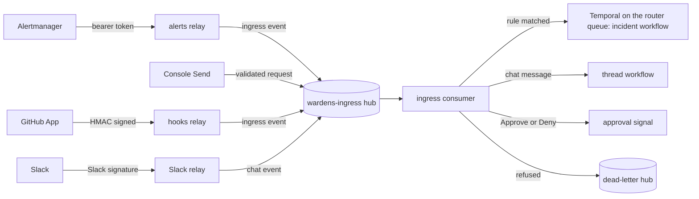

Platform Wardens owns very little data and reads a lot of other people's. Its own data is the record of
what the agents did: run records, artifacts, the audit chain. Everything else (plans, logs, Activity Log
entries, alerts) belongs to another system and is read with the agent's own identity, at the moment
it's needed. The integration work is mostly about the edges: what comes in, in what shape, and what
happens when it comes in twice.

<!-- more -->



## Data ownership and classification
{: #data-ownership-and-classification }

| Data | Owner | Classification |
|---|---|---|
| Run records, artifacts, audit log, memory | The framework (`wardens-state-db`) | Declared per agent; redacted before storage |
| Approvals, verdicts on runs, chat links and threads | The services (`wardens-state-db`) | Internal; chat text is checked for secrets before it's kept, and stays out of Temporal history |
| Workflow history | Temporal (`wardens-db`) | Operational; replay only |
| Manifests, prompts, eval cases | The agent's owner, in the agent's own `warden-<agent>` repository | Reviewed like code |
| Published registry entries, deploy config | `wardens-deploy` | Reviewed; an entry that raises risk needs a signed approval |
| Plans, CI logs, Activity Log, CloudTrail, Jira tickets, cluster state | The system that produced them | Read in place, referenced, not copied |
| Traces, metrics, logs | The platform's `mon` cluster | Redacted at the source |

Each manifest's `dataClassification` names the highest class the agent may touch and whether it may
reach a model. For the agents running today that's infrastructure metadata, and secrets or sensitive
attribute values are stripped before anything leaves the tool. The one exception to "nothing about
people reaches a model" was designed out rather than allowed: when the Change Correlator ranks Jira
tickets, assignees, reporters and comment authors aren't sent, and emails, mentions and account ids are
removed from the text first
([ADR-0036](/posts/projects/platform-wardens/architecture-decision-records/#adr-0036)).

## Data retention and deletion
{: #data-retention-and-deletion }

| Data | Kept | How it goes |
|---|---|---|
| Run records | 180 days; 30 for confidential data | `python -m wardens.state.maintenance` deletes expired rows |
| Audit log | 365 days; insert-only, the chain's daily head anchored in `mon` | Maintenance deletes only from the oldest end, up to the first event still kept, so a gap in the middle would read as tampering |
| Memory items | Until their own expiry, and only after review | Each item carries source, expiry and a review flag |
| GitHub change events | 400 days | A whitelisted summary per delivery, never the whole payload |
| Chat messages and threads | Message text 30 days; a thread's row 30 days past its last message | A thread expires after 48 idle hours (configurable per cell) and takes no new messages |
| Action claims | 30 days | One claim per act, so a retried act runs once |
| Registry entries | For good | A published version never changes; the registry keeps every version so a rollback is checked against its own manifest |
| Temporal history | Temporal's namespace retention | Resettable: nothing depends on it after a run ends |
| Drift's shared module checkout | One run | Deleted after the run |

Retention is a constant in the framework's state module (180, 30 and 365 days), so changing it is a
reviewed code change, not a setting someone can quietly turn down.

## Database schema and migrations
{: #database-schema-and-migrations }

The state store's schema is owned by the framework as numbered migrations, applied by
`python -m wardens.state.migrate`. In gitops it runs as a plain Kubernetes Job from the console image,
named after the newest migration (twenty migrations by wardens 0.10.0, the last for the chat link's
channel). A Job can't change once created,
so a new migration means a new Job name and an image that carries it; migrating twice changes nothing.
It's a sync wave after the password and pull secrets, and not an Argo CD hook, so self-heal never
recreates a finished Job.

Roles are per writer: the schema owner applies migrations, and each writer connects with a role that
can do only what it needs: `wardens_agent` for the agents, `wardens_console`, `wardens_ingress` for the
consumer's chat path, and `wardens_eval`, which can only `SELECT` people's verdicts and judge samples for
the nightly evals. The audit table takes inserts, not updates, and memory has row-level security per
agent. Order matters when a migration adds a column a new image writes: the schema Job applies it
first, then the image rolls out.

## Data validation and quality
{: #data-validation-and-quality }

Every record is validated twice: when it's written and when it's read back.

- JSON Schema (draft 2020-12, `additionalProperties: false`) for task, message, artifact, finding,
  proposed action, change event, run record, ingress event, incident view, eval case and the manifest.
  The schemas ship inside the `wardens` wheel, so an agent repository needs no copy of them.
- Agents never validate against the schemas themselves: the binding does it on the worker, the task
  before the run and every emitted artifact after, from the manifest it was given.
- Cross-field rules JSON Schema can't express, in code: the owner and reviewer differ, action tools are
  act tools, schedules name an existing capability, and more.
- A record that fails validation at the agent's boundary is a bug in the agent and is never sent.
- The file artifact store validates on write and on read, so a hand-edited artifact can't sneak back in.

Between agents, the contract is checked before deploy, not discovered in production. wardens-deploy's CI
runs consumer-driven contract checks for every declared handoff on each agent's two newest versions, the
deployed one and the one a rollback goes back to, using the producer's own samples as evidence
([ADR-0042](/posts/projects/platform-wardens/architecture-decision-records/#adr-0042)).

Contracts change by expand, then contract: a new field arrives as optional, and a schema change that
refuses what the last release accepted ships only in a major `wardens` release. `wardens release check`
compares the schemas with the last release and fails a tightening that isn't named.

Quality of what the agents *say* is a different problem, handled by evals: a deterministic claim check
confirms every id in a finding appears in a tool's output.

## Import and export requirements
{: #import-and-export-requirements }

There's no bulk import or export. The exports that matter are the run record (readable by people,
linked from every notification), the OTLP stream of spans and metrics to `mon`, and each agent's
registry entry, which agent-ci publishes to wardens-deploy on every merge (its manifest, schemas,
samples, accepted eval report and a `source.json` naming the commit, run and image digest that built it).
People's verdicts on runs leave the console only one way: a read-only endpoint the nightly evals call,
which serves run id, stage, verdict, state and case id and nothing about the people
([ADR-0044](/posts/projects/platform-wardens/architecture-decision-records/#adr-0044)).

The one import is eval cases: drift's cases were harvested from real drift scans of `infra-azure`, and
CI/CD triage's 42 real cases from harvested failed runs (plus 17 from the failure lab), each stored as
YAML with the inputs and the expected outcome.

## External systems and third-party integrations
{: #external-systems-and-third-party-integrations }

| System | Used by | How |
|---|---|---|
| GitHub | Drift, Stack Author, CI/CD triage, the Change Correlator, the webhook | A GitHub App per agent; installation tokens; signed webhooks in, including org and repository change events |
| Azure (Resource Graph, Activity Log) | Drift, Change Correlator | Entra workload identity federation, read only |
| AWS CloudTrail event history | Change Correlator | `LookupEvents` through a federated read-only role, no keys; built, waiting for its role and a live check ([ADR-0035](/posts/projects/platform-wardens/architecture-decision-records/#adr-0035)) |
| Jira Cloud | Change Correlator | REST search, read only, a dedicated viewer account whose token is in OpenBao; a model only ranks the candidates the rules found ([ADR-0036](/posts/projects/platform-wardens/architecture-decision-records/#adr-0036)) |
| Kubernetes APIs | Cluster Upgrade Readiness | Read only, with its own 15-minute service account token |
| LiteLLM | Every model call, MCP | A virtual key per agent, a model key and an MCP-only key |
| Alertmanager (Mimir) | Incident triage | Webhook with a bearer token |
| Slack | Team chat, approval cards | One app: events, presses and commands in through the relay; posts out only from the chat egress worker, which alone holds the bot token |
| Slack, Teams, email (notify) | Findings digests and failure notices | Incoming webhooks, Teams Workflows, Graph email |
| SearXNG (web search) | Agents granted it | MCP through LiteLLM and `mcp-guard` |

The Change Correlator's decision ([ADR-0016](/posts/projects/platform-wardens/architecture-decision-records/#adr-0016))
sets the rule for adding one: a provider's own MCP server is used only where it passes our acceptance
test; otherwise the agent reads the API itself.

## Event and messaging contracts
{: #event-and-messaging-contracts }

Inside, agents talk only through Temporal, with A2A-shaped tasks, messages and artifacts. At the edge,
events arrive as a CloudEvents envelope (`ingress-event` schema) on an Event Hubs emulator in `wardens`
([ADR-0030](/posts/projects/platform-wardens/architecture-decision-records/#adr-0030)). Since
2026-11-16 the console's Send takes the same path, so what an operator tests is what an alert runs
([ADR-0038](/posts/projects/platform-wardens/architecture-decision-records/#adr-0038)), and since
2026-11-19 so does Slack ([ADR-0041](/posts/projects/platform-wardens/architecture-decision-records/#adr-0041)):

The relays answer as soon as the event is on the hub, or 503 if the hub won't take it. The consumer
reads at its own pace, waits while Temporal is down, skips stale events, and dead-letters a refused task
at once. Delivery is at least once, so the workflow id is derived from the source event (for a drift
scan, `incident-drift-<owner>-<repo>-<run>`) and Temporal refuses a second start.

Chat has three event types of its own: a message or `/wardens` command, a button press, and a member
change. The consumer checks Slack's signature again over the signed body the event carries, refuses a
message that holds a secret without storing it, and keeps text by reference so that Temporal history
holds only ids and hashes. An Approve or Deny press carries only an opaque id; the consumer turns it into
the approval signal for the waiting approve-then-act workflow, and only for a linked person in the
action's approver group.

The agent registry is a contract too. Every reader of another agent's manifest, schemas or samples (the
router, handoffs, the console, the webhooks, the MCP allow lists) goes through one function,
`wardens.registry.agents_root()`, which reads `WARDENS_REGISTRY_DIR`, laid out as
`<agent>/<version>/`. The router uses the entry for the version the worker reports, so a rolled-back
image is checked against its own manifest.

## Backup and restore strategy
{: #backup-and-restore-strategy }

Until Velero backs up the `wardens` cluster, a nightly dump of both Postgres databases goes to another
host, kept for seven nights, with an alert if a dump is late. The state store is the one that matters;
Temporal's database can be reset without losing anything a person needs.

> **TODO:** Has a restore of `wardens-state-db` from the nightly dump been tested? Record the date and
> how long it took in [Support and Maintenance](/posts/projects/platform-wardens/16-support-and-maintenance/#backup-verification).
{: .prompt-warning }

## Data migration and reconciliation
{: #data-migration-and-reconciliation }

There's no legacy data to migrate. The closest thing is the run records that used to be written to a
local file in each worker pod and were lost with the pod: since the state store went live, they go to
Postgres, and a record that can't be stored falls back to the local file and is counted, so the gap is
visible on a dashboard instead of silent.

The move to one repository per agent was a migration of files, not data. The agent folders became
wardens-deploy's first registry entries (`wardens registry build`, 2026-11-19), the deploy config moved
out of the wheel into wardens-deploy `config/`, and each agent repository started fresh with a first
commit naming the platform-wardens commit it came from. The old history stays readable in
platform-wardens at the last commit that had each folder.

If the Azure target happens, the migration is the state store itself (Postgres to Azure Database for
PostgreSQL), and the audit chain's anchors are how you'd reconcile that nothing was lost or changed.

## Checklist
{: #checklist }

- [ ] Every agent declares its data classification and whether data reaches a model
- [ ] Retention for every store is written down, including the audit log
- [ ] A new migration ships with a new schema Job name and an image that carries it
- [ ] Every edge validates its input against a schema before acting
- [ ] Every declared handoff passes wardens-deploy's contract check on both newest versions of each agent
- [ ] Every event source's workflow id makes a redelivery a no-op
- [ ] A restore of the state store from the nightly dump has been tested
- [ ] Velero backs up `wardens`, and the nightly dump's job is reviewed


