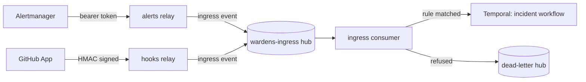

Platform Wardens owns very little data and reads a lot of other people's. Its own data is the record of
what the agents did: run records, artifacts, the audit chain. Everything else (plans, logs, Activity Log
entries, alerts) belongs to another system and is read with the agent's own identity, at the moment
it's needed. The integration work is mostly about the edges: what comes in, in what shape, and what
happens when it comes in twice.

<!-- more -->



## Data ownership and classification
{: #data-ownership-and-classification }

| Data | Owner | Classification |
|---|---|---|
| Run records, artifacts, audit log, memory | The framework (`wardens-state-db`) | Declared per agent; redacted before storage |
| Workflow history | Temporal (`wardens-db`) | Operational; replay only |
| Manifests, prompts, eval cases | The agent's owner, in git | Reviewed like code |
| Plans, CI logs, Activity Log, cluster state | The system that produced them | Read in place, referenced, not copied |
| Traces, metrics, logs | The platform's `mon` cluster | Redacted at the source |

Each manifest's `dataClassification` names the highest class the agent may touch and whether it may
reach a model. For the agents running today that's infrastructure metadata, and secrets or sensitive
attribute values are stripped before anything leaves the tool.

## Data retention and deletion
{: #data-retention-and-deletion }

| Data | Kept | How it goes |
|---|---|---|
| Run records | 180 days; 30 for confidential data | `python -m wardens.state.maintenance` deletes expired rows |
| Audit log | 365 days; insert-only, the chain's daily head anchored in `mon` | Maintenance deletes only from the oldest end, up to the first event still kept, so a gap in the middle would read as tampering |
| Memory items | Until their own expiry, and only after review | Each item carries source, expiry and a review flag |
| Temporal history | Temporal's namespace retention | Resettable: nothing depends on it after a run ends |
| Drift's shared module checkout | One run | Deleted after the run |

Retention is a constant in the framework's state module (180, 30 and 365 days), so changing it is a
reviewed code change, not a setting someone can quietly turn down.

## Database schema and migrations
{: #database-schema-and-migrations }

The state store's schema is owned by the framework as numbered migrations, applied by
`python -m wardens.state.migrate`. In gitops it runs as a plain Kubernetes Job from the console image,
named after the newest migration (`wardens-state-schema-0006` today). A Job can't change once created,
so a new migration means a new Job name and an image that carries it; migrating twice changes nothing.
It's a sync wave after the password and pull secrets, and not an Argo CD hook, so self-heal never
recreates a finished Job.

Roles are per writer: the schema owner applies migrations, and each agent and the console connect
with a role that can do only what it needs (the audit table takes inserts, not updates).

## Data validation and quality
{: #data-validation-and-quality }

Every record is validated twice: when it's written and when it's read back.

- JSON Schema (draft 2020-12, `additionalProperties: false`) for task, message, artifact, finding,
  proposed action, change event, run record, ingress event and the manifest.
- Cross-field rules JSON Schema can't express, in code: the owner and reviewer differ, action tools are
  act tools, schedules name an existing capability, and more.
- A record that fails validation at the agent's boundary is a bug in the agent and is never sent.
- The file artifact store validates on write and on read, so a hand-edited artifact can't sneak back in.

Quality of what the agents *say* is a different problem, handled by evals: a deterministic claim check
confirms every id in a finding appears in a tool's output.

## Import and export requirements
{: #import-and-export-requirements }

There's no bulk import or export. The two exports that matter are the run record (readable by people,
linked from every notification) and the OTLP stream of spans and metrics to `mon`. The one import is
eval cases: drift's cases were harvested from real drift scans of `infra-azure`, and CI/CD triage's
42 real cases from harvested failed runs (plus 17 from the failure lab), each stored as YAML with the inputs and the expected outcome.

## External systems and third-party integrations
{: #external-systems-and-third-party-integrations }

| System | Used by | How |
|---|---|---|
| GitHub | Drift, Stack Author, CI/CD triage, the webhook | A GitHub App per agent; installation tokens; signed webhooks in |
| Azure (Resource Graph, Activity Log) | Drift, Change Correlator | Entra workload identity federation, read only |
| Kubernetes APIs | Cluster Upgrade Readiness, incident triage (planned) | Read only; short-lived tokens planned |
| LiteLLM | Every model call, MCP | A virtual key per agent, a model key and an MCP-only key |
| Alertmanager (Mimir) | Incident triage | Webhook with a bearer token |
| Slack, Teams, email | Notify | Incoming webhooks, Teams Workflows, Graph email |
| SearXNG (web search) | Agents granted it | MCP through LiteLLM and `mcp-guard` |

The Change Correlator's decision ([ADR-0016](/posts/projects/platform-wardens/architecture-decision-records/#adr-0016))
sets the rule for adding one: a provider's own MCP server is used only where it passes our acceptance
test; otherwise the agent reads the API itself.

## Event and messaging contracts
{: #event-and-messaging-contracts }

Inside, agents talk only through Temporal, with A2A-shaped tasks, messages and artifacts. At the edge,
events arrive as a CloudEvents envelope (`ingress-event` schema) on an Event Hubs emulator in `wardens`
([ADR-0030](/posts/projects/platform-wardens/architecture-decision-records/#adr-0030)):

The relays answer 202 as soon as the event is on the hub, or 503 if the hub won't take it. The consumer
reads at its own pace, waits while Temporal is down, skips stale events, and dead-letters a refused task
at once. Delivery is at least once, so the workflow id is derived from the source event (for a drift
scan, `incident-drift-<owner>-<repo>-<run>`) and Temporal refuses a second start.

## Backup and restore strategy
{: #backup-and-restore-strategy }

Until Velero backs up the `wardens` cluster, a nightly dump of both Postgres databases goes to another
host, kept for seven nights, with an alert if a dump is late. The state store is the one that matters;
Temporal's database can be reset without losing anything a person needs.

> **TODO:** Has a restore of `wardens-state-db` from the nightly dump been tested? Record the date and
> how long it took in [Support and Maintenance](/posts/projects/platform-wardens/16-support-and-maintenance/#backup-verification).
{: .prompt-warning }

## Data migration and reconciliation
{: #data-migration-and-reconciliation }

There's no legacy data to migrate. The closest thing is the run records that used to be written to a
local file in each worker pod and were lost with the pod: since the state store went live, they go to
Postgres, and a record that can't be stored falls back to the local file and is counted, so the gap is
visible on a dashboard instead of silent.

If the Azure target happens, the migration is the state store itself (Postgres to Azure Database for
PostgreSQL), and the audit chain's anchors are how you'd reconcile that nothing was lost or changed.

## Checklist
{: #checklist }

- [ ] Every agent declares its data classification and whether data reaches a model
- [ ] Retention for every store is written down, including the audit log
- [ ] A new migration ships with a new schema Job name and an image that carries it
- [ ] Every edge validates its input against a schema before acting
- [ ] Every event source's workflow id makes a redelivery a no-op
- [ ] A restore of the state store from the nightly dump has been tested
- [ ] Velero backs up `wardens`, and the nightly dump's job is reviewed


