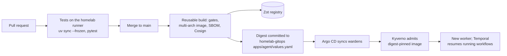

Platform Wardens has two release paths that are easy to confuse. One ships code: a merge builds a signed
image and Argo CD deploys its digest, the same way as everything else on the homelab. The other ships
**trust**: an agent moving from shadow to promote to operate, or from L0 to L1. The first is automated
end to end. The second never is, and that's on purpose.

<!-- more -->



## Build automation
{: #build-automation }

Each image has its own workflow (`terraform-drift.yaml`, `change-correlator.yaml`, `stack-author.yaml`,
`incident-triage.yaml`, `cicd-triage.yaml`, `mcp-guard.yaml`, `wardens-console.yaml`), and each runs only
when a file in its image or its tests changes. Docs-only changes (READMEs, changelogs, an agent's
`docs/`) build nothing, but prompts (`*.prompt.md`) count as code. Images are built from the repo root
because they need the workspace lock, `framework/` and `contracts/`.

The *CI/CD* tab of the [system diagram](/posts/projects/platform-wardens/05-technical-architecture/#system-context-and-component-architecture)
walks the same path between the real components.

## Automated test execution
{: #automated-test-execution }

On a pull request and on `main`, the workflow runs on the self-hosted `homelab` runner: `uv sync
--frozen`, the framework tests (with a local Temporal), then the agent's own unit tests. Any change to
`framework/`, `contracts/`, `pyproject.toml` or `uv.lock` triggers every image that contains them, so a
framework change is tested by every agent that depends on it.

> **TODO:** The eval suites aren't wired into CI yet (the `eval` module's *Not yet* column). Which
> changes should run them automatically, and against which model, given CI can't reach a live model?
{: .prompt-warning }

## Static analysis and security scanning
{: #static-analysis-and-security-scanning }

The platform's reusable build runs the same gates for every image on the homelab: Gitleaks (secrets),
Semgrep (code), Trivy (image and dependencies), Checkov (Dockerfile and config), Hadolint (Dockerfile),
an SBOM, and a Cosign signature. A gate that fails stops the push. The repo carries
`.gitleaksignore` and `.semgrepignore` for the known false positives (the Event Hubs emulator's public
development key, recorded CI logs in eval fixtures), each added in a PR that said why.

## Artifact and container management
{: #artifact-and-container-management }

Images go to the platform's Zot registry in `core`, signed with Cosign, built for amd64 and arm64. Gitops
pins them by digest, never by tag, and Kyverno refuses an image that isn't pinned. An agent's image holds
the framework, the contracts and that agent only; the console's image holds the framework plus every
agent's manifest, input schemas and samples, but no agent code.

## Deployment automation
{: #deployment-automation }

A push to `main` that changes an image ends with a commit to `homelab-gitops` that updates the image
digest in `apps/<agent>/values.yaml`. Argo CD in `platform` syncs it to `wardens` with the shared
`wardens-agent` chart. CI never talks to the cluster. When a worker restarts on a new image, Temporal
hands its running workflows to the new worker, which is why workflow code changes go behind
`workflow.patched` and are replay-tested first.

## Database deployment strategy
{: #database-deployment-strategy }

The state store's migrations are numbered and idempotent, run by a Kubernetes Job named after the
newest migration (`wardens-state-schema-0006` today) from the console image, in an Argo CD sync wave
after its secrets. Shipping a migration means a new Job name and a digest of an image that carries the
migration. Temporal's schema has its own Job the same way.

## Approval gates
{: #approval-gates }

On GitHub Free there are no environment approvals, so the merge is the code gate: a reviewed pull
request is the approval to deploy. The gates that matter more are the lifecycle gates, and they're
evidence, not buttons:

| Gate | Moves an agent | Needs |
|---|---|---|
| G2 Build | build → shadow | Evals meet floors, run record and kill switch proven |
| G3 Shadow | shadow → promote | Scored live runs meet floors, zero safety failures |
| G4 Promote | to a higher level | Evidence for that level, ROI, the reviewer's sign-off |

The proposed release path ([ADR-0023](/posts/projects/platform-wardens/architecture-decision-records/#adr-0023))
ties the two together: one digest is promoted from shadow to operate on the evidence gathered with that
exact digest, with provenance, a behaviour hash, a rehearsed rollback and retirement without leftovers.

## Versioning and release notes
{: #versioning-and-release-notes }

Each agent has a `version` in its manifest and its own `CHANGELOG.md`; the framework is versioned with
the workspace. Images are identified by digest, and the digest commit in gitops is the release record.
Every record carries `schemaVersion`, so a reader knows which contract a stored run record used.

## Rollback and roll-forward procedures
{: #rollback-and-roll-forward-procedures }

- **Rollback** is reverting the digest commit in `homelab-gitops`; Argo CD syncs the old image.
- **A bad agent in production** is stopped first, rolled back second: the kill switch stops it within
  60 seconds without waiting for a deploy.
- **Running workflows** survive both directions only if the change was patched; an unpatched change to
  workflow code can break a run that's waiting, which the replay test is there to catch.
- **Roll-forward** is the normal fix: a new PR, a new digest.

> **TODO:** Has a rollback (revert the digest, confirm the old worker resumes a running workflow) been
> rehearsed on `wardens`? ADR-0023 wants it rehearsed before promotion.
{: .prompt-warning }

## Release calendar
{: #release-calendar }

There isn't one. Code ships when it merges, several times a day in busy weeks. The one timing rule worth
keeping is about schedules: drift runs at 08:00 UTC, two hours after the daily drift scan, so a deploy
of the drift worker is better outside that window. The `overlap: skip` and catch-up window on the
schedule mean a deploy during it costs a delayed run, not a lost one.

## Checklist
{: #checklist }

- [ ] Every image has its own workflow with path filters, and docs-only changes build nothing
- [ ] Framework changes build and test every image that contains them
- [ ] Every image is signed, multi-arch and pinned by digest in gitops
- [ ] Workflow code changes are patched and replay-tested
- [ ] A rollback has been rehearsed on `wardens`
- [ ] Eval suites run automatically on the changes that need them
- [ ] An agent's stage changes only with its gate evidence in `gates/`


