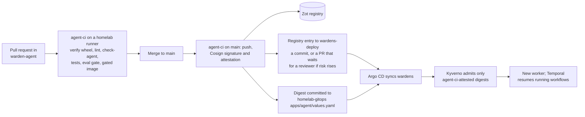
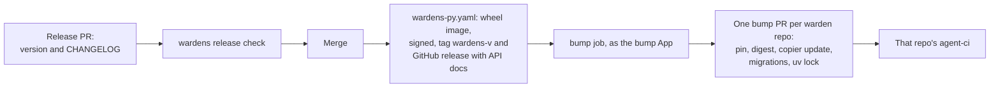

Platform Wardens has three release paths that are easy to confuse. The library ships as a versioned
`wardens` wheel, and bump pull requests carry it to each agent. An agent ships from its own repository: a
merge builds a signed image, publishes a registry entry and Argo CD deploys the digest. And an agent ships
**trust**: moving from shadow to promote to operate, or from L1 to L2. The first two are automated end to
end. The third never is, and that's on purpose.

<!-- more -->



## Build automation
{: #build-automation }

Since the split ([ADR-0040](/posts/projects/platform-wardens/architecture-decision-records/#adr-0040)),
images are built where their code lives:

| Repo | Workflow | Builds |
|---|---|---|
| Each `warden-<agent>` | `ci.yaml`, calling homelab-gitops `agent-ci.yaml` | The agent's image and registry entry |
| platform-wardens | `wardens-py.yaml` | The `wardens` wheel image and the release |
| platform-wardens | `wardens-router.yaml`, `wardens-console.yaml`, `mcp-guard.yaml` | The router, console and `mcp-guard` images |
| platform-wardens | `pr.yaml`, `lint.yaml`, `evals-nightly.yaml` | Nothing: checks, docs drift, nightly evals |
| wardens-deploy | `ci.yaml`, `approvals-sync.yaml` | Nothing: registry checks, approved entries merged |

`agent-ci.yaml` is the only publish path for an agent: it builds the image itself (instead of nesting the
platform's generic build) so that the signature and attestation it writes can be tied to that one
workflow. The path from an agent's pull request to a running worker:

The *CI/CD* tab of the [system diagram](/posts/projects/platform-wardens/05-technical-architecture/#system-context-and-component-architecture)
walks the same path between the real components.

## Automated test execution
{: #automated-test-execution }

Everything runs on the self-hosted `homelab` runners, ten of them since 2026-11-18, shared with every
other repo on the homelab.

**platform-wardens, on a pull request**, runs one job, `pr.yaml`'s `checks` (an owner decision on
2026-11-18, after one framework PR started about 22 jobs that spent 258 minutes queueing for 29 minutes of
work). It mirrors the local checks in order: `uv sync --frozen`, `wardens docs check`, ruff, `lint-imports`,
pyright, `wardens release check`, the framework, services and mcp-guard tests, and the wheel test (the
wheel installed outside the checkout, both suites run against it). Later steps run after a failed one, so
one run shows every failure. A docs-only PR runs just the docs check. A per-component workflow starts on a
PR only when its own image's files change, and then only builds with gates. **On `main`** every workflow
runs in full.

**An agent repo** runs agent-ci on every PR and on `main`: verify and install the pinned wheel, ruff,
`check-agent`, the agent card check, unit and replay tests, and the eval gate (`wardens eval run .
--model test --gate`). The gate fails on a safety failure, a regression against the agent's
`evals/accepted.json` for the same model family, or a missed threshold in a recorded run.

**Nightly**, at 02:17 UTC, `evals-nightly.yaml` runs every agent repository's eval set against the live
model, each with the wheel it pins and the model settings it's deployed with
([ADR-0046](/posts/projects/platform-wardens/architecture-decision-records/#adr-0046)), and sends the
scores to Mimir for the eval alerts. That answers the question I used to leave open here: deterministic
evals gate every PR, live-model evals run on a schedule, and CI never needs a live model to merge.

## Static analysis and security scanning
{: #static-analysis-and-security-scanning }

The image gates are the same for every image on the homelab: Gitleaks (secrets), Semgrep (code), Trivy
(image and dependencies), Checkov (Dockerfile and config), Hadolint (Dockerfile), an SBOM, and a Cosign
signature. A gate that fails stops the push. Code checks come before them: ruff with banned APIs, pyright
and import-linter in every repo, and `check-agent` in each agent repo (the template's folders, the manifest
rules, the agent card, the supply-chain policy and the pin matching its digest).

Trivy pushes back in a useful way. The agent template carries an `APT_REFRESH` date that, when moved
(2026-11-23 most recently), makes a new or bumped agent re-run the apt upgrade and pick up the Debian fixes
the gate asks for. The repos keep `.gitleaksignore` and `.semgrepignore` for known false positives (the
Event Hubs emulator's public development key, recorded CI logs in eval data), each added in a PR that said
why.

## Artifact and container management
{: #artifact-and-container-management }

Everything lands in the platform's Zot registry in `core`, signed with Cosign:

| Artifact | Built by | Notes |
|---|---|---|
| `platform/wardens-py:<version>` | platform-wardens | `FROM scratch`, just the wheel in `/wheels/`; agents copy it in, so there's no base image and each agent keeps one lock |
| `platform/warden-<agent>` | That agent's agent-ci | The agent, its pinned `wardens` and its OS packages; nothing else |
| Router, console, `mcp-guard` | platform-wardens | The router and console install `wardens-services` too, which is never published |
| `registry/<agent>/<version>/` | agent-ci, in wardens-deploy | Manifest, schemas, samples, accepted eval report, approval record when needed, and the build it came from. A published version never changes |

Release tags never move, gitops pins images by digest, and Kyverno on `wardens` refuses an agent image
that isn't both signed and carrying an `agent-ci` attestation whose signer is `agent-ci.yaml`. The console's
image no longer carries any agent's manifest: it reads the registry like every other pod.

## Deployment automation
{: #deployment-automation }

An agent's `main` run ends with two writes: the image digest into homelab-gitops
`apps/<agent>/values.yaml`, and the registry entry into wardens-deploy. Argo CD in `platform` syncs both
to `wardens` with the shared `wardens-agent` chart. CI never talks to the cluster.

A registry entry that raises risk over the agent's last one (a higher action level, a new act tool, a
bigger budget, wider bounds; decision 0040 rule 5) can't merge by itself. Since
[ADR-0048](/posts/projects/platform-wardens/architecture-decision-records/#adr-0048) agent-ci asks the
console for the approval when it opens the pull request, the reviewer presses Approve on the console's
Approvals page, and wardens-deploy's `approvals-sync` commits the signed `approval.json`, re-runs the
checks and merges. [ADR-0049](/posts/projects/platform-wardens/architecture-decision-records/#adr-0049)
has the console start that sync right after the press, because GitHub's five-minute cron ran late or not
at all under load.

When a worker restarts on a new image, Temporal hands its running workflows to the new worker, which is
why workflow code changes go behind `workflow.patched` and are replay-tested first.

## Database deployment strategy
{: #database-deployment-strategy }

The state store's migrations are numbered and idempotent (they reached 0020 with `wardens` 0.9.0), run
by a Kubernetes Job named after the newest migration, from the console image, in an Argo CD sync wave
after its secrets. Shipping a migration means a new Job name and a digest of an image that carries the
migration. Temporal's schema has its own Job the same way.

## Approval gates
{: #approval-gates }

On GitHub Free there are no environment approvals or required checks on a private repo, and the org stays
on Free on purpose (decision 0040 rule 9). So the guarantees come from the publish path instead: only
agent-ci can produce an admissible image, and only a signed approval lets a risk-raising registry entry
in. For ordinary code the merge is the gate.

The lifecycle gates matter more, and they're evidence, not buttons:

| Gate | Moves an agent | Needs |
|---|---|---|
| G2 Build | build → shadow | Evals meet floors, run record and kill switch proven |
| G3 Shadow | shadow → promote | Scored live runs meet floors, zero safety failures |
| G4 Promote | to a higher level | Evidence for that level, ROI, the reviewer's sign-off |

terraform-drift's level 2 actions are the one deliberate exception so far: an owner waiver
([ADR-0047](/posts/projects/platform-wardens/architecture-decision-records/#adr-0047)) lets it merge or
apply after a Slack approval on development and qa stacks only, for 30 days or 30 approved runs, before
the floors apply as written. The proposed release path
([ADR-0023](/posts/projects/platform-wardens/architecture-decision-records/#adr-0023)) ties code and trust
together: one digest is promoted on the evidence gathered with that exact digest.

## Versioning and release notes
{: #versioning-and-release-notes }

`wardens` is semantic over its public API: each subpackage's `__all__`, the contracts and the `wardens`
command. Every framework change adds a line under `## [Unreleased]` in `framework/CHANGELOG.md`, and a
release is just a PR that sets the version and renames that section:

`wardens release check` is what keeps a minor version honest. It compares the contracts with the last
release: an expansion passes, a tightening (a removed field, a new `required`, a narrower type) fails
unless the CHANGELOG names it and the release is a major. Since
[ADR-0043](/posts/projects/platform-wardens/architecture-decision-records/#adr-0043) it does the same for
`check-agent` rules: it renders the last release's template fresh and checks out every agent repo, and a
rule they now fail is breaking too. Nobody pushes a `wardens-v*` tag by hand; the release job tags with a
GitHub App token and can re-run safely
([ADR-0045](/posts/projects/platform-wardens/architecture-decision-records/#adr-0045)), after 0.5.0 needed
a hand-made tag.

Each agent has its own `version` in its manifest and its own `CHANGELOG.md`, and each version is a
registry entry. Every run record carries `schemaVersion` and the `frameworkVersion` the worker ran.

## Rollback and roll-forward procedures
{: #rollback-and-roll-forward-procedures }

- **Rollback** of an agent is reverting the digest commit in `homelab-gitops`; Argo CD syncs the old
  image. The router uses the registry entry whose version matches what the worker reports, so the
  manifest rolls back with the image.
- **A bad agent in production** is stopped first, rolled back second: the kill switch stops it within 60
  seconds without waiting for a deploy.
- **A bad `wardens` release** is fixed forward: `wardens bump` refuses a downgrade, so the fix is a new
  patch release and its bump PRs (0.8.1 and 0.9.1 were exactly that).
- **Running workflows** survive both directions only if the change was patched; the replay test catches
  an unpatched change to workflow code.

> **TODO:** Has a rollback (revert the digest, confirm the old worker resumes a running workflow) been
> rehearsed on `wardens`? ADR-0023 wants it rehearsed before promotion.
{: .prompt-warning }

## Release calendar
{: #release-calendar }

There isn't one. Code ships when it merges: `wardens` went from 0.2.0 to 0.10.0 in eight days
(2026-11-18 to 2026-11-25), fourteen releases counting a candidate and the patches, and every final
release opened bump PRs in the agent repos. On `main` a running build is never
cancelled, and a newer waiting commit replaces an older waiting one.

Schedules matter less than they did. terraform-drift no longer has one: since
[ADR-0032](/posts/projects/platform-wardens/architecture-decision-records/#adr-0032) it runs on drift-scan
events. The only agent schedule now is cluster-upgrade-readiness, weekly on Monday 06:00 IST with
`overlap: skip` and a 12-hour catch-up window, so a deploy during it costs a delayed run, not a lost one.

## Checklist
{: #checklist }

- [ ] Every agent image comes only from its own repo's agent-ci
- [ ] A platform-wardens PR runs one `checks` job and is pushed once it passes locally
- [ ] Every framework change has a CHANGELOG line, and `wardens release check` passes
- [ ] Every image is signed and pinned by digest; agent images carry the agent-ci attestation
- [ ] Bump PRs merge within a week of each release
- [ ] Workflow code changes are patched and replay-tested
- [ ] A rollback has been rehearsed on `wardens`
- [ ] An agent's stage changes only with its gate evidence in `gates/`


