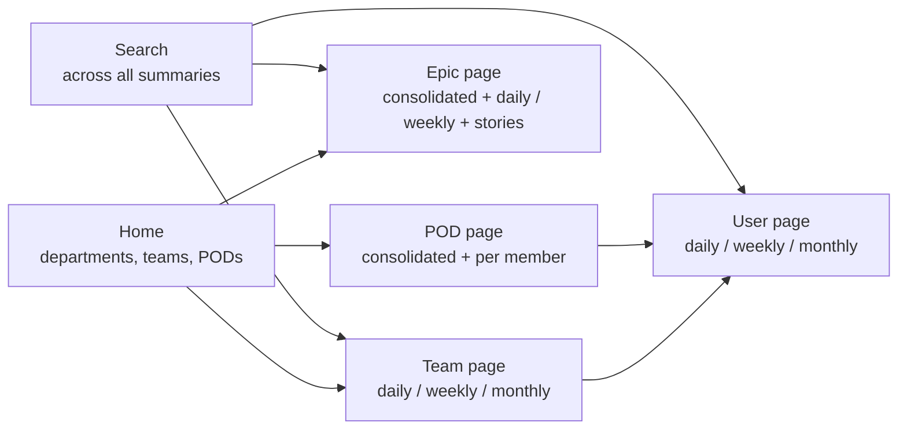

The product of the Productivity Dashboard is prose: Markdown summaries written by an AI. So the UI's
job is not charts but **reading**: finding the right summary fast, reading it comfortably, checking
it against its source when it matters, and fixing it with one click when the data was late. Everything
in the interface serves one of those four actions.

<!-- more -->



## Information architecture
{: #information-architecture }

Four page types, one for each summary level, each with the same period tabs. Which views appear is
configuration: `visible_views` (team, user, epic, pod), `visible_teams` and the POD list come from the
chart's ConfigMap through `GET /api/config`, so a view can be turned off without a release.

## User flows
{: #user-flows }

- **Read:** Home → team → user → *Daily* tab → summary.
- **Verify:** on a user page, open the raw collector data for that day (`/api/collector-data`) next to
  the summary, to see exactly which PRs and tickets it was written from.
- **Refresh:** *Refresh* starts a Kubernetes Job that regenerates that user's, team's, epic's or POD's
  summary; the button polls `/api/refresh/status` until it's done.
- **Find:** the search bar calls `POST /api/search` across every summary.
- **Share:** print or export a summary for an email or a review document.

## Wireframes and prototypes
{: #wireframes-and-prototypes }

For a reading-first product, the first prototype is the Markdown file itself. Generated `summary.md`
files on the share are readable before any UI exists, so the summary format (headings, sections, level
of detail) can be designed with users by showing them real files, and the UI designed around the
format afterwards.

> **TODO:** Were early summaries shared as files or in chat before the UI existed, and what feedback
> shaped the format?
{: .prompt-warning }

## Visual design and design system
{: #visual-design-and-design-system }

The frontend is React 18 with Vite and Tailwind CSS; summaries render through `react-markdown` with
`remark-gfm` for tables and task lists, plus syntax highlighting for code blocks. Shared components keep
pages consistent:

| Component | Job |
|---|---|
| `FilterPanel` | Department, team, user and date filters |
| `SummaryViewer` + `MarkdownRenderer` | Render a summary with a table of contents |
| `UserTabs` | Daily / weekly / monthly switcher |
| `TimelineView` | Summaries along a date axis |
| `SearchBar` | Full-text search |
| `RefreshCacheButton` | On-demand regeneration with status polling |
| `PrintExport` | Print or export |
| `CollectorStats` | Whether collector data exists for a date |

Tailwind's typography defaults suit long-form text well; the one design rule I'd add is a comfortable
reading width (around 70 to 80 characters) for summaries, however wide the screen.

## Interaction patterns
{: #interaction-patterns }

- **Period tabs everywhere**, in the same place on every page type.
- **Date as the main filter**, because every summary is for a day, week or month.
- **Refresh as an explicit action** with visible progress, not a silent background job, because it
  costs AI tokens and takes time.
- **Source next to summary**, so verification is one click rather than a trip to GitHub and Jira.

## Responsive behavior
{: #responsive-behavior }

Unlike a table-heavy dashboard, summaries read well on a phone: they're headings and bullet points.
That makes mobile worth supporting for the daily view, since standup is often joined from a phone. The
filter panel should collapse into a drawer at narrow widths.

> **TODO:** How does the UI behave at phone width today?
{: .prompt-warning }

## Accessibility design
{: #accessibility-design }

- Keep the rendered Markdown semantic: real headings and lists help screen readers navigate a summary.
- Make the table of contents keyboard-navigable and announce refresh progress with an ARIA live region.
- Don't encode status (generated, missing, refreshing) in colour alone.
- Run an automated check (axe or Lighthouse) against the built app in CI.

## Usability testing
{: #usability-testing }

Two five-minute tasks cover the important paths: "Find what your team did last week and copy it into an
email" for a manager, and "Check whether yesterday's summary missed anything of yours" for an engineer.
The second one tests the verify flow, which matters most for trust.

> **TODO:** Has any usability feedback been gathered from engineers, managers or executives?
{: .prompt-warning }

## Content and messaging
{: #content-and-messaging }

The content is AI-written, so the messaging rules live in the prompts. The current daily prompt already
sets good ones: specific accomplishments, PRs summarized with what and why, Jira tickets referenced by
key, blockers called out, grouping by epic or POD label, and no filler such as "worked on Jira tickets"
or "no pull requests today".

Two UI messages matter as much as the prose:

- Label every summary as **AI-generated from GitHub and Jira**, with the generation time.
- Show **"no activity recorded"** clearly when a collector found nothing, so absence of data is never
  mistaken for absence of work.

## Checklist
{: #checklist }

- [ ] Four page types with identical period tabs
- [ ] Views, teams and PODs controlled by `/api/config`
- [ ] Source data one click away from every summary
- [ ] Refresh shows progress and completion
- [ ] Every summary labelled as AI-generated, with its generation time
- [ ] Comfortable reading width; daily view usable on a phone
- [ ] Accessibility check in CI


