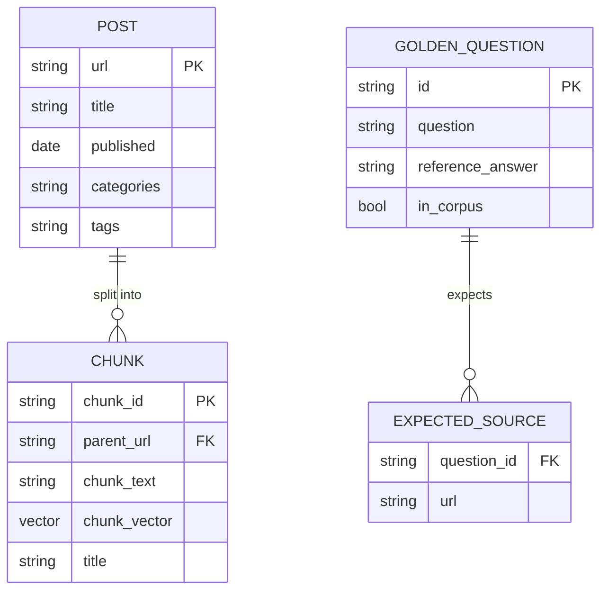

The central architectural choice is that one search index serves four ways of answering. Standard RAG, a Foundry
IQ knowledge base, a Foundry agent and an Agent Framework agent all read the same chunks, so when one mode wins
the comparison it's because of how it retrieves, not what it retrieves from.

<!-- more -->



## System context and component architecture
{: #system-context-and-component-architecture }

The diagram covers both the first slice and the enterprise target. Components with a phase badge are planned;
the rest are applied. Click a group to open it, or pick a use case in the sidebar to replay it hop by hop:

- syncing the blog;
- asking a question, with and without a cache hit;
- the agentic path;
- ingesting a new source through the enterprise pipeline, including an item that fails a gate;
- scoring a change.

The views show identities, telemetry, the deploy path and the vector store benchmark.



| Component | Role | Built from |
|---|---|---|
| Corpus sync | Cleans the posts and uploads changed ones, daily and when the blog publishes | GitHub Actions workflow in the lab repo |
| Blob container `posts` | One JSON document per post: cleaned text with title, URL, date, categories and tags as fields | Storage account, shared key off |
| Search indexer and skillset | Reads blobs, splits text, calls the embedding model, writes chunks | Azure AI Search (Foundry IQ), Basic |
| Index | Chunk text, vector, title, URL, date, tags; vectorizer; semantic configuration | JSON in the lab repo |
| Knowledge base | Agentic retrieval over the same index | Foundry IQ, REST `2026-10-01` |
| Foundry agent | Agent Service agent with the knowledge base as an MCP tool | Foundry project |
| rag-api | Standard mode and the Agent Framework agent; one `/chat` endpoint with `mode=` | Python, FastAPI, Container Apps |
| Models | One embedding and one chat deployment | Foundry |
| Application Insights | Traces, metrics, logs | Log Analytics workspace |
| Eval harness | Golden set through every mode and the homelab RAG | Python, `make eval` |
| Data Factory (Phase 10) | One pipeline per source, from one template, copying into the lake's raw zone | Data Factory, consumption-billed ([ADR 0016](/posts/projects/rag-on-cloud/architecture-decision-records/#adr-0016)) |
| Data Lake (Phase 10) | Zones `raw` (as fetched, kept for replay), `curated` (one canonical schema), `quarantine` (failed items) | Data Lake Storage Gen2, folder permissions per source |
| Processing (Phase 10) | Extractor per format, quality gates, PII check, lineage | Azure Functions (Flex Consumption), Document Intelligence, AI Language |
| Semantic cache (Phase 11) | Answers repeated questions without retrieval or generation | Azure Managed Redis ([ADR 0017](/posts/projects/rag-on-cloud/architecture-decision-records/#adr-0017)) |

## Technology and framework selection
{: #technology-and-framework-selection }

| Need | Choice | Why, and what I passed over |
|---|---|---|
| Retrieval | Azure AI Search | Hybrid search, semantic ranker, integrated vectorization and knowledge bases in one service. A vector-only store (Cosmos DB, Postgres with pgvector) would need the ranker and agentic layer built by hand |
| Embedding model | `text-embedding-3-small`, `Standard` deployment | Cheap, well supported by the embedding skill and vectorizer |
| Chat model | `gpt-5-mini`, `DataZoneStandard` deployment (ADR 0013) | Small and cheap, and answers here are short and grounded in retrieved chunks. The platform's terraform-drift agent is priced against the same model. A bigger model only if the golden set shows generation, not retrieval, is the weak part |
| Orchestrator | A plain FastAPI pipeline in the shared core; Microsoft Agent Framework for the Azure agent mode (ADR 0006, proposed) | A fixed search-then-generate sequence needs no framework and must run on every cloud; Microsoft's agentic RAG guidance uses Agent Framework, and Semantic Kernel's agent features moved into it |
| Hosting | Container Apps, consumption | Scales to zero, managed identity, built-in Entra sign-in. App Service would bill idle |
| IaC | Terraform through the platform's shared module (ADR 0003) | Same scanners, state and review as every other Azure stack; azd would be faster but bypasses that |
| Language | Python | Matches the homelab `rag-api`, so the scorer and prompts are shared |
| Enterprise ingestion (Phase 10) | Data Factory, a Data Lake with medallion zones, Functions ([ADR 0016](/posts/projects/rag-on-cloud/architecture-decision-records/#adr-0016)) | Connectors, triggers, retries and run history with no idle cost. Fabric fits an organisation that already pays for a capacity; this lab's budget doesn't |
| Speed (Phase 11) | Measure each stage first, then tune the index and add a semantic cache ([ADR 0017](/posts/projects/rag-on-cloud/architecture-decision-records/#adr-0017)) | Generation takes seconds and retrieval tens of milliseconds, so a faster vector store would speed up the smallest stage. Cosmos DB and pgvector are benchmarked on the same data instead of assumed |
| Multi-cloud layout | A shared core plus one adapter folder per cloud (ADR 0009) | AWS and GCP come later from the same repo; a per-cloud repo would let prompts and scorer drift, a framework over every cloud would hide the native services |

The shared core is what doesn't import a cloud SDK: the API, prompts, citations, "not found" handling and the scorer.
Each cloud implements three small interfaces, and its ingestion is that cloud's managed pipeline (ADR 0010):

```python
class Retriever(Protocol):
    def retrieve(self, question: str, top_k: int, filters: Filters | None = None) -> list[Chunk]: ...

class Generator(Protocol):
    def generate(self, question: str, chunks: list[Chunk]) -> Answer: ...

class AgentMode(Protocol):
    name: str
    def answer(self, question: str) -> Answer: ...
```

Neither model uses the `GlobalStandard` deployment type. The tenant the lab runs in denies it with an Azure Policy
(ADR 0012), and in `eastus` gpt-5-mini is offered as `DataZoneStandard` (US data zone) but not as regional `Standard`.

## API and integration architecture
{: #api-and-integration-architecture }

One endpoint, with the mode as a parameter so the eval harness can loop over modes:

```http
POST /chat
{ "question": "How does the homelab back up its clusters?", "mode": "standard" }

200 OK  (streamed)
{ "answer": "...", "citations": [{"title": "...", "url": "https://cloudutsuk.com/posts/..."}],
  "mode": "standard", "trace_id": "..." }
```

| Mode | Path inside the API |
|---|---|
| `standard` | Search SDK hybrid query with `queryType=semantic`, top 5 chunks, one chat call |
| `knowledge-base` | Knowledge base retrieve call, extractive output, then one chat call |
| `foundry-agent` | Calls the Agent Service agent, which uses the knowledge base over MCP |
| `agent` | Agent Framework agent with a `search_blog(query, top_k, tags)` tool |

All outbound calls are HTTPS to Azure endpoints with an Entra token from the app's managed identity. The
integration with the homelab is one-way: the eval harness calls the homelab `rag-api` as another mode.

## Data architecture and data models
{: #data-architecture-and-data-models }

Data flows one way, from posts to chunks; nothing in Azure is a source of truth, so everything can be rebuilt.



The index uses index projections, so one post produces many chunk documents, each carrying its parent's title
and URL for citation. From Phase 10, every source writes the same canonical document to the curated zone, so the
index doesn't care where a document came from:

```json
{"id": "<sha1 of source_id + key>", "source_id": "blog", "source_uri": "https://cloudutsuk.com/posts/...",
 "title": "...", "content": "<clean Markdown>", "classification": "public", "acl": {"groups": [], "users": []},
 "content_hash": "<md5>", "ingest_run_id": "<run id>", "extractor": "markdown@1", "language": "en"}
```
 Details of the fields, chunk size and re-indexing are in
[Data and Integration](/posts/projects/rag-on-cloud/07-data-and-integration/#database-schema-and-migrations).

## Identity and access architecture
{: #identity-and-access-architecture }

Keyless, end to end (ADR 0004):

| Caller | Target | Identity | Role |
|---|---|---|---|
| Me (CLI, `make index`, eval) | Search | Entra user | Search Service Contributor, Search Index Data Contributor |
| Me | Foundry project | Entra user | Foundry User (the built-in role formerly called Azure AI User) |
| Search indexer | Storage | Search's user-assigned identity `dv-id-rag-search-01` | Storage Blob Data Reader |
| Search skillset and vectorizer | Foundry embedding deployment | Search's user-assigned identity | Cognitive Services OpenAI User |
| rag-api | Search | User-assigned identity | Search Index Data Reader |
| rag-api | Foundry models and agent | User-assigned identity | Cognitive Services OpenAI User, Foundry User |
| Knowledge base MCP connection | Search | Foundry project managed identity | Search Index Data Reader |
| GitHub Actions | Storage, registry | Federated credential (OIDC) | Storage Blob Data Contributor, AcrPush |
| Data Factory (Phase 10) | Lake `raw`, Key Vault | Its own managed identity | Write to its source's raw folder; Key Vault Secrets User |
| Processing Function (Phase 10) | Lake `raw`, `curated`, `quarantine`; Document Intelligence, Language | Its own managed identity | Read raw; write curated and quarantine; Cognitive Services User |

Search uses a user-assigned identity rather than a system-assigned one so that its role assignments can exist
before the service does: the Search service is removed and recreated between sessions (ADR 0008), and a
system-assigned identity would come back with a new principal and no roles. The first six rows are applied
(2026-11-22), at resource-group scope for now because the role-assignment module has no Search or Foundry scope yet;
the group holds only this lab. The rest arrive with the API in Phase 1.

Callers of the API sign in with Entra ID through Container Apps' built-in authentication. More in
[Security and Privacy](/posts/projects/rag-on-cloud/06-security-and-privacy/#authentication-and-authorization).

## Hosting and deployment model
{: #hosting-and-deployment-model }

Everything sits in one resource group, `dv-rg-rag-01`, in a sandbox subscription in a separate Entra tenant
(ADR 0012), in a single region, defined in an `infra-azure` stack beside the platform's other Azure stacks. The
stack has been applied since 2026-11-22; what it holds is in
[Infrastructure and Environments](/posts/projects/rag-on-cloud/11-infrastructure-and-environments/#compute-storage-and-databases). Application code ships as a container image to a
registry, pulled by Container Apps with its managed identity. Index objects deploy separately through
`make index`, because they're data-plane objects the Terraform provider doesn't manage.

The region is `eastus` like the other stacks, pending the feature check in
[Product Planning](/posts/projects/rag-on-cloud/03-product-planning/#risk-and-dependency-management).

## Scalability and performance strategy
{: #scalability-and-performance-strategy }

Scale isn't the question for a corpus of a few hundred posts on one Basic replica; latency is. The levers I
expect to matter:

- **Top-k and chunk size**: fewer, better chunks cut prompt tokens and generation time.
- **Semantic ranker** adds a reranking step; the retrieval table will show whether its gain is worth the time.
- **Agentic modes** add model calls. Knowledge base reasoning effort (minimal vs low) is the main dial.
- **Cold starts**: Container Apps at zero replicas adds start-up time to the first call. For eval runs I'll warm
  it first so the latency numbers measure RAG, not the platform.

Phase 11 turns these into measurements ([ADR 0017](/posts/projects/rag-on-cloud/architecture-decision-records/#adr-0017)). Each change has to move a measured number:

1. **Measure each stage.** The API records a span per stage (embed, retrieve, rerank, generate, first token), and
   the eval results report p50 and p95 for each.
2. **Tune the index.** Try quantization with rescoring and shorter vectors on the golden set.
3. **Cache repeated questions.** A semantic cache answers a repeated question without retrieval or generation. Its
   key includes the index version, the prompt version and the caller's permission scope.
4. **Stream the answer**, so the first words arrive before the whole answer is written.
5. **Benchmark two other stores.** Cosmos DB and PostgreSQL with pgvector get the same chunks and queries. The lab
   switches only if one is faster without losing relevance or permission trimming.

## Resilience and disaster recovery
{: #resilience-and-disaster-recovery }

The DR plan is "rebuild": the posts live in Git, the index definitions in the lab repo, and the infrastructure in
Terraform. Losing the Search service, or deleting it on purpose between sessions (ADR 0008), costs one indexer
run. No backups, no second region, and no availability zones (they aren't offered on Basic anyway). The one
thing worth keeping is the results history, which is committed to the lab repo.

## Architectural decision records
{: #architectural-decision-records }

The decisions live as MADR files in the lab's own repo and are published here.



## Checklist
{: #checklist }

- [ ] One index serves every answer mode
- [x] Chat model chosen and recorded in an ADR (0013)
- [ ] Region feature check done
- [ ] Every role assignment in the identity table is in Terraform
- [ ] Container Apps sign-in rejects anonymous calls
- [ ] Rebuild from an empty resource group timed
- [ ] ADR 0006 (orchestrator) and 0008 (idle cost) accepted or replaced
- [ ] ADR 0016 (enterprise ingestion) and 0017 (retrieval speed) accepted or changed
- [ ] A restricted test item is invisible to a denied user, chunks included


