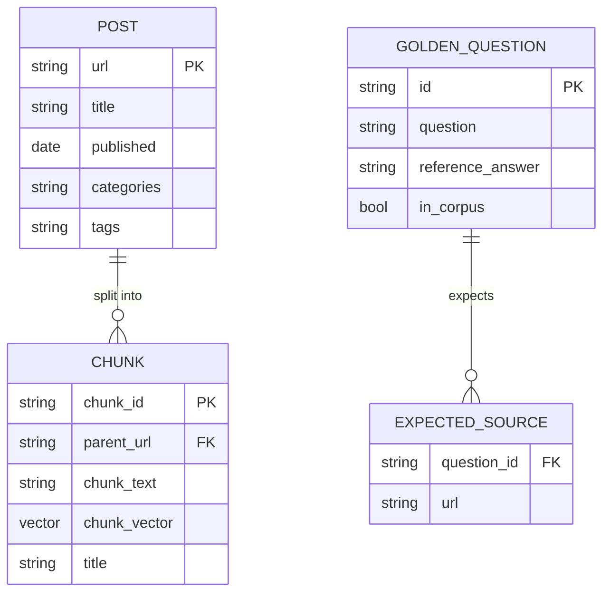

The central architectural choice is that one search index serves four ways of answering. Standard RAG, a Foundry
IQ knowledge base, a Foundry agent and an Agent Framework agent all read the same chunks, so when one mode wins
the comparison it's because of how it retrieves, not what it retrieves from.

<!-- more -->



## System context and component architecture
{: #system-context-and-component-architecture }

Press play to follow a post from publication to an answer; tick the box for the agentic path.



| Component | Role | Built from |
|---|---|---|
| Corpus sync | Uploads changed posts with their metadata | GitHub Actions workflow in the lab repo |
| Blob container `corpus` | Raw Markdown, one blob per post | Storage account, shared key off |
| Search indexer and skillset | Reads blobs, splits text, calls the embedding model, writes chunks | Azure AI Search (Foundry IQ), Basic |
| Index | Chunk text, vector, title, URL, date, tags; vectorizer; semantic configuration | JSON in the lab repo |
| Knowledge base | Agentic retrieval over the same index | Foundry IQ, REST `2026-10-01` |
| Foundry agent | Agent Service agent with the knowledge base as an MCP tool | Foundry project |
| rag-api | Standard mode and the Agent Framework agent; one `/chat` endpoint with `mode=` | Python, FastAPI, Container Apps |
| Models | One embedding and one chat deployment | Foundry |
| Application Insights | Traces, metrics, logs | Log Analytics workspace |
| Eval harness | Golden set through every mode and the homelab RAG | Python, `make eval` |

## Technology and framework selection
{: #technology-and-framework-selection }

| Need | Choice | Why, and what I passed over |
|---|---|---|
| Retrieval | Azure AI Search | Hybrid search, semantic ranker, integrated vectorization and knowledge bases in one service. A vector-only store (Cosmos DB, Postgres with pgvector) would need the ranker and agentic layer built by hand |
| Embedding model | `text-embedding-3-small` (proposed) | Cheap, well supported by the embedding skill and vectorizer |
| Chat model | Open | See the TODO below |
| Orchestrator | A plain FastAPI pipeline in the shared core; Microsoft Agent Framework for the Azure agent mode (ADR 0006, proposed) | A fixed search-then-generate sequence needs no framework and must run on every cloud; Microsoft's agentic RAG guidance uses Agent Framework, and Semantic Kernel's agent features moved into it |
| Hosting | Container Apps, consumption | Scales to zero, managed identity, built-in Entra sign-in. App Service would bill idle |
| IaC | Terraform through the platform's shared module (ADR 0003) | Same scanners, state and review as every other Azure stack; azd would be faster but bypasses that |
| Language | Python | Matches the homelab `rag-api`, so the scorer and prompts are shared |
| Multi-cloud layout | A shared core plus one adapter folder per cloud (ADR 0009) | AWS and GCP come later from the same repo; a per-cloud repo would let prompts and scorer drift, a framework over every cloud would hide the native services |

The shared core is what doesn't import a cloud SDK: the API, prompts, citations, "not found" handling and the scorer.
Each cloud implements three small interfaces, and its ingestion is that cloud's managed pipeline (ADR 0010):

```python
class Retriever(Protocol):
    def retrieve(self, question: str, top_k: int, filters: Filters | None = None) -> list[Chunk]: ...

class Generator(Protocol):
    def generate(self, question: str, chunks: list[Chunk]) -> Answer: ...

class AgentMode(Protocol):
    name: str
    def answer(self, question: str) -> Answer: ...
```

> **TODO:** Which chat model should the lab deploy? It has to be available in the chosen region, support tool
> calling for the agent modes, and be priced for a few hundred eval questions per run.
{: .prompt-warning }

## API and integration architecture
{: #api-and-integration-architecture }

One endpoint, with the mode as a parameter so the eval harness can loop over modes:

```http
POST /chat
{ "question": "How does the homelab back up its clusters?", "mode": "standard" }

200 OK  (streamed)
{ "answer": "...", "citations": [{"title": "...", "url": "https://cloudutsuk.com/posts/..."}],
  "mode": "standard", "trace_id": "..." }
```

| Mode | Path inside the API |
|---|---|
| `standard` | Search SDK hybrid query with `queryType=semantic`, top 5 chunks, one chat call |
| `knowledge-base` | Knowledge base retrieve call, extractive output, then one chat call |
| `foundry-agent` | Calls the Agent Service agent, which uses the knowledge base over MCP |
| `agent` | Agent Framework agent with a `search_blog(query, top_k, tags)` tool |

All outbound calls are HTTPS to Azure endpoints with an Entra token from the app's managed identity. The
integration with the homelab is one-way: the eval harness calls the homelab `rag-api` as another mode.

## Data architecture and data models
{: #data-architecture-and-data-models }

Data flows one way, from posts to chunks; nothing in Azure is a source of truth, so everything can be rebuilt.



The index uses index projections, so one post produces many chunk documents, each carrying its parent's title
and URL for citation. Details of the fields, chunk size and re-indexing are in
[Data and Integration](/posts/projects/rag-on-cloud/07-data-and-integration/#database-schema-and-migrations).

## Identity and access architecture
{: #identity-and-access-architecture }

Keyless, end to end (ADR 0004):

| Caller | Target | Identity | Role |
|---|---|---|---|
| Me (CLI, `make index`, eval) | Search | Entra user | Search Service Contributor, Search Index Data Contributor |
| Me | Foundry project | Entra user | Azure AI User (to verify the current role name) |
| Search indexer | Storage | Search system-assigned identity | Storage Blob Data Reader |
| Search skillset and vectorizer | Foundry embedding deployment | Search system-assigned identity | Cognitive Services OpenAI User |
| rag-api | Search | User-assigned identity | Search Index Data Reader |
| rag-api | Foundry models and agent | User-assigned identity | Cognitive Services OpenAI User, Azure AI User |
| Knowledge base MCP connection | Search | Foundry project managed identity | Search Index Data Reader |
| GitHub Actions | Storage, registry | Federated credential (OIDC) | Storage Blob Data Contributor, AcrPush |

Callers of the API sign in with Entra ID through Container Apps' built-in authentication. More in
[Security and Privacy](/posts/projects/rag-on-cloud/06-security-and-privacy/#authentication-and-authorization).

## Hosting and deployment model
{: #hosting-and-deployment-model }

Everything sits in one new resource group in the dev subscription, in a single region, defined in an
`infra-azure` stack beside the existing Foundry stack. Application code ships as a container image to a
registry, pulled by Container Apps with its managed identity. Index objects deploy separately through
`make index`, because they're data-plane objects the Terraform provider doesn't manage.

The region is `eastus` like the other stacks, pending the feature check in
[Product Planning](/posts/projects/rag-on-cloud/03-product-planning/#risk-and-dependency-management).

## Scalability and performance strategy
{: #scalability-and-performance-strategy }

Scale isn't the question for a corpus of a few hundred posts on one Basic replica; latency is. The levers I
expect to matter:

- **Top-k and chunk size**: fewer, better chunks cut prompt tokens and generation time.
- **Semantic ranker** adds a reranking step; the retrieval table will show whether its gain is worth the time.
- **Agentic modes** add model calls. Knowledge base reasoning effort (minimal vs low) is the main dial.
- **Cold starts**: Container Apps at zero replicas adds start-up time to the first call. For eval runs I'll warm
  it first so the latency numbers measure RAG, not the platform.

## Resilience and disaster recovery
{: #resilience-and-disaster-recovery }

The DR plan is "rebuild": the posts live in Git, the index definitions in the lab repo, and the infrastructure in
Terraform. Losing the Search service, or deleting it on purpose between sessions (ADR 0008), costs one indexer
run. No backups, no second region, and no availability zones (they aren't offered on Basic anyway). The one
thing worth keeping is the results history, which is committed to the lab repo.

## Architectural decision records
{: #architectural-decision-records }

The decisions live as MADR files in the lab's own repo and are published here.



## Checklist
{: #checklist }

- [ ] One index serves every answer mode
- [ ] Chat model chosen and recorded in an ADR
- [ ] Region feature check done
- [ ] Every role assignment in the identity table is in Terraform
- [ ] Container Apps sign-in rejects anonymous calls
- [ ] Rebuild from an empty resource group timed
- [ ] ADR 0006 (orchestrator) and 0008 (idle cost) accepted or replaced


