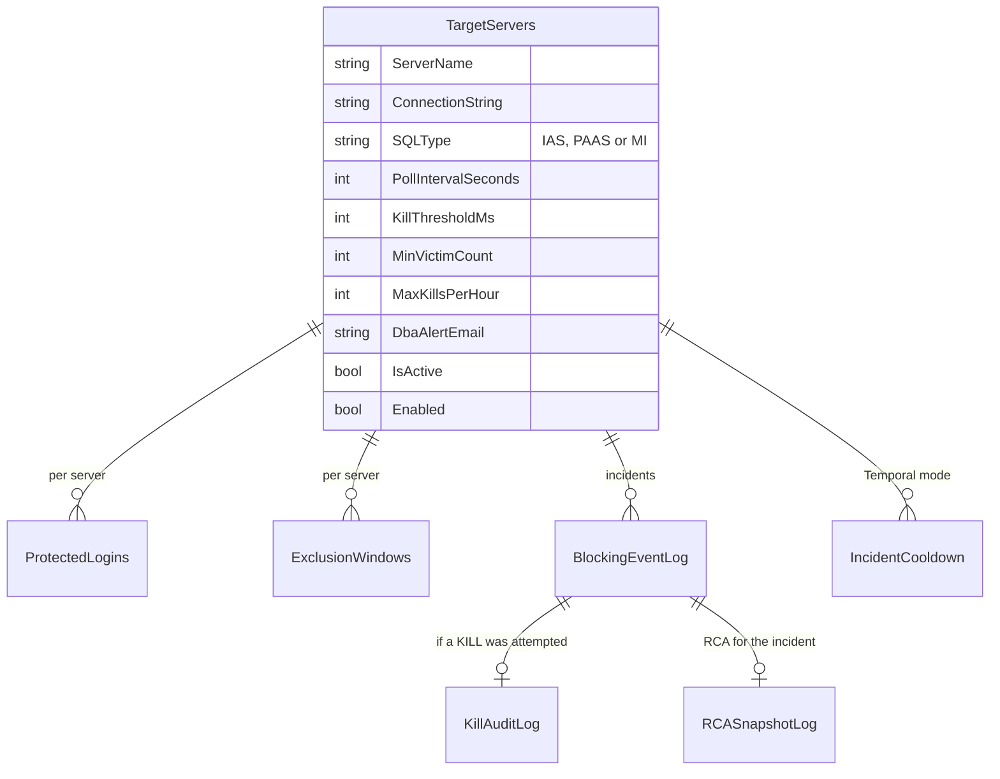

The most important architectural decision in the SQL Blocking Agent is where the LLM is *not* allowed.
Of the seven nodes in a cycle, only three call a model, and none of those three can run SQL, write an
audit row or issue a `KILL`. The LLM explains and recommends; deterministic Python detects, enforces
the rules and acts. The rest of the architecture exists to keep that boundary sharp.

<!-- more -->



## System context and component architecture
{: #system-context-and-component-architecture }

One monitoring cycle, end to end. The three LLM steps light up Azure AI Foundry, so you can see exactly
where the model is involved. Tick the box to follow an `ALERT_ONLY` or `SKIP` decision instead of an
approved `KILL`:



| Component | Implementation | Calls the LLM? |
|---|---|---|
| Entry point | `main.py`: loads config, starts the approval API and one poller per server | No |
| Orchestrator | `orchestrator/workflow.py` (`run_graph`): a plain async state machine, state re-validated after every node | No |
| Shared state | `orchestrator/state.py`: the `BlockingAgentState` Pydantic model | No |
| Configuration | `orchestrator/config.py`: environment defaults plus `TargetServers` rows, refreshed every minute | No |
| Detection | `agents/detector`, `tools/blocking_check.py`: DMVs, head blocker, victims | No |
| Analyzer | `agents/analyzer`: deterministic diagnostics, then one structured LLM call | Yes |
| Determination | `agents/determination`: hard gates in code, then one structured LLM call | Yes (only if no gate fires) |
| Approval | `orchestrator/router.py` (FastAPI) and `approve.py` | No |
| Action | `agents/action`, `tools/sql_query.py`, `tools/sql_validator.py` | No |
| RCA | `agents/rca`, `tools/rca.py` | Yes |
| Notification | `agents/notifier`, `audit_log.py`, `report_renderer.py`, `blob_storage.py`, `alert.py` | No |

Two bounds keep a cycle predictable: the Analyzer to Determination retry runs at most once
(`MAX_ANALYSIS_RETRIES = 1`), and an incident still inside `analysis_cooldown_seconds` skips the LLM
pipeline entirely.

## Technology and framework selection
{: #technology-and-framework-selection }

| Choice | Why | Trade-off |
|---|---|---|
| Pydantic AI | Native structured output, schema-validation retries, token usage, keyless Azure auth | Smaller ecosystem than LangChain |
| Plain async state machine | The flow is linear with one bounded retry; a graph runtime adds nothing | Hand-written routing to maintain |
| `pyodbc`, direct connections | Full control of every SQL statement, including the `KILL` connection's transaction state | No MCP-style tool abstraction |
| Azure AI Foundry, `gpt-5-mini` default | Inside the tenant, managed identity auth, per-agent model and thinking level by env var | Model behavior changes need re-testing |
| FastAPI approval API | Tiny, typed, easy to call from `approve.py` or `curl` | No auth yet (see [Identity](#identity-and-access-architecture)) |
| Temporal (optional) | Durable cycles and durable approval waits | A Temporal server to run; not in production |

The framework decision has its own document in the repo. The agent started as a LangChain + LangGraph
prototype, and the team moved it to Pydantic AI because the job is three narrow LLM steps that each
return one JSON object: manual fence-stripping and `json.loads` were fragile, two large dependency
trees were used for about 5% of their surface, and token visibility wasn't built in. The prompts, the
gates and the deterministic fallbacks didn't change. Only the plumbing did.

## API and integration architecture
{: #api-and-integration-architecture }

| Interface | Direction | Contract |
|---|---|---|
| Monitored SQL Servers | Out | DMV queries (read), `KILL` (write, approved only) |
| AgentConfigDB | In | `TargetServers`, `ProtectedLogins`, `ExclusionWindows` |
| AgentLogDB | Out | Inserts into `BlockingEventLog`, `KillAuditLog`, `RCASnapshotLog` |
| Azure AI Foundry | Out | Three structured calls per analyzed cycle through `agents/llm.py` (`ask_structured()`) |
| Approval API | In | `GET /health`, `GET /pending`, `GET /pending/{id}`, `POST /approvals/{id}/approve`, `POST /approvals/{id}/deny` |
| Azure Blob Storage | Out | HTML RCA report upload |
| SMTP | Out | DBA email, HTML with plain-text fallback |
| Platform One (Temporal mode only) | Out | HITL registration and resolution; a versioned JSON RCA report (schema v1, max 1 MiB, idempotent by correlation ID) |

Every LLM call goes through one function, so model, timeout, retries, token tracking and auth are
changed in one place.

## Data architecture and data models
{: #data-architecture-and-data-models }

The agent's own data lives in two SQL Server databases on a management server, plus one in-memory state
object per cycle:



`BlockingAgentState` carries detection data (blocking rows, head blocker), analysis (diagnosis,
findings, log, lock, plan and Query Store fields), the decision (decision, reason, risk, rule), action
results (kill status, validation, chain cleared), approval, RCA and runtime data (correlation ID,
dry-run, errors). It's re-validated after every node, so a node that returns a malformed update fails
loudly instead of corrupting the next step.

## Identity and access architecture
{: #identity-and-access-architecture }

| Identity | Used for | Grants |
|---|---|---|
| Pod workload identity (AKS) | Azure AI Foundry, Blob Storage, Key Vault via External Secrets | `Cognitive Services OpenAI User`, `Storage Blob Data Contributor` |
| `sql_agent_reader` | DMV detection and diagnostics | `VIEW SERVER STATE` |
| `sql_agent_killer` | The `KILL` | `VIEW SERVER STATE`, `ALTER ANY CONNECTION` |
| `sql_agent_config` | Reading AgentConfigDB | `SELECT` on `dbo` |
| `sql_agent_logger` | Writing AgentLogDB | `INSERT` only on the audit tables |
| Entra token (PaaS and MI targets) | Connecting to Azure SQL targets | Per target |
| Shared SQL login (IaaS targets) | Connecting to VM-hosted SQL Server | From the environment, never stored in `TargetServers` |

Two design points are worth calling out. The logger can only `INSERT`, so the audit trail is immutable
by permission, not by convention. And the identity that can kill is separate from the one that reads,
so a bug in diagnostics can't become a `KILL`.

The open item is the approval API, which has no authentication or authorization. The Helm design
record accepts that only while the ingress stays private to the DBA network.

> **TODO:** What's the plan and date for adding authentication to the approval API (for example Entra ID
> tokens checked against a DBA group)?
{: .prompt-warning }

## Hosting and deployment model
{: #hosting-and-deployment-model }

Production runs on **AKS**, deployed by **Argo CD** from a single reusable Helm chart with
environment-specific values. The chart deploys only the agent: a `Deployment` with **one replica** in
**loop mode**, a `ServiceAccount` with workload identity, a `SecretStore` and `ExternalSecret` for
credentials, a `NetworkPolicy`, a `PodDisruptionBudget`, a `ConfigMap` and a `Service` for the approval
API. It doesn't deploy databases, Temporal or a collector.

Azure Container Apps (one always-on replica) was the earlier recommended path in the deployment guide
and works the same way. The Helm design record confirms AKS with Argo CD as the production platform,
with the DevOps team owning the namespace, service account, secrets, network policies and ingress.

Azure AI Foundry hosts the model, not the agent. The agent is a long-running worker that calls Foundry.

## Scalability and performance strategy
{: #scalability-and-performance-strategy }

- **Per-server pollers.** One asyncio task per monitored server; a slow server doesn't delay others.
- **Skip, don't queue.** If a server's previous cycle is still running, the next tick is skipped.
- **LLM work only on blocking.** A quiet server costs one DMV query per poll and no tokens.
- **Cooldown.** A persistent blocker isn't re-analyzed every 15 seconds.
- **Blocking I/O off the event loop.** SQL and LLM bridge code is synchronous; in Temporal mode it runs in
  a thread pool.

The scaling limit is replicas. Without a leader lock, two replicas would poll the same servers and could
both decide to kill, so production is pinned to one. The Helm record notes a requirement for up to ten
replicas, which must wait for a distributed lock.

> **TODO:** How many SQL Servers does production monitor today, and how many are planned? That decides
> whether one replica is enough for a while.
{: .prompt-warning }

## Resilience and disaster recovery
{: #resilience-and-disaster-recovery }

| Failure | Behavior |
|---|---|
| `TargetServers` read fails | Keep the current pollers; don't treat failure as "no servers" |
| Empty `TargetServers` at startup | Fail closed: no monitoring rather than guessing |
| LLM error or invalid output | Validation retries, then deterministic fallbacks; no LLM decision means no kill |
| Approval never answered | Timeout downgrades to `ALERT_ONLY` |
| SQL connection fails | Pod stays ready (by design); logs and alerts carry the signal |
| Pod restarts mid-cycle | Loop mode loses that cycle and the in-memory cooldown; next poll starts fresh |
| Kill issued, session still present | `STILL_PRESENT` recorded and reported |

Loop mode is not durable, and that's accepted while production is dry-run. Temporal mode exists for the
day a half-finished approval or kill must survive a restart: every step becomes an activity, the
approval wait becomes a durable signal, and the Action activity runs with a single attempt so a kill is
never retried automatically.

## Architectural decision records
{: #architectural-decision-records }

| ADR | Decision |
|---|---|
| 001 | Only Analyzer, Determination and RCA call the LLM; everything else is deterministic |
| 002 | Pydantic AI instead of LangChain + LangGraph (documented in `WHY_PYDANTIC_AI.md`) |
| 003 | Direct `pyodbc`, no MCP server |
| 004 | Hard gates run before the LLM and can't be overridden |
| 005 | Human approval mandatory in production; timeout means deny |
| 006 | Keyless LLM auth with `DefaultAzureCredential` |
| 007 | Loop mode, single replica until a leader lock exists |
| 008 | AKS + Helm + Argo CD as the production platform |
| 009 | Agent state stays on SQL Server; PostgreSQL migration out of scope |
| 010 | Temporal is optional and off in production |

ADR 001, as an example:

```markdown
# ADR-001: The LLM never acts
Status: Accepted
Context: The agent can terminate production sessions. LLM output is probabilistic.
Decision: Only Analyzer, Determination and RCA call a model. They return validated Pydantic objects.
SQL, gates, approval, KILL, validation and audit are deterministic code paths the model cannot invoke.
Consequences: Every destructive step is testable and explainable without the model. The model's job is
analysis quality, which can be reviewed in dry-run before any kill is enabled.
```

## Checklist
{: #checklist }

- [ ] The diagram above is updated when nodes or gates change
- [ ] ADRs 001 to 010 are written in the repo
- [ ] Approval API authentication is designed and scheduled
- [ ] A leader lock is designed before any replica increase
- [ ] Monitored-server count and growth are recorded
- [ ] Loop-mode restart behavior (lost cycle, lost cooldown) is documented for operators


