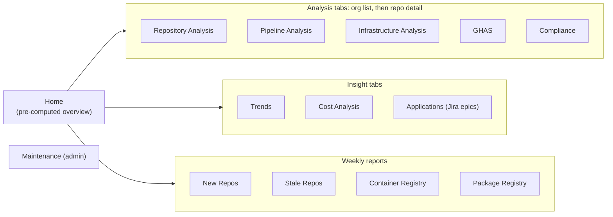

A DevOps dashboard fails in one of two ways: it shows so much that executives give up, or so little
that engineers go back to the GitHub UI. The State of DevOps dashboard handles that by giving each
audience its own entry point. Executives get a Home page that loads one pre-computed file. Engineers
get a tab per analyzer and a drill-down from organization to repository.

<!-- more -->



## Information architecture
{: #information-architecture }

The information architecture mirrors the data. Each analyzer writes to its own folder, and each folder
has its own tab, so there's never a question of where something lives.

Fourteen tabs is a lot, which is why the sidebar is driven by `GET /api/sidebar-config`. Tabs can be
switched off per environment without a frontend release, so a half-finished analyzer can ship to
production with its tab hidden.

## User flows
{: #user-flows }

The core flow is the same in every analysis tab, which makes the dashboard learnable:

1. **Org list**: every org with its latest analysis date and summary numbers
   (`OrganizationList`, `PipelineOrganizationList`, `InfraOrganizationList`, …).
2. **Repository list** for one org, paginated and searchable in the browser, optionally for a past
   date (`?date=`).
3. **Repository detail**: every sub-analyzer's result for one repo (`RepositoryDetail`,
   `PipelineRepositoryDetail`, `InfraRepositoryDetail`).
4. **Act**: *Create Jira story* on a finding opens `JiraCreateModal`, pre-filled with repo, component
   and description, and calls `POST /api/jira/create-story`.

The fourth step is the one I'd protect above all others. A finding that takes two clicks to turn into a
ticket gets fixed; one that needs copy-pasting into Jira usually doesn't.

## Wireframes and prototypes
{: #wireframes-and-prototypes }

For a solo internal tool, the cheapest prototype is the real thing with real data. The analyzers write
JSON independently of the UI, so the first "wireframe" for any tab can be the JSON file itself, opened
next to a list of the questions the tab must answer. If a question can't be answered from the file, the
analyzer changes before any React is written.

> **TODO:** Were any sketches or mockups made (even on paper or in a slide) for the Home page or the
> repo detail page? A before/after screenshot would make this section much stronger.
{: .prompt-warning }

## Visual design and design system
{: #visual-design-and-design-system }

There's no separate design system. The frontend is Create React App with React 18, React Router and
Recharts for charts, plus a small set of shared components that give every tab the same chrome:

| Component | Used for |
|---|---|
| `Sidebar` | Navigation, honouring feature flags |
| `Pagination` | Every repository table (client-side, 10 rows per page) |
| `HeaderRefreshButton`, `RefreshButton` | Re-fetching data after a job run |
| `JiraCreateButton`, `JiraCreateModal` | Turning findings into stories |

For a tool like this I'd add only one thing before a full design system: a fixed status palette
(pass, warn, fail, no data) used identically in tables, badges and charts. Consistent colour meaning
does more for an executive glance than any amount of styling.

## Interaction patterns
{: #interaction-patterns }

- **Drill-down, never dead ends.** Every number on a summary links to the list behind it.
- **Explicit refresh.** Data changes once a day, so there's no live polling; refresh buttons re-fetch
  on demand and the backend's Redis cache makes repeated views cheap.
- **Date as a first-class filter.** Because outputs are stored per day, "show me this org on the 1st
  of last month" is a query parameter, not a feature request.
- **Modal for actions, page for reading.** Jira creation is the only write action and lives in a modal,
  so reading never risks a side effect.

## Responsive behavior
{: #responsive-behavior }

The dashboard is a desktop tool. Repository tables with many check columns don't fit a phone, and
nobody triages CODEOWNERS gaps on one. The one view worth making work on a phone is Home, because an
executive may open a link from Teams on mobile.

> **TODO:** Does the Home page currently work at phone width? If not, it's worth a small CSS pass:
> stack the headline numbers and let charts take the full width.
{: .prompt-warning }

## Accessibility design
{: #accessibility-design }

Accessibility is an open question for this dashboard (see
[Requirements](/posts/projects/state-of-devops/02-requirements-gathering/#accessibility-and-localization-requirements)).
These are the changes I'd make first, in order of value:

1. Never use colour alone for pass/fail: add an icon or text label in tables and badges.
2. Pick a colour-blind-safe palette for Recharts series, and label lines directly.
3. Offer a "view as table" toggle for every chart, which also helps anyone exporting numbers.
4. Make the sidebar and modal fully keyboard-operable, with focus returned after the Jira modal closes.
5. Run an automated check (axe or Lighthouse) in CI against the built app.

## Usability testing
{: #usability-testing }

The lightest useful test for this audience is a five-minute task test. Give an executive "Find out
whether open Dependabot alerts went up or down last month" and give an engineer "Raise a Jira story for
the repo with the most failing checks in org X". Then watch without helping. Wherever they hesitate is
the next UI change.

> **TODO:** Was any feedback session or usability test done with executives or engineers? What did
> they struggle with?
{: .prompt-warning }

## Content and messaging
{: #content-and-messaging }

Words matter more than charts here, because the audience is mixed:

- Label checks by **outcome**, not implementation: "Has a code owner" rather than "CODEOWNERS file
  present".
- Always show **as of** with the analysis date, in UTC. A number without a date invites the wrong
  argument.
- Say **"no data"** distinctly from **zero**: an analyzer that didn't run is not the same as a perfect
  score.
- Keep the Teams notifications short and link straight to the matching tab. The stale report is
  titled "OSPO Stale Repository Report", so the open source program office recognises it as theirs.

## Checklist
{: #checklist }

- [ ] Every analyzer has exactly one tab, with org list, repo list and repo detail
- [ ] Sidebar tabs controlled by `/api/sidebar-config`, per environment
- [ ] Jira creation reachable in two clicks from any finding
- [ ] Status palette (pass, warn, fail, no data) used consistently everywhere
- [ ] "As of" date shown on every page, in UTC
- [ ] Charts have a table view and colour-blind-safe series
- [ ] One five-minute task test run with an executive and an engineer


