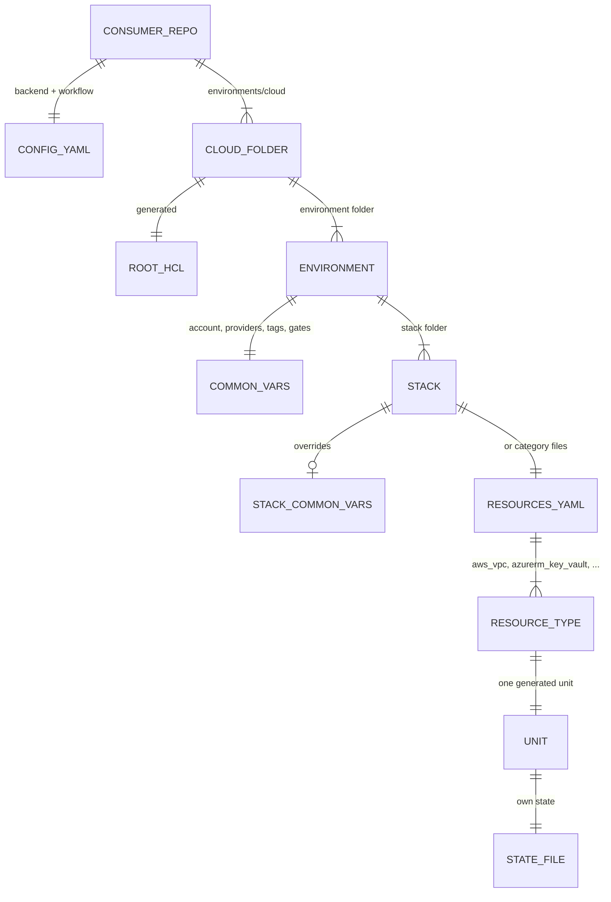

The most important architectural fact about Y-IaC is that a consumer repo contains no Terraform and no
Terragrunt logic at all. It has YAML, an 86-line `entrypoint.py` stub, and a generated `root.hcl` that
it never edits. Everything else is produced at run time from the shared repository. That's what makes
the platform consistent, and it's also why a bug in the shared path is a bug in every consumer.

<!-- more -->



## System context and component architecture
{: #system-context-and-component-architecture }

At the highest level there are two kinds of repository and one execution path. Y-IaC holds the modules,
the CLI and the reusable workflows; each infra-* consumer holds only YAML. The same CLI runs on a laptop
and on a GitHub Actions runner, and only the action (plan or apply) changes between review and
deployment. Press play, or step through it:



The components, and where they live in the repository:

| Component | Location | Job |
|---|---|---|
| Entrypoint stub | `entrypoint.py` (identical in every consumer) | Find the shared module, put `src/` on `sys.path`, call the CLI |
| Shared CLI | `src/<org>_iac/` | Parse, bootstrap, validate, authenticate, dispatch, generate, report |
| Terraform modules | `cloud/<cloud>/terraform/<type>/`, `providers/<provider>/terraform/<type>/` | The actual resources: 146 cloud, 29 provider modules |
| Terragrunt unit templates | `cloud/<cloud>/terragrunt/<type>/terragrunt.hcl` | Map YAML entries to module inputs |
| Root template | `template/root.hcl` | Generate `provider.tf`, `backend.tf`, `.tflint.hcl`; retries; hooks |
| Configuration catalog | `config/` | Provider versions, backends, OPA, Trivy, Wiz, Infracost, Jira, error catalog |
| Automation | `.github/workflows/`, `.github/actions/` | Plan, apply, drift, summaries, notifications, compatibility |
| Validation tools | `tools/validate_terraform_module.py` | Per-module fmt, init, schema, validate, TFLint, docs |

### How one run works, part 1: the Python CLI

This is the flow most people never see. One command in a consumer goes through the entrypoint stub,
bootstrap sync, argument parsing and validation (reading `common_vars.yaml` and `resources.yaml`), then
exports environment variables and authenticates (reading `config.yaml` and `.env` or CI secrets). Only
then does the stack generator turn `resources.yaml` into `terragrunt.stack.hcl`, which Terragrunt expands
into one generated unit per resource type:



The module paths below are relative to the package (`src/<org>_iac/`):

| Stage | Module | Reads | Writes or exports |
|---|---|---|---|
| Stub | `entrypoint.py` | `GITHUB_ACTIONS` | `sys.path` |
| Bootstrap | `bootstrap/sync.py`, `templates.py`, `cache.py` | Shared module checkout, content hash | Synced copy, stub, `root.hcl`, `terragrunt-cicd.yaml`, Taskfile, `.gitignore` |
| Parse | `cli/parser.py`, `passthrough.py`, `dispatch.py` | argv | Dispatch target, Terraform passthrough flags |
| Validate | `cli/arg_validation.py` | `common_vars.yaml`, `resources.yaml` | `TARGET_ACCOUNT` |
| Export | `cli/env_export.py` | `config.yaml`, `common_vars.yaml`, CLI flags | `CLOUD`, `ENVIRONMENT`, `STACK`, gate and lock variables |
| Authenticate | `environment/handler.py`, `backend.py`, `credentials.py`, `azure_auth.py` | `config.yaml`, `.env`, CLI login, CI secrets | `ARM_*`, `BACKEND_*` |
| Generate | `generators/stack_generator.py` | `resources.yaml` or category files | `terragrunt.stack.hcl` |
| Expand | `terragrunt stack generate` | `terragrunt.stack.hcl` | `.terragrunt-stack/<type>/terragrunt.hcl` |
| Merge | `generators/common_vars_merge.py` | Environment and stack `common_vars.yaml` | `.terragrunt-stack/common_vars.yaml` |
| Order | `generators/dependency_graph.py` | Generated units' `dependency` blocks | Execution waves |

The merge step is subtle and important. Unit templates find variables with
`find_in_parent_folders("common_vars.yaml")`, and searching upward from `.terragrunt-stack/<unit>/` the
first match is `.terragrunt-stack/` itself. Writing the merged file there is what makes stack-level
overrides work. Without it, the search silently falls through to the environment file, and you get a
successful plan against the wrong variables.

### How one run works, part 2: inside one generated unit

Part 2 follows one unit, `aws_vpc`. The unit reads the YAML itself and includes `root.hcl`. `root.hcl`
reads the merged `common_vars.yaml`, the backend entry from `config.yaml`, the pinned versions from
`config/providers.yaml`, and credentials from environment variables. From those it generates
`provider.tf` and `backend.tf`, and then Terraform runs against the shared module source:



What `root.hcl` decides, and from which input:

| Decision | Input | Rule |
|---|---|---|
| Backend type and location | `config.yaml` (repo root first, then the shared one) | Entry whose `repo` equals the repo folder name; `common_vars.backend` overrides |
| State key | Backend `key`, cloud folder, unit path | `<key>/<cloud>/<unit path>/terraform.tfstate` |
| Which providers | `common_vars.providers`, else a map by environment name | Only listed providers appear in `required_providers` |
| Provider versions | `config/providers.yaml`; `override_versions` per unit for azurerm | `lookup` with a fallback constraint |
| Azure subscriptions | `common_vars.subscriptions` | One aliased `azurerm` per subscription, `data_only` or `resource` mode |
| Credentials | Environment only | `ARM_*`, `<SUB>_ARM_*`, `BACKEND_*`, `GH_TOKEN`, `JFROG_*`, `GRAFANA_*`, `ZPA_*` |

One honest note from reading the code: the stack generator writes each resource's instances into the
unit's `values`, and Terragrunt writes them to `terragrunt.values.hcl`. But none of the 132 cloud unit
templates reference `values.`; they read `resources.yaml` directly. The values file is effectively a
record of what was generated. That's worth either using or removing, and I've put it on the
[technical debt list](/posts/projects/y-iac/09-implementation/#technical-debt-tracking).

## Technology and framework selection
{: #technology-and-framework-selection }

| Choice | Why | Trade-off |
|---|---|---|
| Terraform | Provider coverage for every target: Azure, AWS, GCP, GitHub, JFrog, Grafana, Zscaler | Licence change pushes some teams to OpenTofu; nothing here blocks a switch |
| Terragrunt stacks | Generated units, per-unit state, DRY root config, dependency ordering | `terragrunt stack` is newer and its CLI has changed between releases |
| Python 3.12 CLI | One place for validation, auth, generation and reporting; testable with pytest | Another runtime on every runner; `entrypoint.py` installs PyYAML and python-dotenv if missing |
| YAML for consumers | Readable by people who don't know HCL; easy to lint | No type system; validation has to be explicit |
| GitHub Actions reusable workflows | Consumers call shared workflows by ref; no pipeline copy | Ref management becomes a release concern |
| OPA, Trivy or Wiz, Infracost | Policy, security and cost views on the same plan JSON | Three tools to keep configured and updated |

The decision I'd defend hardest is the Python layer. Terragrunt alone can't validate a subscription
mapping, choose credentials per subscription, lint YAML for duplicates or merge tags safely. Before the
restructure that logic lived under `python/lib/`, which the stub still falls back to for consumers that
haven't re-synced; the package splits it into modules with their own tests.

## API and integration architecture
{: #api-and-integration-architecture }

Y-IaC has no HTTP API. Its contracts are files, environment variables and workflow inputs, and they
need the same versioning discipline an API would:

| Contract | Producer → consumer | Versioned by |
|---|---|---|
| `resources.yaml`, `common_vars.yaml`, `config.yaml` shapes | Consumer → CLI and unit templates | Docs in `09-consumer-repo-config-reference.md` |
| Module variables and outputs | Module → unit template → other units via `dependency` | Module README, validator |
| Dependency mock outputs | Unit template → first plan of a new stack | Unit template |
| Environment variable names | CLI → `root.hcl` → providers | `cli/env_export.py`, `root.hcl` |
| Reusable workflow inputs | Consumer workflow → Y-IaC workflows | Workflow file at the consumer's pinned ref |
| Plan JSON and report formats | Terraform → gates and reports | Terraform's JSON format version |
| Teams and Jira payloads | Drift workflows → Teams, Jira REST API | Workflow and `config/jira/drift-ticket.yaml` |

External integrations, all outbound: cloud and SaaS provider APIs, state backends, GitHub, the Wiz
service, Microsoft Teams webhooks and Jira (`/rest/api/2` and `/rest/agile/1.0`).

## Data architecture and data models
{: #data-architecture-and-data-models }

There's no application database. The durable data is:

- **Terraform state**, one file per unit, keyed `<key>/<cloud>/<unit path>/terraform.tfstate`.
- **Consumer YAML** and the **generated Terragrunt files** (generated files are reproducible and
  ignored by Git).
- **Plan files, plan JSON, summaries, validation reports and logs** as workflow artifacts.
- **Git history, PRs, workflow runs and Jira tickets** as the audit trail.

The core data model is the YAML hierarchy:



The data and state rules (ownership, retention, backup) are in
[Data and Integration](/posts/projects/y-iac/07-data-and-integration/).

## Identity and access architecture
{: #identity-and-access-architecture }

Identity comes from the execution environment, never from YAML:

| Context | Identity | How |
|---|---|---|
| Laptop (default) | The engineer's Azure CLI login | `az login`; the CLI sets the active subscription |
| Laptop (`--use-service-principal`) | A service principal from `.env` | `ARM_CLIENT_ID`, `ARM_CLIENT_SECRET`, `ARM_TENANT_ID` |
| CI | A service principal from GitHub secrets | Same variables, injected by the reusable workflow |
| Extra Azure subscriptions | Per-subscription credentials | `<SUB>_ARM_SUBSCRIPTION_ID`, plus client ID and secret in `resource` mode |
| State backend | Separate backend credentials when `backend_auth_alias` is set | `BACKEND_ARM_*`, `BACKEND_AWS_*`, `BACKEND_GOOGLE_*` |
| GitHub provider | Token | `GH_TOKEN` or `GITHUB_TOKEN` |

Separating backend credentials from deployment credentials is a good design: the identity that can write
state doesn't need to be the identity that can create resources, and vice versa. The weak point is the
CI service principal secret, which is long-lived. I'd move CI to OIDC federated credentials; the details
are in [Security and Privacy](/posts/projects/y-iac/06-security-and-privacy/#authentication-and-authorization).

My recommendation, as a best-practice default: **Contributor scoped to the resource groups or
subscription a consumer deploys to**, plus **User Access Administrator only for consumers that manage
role assignments** (ideally with an ABAC condition limiting which roles it can grant), and
**Storage Blob Data Contributor on the state container only** for the backend identity. The DevOps team
reviews these assignments quarterly.

## Hosting and deployment model
{: #hosting-and-deployment-model }

Y-IaC itself isn't deployed anywhere; it's a repository that consumers execute. Delivery works like this:

- **Locally**, a consumer clones Y-IaC next to itself (`../terragrunt_shared_module`). Bootstrap syncs the
  needed parts into the consumer on each run when the content hash changes.
- **In CI**, the reusable workflow checks out Y-IaC into `./terragrunt_shared_module` at the ref from the
  consumer's `config.yaml` (`iac_shared_module_ref`), on the runner named there (`ubuntu-latest` for the
  cloudutsukpilot consumers).
- **Infrastructure** is created in the consumer's targets: Azure subscriptions for most consumers, AWS
  for `infra-aws`, GitHub for `infra-github`, and SaaS providers where the stack asks for them.

The consequence is that **the consumer's ref is the release mechanism**. A consumer on `main` gets every
change immediately; a consumer on a branch or tag gets what that ref contains. Release management builds
on that in [CI/CD and Release Management](/posts/projects/y-iac/12-cicd-and-release-management/#versioning-and-release-notes).

## Scalability and performance strategy
{: #scalability-and-performance-strategy }

Scale for Y-IaC means stack count, unit count per stack, provider API limits, runner capacity, plan size
and state backend throughput. The design choices that help:

- **One unit per resource type**, not per instance. A stack with 40 key vaults is still one unit.
- **Per-unit state.** Small state files lock independently, so two units never wait for each other.
- **Dependency waves.** Units with no dependency between them run in parallel within a wave.
- **Plugin cache** (`TERRAFORM_PLUGIN_CACHE_DIR`) so providers download once per runner.
- **Change detection** in CI, so only changed stacks plan.
- **Applies run one stack at a time** (`max-parallel: 1`), which trades speed for predictability.

The limit I'd watch is provider API throttling on large Azure stacks during the weekly drift scan, when
every stack in a consumer plans at once.

## Resilience and disaster recovery
{: #resilience-and-disaster-recovery }

What can fail, and what the platform does about it:

| Failure | Behavior |
|---|---|
| Transient network error, "in use by" on delete, SSH reset | `root.hcl` `errors.retry`: 3 attempts, 30 s apart |
| State lock held by a dead run | Detect lock, release only if older than the minimum age, retry (opt-in) |
| Backend timeout during init | Runner retries the stack command |
| Partial apply (one unit fails) | Other units' state is unaffected; re-run converges |
| State file corrupted or deleted | Restore from backend versioning; needs a tested procedure |
| Y-IaC ref broken | Consumers pin back to the previous ref |

Deterministic re-runs are the main resilience property: the same YAML and ref give the same generated
files, so "run it again" is a safe instruction.

Blob versioning is **enabled** on the Azure state storage, and a state restore has been rehearsed. For the
S3 backend used by `infra-aws`, bucket versioning should be enabled to the same standard.

## Architectural decision records
{: #architectural-decision-records }

The guide lists decisions that deserve ADRs. Several are already made in code, so the ADRs would record
them rather than decide them:

| ADR | Decision (as implemented) |
|---|---|
| 001 Backend strategy | Per-repo backend in `config.yaml`, per-unit state key; local, azurerm, s3, gcs |
| 002 Provider version policy | Global pins in `config/providers.yaml`, per-unit azurerm overrides |
| 003 Conditional dependencies | `mock_outputs` so a unit can plan before its dependency exists |
| 004 Module release compatibility | Consumers pin `iac_shared_module_ref`; compatibility workflow |
| 005 Policy enforcement | Three levels: advisory, soft-mandatory, mandatory, per gate |
| 006 State-lock recovery | Opt-in, age-guarded, retry-limited |
| 007 Workflow ownership | Reusable workflows live in Y-IaC; consumers call, never copy |
| 008 Deprecation policy | Not decided |

A minimal template:

```markdown
# ADR-006: State-lock recovery
Status: Accepted
Context: Killed CI jobs leave locks that block every later run on that state file.
Decision: Release locks automatically only when AUTO_RELEASE_LOCK is set and the lock is older than
LOCK_MIN_AGE_MINUTES. An unknown creation time is treated as unsafe.
Consequences: Fewer manual unlocks; a live apply's lock is never broken.
```

## Checklist
{: #checklist }

- [ ] The three run walkthroughs above match the current code after each CLI refactor
- [ ] Every contract in the integration table has a named owner and a version note
- [ ] The `values` versus direct `resources.yaml` read is decided and cleaned up
- [ ] CI moves from client secrets to OIDC federated credentials
- [ ] Backend versioning is confirmed for every state store
- [ ] ADRs 001 to 007 are written; ADR 008 (deprecation) is decided
- [ ] API throttling during the drift scan is measured on the largest Azure consumer


