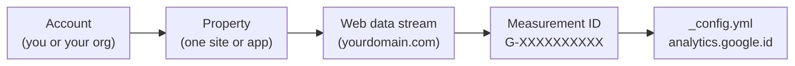
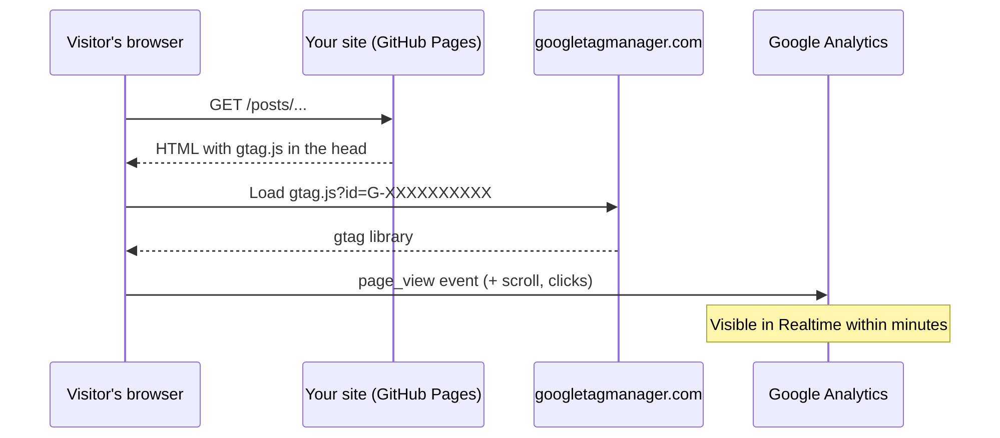

You've published a few posts and the obvious next question is: is anyone reading them? Google Analytics 4 (GA4) answers that, and on a Jekyll site with the Chirpy theme the wiring is much smaller than most tutorials suggest. This guide walks through creating the GA4 account, property and web data stream, getting the Measurement ID onto every page (only in production), and checking that real data is arriving. I'll also cover the manual include approach for themes that don't support GA out of the box, and the mistakes that leave you staring at an empty Realtime report.

<!-- more -->

## How GA4 is organised

Before clicking through the setup screens, it helps to know what you're creating. GA4 has three levels, and the only thing your site needs from all of this is the **Measurement ID** at the bottom.



An **account** is the top-level container, usually one per person or organisation. A **property** holds the reports for one site (or a site plus its app), along with its time zone and currency. A **data stream** is where data comes in from; for a blog that's a single Web stream for your domain. One account can hold many properties, so if you run several blogs, give each its own property rather than mixing them.

## Step 1: Sign up for Google Analytics

Go to [Google Analytics](https://analytics.google.com/), sign in with your Google account and click **Start measuring**. The wizard walks you through five screens.

### Create the account

- **Account name:** your blog or website name works fine (for example, `Cloudutsuk`).
- **Data sharing settings:** leave the defaults selected unless you have a reason to opt out. You can change these later in Admin.
- Click **Next**.

### Create the property

- **Property name:** something descriptive, such as `Blog Analytics` or `Chirpy Site Analytics`. If you'll have more than one site in this account, use the domain name so you can tell them apart.
- **Reporting time zone:** pick your local time zone. This decides where "today" starts and ends in your reports, so get it right now; changing it later doesn't rewrite historical data.
- **Currency:** your preferred currency. It barely matters for a blog, but AdSense revenue reports (if you [add AdSense later](/posts/website/analytics/setup-google-adsense-in-jekyll-chirpy-theme/)) will use it.
- Click **Next**.

### Business details and objectives

- **Industry category:** for a tech blog, **Computers & Electronics** is the closest fit.
- **Business size:** choose the size that describes you. For a personal blog that's the smallest option.
- **Business objectives:** these decide which reports GA4 shows you by default; they don't limit what data is collected. For a technical blog, good choices are:
  - Generate leads
  - Raise brand awareness
  - Examine user behavior
- Click **Create**, then review and accept the Google Analytics Terms of Service (and the Data Processing Amendment if you're asked).

### Set up the web data stream

Now GA4 asks where data will come from.

- **Choose a platform:** select **Web**.
- **Website URL:** enter your domain, for example `cloudutsuk.com` (the `https://` is chosen from a dropdown).
- **Stream name:** something descriptive, such as `My Blog Stream` or `Chirpy Site Stream`.
- **Enhanced measurement:** leave it on. It automatically collects page views plus scrolls, outbound clicks, site search and file downloads without any extra code, which is exactly what a static site needs.
- Click **Create stream**.

### Copy the Measurement ID

The stream details page shows the **Measurement ID**, which looks like `G-XXXXXXXXXX`. Copy it; it's the only value you need on the Jekyll side.

> The Measurement ID isn't a secret. It appears in the page source of every page that loads the tag, so it's fine to commit it to a public repository.
{: .prompt-info }

## Step 2: Add the Measurement ID to Chirpy

Here's the part most guides overcomplicate. Chirpy has GA4 support built in. Open `_config.yml` and fill in the `analytics.google.id` field that the theme already provides:

```yaml
# Web Analytics Settings
analytics:
  google:
    id: G-XXXXXXXXXX # replace with your Measurement ID
```

That's it. You don't need a custom include or a layout override. Chirpy's `head.html` loops over the `analytics:` providers and includes `_includes/analytics/google.html` for any provider with an `id`, and the whole block is wrapped in ``. So the tag is added on your live site and left out of local `jekyll serve` sessions automatically.

Here's what happens when someone opens a page:



> Chirpy's `pageviews:` setting (the view counter shown on posts) is separate from analytics and currently only supports GoatCounter. Adding a GA4 ID won't show view counts on your posts.
{: .prompt-tip }

If you're new to the theme's configuration file, the [Chirpy configuration options](/posts/website/jekyll/chirpy/jekyll-chirpy-theme-configuration-options/) post covers the other settings, and [Build a Site with Chirpy Theme](/posts/website/jekyll/chirpy/jekyll-build-a-site-with-chirpy-theme/) covers the initial setup.

## Step 2 (alternative): add the tag manually

If you're on a Jekyll theme without built-in analytics, or an old Chirpy version, you can add the tag yourself. It takes three small pieces.

**1. Make sure the `_includes` directory exists.**

```bash
mkdir -p _includes
```

`_includes` is the standard Jekyll folder for reusable snippets. Keeping the tracking code in its own file makes it easy to include on every page and to change in one place.

**2. Create `_includes/analytics.html`** with the global site tag:


```html
<!-- Global site tag (gtag.js) - Google Analytics -->
<script async src="https://www.googletagmanager.com/gtag/js?id={{ site.analytics.google.id }}"></script>
<script>
  /* global dataLayer */
  window.dataLayer = window.dataLayer || [];
  function gtag(){dataLayer.push(arguments);}
  gtag('js', new Date());
  gtag('config', '{{ site.analytics.google.id }}');
</script>
```


Two details are worth explaining. The `/* global dataLayer */` comment tells linters that `dataLayer` is a global variable, so they don't flag it as undefined. And reading the ID from `site.analytics.google.id` instead of hardcoding it means `_config.yml` stays the single place to change it.

> The Liquid variable has to match the key in `_config.yml` exactly. An earlier version of this post used `site.google_analytics.id` in the include while the config used `analytics.google.id`. Liquid doesn't error on a missing variable; it renders an empty string, so you end up with `gtag/js?id=` and no data. If your Realtime report stays empty, view the page source and check for that first.
{: .prompt-warning }

**3. Include it in the `<head>` of your layout**, only in production:


```liquid
<head>
  ...
  
    
  
</head>
```


Google recommends placing the tag in the `<head>`. Putting it just before the closing `</head>` keeps it after your stylesheets and meta tags, and since the script loads `async`, it doesn't block rendering either way. The `jekyll.environment` check stops your own local browsing from polluting the reports, and the `site.analytics.google.id` check means the block disappears cleanly if you remove the ID.

> Don't use the manual include **and** Chirpy's built-in support together. You'll load gtag twice and every page view gets counted twice.
{: .prompt-danger }

## Step 3: Build and deploy

To check the output locally, build in production mode so the analytics tag is actually included:

```bash
JEKYLL_ENV=production bundle exec jekyll build -d "_site"
grep -o 'gtag/js?id=[^"]*' _site/index.html
```

The `JEKYLL_ENV=production` variable tells Jekyll to build in production mode, which is what turns on features meant only for the live site, like analytics. The `grep` should print `gtag/js?id=G-XXXXXXXXXX`. If it prints `gtag/js?id=` with nothing after it, the variable name is wrong (see the warning above).

Then commit and push:

```bash
git add _config.yml
git commit -m "Add Google Analytics tracking to the site"
git push
```

GitHub Pages and the standard Chirpy GitHub Actions workflow both build with `JEKYLL_ENV=production`, so you don't need to set anything extra in CI.

## Step 4: Verify the integration

### Check the Realtime report

1. Open [Google Analytics](https://analytics.google.com/) and select your site's property.
2. Go to **Reports → Realtime**.
3. Open your live website in a separate tab or window (not `localhost`, which has no tag).
4. Click around a few pages and watch for your visit in the Realtime cards.

> Google says data can take up to 30 minutes to start arriving in a new property, and the standard reports (as opposed to Realtime) can take a day or two to fill in. Don't panic if the Home dashboard is empty on day one.
{: .prompt-info }

### Inspect your site's source code

Confirm the tag is actually on the page:

1. Open your live website in any browser.
2. Right-click and choose **View Page Source**.
3. Search for `googletagmanager` in the `<head>` section.

With Chirpy's built-in support, it looks like this:

```html
<!-- Global site tag (gtag.js) - Google Analytics -->
<script defer src="https://www.googletagmanager.com/gtag/js?id=G-XXXXXXXXXX"></script>
<script>
  document.addEventListener('DOMContentLoaded', () => {
    window.dataLayer = window.dataLayer || [];
    function gtag() {
      dataLayer.push(arguments);
    }

    gtag('js', new Date());
    gtag('config', 'G-XXXXXXXXXX');
  });
</script>
```

With the manual include, you'll see the `async` version from Step 2 instead. Either is fine, as long as the ID after `id=` is filled in and the block appears only once.

### Check the network request

If the tag is in the source but Realtime stays empty, open DevTools, go to the **Network** tab, reload, and filter for `collect`. You should see requests to `google-analytics.com/g/collect` carrying your Measurement ID as `tid=G-…`. If there are none, an ad blocker or privacy extension is the usual culprit; try a clean browser profile.

## Common pitfalls

- **Testing on `localhost`.** The tag is production-only by design, so local visits never show up.
- **Your own ad blocker.** uBlock Origin, Brave and similar block gtag. Your visits won't appear, and a real share of a technical audience blocks it too, so treat GA numbers as a lower bound.
- **Wrong variable name in a manual include**, which renders an empty `id=`.
- **Two tags on the page**, which double-counts every page view.
- **Data retention left at the default.** GA4 keeps event-level data for 2 months unless you change it. For a blog where you want year-over-year trends in Explorations, set **Admin → Data Settings → Data Retention** to 14 months.
- **Counting your own visits.** Add your IP under **Admin → Data streams → (your stream) → Configure tag settings → Define internal traffic**, then activate the filter under **Data Settings → Data Filters**.

## Conclusion

On Chirpy, Google Analytics is one line in `_config.yml`. Most of the real work is the GA4 account, property and stream setup, plus a couple of settings (retention, internal traffic) that are worth fixing on day one. The manual include is still useful on other themes, as long as the Liquid variable matches your config.

Your next step: set the ID, push, then open the Realtime report and visit your own site from your phone. If you also want to put ads on the site, [Google AdSense on a Jekyll Site](/posts/website/analytics/setup-google-adsense-in-jekyll-chirpy-theme/) picks up from here.

## References

- [Set up Analytics for a website and/or app](https://support.google.com/analytics/answer/9304153)
- [Verify data collection in Google Analytics](https://support.google.com/analytics/answer/9744165)
- [Data retention in Google Analytics](https://support.google.com/analytics/answer/7667196)
- [jekyll-theme-chirpy on GitHub](https://github.com/cotes2020/jekyll-theme-chirpy)
