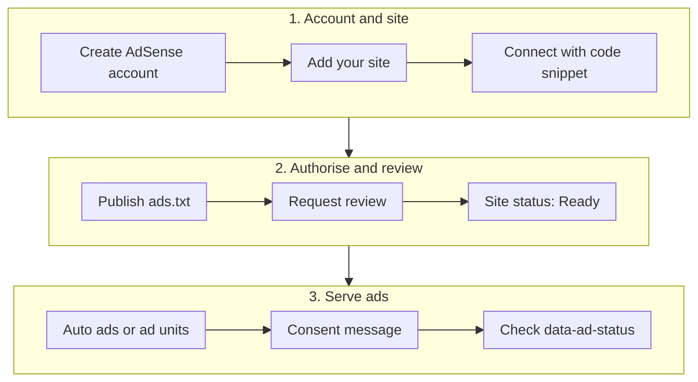

You pasted the AdSense snippet into your Jekyll layout, pushed to GitHub Pages, opened the site and... nothing. Or worse, a row of blank white 300×250 rectangles in the sidebar where ads should be. The code is usually fine. What's missing is one of the half-dozen steps around it: the site review, `ads.txt`, consent, or simply waiting for Google to start filling the slot. This guide walks through the whole path for a Jekyll site (with Chirpy-specific bits where the theme matters), in the order that actually works, and ends with how to check what AdSense is doing on a live page.

<!-- more -->

## How the pieces fit together

AdSense isn't one switch. There's an account, a site that Google reviews, an authorisation file, the ad code itself, and a consent layer for visitors from Europe. Ads only show once all of them line up.



If you only remember one thing: **the site has to be "Ready" in AdSense before any ad code does anything visible.** Everything before that point is setup that produces no ads at all.

## Before you start

You need four things:

- **A site you control at the HTML level.** Jekyll is perfect for this because every page comes from your layouts and includes. Google lists source-code access as an eligibility requirement.
- **A domain you own, ideally.** `ads.txt` must be served from the root of your domain. With a custom domain on GitHub Pages (a `CNAME` file in the repo), that's trivial. On a shared host where you can't put files at the root, you'll fight it.
- **Real content.** Google wants original content that attracts an audience. A fresh blog with three posts and a "coming soon" page is a common reason for rejection. Publish a decent set of posts first.
- **Being 18 or over**, or a parent or guardian signing up for you.

I'd also make sure the site already has Google Analytics wired up. It isn't required, but when you're later trying to work out whether low earnings are a traffic problem or an ad problem, you'll want the numbers. The [Google Analytics setup for Chirpy](/posts/website/analytics/setup-google-analytics-in-jekyll-chirpy-theme/) post covers that.

## Step 1: Create the account and add your site

Sign up at [adsense.google.com](https://adsense.google.com/start/) with the Google account you want payments tied to. Enter your site URL (just the domain, for example `cloudutsuk.com`) during sign-up, or later under **Sites → Add site**.

AdSense then asks you to connect the site using one of three methods:

| Method | What you add | When to pick it |
| --- | --- | --- |
| AdSense code snippet | `<script>` tag in the `<head>` of every page | Default choice; you need this script anyway to show ads |
| ads.txt snippet | One line in `/ads.txt` | You don't want to touch the layout yet |
| Meta tag | `<meta name="google-adsense-account">` in `<head>` | You want verification without loading ad code on every page |

For a Jekyll site I'd go with the code snippet. You'll need it in place to serve ads, so verifying with it saves a round trip.

## Step 2: Load the AdSense script once, in the head

The snippet AdSense gives you looks like this (with your own publisher ID):

```html
<script async
  src="https://pagead2.googlesyndication.com/pagead/js/adsbygoogle.js?client=ca-pub-0000000000000000"
  crossorigin="anonymous"></script>
```

Chirpy includes a hook file in its `<head>` for exactly this kind of thing: `_includes/metadata-hook.html`. Create that file in your repo and Jekyll uses it in place of the theme's empty one:


```liquid
<!-- _includes/metadata-hook.html -->

  <script async
    src="https://pagead2.googlesyndication.com/pagead/js/adsbygoogle.js?client=ca-pub-0000000000000000"
    crossorigin="anonymous"></script>

```


The `jekyll.environment` guard matters. Your local `jekyll serve` runs in development mode, so you don't load ad code on `localhost`, don't generate junk impressions, and don't accidentally click your own ads while testing (which is a policy violation, not just bad manners). GitHub Pages builds with `JEKYLL_ENV=production`, so the script appears on the live site only.

> Load `adsbygoogle.js` **once per page**. A lot of guides (including the earlier version of this post) paste the full AdSense snippet, script tag and all, into every ad include. It works, because the browser de-duplicates the request, but it's noise. Keep the script in the head and put only the `<ins>` plus `push()` in each slot.
{: .prompt-tip }

## Step 3: Publish ads.txt

`ads.txt` is a plain text file at the root of your domain that tells ad buyers which sellers are authorised to sell your inventory. Without it, AdSense shows a warning and you'll lose revenue, because buyers avoid inventory they can't verify.

Create `ads.txt` at the **root of the repository** (next to `_config.yml`), with one line:

```text
google.com, pub-0000000000000000, DIRECT, f08c47fec0942fa0
```

Replace `pub-0000000000000000` with your publisher ID; the last field is Google's fixed certification ID and stays as it is. Jekyll copies any file without front matter straight into `_site/`, so it will be published at `https://yourdomain/ads.txt`.

Two things to check:

```bash
# After the build, the file should be in the output
ls _site/ads.txt

# After deploying, it should be served with a 200 and the right content
curl -si https://yourdomain.com/ads.txt | head -5
```

If `_site/ads.txt` is missing, look at the `exclude:` list in `_config.yml`. A wildcard like `*.txt` will quietly drop it.

## Step 4: Request the review and wait

Back in AdSense, open **Sites**, select your site and request review. The status starts as **Requires review** and moves to **Ready** once Google's checks pass. According to Google, the review usually takes a few days, and sometimes 2–4 weeks.

During this window you can deploy ad slots, but they'll render empty. That's expected. Don't keep pushing changes to "fix" an empty slot while the site is still under review.

If the review fails, AdSense tells you why. The common ones are low-value or thin content, navigation problems (pages that are hard to reach), and policy issues. Fix those, then request review again.

## Step 5: Choose Auto ads, ad units, or both

Once the site is Ready, you decide where ads appear.

| | Auto ads | Manual ad units |
| --- | --- | --- |
| Setup | Toggle in **Ads → By site**; the head script is enough | Create unit in **Ads → By ad unit**, paste `<ins>` code into your layout |
| Placement | Google decides (in-page, anchor, vignette) | Exactly where you put it |
| Control | Ad load slider, excluded areas, format toggles | Full control over size and position |
| Effort | Minimal | You maintain the layout overrides |

My take: start with Auto ads only. It's the quickest way to see whether your site serves ads at all, and it rules out layout mistakes. Add manual units afterwards for the spots you care about, like a sidebar or the end of an article. You can run both; Auto ads will avoid the areas your units already occupy.

> Auto ads can inject anchor and vignette (full-screen) formats. If those feel too aggressive on a technical blog, turn them off individually in the Auto ads settings instead of disabling Auto ads entirely.
{: .prompt-info }

## Step 6: Place ad units in a Chirpy layout

Chirpy doesn't have ad slots built in, so you override its layout. Copy `_layouts/default.html` from the theme version you use (check `Gemfile.lock` for the version, then grab the file from that tag in the [jekyll-theme-chirpy repo](https://github.com/cotes2020/jekyll-theme-chirpy)) into your own `_layouts/` folder.

Then create one include per ad unit. Each one holds only the `<ins>` element and the `push()` call:

```html
<!-- _includes/adsense_panel_sidebar_top.html -->
<ins class="adsbygoogle"
     style="display:inline-block;width:300px;height:250px"
     data-ad-client="ca-pub-0000000000000000"
     data-ad-slot="1234567890"></ins>
<script>
  (adsbygoogle = window.adsbygoogle || []).push({});
</script>
```

And reference the includes in your copied layout. In Chirpy the right-hand panel is the `<aside id="panel-wrapper">` element, so a sidebar ad between the trending tags and the recently updated list looks like this:


```liquid
<aside aria-label="Panel" id="panel-wrapper" class="col-xl-3 ps-2 text-muted">
  <div class="access">
    

    <div id="sidebar-top" style="margin: 30px 0;">
      
    </div>

    
  </div>
  ...
</aside>
```


For an ad under each post, put an include after the content inside `<main>`. A responsive in-article or in-feed unit (`style="display:block"` with `data-ad-format`) suits the content column far better than a fixed 300×250 box.

> Overriding `default.html` means you own that file. When you upgrade Chirpy, diff your copy against the new upstream version and re-apply your ad includes, otherwise you'll miss theme fixes. A comment at the top of the file listing your local changes makes this much less painful.
{: .prompt-warning }

Keep in mind that Chirpy hides the right-hand panel below the `xl` breakpoint, so sidebar ads only show on wide screens. On phones, the in-content units and Auto ads do the work.

## Step 7: Set up consent for EEA, UK and Swiss visitors

This is the step people skip, and it costs real money. Google requires a **Google-certified consent management platform (CMP)** integrated with the IAB Transparency and Consent Framework when serving ads to users in the EEA and UK (since 16 January 2024) and Switzerland (since 31 July 2024). Without one, you aren't eligible to serve personalised ads to those visitors.

The easiest route on a static site is AdSense's own CMP: **Privacy & messaging → European regulations**, create a message, and publish it. It's served by the same script you already load, so there's nothing to add to Jekyll. If you already run a third-party cookie banner, pick one from Google's certified CMP list instead of stacking two banners.

## Step 8: Verify on the live page

Once the site is Ready and the code is deployed, open the live page, then open the browser DevTools console and run:

```javascript
document.querySelectorAll('ins.adsbygoogle').forEach(el =>
  console.log(el.dataset.adSlot || '(auto)', el.dataset.adsbygoogleStatus, el.dataset.adStatus)
);
```

Each line tells you what AdSense did with that slot:

| `data-adsbygoogle-status` | `data-ad-status` | Meaning |
| --- | --- | --- |
| *(missing)* | *(missing)* | The `push()` never ran. Script blocked, JS error, or the include isn't on the page |
| `done` | `filled` | An ad was served. You're done |
| `done` | `unfilled` | AdSense processed the slot but returned no ad |

That last row is the one that confuses people. `unfilled` means your code works. Google simply had no ad to show for that slot at that moment, usually because the site isn't Ready yet, the unit is brand new, there's a policy or ad-serving limit on the account, or demand for that traffic is low. Check **Sites** and **Policy center** in AdSense before touching the code.

Also open the **Network** tab and filter for `googlesyndication`. If those requests fail with `ERR_BLOCKED_BY_CLIENT`, it's your ad blocker. Test in a clean browser profile.

## Step 9: Hide empty slots

A fixed-size unit that comes back `unfilled` still takes up its 300×250 (or 300×600) space, and on a dark theme that shows up as an obvious blank box. Google's recommended fix is a CSS rule on the status attribute:

```scss
ins.adsbygoogle[data-ad-status='unfilled'] {
    display: none !important;
}
```

In Chirpy, put this in your override of `assets/css/jekyll-theme-chirpy.scss`. That file is the stylesheet the theme actually links to.

> A stray `style.scss` or `style.css` at the repo root does nothing on a Chirpy site. Without front matter Jekyll doesn't compile it, and no layout links to it. If a CSS change "isn't working", check that the file you edited ends up in a `<link>` on the page.
{: .prompt-danger }

## Common pitfalls

- **Expecting ads during review.** Slots render empty until the site is Ready. That's not a bug.
- **Testing with an ad blocker on.** You'll see no requests at all and assume the code is broken.
- **Clicking your own ads** to "check they work". Don't. Use the console check above instead.
- **`ads.txt` excluded by `_config.yml`**, or served from a subfolder instead of the domain root.
- **Loading ads locally.** Without the production guard, every `jekyll serve` session sends invalid impressions.
- **Forgetting the theme override after an upgrade.** Your ad includes vanish, or the layout breaks, after a Chirpy version bump.
- **Too many fixed-size units.** Three 300×250 boxes in the sidebar look heavy when only one fills. Fewer, better-placed units usually earn the same.

## Conclusion

Getting AdSense onto a Jekyll site is mostly a sequencing problem. Load the script once in the head with a production guard, publish `ads.txt`, wait for the site to be Ready, start with Auto ads, then add a few manual units where they make sense and turn on the consent message. When a slot looks empty, check `data-ad-status` before you touch any code: `unfilled` sends you to the AdSense dashboard, not your editor.

Your next step: open your live site, run the console snippet from Step 8, and see what each slot reports.

## References

- [Eligibility requirements for AdSense](https://support.google.com/adsense/answer/9724)
- [Connect your site to AdSense](https://support.google.com/adsense/answer/12169212)
- [Ads.txt guide](https://support.google.com/adsense/answer/7584263)
- [Hide unfilled ad units](https://support.google.com/adsense/answer/10762946)
- [Requirements for using a Google-certified CMP](https://support.google.com/adsense/answer/13554020)
- [jekyll-theme-chirpy on GitHub](https://github.com/cotes2020/jekyll-theme-chirpy)
