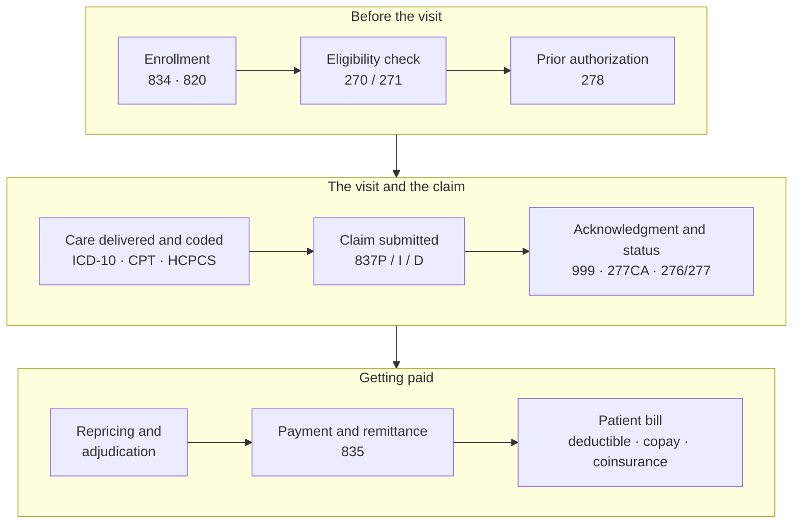


  Learning-path index for the Healthcare domain (linked from the Domains tab, _tabs/domains.md).
  The list below is generated: levels/topics from _data/domain_paths/healthcare.yml, posts from
  every post with `domain: healthcare`. Add a post there and it appears here.


[← All domains](/domains/)

US healthcare is a three-way relationship between **patients**, the **providers** who treat them and the
**payers** who fund that care: commercial insurers, employers and government programs such as Medicare and
Medicaid. Most of its complexity, and most of the software, lives in the paperwork between providers and
payers: checking coverage, getting approval, coding what happened, submitting a claim and reconciling the
payment, all under HIPAA's privacy rules.

This learning path follows that work from the basics to the systems engineers build. It started from the
[HealthTech Decoded](https://www.youtube.com/@HealthTechDecoded) YouTube channel, and each post links the
videos that cover its topic.

## The workflow in one picture

The numbers are ANSI X12 transaction sets, the electronic formats HIPAA mandates for each step. HIPAA's
privacy and security rules apply to every step.

## Learning path


